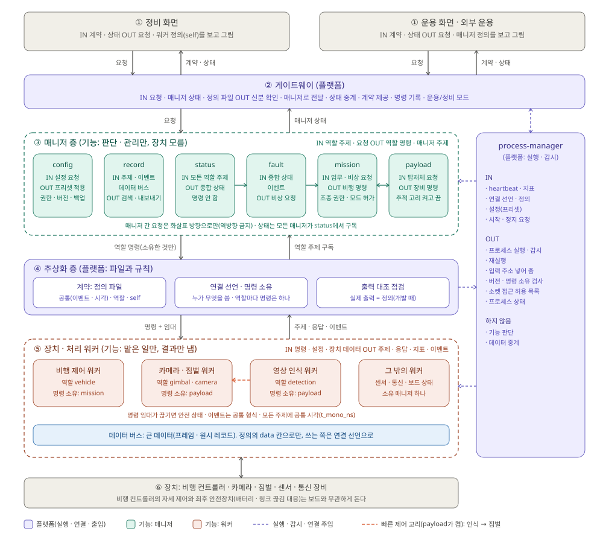

# 워크스페이스 설계서

| 항목 | 내용 |
|---|---|
| 문서 버전 | 0.58 |
| 대상 | 워크스페이스(워커를 실행·감시·설정·관찰하는 플랫폼)와 워커 템플릿(워커를 만드는 틀) |
| 대상 보드 | Jetson Orin NX 16GB, JetPack 6.2.2 (시험: L4T R36.5.2, Ubuntu 22.04.5). 개발 PC: WSL·Linux |
| 워커 설계 | 각 워커 폴더 `workers/<이름>/design.md`. 이 문서는 특정 워커를 모른다 |
| 현장 값 | 주소·장비 구성 등은 프로필(`install/profiles/<이름>/`)에. 이 문서는 `<보드 주소>`처럼 자리만 쓴다 |
| 상태 | 구현 반영(0.37 기준 코드와 일치). 0.38 워커 간 통신 정의(6.6.7)는 형식·템플릿·점검만 구현, 나머지는 12장. 0.40 계층과 매니저(4.1)·0.41 계약 규칙(6.6.7.1~6.6.7.2)·0.42 언어(원칙 10: 상주 블록 C++)는 설계 확정, 구현 전. 미결은 15장 |

절 번호는 코드 주석이 참조하므로(예: "design.md 9.5") 바꾸지 않는다. 변경 이력은 부록 B.

## 1. 목적

**워커**는 하나의 기능(장치 제어, 캡처, 송출, 통신, 데이터 처리 등)을 맡는 기능 단위다. 안은 스레드 여럿이든 자식 프로세스 여럿이든 자유롭게 설계한다(3장 "단계"). 모듈처럼 만들어서 워크스페이스에 넣었다 뺐다 하고, 다른 보드·다른 프로그램에도 가져가 쓴다.

**워크스페이스**는 보드(Jetson)에서 워커를 개발·운영하는 환경이다. 워커를 띄우고 감시하고(죽거나 멈추면 다시 띄움), 설정을 바꾸고, 명령을 전달하고, 보드 전체와 워커별 자원 사용을 보여 준다. 워커가 무엇을 하는지는 모른다.

**워커 템플릿**(`workers/_template`)은 워커를 만드는 틀이다. 워크스페이스와의 계약(9장)을 이미 지키는 예제 워커로, 복사해서 기능만 채우면 워크스페이스에 붙는다.

요구사항:

- 워커를 더하거나 빼도 워크스페이스 코드(Manager·REST·화면 틀)는 바뀌지 않는다(애드온)
- 워커 하나 = 폴더 하나. 워크스페이스는 워커 목록도 워커 설정도 들고 있지 않다. 워커 폴더를 넣으면 붙고 지우면 설정째 사라진다. 폴더째 다른 워크스페이스로 옮겨 설치·실행되고, 워크스페이스 없이도 빌드·실행된다
- 워커 설정은 워커 폴더의 파일(프리셋)이고 깃으로 공유된다. 상황마다 설정 묶음(프리셋)을 나눠 저장하고 고른다
- 워커 안의 기능도 모듈 단위로 붙이고 뗀다. 다른 사람이 만든 모듈을 폴더째 가져와 붙인다
- 외부(화면·REST·운용 인터페이스)에서 워커별 시작·정지·설정·명령이 가능하다
- 개발·정비(REST)와 운용 인터페이스가 같은 핵심(Manager API) 위에 선다. 운용 인터페이스도 워커(Manager API를 쓰는 워커, 6.5)로 이 작업대에서 개발한다
- 워커끼리 요청·응답, 상태 구독, 대용량 데이터를 주고받는 통로를 플랫폼이 준다(6.6.7)
- 어떤 장애에서도 프로세스가 무한 대기에 남지 않는다. 워커 하나의 장애가 다른 워커·워크스페이스에 번지지 않는다
- 보드 자원(CPU·GPU·메모리·온도·전력)과 워커별 사용(프로세스·스레드·CPU)을 보며 최적화할 수 있다

## 2. 범위

| 포함 | 제외 |
|---|---|
| Manager와 Manager API, 클라이언트 구분 | 특정 워커의 기능·설정·명령(워커 설계서) |
| REST(화면 제공), logger, Manager API를 쓰는 워커(6.5) | 미디어 서버 자체 |
| 화면(보드 REST가 제공하는 웹 화면)과 패널 규칙 | 운용 프로토콜 매핑(그 워커 설계서) |
| 관측: 워커 지표, 워커별 자원, 기록, 시스템 모니터 | 프로젝트 목표·장비 선정(프로필·워커 설계서) |
| 설정 체계: 프로필, 데이터 폴더 설정, 워커 설정 스키마 | |
| 워커 계약(9장)과 워커 템플릿(6.6) | |
| 설치·시작·배치, 개발 도구, 빌드·배포 | |

## 3. 용어

| 용어 | 의미 |
|---|---|
| 워커 | 기능 단위 하나(모터, 카메라, 데이터 처리 등). 폴더 `workers/<이름>/` 하나 = 워커 하나 = Manager가 띄우는 실행 파일 하나. 안은 멀티 스레드·자식 프로세스 등 자유. 같은 종류를 둘 띄우려면 폴더를 복사한다 |
| 워커 type | 워커 종류 선언(실행 파일, 감시 시간, 설정 스키마). 워커 폴더 `workspace/worker-types.json` |
| 워커 id | 워커 폴더 이름. 소켓·로그·화면 이름 |
| 프리셋 | 워커 설정 묶음 하나. 워커 폴더 `workspace/presets/<이름>.json`. 그중 하나가 "사용 중"(`workspace/config.json`) |
| 모듈 | 워커 안의 기능 단위(`lib/<모듈>/`). 호스트에 붙인다(6.6.3) |
| 호스트 | 워커 공통 실행 뼈대(libworker `worker::Host`). 계약(9장)을 전부 맡는다 |
| 기본 탑재 워커 | 플랫폼 부품인 워커(시스템 모니터 `system-monitor`, 폴더 `monitor/`). 같은 방식으로 부품 폴더에 설정 파일 |
| Manager | 워커 관리 상태의 단일 소유자. 실행·감시·재실행, 설정 저장, Manager API |
| Manager API | Manager의 Unix 소켓 API. 워커 관리의 유일한 제어 핵심 |
| Manager 클라이언트 | Manager API에 붙는 프로세스: REST, logger, Manager API를 쓰는 워커. 클라이언트마다 전용 소켓(6.1) |
| Manager API를 쓰는 워커 | type에 `"manager_api": true`를 선언한 워커. 다른 워커를 시작·정지·설정할 수 있다(외부 운용 인터페이스 등, 6.5) |
| 명령 소켓 | REST·다른 워커 → 워커 명령 경로(9.6). Manager를 거치지 않음 |
| 스트림 소켓 | 워커 → REST·다른 워커 텔레메트리 발행 경로(9.7) |
| heartbeat | 워커 → Manager 생존·지표 알림(9.5) |
| 자체 워치독 | 워커가 처리 루프에서 커널 타이머를 다시 맞추는 멈춤 감지(6.6) |
| 쓰기 op | 워커 상태를 바꾸는 Manager 요청(start/stop/설정·프리셋/자동 시작). logger와 로컬 `manager.sock`은 못 함 |
| 프로필 | 워크스페이스 자체 설정 묶음(`install/profiles/<이름>/`의 설정 파일). 설치할 때 데이터 폴더에 넣음(6.12). 워커 설정(프리셋)은 들어가지 않음 |
| 데이터 폴더 | `<워크스페이스>_data`. 설정·상태·로그·기록·소켓. 깃에 넣지 않음 |
| desired_state / actual_state | 목표 상태(`running`/`stopped`, 그 부팅 동안) / 관측 상태 |
| autostart | 부팅 때 자동 시작(워커 폴더 `workspace/config.json`) |
| 임시 적용 | 저장하지 않고 워커에 반영한 설정. 이번 부팅 동안만(데이터 폴더 `run/temp_config.json`) |
| 프레임 버스(데이터 버스) | 생산 워커가 소유하는 공유 버퍼 + 알림 소켓. 영상 프레임과 원시 데이터 레코드(6.7) |
| 상대 워커 | 설정 칸(`format: worker_id`)이 가리키는 다른 워커. 워커 간 통신의 상대(6.6.7) |

**단계** (시스템 공학 용어와의 대응. 폴더·코드 이름은 바꾸지 않는다):

| 단계 | 여기서 | 예 | 경계 규칙 | 시험 |
|---|---|---|---|---|
| 시스템 | 장비 전체 | 장비 + 운용 장치 | — | 통합 시험(이 문서 밖) |
| 서브시스템 | 보드 하나 = 워크스페이스 + 프로필 + 워커 묶음 | 임무 보드 | 프로필·워커 폴더가 구성을 정함 | `dev/system-check.sh`(보드) |
| 워커(CSCI) | 기능 단위 하나, 폴더 하나 | 카메라, 짐벌, 센서 | 다른 워커와는 6.6.7 통로로만. ICD = 워커 design.md 3장 | `test/test_worker.cpp`(실행 파일) |
| 모듈(CSC) | 워커 안 기능 묶음 `lib/<모듈>/` | source, processor | 다른 모듈과는 포트로만(6.6.3) | `lib/<모듈>/test/`(호스트 없이, 가짜 포트) |
| 유닛(CSU) | 모듈 코어 `lib/<모듈>/core/` | Generator, Window | libworker를 모름(6.6.4) | `lib/<모듈>/test/`(코어만) |

규칙을 어긴 곳은 `dev/test_workers.py`가 미준수 목록으로 알린다(실패가 아니라 알림, 워커 고도화 때 없앤다). 층 규칙(코어가 libworker를 씀)만 실패로 본다.

## 4. 전체 구성

```text
 브라우저(정비 PC)                  CUCS(지상 운용국, 예정)
   │ HTTP :8080                      │ 운용 프로토콜
   ▼                                 ▼
보드 ─────────────────────────────────────────────────────────────────────────
 workspace-start.sh (시작 셸, root: 데이터 폴더 준비 · 워커 prepare · 감시 · 순서 종료)
 ┌───────────────────────────┐  ┌──────────────┐  ┌─────────────────────┐
 │ REST :8080                │  │ Manager API를 │  │ workspace-logger     │
 │  · Manager API 번역        │  │ 쓰는 워커(선택)│  │  (읽기 전용 구독 →    │
 │  · 화면 제공(ui/web+패널)   │  └──────┬───────┘  │   records/*.jsonl)   │
 │  · 보드 읽기(로그·프로세스) │         │          └──────────┬──────────┘
 └──────┬──────────┬─────────┘         │                     │
        │ Unix 소켓 manager-{rest|logger|<워커 id>}.sock (워커 관리) │
        ▼                                                     ▼
 ┌──────────────────────────────────────────────────────────────────┐
 │ Manager: 워커 폴더(type 선언·설정 파일) · 실행/감시/재실행 · 설정 검사·저장 │
 │          heartbeat 수신(notify.sock) · 워커별 자원 측정            │
 └───────────────┬──────────────────────────────────────────────────┘
                 │ fork/exec · SIGTERM · exit 감시          ▲ heartbeat(READY, WATCHDOG+지표)
                 ▼                                          │
   [워커 A]  [워커 B]  [system-monitor(기본 탑재)] ──────────┘
     ▲  │ 명령 소켓 run/cmd/{id}.sock (요청-응답, REST·다른 워커 → 워커)
     │  └ 스트림 소켓 run/stream/{id}.sock (텔레메트리 발행, 워커 → REST·다른 워커)
     ├── 워커 ↔ 워커: 명령 소켓(요청-응답), 스트림 구독, 데이터 버스(6.6.7)
     └── 장치(카메라 등), 로컬 미디어 서버(MediaMTX)
```

| 프로세스 | 개수 | 언어 | 책임 | 띄우는 쪽 |
|---|---|---|---|---|
| 시작 셸 `workspace-start.sh` | 1 | bash | 데이터 폴더 준비, 네트워크 적용, 워커 `prepare.sh`, 아래 프로세스 기동·감시·순서 종료 | systemd 서비스 1개 |
| Manager | 1 | C++ | 워커 관리 상태 단일 소유, 실행·감시·재실행, 설정 검사·저장 | 시작 셸 |
| REST | 1 | C++ | HTTP ↔ Manager API, 명령·스트림 중계, 화면 제공, 보드 읽기 | 시작 셸 |
| Manager API를 쓰는 워커(외부 운용 인터페이스 등) | 0~N | C/C++ | 다른 워커 시작·정지·설정. 워커 폴더로 넣는 선택 부품(6.5) | Manager(워커로) |
| workspace-logger | 1 | C++ | Manager 상태·지표·명령 이력을 부팅 단위 파일로 기록 | 시작 셸 |
| 워커 | N | 성능에 따라 C/C++ 또는 Python(원칙 10) | 각자의 기능. 계약(9장)만 지킴 | Manager |

분리 원칙:

- 모든 구성 요소는 별도 프로세스다. 하나가 죽어도 다른 프로세스에 영향이 없다
- Manager API가 워커 관리의 유일한 제어 핵심이다. REST는 상태 없는 번역 계층이다
- 워커의 부모는 Manager뿐이다. 워커는 다른 워커를 띄우지 않는다. 다른 워커와는 명령·스트림·데이터 버스로만 주고받는다(6.6.7). 워커 관리(시작·정지·설정)는 Manager API를 쓰는 워커만 한다(6.5)
- Manager 클라이언트 ↔ Manager, REST·워커 ↔ 워커는 Unix 소켓만 쓴다. 제어망 IP가 바뀌어도 영향이 없다
- 워커 간 대용량 데이터(프레임·원시 레코드)는 데이터 버스(프레임 버스)로만 공유한다

장애 영향 범위:

| 죽은 프로세스 | 영향 | 복구 |
|---|---|---|
| REST·logger | 그 기능만 안 됨. Manager·워커는 계속 | 자동 재시작 없음. `workspace-start.sh` |
| Manager API를 쓰는 워커 | 그 워커의 기능만 안 됨 | 워커처럼 Manager가 다시 띄움 |
| Manager | 시작 셸이 전체를 내림(워커는 systemd가 정리) | `workspace-start.sh`. 같은 부팅이면 직전 실행 상태로 복원 |
| 워커 | 그 워커만. 다른 워커는 계속 | Manager가 다시 띄움(고정 간격, 횟수 제한 없음) |

### 4.1 계층과 매니저 (0.40)

위 구성은 프로세스를 나눈 것이다. 그 위에 **누가 판단하고 누가 일만 하는지**를 층으로 나누고, 층 사이는 계약(입출력 정의, 6.6.7)으로만 잇는다. 블록별 입출력·규칙·매니저 책임의 자세한 판은 `docs/layers.md`.



두 평면: **기능**(매니저 = 판단, 워커 = 일)과 **플랫폼**(게이트웨이 = 출입, 추상화 층 = 계약·연결, process-manager = 실행·감시). 플랫폼은 기능 평면의 부모라 같은 층에 두지 않는다.

| 블록 | 평면 | IN | OUT | 하지 않음 |
|---|---|---|---|---|
| 화면·외부 운용 | — | 계약(`GET /io`), 상태(SSE) | 요청 | 판단, 워커 직접 접근 |
| 게이트웨이(REST) | 플랫폼 | 요청, 매니저 상태, 정의 파일 | 신분 확인, 매니저로 전달, 상태 중계, 계약 제공, 명령 기록, 운용/개발 모드 | 판단 |
| 매니저 | 기능 | 역할 주제, 요청 | 소유한 역할의 명령, 매니저 주제 | 장치와 대화 |
| 추상화 층 | 플랫폼 | (파일과 규칙) | 계약(6.6.7.1), 연결 선언·명령 소유(6.6.7.4), 출력 대조(6.6.7.2) | 실행 |
| 워커 | 기능 | 명령(+ 임대), 설정, 장치 데이터 | 주제, 응답, 지표, 이벤트, 데이터 버스 | 판단, 결과를 누가 쓰는지 알기 |
| process-manager | 플랫폼 | heartbeat·지표, 연결 선언·정의, 설정, 시작·정지 요청 | 실행·감시·재실행, 입력 주소 주입, 버전·명령 소유 검사, 소켓 접근 허용 목록 | 기능 판단(원칙 5), 데이터 중계 |

| 매니저 | 하는 일 | 명령 소유 |
|---|---|---|
| `config-manager` | 설정·프로파일, 검증·백업·되돌리기, 사용자·권한·키, 소프트웨어 버전 | 없음(설정 적용은 process-manager에 요청) |
| `status-manager` | 역할 주제를 시스템 상태 하나로(건강·비행 상태·링크), 시각 기준 공유. 보기만 | 없음 |
| `fault-manager` | 이상 탐지·격리, 심각도, 비상 대응 요청. 다른 매니저가 죽어도 돎 | 없음(mission에 요청) |
| `record-manager` | 정의된 주제·이벤트를 정한 주기로 같은 시간축에 기록·검색 | 없음 |
| `mission-manager` | 임무·경로, 조종 권한, 모드 전환 허가 | 기체 역할 |
| `payload-manager` | 탑재체(카메라·짐벌·인식·추적) 운용, 빠른 제어 고리 켜고 끄기 | 짐벌·카메라·인식 역할 |

매니저도 워커와 같은 프로세스 계약(9장)을 따른다. 이름은 `<용도>-manager`이고, 이 문서에서 "Manager"는 process-manager를 뜻한다.

## 5. 설계 원칙

1. **핵심은 하나.** 워커 관리는 Manager API에 한 번만 구현한다. REST·Manager API를 쓰는 워커는 그 위의 클라이언트다
2. **제어면과 데이터면 분리.** 명령·상태는 Unix 소켓의 작은 메시지, 프레임은 공유 버퍼. 데이터는 REST·Manager를 거치지 않는다
3. **워커는 애드온.** Manager는 워커를 type 선언으로만 안다. 워커 폴더를 넣고 다시 시작하면 붙는다
4. **워커는 이식 가능.** 워커 기능과 워크스페이스 연동을 처음부터 나눈다(6.6.4). 워크스페이스는 워커의 이식처 중 하나다
5. **역할 분담.** 워커는 자기 일과 장비 판단(기다릴지, 스스로 끝낼지). Manager는 워커 **프로세스**만 본다(heartbeat가 끊기면 종료 후 재실행). 장비 상태나 처리량으로 워커를 판단하지 않는다

   | 상황 | 판단 | 조치 |
   |---|---|---|
   | heartbeat가 안 옴(프로세스 멈춤·죽음) | Manager | 종료 후 재실행 |
   | heartbeat는 오는데 일을 못 함(장비 끊김 등) | 워커 | 살아서 지표로 보고하며 재연결, 복구 불가면 스스로 종료 |

6. **외부 대상 무응답은 종료 사유가 아니다.** 장비·미디어 서버·프레임 버스 생산자가 응답하지 않으면 워커는 살아서 `link` 지표로 보고하고 재연결한다
7. **모든 I/O에 timeout.** 무한 `recv`/`join`/대기 금지. 생산자는 소비자를 기다리지 않는다(느린 쪽이 건너뜀, 최신값 우선)
8. **desired ≠ actual.** API는 목표 상태를 기록하고 즉시 응답한다. 실제 기동·중지는 Manager 루프가 맞춘다
9. **설정은 두 종류.** 워크스페이스 설정은 파일로만 바꾸고 화면은 보여 주기만 한다. 워커 설정은 화면에서 스키마 폼으로 바꾼다(6.12)
10. **언어는 상주 여부와 성능으로.** 보드에 늘 상주하는 플랫폼(process-manager, 게이트웨이, 기록)과 매니저는 C++: 한 번 만들면 거의 바뀌지 않고 켜져 있는 내내 돌므로 실행 비용(메모리·CPU·저장 공간)을 우선한다(저가 보드 기준. 실측: 같은 성격의 일에 Python 프로세스 12~25 MB, C++ 2~5 MB). 워커는 계속 더해지고 일의 성격이 제각각이라 성능에 따라 고른다: 기본 C/C++와 HW 가속, 가벼운 일은 Python 허용. Manager가 보는 것은 실행 인자·설정 파일·exit code·heartbeat·로그뿐이라 워커 언어와 무관하다
11. **명령은 위에서 아래로, 결과는 아래에서 위로(4.1).** 화면 → 게이트웨이 → 매니저 → 워커. 아래층은 위층을 모른다. 판단(예: 모드 전환 허가)은 매니저 한 곳에서 하고, 어디서 요청해도 같은 매니저를 지난다
12. **층 사이는 계약으로만.** 바깥으로 나가는 명령 응답·주제·`get_status`·지표·이벤트·데이터 버스는 모두 입출력 정의에 있다(6.6.7.1). 정의 밖은 워커 속사정(`runtime`)뿐. 연결은 선언으로 잇고 끊으며, 정의가 같으면 갈아 끼워도 위층은 그대로
13. **명령하는 곳은 허용 목록으로, 조정은 매니저가.** 워커 명령 소켓은 화면(게이트웨이, 장비 자체라 늘 허용)과 연결 선언 `commanders`에 적힌 곳(외부 연동 워커, 매니저)의 명령만 받는다. 플랫폼은 동시 명령을 조정하지 않고 도착 순서대로 넘기며, 모든 명령에 보낸 곳(`from`)을 남긴다. 누가 우선인지(조종 권한)는 판단이라 매니저 규칙으로 둔다(`docs/command-path.md`). 매니저 간 요청은 정해진 방향으로만: fault → mission, mission ↔ payload. 상태는 모두 status에서 구독. 역방향·순환 금지
14. **명령 임대.** 명령하는 매니저는 임대를 주기적으로 갱신하고, 끊기면 워커는 정의에 적힌 안전 상태로 간다(매니저가 죽어도 장치가 마지막 명령대로 계속 움직이지 않게)
15. **비행 컨트롤러와의 경계.** 자세 제어와 최후 안전장치는 비행 컨트롤러가 맡고, 매니저는 임무 수준 감독이다. 보드가 통째로 멈춰도 기체는 비행 컨트롤러의 안전장치로 버틴다
16. **빠른 제어 고리는 예외.** 매 프레임 오가는 제어는 소유 매니저가 켜고 끄고, 켜진 동안만 정해진 두 워커가 직접 주고받는다(켜진 고리는 매니저 상태에 보이고 임대가 걸림)
17. **운용 모드가 기본, 개발 모드는 토글.** 워크스페이스 설정 화면의 토글로 켠다(관리 역할). 운용 모드에서는 읽기와 역할 명령만 되고, 워커 전용 명령(`io/self.json`·계약에 없는 명령)·설정·시작/정지·연결 선언 바꾸기는 개발 모드에서만 된다. 화면·원격·외부 연동 워커 모두 같은 규칙(`docs/command-path.md` 3장). 매니저가 생기면 개발 모드에서 비행 조건 검사를 건너뛰고 장비 하나씩 시험하는 명령도 넘긴다(경로는 그대로 매니저 경유). 저장하지 않는 상태라 재시작하면 운용 모드(원칙 9의 "설정"이 아님). 켜고 끈 시각과 그동안 명령은 모두 기록
18. **매니저는 엔진과 규칙을 나눈다.** 엔진(상태 모으기, 이상 판단 틀, 명령 소유·임대 관리)은 코드로 한 번 만들고, 기체·임무마다 바뀌는 규칙(예: 배터리 몇 % 이하면 귀환, 임무별 허용 모드)은 데이터(프로파일)로 둔다. 규칙은 config-manager가 관리·검증한다. 기체가 바뀌어도 매니저 코드는 그대로

## 6. 구성 요소 상세

### 6.1 Manager 클라이언트와 쓰기 권한

워크스페이스는 워커를 개발·시험하는 작업대다. 워크스페이스 저장소 그대로는 장비(납품·운용 장비)에 싣지 않는다. 장비에는 같은 코드에서 개발 부품을 걷어낸 제품 묶음을 싣는다(11.4: 소스 없음, 설정 잠금, REST 토큰, 기본 화면). 그래서 운용 모드·제어권은 워크스페이스에 두지 않는다(0.25에서 없앰). 명령 주체는 운용 절차나 운용 인터페이스 워커 설계에서 정한다.

| 클라이언트(소켓) | 쓰기 op | 기동 |
|---|---|---|
| REST(화면) `manager-rest.sock` | 됨 | 시작 셸, 늘 |
| Manager API를 쓰는 워커 `manager-<워커 id>.sock` (6.5) | 됨. 자기 자신은 못 건드림 | Manager(워커로) |
| logger `manager-logger.sock` | 안 됨(기록만) | 시작 셸, 늘 |
| 로컬 도구 `manager.sock` | 안 됨(읽기 전용) | — |

- 쓰기 op가 막히면 `forbidden`. 워커 명령(9.6)은 Manager를 거치지 않고 REST·다른 워커가 워커 명령 소켓으로 보낸다
- 예전 보드에 남은 `<데이터>/config/mode`, `manager.json` `"control"`은 읽지 않는다
- 클라이언트 식별: 모든 프로세스가 같은 계정으로 돌므로 Manager는 **접속한 소켓**으로 구분한다. 같은 계정의 다른 프로세스는 막지 않는다(전용 보드 전제)

### 6.2 Manager API (Unix 소켓)

| 항목 | 내용 |
|---|---|
| 전송·경로 | Unix `SOCK_STREAM`. 클라이언트 전용 `<데이터>/run/manager-{rest\|logger\|<워커 id>}.sock`, 로컬 도구용 `manager.sock`(읽기 전용) |
| 권한 | 소켓 파일 `0600` |
| 프레이밍 | UTF-8 JSON 한 줄 + `\n`, 1건 64 KiB 상한 |
| timeout | Manager 측 요청 읽기 1 s |
| 연결 | 요청-응답은 요청 1건 = 연결 1개. 구독(`subscribe`)은 연결 유지, Manager가 push |

```json
{"op": "start", "id": "example"}
{"ok": true, "data": {"id": "example", "desired_state": "running", "actual_state": "starting"}}
{"ok": false, "error": {"code": "forbidden", "message": "logger is read-only"}}
```

구독: `{"op": "subscribe", "topics": ["workers", "system", "commands"], "period_ms": 1000}` → `{"event": "worker_status"|"system"|"command", "data": {...}}`. 변화 시 즉시, 변화가 없어도 주기마다 전체. 구독자별 송신은 non-blocking이고, 버퍼가 차면 그 구독자에게는 최신값만 남긴다. 5 s 이상 못 받는 구독자는 끊는다.

| op | 인자 | 쓰기 | REST |
|---|---|---|---|
| `ping` | — | | `GET /health` |
| `system` | — | | `GET /system` |
| `list` / `get` | — / `id` | | `GET /workers`, `GET /workers/{id}` |
| `get_config` / `get_schema` | `id` | | `GET /workers/{id}/config`, `/schema` |
| `get_io` | `id` | 입출력 정의(6.6.7.1): `common`, `self`, `includes`(조각), `provides`(역할), `uses`(입력별 + 사본 `definition`). 워커 폴더 파일을 읽음, `io.json`이 없으면 `not_found` | `GET /workers/{id}/io` |
| `subscribe` | `topics`, `period_ms` | | (logger, Manager API를 쓰는 워커) |
| `set_config` | `id`, `config`, `save`(기본 true) | ✓ | 저장 `PUT /workers/{id}/config`, 임시 `POST /workers/{id}/config/apply` |
| `use_preset` | `id`, `name` | ✓ | `POST /workers/{id}/presets/{name}/use` |
| `save_preset` | `id`, `preset` {`name`, `label`, `config`?, `use`?} | ✓ | `POST /workers/{id}/presets` |
| `rename_preset` | `id`, `name`, `preset` {`name`?, `label`?} | ✓ | `PUT /workers/{id}/presets/{name}` |
| `delete_preset` | `id`, `name` | ✓ | `DELETE /workers/{id}/presets/{name}` |
| `set_autostart` | `id`, `autostart` | ✓ | `PUT /workers/{id}/autostart` |
| `start` / `stop` | `id` | ✓ | `POST /workers/{id}/start`, `/stop` |
| `set_access_mode` | `mode`(`operation`\|`development`) | ✓(`manager-rest.sock`만) | 게이트웨이 `PUT /api/mode`(원칙 17, `docs/gateway.md` 3장). 메모리에만, `system`·구독에 `access_mode`, 재시작하면 `operation`(0.52). `peers.json`에 반영(0.55, `docs/command-path.md`) |
| `get_connections` | (없음) | | 연결 선언(`connections.json`)과 검사 결과(`commanders` 항목별 `ok`·`error`). 0.55는 `commanders`만 | `GET /connections` |
| `set_connections` | `connections`(파일 전체) | ✓ | 검사 후 저장, `peers.json` 다시 씀. 운용 모드에서는 Manager API 워커에 `forbidden`(관리 조작) | `PUT /connections` |

에러 `code`: `bad_request`(설정 오류면 `fields: {경로: 메시지}`), `not_found`, `conflict`, `forbidden`, `internal`. Manager는 요청 처리 중 워커 기동·종료를 기다리지 않는다.

### 6.3 Manager

**C++ process-manager로 다시 만든다(0.46, 설계 `docs/process-manager.md`):** 하는 일·API·파일은 이 절 그대로 두고, 상태는 제어 루프 하나, 기다릴 수 있는 일(구독 송신 `pm.pub`, 파일 쓰기 `pm.store`, 자원 측정 `pm.res`)은 스레드로 뺀다. 더하는 일: 누구에게 붙을지 알려 주기(6.6.7.4 연결 선언), 명령하는 곳 허용 목록(`run/peers.json`, 워커는 환경 변수 `WORKSPACE_PEERS_FILE`이 있을 때만 봄, 없으면 막지 않음, `docs/command-path.md`). 0.58부터 C++ 판만 있다(Python 판 삭제).

별도 프로세스, 시스템 상태의 단일 소유자. 하나의 non-blocking 이벤트 루프로 API 소켓, 구독자 송신, heartbeat 수신, 워커 exit 감시, 자원 측정을 처리한다.

- 워커 = type 선언이 있는 워커 폴더(`worker-types.d/<폴더>.json`, 시작할 때 `prepare.sh`가 만듦) + 기본 탑재 부품(`*/worker-types.json`의 `builtin`). 설정은 그 폴더의 파일(6.3.1)
- 상태 저장: `<데이터>/state/`(워커에 넘기는 설정 파일, 버전, 로그). 임시 파일 → `fsync` → `rename`. 폴더가 없으면 다시 만든다
- 워커는 자식 프로세스이자 자기 프로세스 그룹의 리더로 띄운다. stdout/stderr는 파일로 직접 리다이렉트(`state/logs/{id}.log`, 10 MiB × 3 로테이션)
- 설정 파일이 없거나 깨졌으면 기본값으로 뜨고 그 파일·type만 건너뛴다(오류 로그)
- 데이터 폴더를 지금 구성과 맞춘다: 시작할 때 지금 클라이언트가 아닌 `run/manager-*.sock`, 지금 워커가 아닌 `state/workers/<id>.json`을 지운다(로그 `state/logs`는 기록이라 둔다)

루프:

1. 워커마다 `desired_state`와 `actual_state` 비교
2. `desired=running`인데 프로세스가 없으면 spawn. 워커끼리 기동 순서는 없다(서로 독립. 다른 워커의 데이터를 쓰는 워커는 없으면 `link=down`으로 기다린다)
3. `desired=stopped`인데 프로세스가 있으면 SIGTERM 1회, 종료를 기다리되 루프는 막지 않음
4. `READY`가 오면 `running`
5. heartbeat가 type의 `watchdog_sec` 동안 없거나 `READY`가 `start_timeout_sec` 안에 없으면 `last_error=stalled`로 SIGTERM, `stop_timeout_sec` 뒤에도 남으면 프로세스 그룹 SIGKILL. 이후 재실행. `progress` 정체는 종료 사유가 아니다
6. 워커가 끝나면 그룹에 남은 자식(ffmpeg 등)을 SIGKILL로 정리, `actual_state=exited`, `last_exit_code`·`last_signal` 기록
7. 재실행 정책: `desired=running`이면 `restart.interval_s`(14.3) 뒤 재시작. 횟수 제한 없음, 간격 고정. 대기 중 `start`는 즉시, `set_config`는 새 설정으로 즉시

| 종료 형태 | 처리 |
|---|---|
| exit 0, stop 요청함 | 정상 정지 |
| exit 0, stop 요청 없음 | 재실행(예상치 못한 종료) |
| exit 1(설정 오류), 2~4, 기타 | 재실행. `last_error`에 사유 |
| SIGALRM(자체 워치독 만료) | 재실행. `last_error=stalled` |
| 그 밖의 시그널(SIGSEGV, OOM 등) | 재실행. `last_signal` 기록 |
| 실행 불가(설정 파일 오류) | `actual=error`, spawn 안 함. 파일을 고치고 다시 시작 |
| 이 기계에서 못 씀(기본 탑재의 `requires` 도구 없음) | `actual=disabled` |

그 밖의 책임:

- **설정 적용 확인:** 설정이 바뀔 때마다 `config_version` +1. 그 버전으로 spawn하면 `applied_version`. 같으면 적용 완료
- **설정 적용 방법:** 기본은 워커 재시작. 바뀐 칸(`<모듈>.<키>`)이 전부 type의 `live_keys`이고 워커가 running이면 설정 파일을 쓰고 `SIGHUP`. 워커(호스트)는 바뀐 모듈의 `reconfigure`로 반영하고 heartbeat `config_version=N`으로 알린다. 5 s 안에 확인이 없으면(반영 못 함) 재시작
- **설정 검사:** `set_config`·`save_preset`에서 type의 `config_schema`로 검사(6.10). 틀리면 저장·적용하지 않는다
- **워커별 자원:** 1초마다 프로세스 그룹의 CPU·메모리·프로세스 수·스레드 수(8.2 `resources`)

Manager는 관찰과 재실행만 한다. 종료 판단과 외부 대상 재연결은 워커가 한다.

#### 6.3.1 워커 설정 (워커 폴더의 프리셋)

**워크스페이스는 워커 목록도 워커 설정도 들고 있지 않다.** 워커는 워커 폴더이고, 설정은 그 폴더의 파일이다. 저장소의 파일이므로 커밋하면 다른 보드·PC에서 받아도 그대로다. **깃에 올리는 일은 사용자가 한다:** 워크스페이스는 깃에 쓰지 않는다(커밋·푸시 없음, 보드는 받기만). 화면에서 저장하면 보드의 파일만 바뀌고, 남기거나 나눌 설정은 사용자가 확인하고 자기 인증으로 커밋한다.

```text
workers/<워커>/workspace/
├─ worker-types.json        실행 파일·감시 시간·설정 스키마(폼 모양)·live_keys
├─ config.json              {"active": "outdoor", "autostart": false}   사용 중 프리셋, 부팅 때 자동 시작
└─ presets/
   ├─ default.json          {"label": "기본",   "config": {"camera": {...}, "stream": {...}}}
   └─ outdoor.json          {"label": "야외",   "config": {...}}
```

- 기본 탑재 워커(플랫폼 부품, 예: `monitor/`)는 부품 폴더 맨 위에 같은 파일을 둔다
- 워커 추가 = 폴더를 넣고 다시 시작. 제거 = 폴더를 지우고 다시 시작(설정도 함께 사라짐). 등록 단계는 없다
- 설치(`install_workspace.sh`)와 새 워커 만들기(`dev/new-worker.sh`)도 워커를 등록하지 않는다
- 프리셋 파일이 아직 없으면 type 선언의 기본값으로 돈다(저장하면 파일이 생긴다). 파일 이름은 영문 소문자·숫자·`-`·`_`, 화면 이름은 `label`
- 쓰기는 Manager만(임시 파일 → rename). 사람이 파일을 직접 고치면 다시 시작할 때 반영된다. 읽지 못하는 파일은 그 워커만 `error`

화면·API에서의 동작:

| 조작 | 동작 | 남는 곳 |
|---|---|---|
| 적용(임시) | 워커에 바로 반영(재시작 또는 SIGHUP). 파일은 그대로 | `<데이터>/run/temp_config.json`(이번 부팅). 재부팅하면 저장된 값으로 |
| 저장 | 사용 중 프리셋 파일에 기록하고 반영 | `presets/<사용 중>.json` |
| 프리셋 고르기 | 사용 중을 바꾸고 그 값으로 다시 시작 | `config.json`의 `active` |
| 새 이름으로 저장 | 지금 칸의 값을 새 프리셋으로 만들고 그것을 사용 | `presets/<새 이름>.json`, `config.json` |
| 이름 바꾸기·삭제 | 사용 중인 프리셋은 지울 수 없다 | `presets/` |
| 자동 시작 켜고 끄기 | 다음 부팅부터 | `config.json`의 `autostart` |

**부팅 정책과 현재 실행 상태는 분리한다.** 사용자 명령이 있어야만 도는 워커가 전원을 켜는 것만으로 동작하지 않게 하기 위해서다.

| 구분 | 위치 | 바꾸는 명령 | 범위 |
|---|---|---|---|
| 부팅 정책 `autostart` | 워커 폴더 `config.json` | `set_autostart` | 부팅할 때마다 |
| 현재 실행 상태 `desired_state` | `<데이터>/run/desired.json`(+ `boot_id`) | `start` / `stop` | 그 부팅 동안. 재부팅하면 무시 |

같은 부팅에서 워크스페이스만 다시 시작하면 직전 실행 상태와 임시 적용 값을 복원하고, 재부팅하면 `autostart`와 저장된 프리셋대로 시작한다. 부팅 구분은 커널 `boot_id`.

예전 `<데이터>/config/workers.json`이 남아 있고 워커 폴더에 설정 파일이 없으면, Manager가 처음 시작할 때 그 값을 워커 폴더(`presets/default.json`, `config.json`)로 옮기고 `workers.json.moved`로 이름을 바꾼다. 옮긴 파일은 사용자가 커밋한다.

### 6.4 REST

**nginx + C++ 게이트웨이로 다시 만든다(0.49, 설계 `docs/gateway.md`):** 바깥은 nginx 하나(화면 파일·HTTPS·제한), 게이트웨이는 보드 안 Unix 소켓만 엶. 이 절의 경로·상태 코드는 그대로, 더하는 일: 신분 확인(세션·토큰, 역할 viewer·operator·maintainer, 개발 보드 기본 끔), 운용/개발 모드(명령 종류 검사, `docs/command-path.md`), 명령 기록, Manager 구독 캐시. 0.54부터 게이트웨이만 있다(Python REST 삭제, `docs/gateway.md` 6.3).

별도 프로세스(늘 띄움), C++ 실행 파일 `gateway/bin/gateway`, 무상태. 바인딩 `WORKSPACE_REST_BIND:WORKSPACE_REST_PORT`(기본 `0.0.0.0:8080`).

- HTTP 핸들러는 검증 → Manager API 1회 → 응답 변환. Manager 연결 1 s·응답 2 s timeout, 실패하면 `503`. Manager가 없어도 REST는 끝나지 않는다
- `POST /workers/{id}/command`: 워커 명령 소켓(9.6)으로 1회 전달. 응답 timeout `WORKSPACE_REST_COMMAND_TIMEOUT`
- `GET /workers/{id}/stream?hz=N`: 워커 스트림 소켓(9.7)을 워커당 하나만 구독해 화면마다 SSE로 나눠 준다
- 화면 제공(6.11): `/`, 패널 파일, `/api/board/<경로>`(이 REST 경로 그대로), `/api/remote/<이름>`, `/api/ui`, `/api/panels`

| 상황 | 코드 |
|---|---|
| 조회 / 등록 / 접수(start·stop·config, 반영은 비동기) | `200` / `201` / `202` |
| `bad_request` / `forbidden` / `not_found` / `conflict` / `internal` | `400` / `403` / `404` / `409` / `500` |
| Manager 연결 불가, 워커 명령 소켓 불가·장치 없음(`unavailable`) | `503` |
| 장치 응답 timeout | `504` |

워커 관리 API(Manager op 대응, 6.2)와 함께, Manager를 거치지 않는 **읽기 전용 보드 조회**(`reads.py`, 경로 고정, 인자는 워커 id·숫자만):

| Path | 설명 |
|---|---|
| `/logs/workers/{id}?lines=200` | 워커 로그 끝부분 |
| `/logs/service?lines=200` | workspace 서비스 journal |
| `/records/commands?lines=200` | 명령 기록(logger 최근 파일 3개) |
| `/system/processes?lines=12` | CPU 순 프로세스 |
| `/system/power_modes` | nvpmodel 모드 이름 |
| `/system/workspace` | 이 보드의 워크스페이스·프로필(6.12): 적용 프로필, 설정 파일(기본 파일 + 프로필 파일) 내용·출처, `workspace.env` 키별 값·기본값·설명. 비밀값은 가림. git 정보는 30 s 캐시, `--no-optional-locks`(잠금 파일을 남기지 않음) |
| `/workers/{id}/tasks?pid=N` | 워커 프로세스 그룹의 프로세스·스레드와 스레드별 CPU |
| `/history/{id}?minutes=60&points=360&keys=a,b&csv=1` | 지난 지표(기록을 칸 평균) |

`PUT /config`는 사용 중 프리셋에 저장, `POST /config/apply`는 저장하지 않고 적용한다(6.3.1). 워커가 running이면 재시작(또는 SIGHUP)으로 반영한다.


납품 이미지에 REST를 넣을지는 고객 보안 요구로 정한다(15장).

### 6.5 Manager API를 쓰는 워커 (외부 운용 인터페이스 등)

Manager API(워커 시작·정지·설정·상태)를 쓰는 워커. 외부 운용 프로토콜을 다른 워커 제어로 바꾸는 워커를 이 작업대에서 개발·시험할 때 쓴다. 필요할 때만 워커 폴더를 넣는다.

| 항목 | 내용 |
|---|---|
| 선언 | 워커 type에 `"manager_api": true`(워커 id가 `rest`·`logger`면 무시) |
| Manager 소켓 | Manager가 `<데이터>/run/manager-<워커 id>.sock`을 열고, 그 워커를 띄울 때만 환경 변수 `WORKSPACE_MANAGER_SOCKET`으로 알려 준다 |
| 호출 | libworker `worker::manager_call({"op": ...})`(선언이 없는 워커면 `no_manager_api`). 읽기·쓰기 op 모두(6.1) |
| 제한 | 자기 자신을 시작·정지·설정하지 못한다(`forbidden`, 스스로 끊기지 않게) |
| 그 밖 | 다른 워커와 같다: 계약(9장), 감시·재실행, 설정·패널, 워커 간 통신(6.6.7)으로 워커 명령·텔레메트리 |
| 시험 | `manager/test_manager_api.py`(임시 워크스페이스: 다른 워커 시작, 자기 제어 금지, 읽기 전용 소켓) |

### 6.6 워커

워커마다 폴더 `workers/<이름>/`에 설계서 `design.md`와 사용법 `README.md`를 둔다. 이 절은 **모든 워커에 공통인 계약과 워커 템플릿**만 다룬다. 워커를 더하거나 빼도 이 문서는 바뀌지 않는다.

공통 계약(워크스페이스가 워커에 요구하는 것은 이것뿐, 상세는 9장):

- 실행: `<exec> --config <파일>`, 환경 변수 `WORKSPACE_WORKER_ID`, `WORKSPACE_NOTIFY_SOCKET`
- 초기화가 끝나면 `READY`, 처리 루프에서 1초마다 `WATCHDOG` + 지표(9.5). 외부 장치 연결은 READY 조건이 아니다(`link` 지표로)
- 처리 루프 안에 자체 워치독(아래). 모든 블로킹 호출에 timeout
- 외부 대상 무응답 시 살아서 보고·재연결. SIGTERM 또는 복구 불가 오류면 정리 후 스스로 종료(exit code 9.2)
- 명령을 받으면 명령 소켓(9.6), 텔레메트리를 내면 스트림 소켓(9.7)
- 다른 워커와는 명령·스트림·데이터 버스로만(6.6.7). 주고받는 것은 입출력 정의(`io.json`, `io/`)로, 상대 주소는 설정 `inputs`로(구현 전까지 설정 칸 `worker_id`)
- 하지 않는 일: 다른 워커 spawn·시작·정지(Manager API를 쓰는 워커만, 6.5), 외부 인터페이스(HTTP 등) 직접 열기

이 계약은 템플릿의 호스트(libworker)가 전부 구현한다. 워커를 템플릿으로 만들면 계약을 따로 신경 쓰지 않는다.

**자체 워치독:** 처리 루프가 돌 때마다 커널 타이머(`setitimer`, `watchdog_sec`)를 다시 맞춘다. 루프가 멈추면 SIGALRM(핸들러 없음)으로 커널이 끝낸다. 전체 스레드가 멈춰도 동작한다. 타이머는 실제 처리 루프 안에서만 맞추고, 스레드가 있으면 모든 스레드가 살아 있을 때만 맞춘다(6.6.1). 오래 걸리는 호출은 `watchdog_sec`보다 짧게 나눈다. Manager의 heartbeat 감시는 워치독이 빠졌을 때의 안전망이다. D 상태(커널 호출에 묶임) 프로세스는 재부팅으로만 복구된다.

**종료 절차(오류·SIGTERM 공통):** ① 타이머를 `stop_timeout_sec`으로 다시 맞춤(정리가 묶여도 스스로 끝남) ② 새 처리 중단 ③ 자원 해제(장치, 소켓, 버퍼, 자식 프로세스) ④ 원인을 stderr 한 줄 ⑤ exit code. 프로세스 종료로 풀리지 않는 자원(파일 잠금, 장치의 계속 동작 등)은 만들지 않는다. 불가피하면 워커 설계서에 대비를 적는다.

#### 6.6.1 워커 내부 구조 (병렬 파이프라인)

통신·장치·영상 워커는 직렬 루프가 아니라 **병렬 파이프라인**(생산자-소비자 + 단일 소유자)으로 만든다. 가벼운 워커는 호스트 루프 하나로 충분하다.

```text
 ┌ RX 스레드 ──────┐ rx 큐  ┌ 호스트 루프(상태 단일 소유) ───────────────┐ tx 큐  ┌ TX 스레드 ──────┐
 │ 수신 → 파싱      │ ─────▶ │ 모듈 on_poll/on_timer · 명령 · heartbeat    │ ─────▶ │ 인코딩 → 송신    │
 │ (시간 제한 대기)  │        │ · 스레드 감시 · 자체 워치독                  │        │ (순서 보장)      │
 └─────────────────┘        └────────────────────────────────────────────┘        └─────────────────┘
```

| 규칙 | 내용 |
|---|---|
| 스레드는 막힐 수 있는 경계에만 | 수신, 송신, 무거운 처리(캡처, 인코딩, AI)마다 하나. 이름은 `<모듈>.<역할>`(`worker::WorkerThread`, OS 스레드 이름 15자) |
| 스레드 사이는 큐로만 | `worker::BoundedQueue`(용량 제한). 공유 변수·잠금으로 상태를 나누지 않는다 |
| 넘칠 때 | 최신이 중요하면 `DropOldest`, 잃으면 안 되면 `Reject`(실패 응답). 버린 수는 지표 |
| 상태는 한 곳 | 상태·명령 대기·지표는 호스트 루프만 읽고 쓴다. 루프는 `poll()`로 큐(`wake_fd`)·소켓·타이머를 함께 기다린다 |
| 멈춤 감지 | 스레드는 루프마다 `beat()`. 호스트는 `ThreadWatch::all_alive()`일 때만 워치독·heartbeat를 갱신한다. 한 스레드라도 멈추면 워커가 끝나고 Manager가 다시 띄운다 |
| 스레드 실패 | 예외로 끝나면 `failed()` → 호스트가 exit 4 |

실행 구조는 개발자가 정한다. 위 규칙을 손으로 엮지 않고 쓰고 싶으면 템플릿의 제공 도구(입력·출력 단계, 처리 시간 예산, 우선순위)를, 구조와 상관없이 항상 켜지는 안전망(예외 잡기, 루프 시간, 재시작 간격)은 6.6.9.

#### 6.6.2 텔레메트리 발행 (발행-구독)

명령은 요청-응답(명령 소켓, 9.6), 계속 바뀌는 텔레메트리는 발행-구독(스트림 소켓, 9.7). 화면이 상태 전체를 폴링하면 보는 화면 수만큼 워커 부담이 늘어서 쓰지 않는다.

```text
모듈 ──publish──▶ pub 큐(DropOldest) ──▶ <모듈>.pub 스레드 ──▶ 스트림 소켓 ──▶ REST(워커당 구독 하나) ──▶ 화면마다 SSE(?hz=N)
```

| 규칙 | 내용 |
|---|---|
| 부품 | 워커 `worker::Publisher`(libworker), 게이트웨이 `gw.up.<워커>`(docs/gateway.md) |
| 막히지 않음 | `publish`는 큐에 넣기만. 느린 구독자는 버퍼 상한을 넘으면 그 구독자만 끊음 |
| 주제(topic) | 상태를 주제로 나누고 주제마다 최소 간격. 간격이 지났고 값이 바뀐 주제만(변경분) |
| 기준 상태(kf) | 새 구독자에게, 그리고 5 s마다 모든 주제 + 최근 이벤트 |
| `get_status` | 같은 주제 값으로 만든다(단발 조회용) |
| heartbeat 지표 | 그대로(1초, 기록·그래프용). 실시간 화면만 스트림 |

발행하지 않는 워커는 스트림 소켓을 열지 않고, 화면은 `get_status` 폴링을 쓴다. 템플릿 예제 모듈이 주제 `counter`를 발행하고 예제 패널이 받는다(본보기).

#### 6.6.3 워커 모듈 구조 (호스트 + 모듈)

워커 = **호스트**(`worker::Host`, 공통) + **모듈** 여러 개. 호스트가 계약(9장)을 전부 맡고 모듈은 자기 일만 한다. 다른 사람이 만든 기능을 모듈 폴더째 붙이고 떼는 것이 목적이다.

```text
main.cpp:  worker::Host host("<이름>-worker");
           auto& a = host.add<A::Module>();          // 모듈 붙이기
           host.add<B::Module>(a.port());            // 모듈끼리는 포트로만
           return host.run(argc, argv);

호스트   실행 인자 · 설정 읽기와 모듈 구역 나눠 주기 · 자체 워치독 · 스레드 감시 · heartbeat(지표 모으기)
         · 명령 소켓(명령 배달, get_status 모으기, 별칭) · 종료 절차(모듈 반대 순서로 stop)
모듈     name → configure(자기 구역) → start(소켓·스레드) → add_pollfds/on_poll/on_timer/next_wakeup
         → handle(명령) · status · metrics · progress · failed → stop
```

| 규칙 | 내용 |
|---|---|
| 모듈 하나 = 폴더 하나 | `lib/<모듈>/`(구성은 6.6.5). 다른 워커에 폴더째 복사해 붙인다 |
| 설정 | `config["<모듈>"]`. 맨 위에는 호스트 키(`watchdog_sec`, `stop_timeout_sec`, `thread_stall_sec`, `command_socket`, `stream_socket`)만. 모르는 키는 설정 오류(exit 1) |
| 명령 | `"<모듈>.<명령>"`. 호스트가 앞부분으로 배달. 모듈이 하나면 앞부분 없이도 됨. 옛 이름은 `host.alias()` |
| 상태 | `get_status` → `{"<모듈>": {...}, "threads": {...}}` |
| 지표 | `"<모듈>_<이름>"`(호스트가 접두어). 공통 이름: `_link` 또는 `_up`(연결 0/1, 모듈 이름이 `link`면 `link_up`), `_fps`, `_errors`, `_drops`, `_latency_ms` |
| 스레드 | `"<모듈>.<역할>"`. 시스템 모니터 스레드 표에 그대로 보인다 |
| 막지 않기 | `on_*`·`handle`은 짧게(호스트 루프 하나를 같이 씀). 기다리는 일은 모듈 스레드 + 큐(6.6.1) |
| 모듈끼리 | 포트(작은 C++ 인터페이스)로만. 같은 포트를 구현한 모듈로 바꿔 끼울 수 있다 |
| 실패·exit | 설정 오류 exit 1, 시작(소켓 등) 실패 exit 3, 스레드 실패 exit 4 |
| 옛 설정 | 모듈 구역 이전 형식(맨 위 키)은 `host.legacy_keys(<모듈>, [키...])`로 그 구역에서 읽고 경고. 다시 저장하면 새 형식 |
| 시험 | 모듈은 호스트 없이 PC에서 시험(`configure` → `worker::call_module` → `on_timer(가짜 시각)`) |

#### 6.6.4 워커 층 나누기 (워크스페이스 밖에서도 쓰게)

| 층 | 무엇 | 위치 | 모르는 것 |
|---|---|---|---|
| ① 기능 코어 | 그 워커의 일(순수 C++) | `lib/<모듈>/core/` | libworker, 소켓, 스레드 감시, 지표 문자열 |
| ② 워커 실행 | 코어를 모듈로 감싸기 + 호스트 | `lib/<모듈>/include·src`, `lib/libworker`, `src/main.cpp` | 워크스페이스(Manager, 데이터 폴더, 화면) |
| ③ 워크스페이스 연동 | type 선언·설정 스키마·준비·설치·확정 실행 파일·패널, heartbeat, 데이터 폴더 기준 소켓 경로 | `workspace/`, libworker `src/workspace/`(빌드 옵션 `WORKER_WORKSPACE`) | — |

- **단독 실행(다른 보드):** `workspace/`를 지우고 `-DWORKER_WORKSPACE=OFF`로 빌드. heartbeat가 빠지고 소켓 기본 경로가 `$XDG_RUNTIME_DIR` 또는 `/tmp`가 되는 것 말고는 같다(실행 인자, 설정 형식, 명령, 스트림). libworker에서 워크스페이스에 닿는 곳은 `worker/workspace.hpp` 하나이고, OFF면 `src/standalone.cpp`
- **기능만 가져가기:** `lib/<모듈>/core/` 복사
- **워크스페이스가 찾는 곳:** `workers/<워커>/workspace/…`, 없으면 예전 위치(폴더 맨 위 `worker-types.json`·`prepare.sh`, `install/install.sh`, `bin/`, 패널은 `ui/web/panels/`). `_`로 시작하는 폴더(틀)는 빼고 찾는다
- **시험:** 워커는 ON·OFF 두 빌드 모두 시험을 통과해야 한다. 연동에만 있는 시험(heartbeat 확인)은 `WORKER_WORKSPACE`로 가린다

| 항목 | 워크스페이스에서 | 단독 실행 |
|---|---|---|
| 실행·다시 실행 | Manager | 직접 또는 이식처(`lib/libworker/tools/run-workers.sh`, systemd 등) |
| 워커 id | `WORKSPACE_WORKER_ID` | config `id`, 없으면 설정 파일 이름 |
| heartbeat | `WORKSPACE_NOTIFY_SOCKET` | 없음(상태는 `get_status`) |
| 명령 소켓 | `<데이터>/run/cmd/{id}.sock` | `command_socket` → `$XDG_RUNTIME_DIR/{id}.sock` → `/tmp/{id}.sock` |
| 조작 | REST·화면 | 워커 CLI(`<대상>-cli`) |
| 로그 | Manager가 파일로 | stdout/stderr |

#### 6.6.5 워커 템플릿 (`workers/_template`)

워커를 만드는 틀이자 그대로 빌드·실행되는 예제 워커다(`example-worker`). 실제 기능은 없고(값 생성·평균), 워커가 갖출 것을 모두 보여 준다: 모듈 셋과 그 사이 포트, 스레드, 자식 프로세스, 워커 간 통신 세 통로와 입출력 정의(`io.json`·`io/`, 6.6.7.1), 단계별 시험, ICD 틀.

| 모듈 | 보여 주는 것 | 유닛(코어) |
|---|---|---|
| `source` | 장치 자리: 스레드 `source.gen`(값 생성) → 큐 → `source.pub`(데이터 버스 `raw f32x<size>` 발행), 스트림 주제 `source`, 명령 `set_rate`·`reset`, 바로 적용(rate·amplitude), 자식 프로세스(`helper_cmd`, 죽으면 2 s 뒤 다시) | `Generator`(시각 → 값 배열) |
| `processor` | 같은 워커 안 모듈 연결: `SourcePort`(포트)를 받아 이동 평균. 명령 `reset`, 바로 적용(window) | `Window` |
| `peer` | 다른 워커와 통신: 설정 `peer`(worker_id)의 데이터 버스를 순서대로 전부 받고(`InOrder`, 빠짐 검사), 스트림 구독, 명령 `set_rate`를 상대 `source.set_rate`로 넘김(응답은 상대 것). 상대가 없거나 다시 시작해도 기다리며 다시 붙음 | `SeqTracker`(번호 빠짐 셈, 헤더만) |

```text
workers/_template/
├─ CMakeLists.txt            이 폴더만으로 빌드(BUILD_TESTING, WORKER_WORKSPACE)
├─ README.md                 틀 사용법: 새 워커 만들기, 모듈 만들기·붙이기·떼기, 시험
├─ new/README.md, design.md  새 워커 문서 틀(@NAME@ @TYPE@). new/GUIDE.md 설계 가이드(작성 순서·안정성 패턴·검토 체크리스트·AI 사용), new/structure.svg 예제 실행 구조 그림. design.md 2.2는 실행 구조 한눈 그림(structure.svg: 프로세스 경계·스레드·자식 프로세스·흐름·범례) 먼저, 3장이 ICD 틀(명령·상태·지표·스트림·데이터 버스·연결·설정)
├─ io.json, io/              입출력 정의: 내보내는 정의 example(io/example.json), peer가 쓰는 사본(io/uses/example.json) 6.6.7.1
├─ src/main.cpp              Host + source·processor(src.port())·peer 조립                  ②
├─ test/test_worker.cpp      워커 통합 시험: 실행 파일 둘(a, b peer=a) — 명령·포트·데이터 버스·구독·명령 전달·다시 붙음, 가짜 장치 모드
├─ tools/example-sim.cpp     가짜 장치 프로그램 틀(가짜 장치 모드 6.6.8, 프리셋 sim)
├─ lib/
│  ├─ libworker/             실행 뼈대 원본(0.9.1): Host·Module·WorkerThread·BoundedQueue·
│  │                         CommandServer·Publisher·ThreadWatch·config 도우미·자식 프로세스,
│  │                         워커 간 통신 Subscriber·CommandClient(peer.hpp), manager_call   ②
│  │  └─ src/workspace/      워크스페이스 연동(heartbeat, 데이터 폴더 경로)                  ③
│  ├─ libframebus/           데이터 버스 원본(6.7): 영상 프레임·원시 레코드, Latest·InOrder
│  ├─ libvideo/              영상 송출 모듈 원본(6.6.6)
│  ├─ source/                ① core/(Generator) ② include/source/{port,module}.hpp, src/  test/ schema.json README.md
│  ├─ processor/             ① core/(Window)    ② module(SourcePort& 받음)               test/(가짜 포트)
│  └─ peer/                  ① core/(SeqTracker) ② module(데이터 버스·Subscriber·CommandClient) test/
└─ workspace/                                                                            ③
   ├─ worker-types.json      type example_worker, exec 자리 @WORKER_EXEC@, 감시 시간, config_schema(묶음 source·processor·peer·호스트), live_keys
   ├─ config.json, presets/default.json, presets/sim.json   설정(사용 중 프리셋, 자동 시작) — 6.3.1, 가짜 장치 6.6.8
   ├─ prepare.sh             시작할 때마다: 실행 파일 고르기(개발 빌드 → workspace/bin) → type 조각 등록
   ├─ install.sh             설치할 때 1회: 패키지·udev·SDK, 확정 실행 파일 확인
   └─ panel/                 화면 패널(panel.json id, panel.js: 시작/정지, 설정 창, 모듈별 상태, 명령(rate·상대 rate·reset), 스트림 받기)
python/workspace_worker.py   Python 워커 도우미 원본(계약: 설정 읽기, 워치독, heartbeat, 정지). Python 워커는 복사해 씀
```

사본 라이브러리: `libworker`·`libframebus`·`libvideo`(Python 워커는 `workspace_worker.py`)는 워커마다 사본을 둔다(워커 폴더 하나로 독립). 틀의 것이 원본이고, 원본을 고치면 그 라이브러리를 쓰는 워커에 덮어쓰고 시험한다. 사본이 원본과 같은지는 `dev/test_workers.py`가 확인한다.

**워커 개발 흐름:**

```text
dev/new-worker.sh [--video] <폴더> [type]    틀 복사·워커 이름 바꾸기(모듈 이름은 그대로, libframebus 늘, --video면 libvideo도)
  → cd workers/<폴더> && jetson-build --native --test     PC 빌드·시험(예제 그대로 돈다)
  → design.md 3장(ICD)부터 → 모듈마다 core(유닛)·module(설정·명령·상태·지표·스레드)·test, 안 쓰는 모듈은 뗌, workspace/
  → dev/workspace-dev.sh (PC) 또는 보드 workspace-start.sh   워크스페이스에서 보기(시스템 모니터·설정·패널)
  → dev/deploy-worker.sh <폴더>   개발 중 보드 반영: Jetson 빌드 → 보드 build/ → 그 워커만 다시 시작(반복)
  → dev/check.sh(커밋 전 검사) → 커밋 → dev/release-worker.sh <폴더>(jetson-build --test 포함) → workspace/bin 커밋   확정
  → 보드: git pull → (시스템 설치가 있는 새 워커면 install_workspace.sh) → workspace-start.sh   (등록 단계 없음)
```

**모듈 붙이기:** `lib/<모듈>/` 복사 → `CMakeLists.txt`에 `add_subdirectory`·링크 → `main.cpp`에 `host.add` → `schema.json`의 묶음을 `workspace/worker-types.json`에 `"section": "<모듈>"`로 → 패널에서 `<모듈>.<명령>`, `data.<모듈>` → 프리셋(`presets/*.json`)의 `config`에 구역. **떼기**는 그 반대(포트를 쓰던 모듈이 있으면 같은 포트를 구현한 모듈로 바꿔 끼움). 상세 절차는 틀 README.

#### 6.6.6 공용 모듈

| 모듈 | 원본 | 하는 일 |
|---|---|---|
| 프레임 탭 `tap` | `lib/libvideo` | `video::TapModule`(libvideo 0.3). 설정 `{"tap": {"enabled", "width", "height", "pixel", ...}}`: 카메라 RTSP를 자식 gst-launch로 풀어(NVDEC) 원본 프레임을 프레임 버스(6.7)로 낸다. 소켓 기본값 `default_socket(워커 id, "frames")`. 송출과 따로라 서로 영향 없음. 인식 같은 영상 처리 워커가 받아 감 |
| 영상 송출 `stream` | `lib/libvideo` | `video::StreamsModule`. 설정 `{"stream": {"streams": [...]}}`의 송출마다 자식 프로세스(gst-launch·ffmpeg)로 띄우고 감시·재시작. 명령 `stream.start|stop`, 지표 `stream_<이름>_link·_fps·_restarts`. 입력 기본값은 장치 모듈이 준다(`host.add<video::StreamsModule>([&dev]{ return dev.stream_defaults(); })`). 송출 항목 칸은 `stream-schema.json`이 원본 |
| 데이터 버스 | `lib/libframebus` | 캡처 → 같은 워커 안 송출, 또는 다른 워커(AI 등)로 프레임·원시 레코드 공유(6.7) |
| 워커 간 통신 | `lib/libworker` `peer.hpp` | 상대 워커 구독(`Subscriber`)·명령(`CommandClient`)(6.6.7) |

워커는 **사용 단위(페이로드)** 로 나눈다. 장치 하나의 제어·캡처·송출을 그 장치 워커 하나가 하고(송출은 공용 모듈), 폴더 하나로 들고 나간다. 송출 자식이 죽으면 그 송출만 다시 띄우고, 장치 워커가 죽으면 송출도 함께 끝난다.

**워커 type 선언(애드온):** Manager는 워커를 type 선언으로만 안다. 시작할 때마다 시작 셸이 `worker-types.d/`를 비우고 워커마다 `prepare.sh`를 실행해 조각(`<폴더>.json`)을 다시 만든다. 조각 이름이 곧 워커 id이고 설정 파일 자리다. 워커 폴더 하나는 type 하나. 기본 탑재(플랫폼 부품)는 부품 폴더 맨 위 `worker-types.json`의 `"builtin": {"id", "autostart"}`, `"requires": [도구]`로 Manager가 만든다.

```json
{"example_worker": {
  "exec": ["@WORKER_EXEC@"],
  "live_keys": ["example.step", "example.period_ms"],
  "start_timeout_sec": 10, "watchdog_sec": 5, "stop_timeout_sec": 6,
  "config_schema": {"groups": [{"title": "예제 카운터", "section": "example", "fields": [ ... ]}]}
}}
```

| 키 | 뜻 |
|---|---|
| `exec` | 실행 인자 목록. `prepare.sh`가 `@WORKER_EXEC@`를 고른 실행 파일로 |
| `exec_candidates` | 실행 파일 후보(`prepare.sh`가 적음: 보드는 `build/` → `build/jetson/install/bin/` → `workspace/bin/`). Manager가 워커를 띄울 때마다 있는 첫째를 `exec[0]`으로 쓴다 → 개발 빌드는 그 워커만 다시 시작하면 반영 |
| `start_timeout_sec`, `watchdog_sec`, `stop_timeout_sec` | Manager 감시 시간(14.2) |
| `config_schema` | 설정 화면 폼(6.10) |
| `live_keys` | 재시작 없이 SIGHUP으로 적용할 칸 `<모듈>.<키>`(또는 모듈 이름 = 그 모듈 전부). 모듈의 `reconfigure`가 반영(6.3) |

| `manager_api` | `true`면 Manager API를 쓰는 워커(6.5). 없으면 일반 워커 |

(예전 선언의 `role`·`default`는 쓰지 않는다. `default`는 프리셋 파일이 없을 때의 기본값으로만 읽는다)

#### 6.6.7 워커 간 통신

> **0.38:** 입출력 정의(`io/`)·입력 주소(`inputs`)·연결 선언(`connections.json`)을 정한다(6.6.7.1~6.6.7.6). **0.38에 들어간 것:** 정의 형식, 템플릿 예시, 점검(`dev/test_workers.py`). **아직(구현 순서 12장):** libworker의 `inputs`·칸 검사, Manager의 수집·연결·주입, 화면 연결 그림. 그때까지 상대 지정은 지금 방식(설정 칸 `worker_id`)이 쓰인다.

**원칙(단독 실행을 기준으로 한 정석):**

- **워커는 스스로 완결된다.** 무엇을 받고 무엇을 내보내는지 자기 정의(`io.json`, `io/`)로 알고, 자기 출력 통로(명령 소켓·스트림·데이터 버스)를 스스로 연다
- **계약은 정의 파일이다.** 내보내는 쪽이 정의를 갖고, 쓰는 쪽은 그 사본을 가져다 쓴다(protobuf `.proto`·ROS 메시지 패키지·OpenAPI 명세와 같은 방식). 칸은 JSON Schema 문법, 정의마다 버전
- **연결은 밖에서 주입한다.** 입력의 상대 주소는 코드가 아니라 설정(`inputs`)으로 받는다. 워커는 상대 워커가 누구인지 모른다
- **워크스페이스는 모아서 관리할 뿐이다.** 모든 워커의 정의를 모으고, 연결을 한 곳(`connections.json`)에서 선언받아 검사하고, 워커를 띄울 때 `inputs`를 채워 준다. 데이터는 Manager를 거치지 않고 워커끼리 직접 오간다. 워크스페이스가 없으면 사람이 `inputs`를 직접 적는다(같은 코드·같은 설정 형식)

워커끼리는 플랫폼이 주는 세 통로로만 주고받는다. 상대는 설정 칸으로 정하고(스키마 `"format": "worker_id"`), 코드에 워커 id를 박지 않는다.

| 통로 | 쓰는 곳 | 보내는 쪽 | 받는 쪽(libworker·libframebus) | 성질 |
|---|---|---|---|---|
| 요청·응답 | 상대에게 시키기(설정값 바꾸기, 동작) | 상대의 명령 소켓(9.6) | `worker::CommandClient`: 별도 스레드가 보내고 응답은 큐로(워커 루프는 기다리지 않음). `send()` → 번호, `next()` → `Reply` | 하나하나 응답. 큐가 차면 거절(`send()` = 0) |
| 신호·상태 | 상대 상태·이벤트 따라가기 | 상대의 스트림(9.7, `Publisher`) | `worker::Subscriber`: 받은 줄을 큐로(`Update{down, kf, topics, events}`) | 최신 우선(밀리면 오래된 것 버림). 다시 붙으면 기준 상태(`kf`)부터 |
| 큰 데이터 | 프레임, 센서 배열 등 | 상대의 데이터 버스(6.7, `Producer`) | `framebus::Consumer`: `Latest`(최신만) 또는 `InOrder`(받은 순서대로 전부) | 공유 메모리, 생산자는 기다리지 않음 |

공통 규칙:

- 상대가 없거나 다시 시작 중이어도 **살아서 기다리며 다시 붙는다**(1 s 간격). 연결 상태는 지표 `<모듈>_link`(0/1)로 보고한다. 상대를 시작·정지하지 않는다
- 받는 도구는 이름 있는 스레드(`<모듈>.sub`, `<모듈>.cmd`, `<모듈>.data`, ThreadWatch 감시)와 크기 제한 큐. 워커 루프는 `wake_fd()`를 `add_pollfds`에 넣고 `next()`로 꺼낸다
- 상대 워커 id가 든 설정 칸은 Manager가 읽어 워커 상태 `peers`(`{설정 경로: 워커 id}`)로 내놓는다. 화면은 "→ 상대"로 보이고, `dev/system-check.sh`는 상대가 있고 도는지 본다. 화면 설정 폼은 그 칸에 워커 id 목록을 준다
- 무엇을 주고받는지는 양쪽 워커 design.md 3장(ICD)에 적는다. 템플릿 `peer` 모듈이 세 통로를 모두 쓰는 예다
- 같은 워커 안 모듈끼리는 이 통로가 아니라 포트(6.6.3)

지금 방식의 빈칸: 통로와 상대 지정은 있지만 **주고받는 내용(주제의 칸, 명령의 인자)이 설계서 글로만 있다.** 쓰는 쪽은 상대 설계서를 읽고 칸 이름을 손으로 코드에 적고, 상대가 이름을 바꾸면 실행해 봐야 안다. 상대 지정도 워커마다 설정 칸에 흩어져 있고, 워커 id → 소켓 경로 변환이 워크스페이스 관례(데이터 폴더)에 기댄다. 아래가 이 빈칸을 채운다.

##### 6.6.7.1 입출력 정의 (`io.json` + `io/`, 워커가 가짐)

**바깥으로 나가는 것은 모두 정의에 있다(0.41, 원칙 12).** 명령 응답, 주제, `get_status`, heartbeat 지표, 데이터 버스. 정의에 없는 칸은 내보내지 않고, 받는 쪽(매니저·다른 워커·화면)도 쓰지 않는다. 예외는 `runtime`(스레드·큐·루프 시간, 워커 속사정) 하나다. 정의는 세 가지다:

| 정의 | 파일 | 담는 것 | 쓰는 쪽 | 갈아 끼우면 |
|---|---|---|---|---|
| 역할 정의 | `io/<역할>.json` | 그 역할이면 누구나 같은 것: 받는 명령, 발행 주제, 데이터 버스 | 매니저, 다른 워커(사본) | 같은 역할 워커로 바꿔도 그대로 |
| 워커 정의 | `io/self.json` | 이 워커 구현의 것: 모듈별 `get_status` 칸, 지표, 진단 주제, 역할에 없는 명령(정비용 등), 임대가 끊겼을 때의 안전 상태 | 정비 화면, record-manager, process-manager | 워커마다 다름(사본 없음) |
| 공통 정의 | `workers/_template/io/common.json`(플랫폼 하나) | 모든 워커가 같은 것: `get_status` 겉모양(`id`, `config_version`, `threads`, `runtime`), 공통 명령(임대 갱신 포함), 오류 code(9.6), heartbeat 형식(9.5), 스트림 겉모양(9.7), **이벤트**(시각·출처·심각도·코드·내용), **시각**(모든 주제의 `t_mono_ns`, 보드 CLOCK_MONOTONIC) | 모두 | 바뀌지 않음(플랫폼 버전) |

**역할 정의는 역할 단위다.** 정의 이름은 워커 이름·type이 아니라 그 워커가 맡는 역할(예: 기체 정보, 짐벌, 카메라, 예제의 `example`)이다. 워커 하나가 정의를 여러 개 내보낼 수 있고, 같은 정의를 내보내는 워커끼리는 서로 바꿔 쓸 수 있다(쓰는 쪽은 사본도 연결도 그대로). 역할에 넣을지 워커 정의에 넣을지는 "다른 회사 장비로 바꿔도 같은 값이 나와야 하나"로 가른다(예: 기체 자세는 역할, 장비별 링크 통계는 워커).

```text
workers/<이름>/
├─ io.json                 이 워커가 내보내는 정의(provides)와 쓰는 정의(uses)의 목록, 출력 대조 방법(check)
└─ io/
   ├─ <역할>.json          내보내는 역할 정의의 원본(이 워커가 처음 내보낸 정의)
   ├─ self.json            워커 정의(이 워커만)
   └─ uses/<역할>.json     쓰는 정의의 사본(다른 워커가 내보내는 것)
```

정의 파일(`io/<정의>.json`): 받는 명령, 발행 주제, 데이터 버스와 그 칸. 칸은 **JSON Schema 문법**(`type`·`properties`·`required`·`items`·`enum`·`minimum`/`maximum`)으로 쓰고, 단위는 덧붙임 칸 `unit`(표준 검사기는 모르는 칸을 무시한다).

```json
{
  "name": "example", "version": "1.0",
  "commands": {
    "source.set_rate": {
      "args":  {"type": "object", "required": ["hz"],
                "properties": {"hz": {"type": "number", "exclusiveMinimum": 0, "unit": "Hz"}}},
      "reply": {"type": "object", "properties": {"rate_hz": {"type": "number", "unit": "Hz"}}},
      "errors": ["bad_request"]}
  },
  "topics": {
    "source": {"every_ms": 200,
               "schema": {"type": "object", "required": ["seq", "mean", "rate_hz"],
                          "properties": {"seq": {"type": "integer"}, "mean": {"type": "number"},
                                         "rate_hz": {"type": "number", "unit": "Hz"}}}}
  },
  "data": {
    "frames": {"format": "f32x<size>"}
  }
}
```

워커 정의(`io/self.json`): 역할 정의와 같은 문법에 `status`(get_status 모듈 칸)와 `metrics`(heartbeat 지표)를 더한다. `get_status`의 응답은 공통 정의의 겉모양 + 이 `status`다.

```json
{
  "name": "self", "version": "1.0",
  "status": {
    "source": {"type": "object", "required": ["rate_hz", "sent"],
               "properties": {"rate_hz": {"type": "number", "unit": "Hz"}, "sent": {"type": "integer"}}}
  },
  "metrics": {
    "source_rate_hz": {"type": "number", "unit": "Hz", "description": "지금 내보내는 주기"},
    "source_sent": {"type": "integer"}
  },
  "commands": {},
  "topics": {}
}
```

**라이브러리 조각:** 여러 워커가 같이 쓰는 라이브러리 모듈(예: libvideo의 송출·프레임 탭)은 자기 모듈의 `status`·`metrics`·`topics`·`commands`를 조각 정의 `lib/<라이브러리>/io/<모듈>.json`(워커 정의와 같은 문법)으로 갖는다. 워커 정의는 `"include": ["lib/libvideo/io/stream.json"]`(워커 폴더 기준 경로)로 가져와 합친다. 같은 이름이 둘이면 실패. 라이브러리 사본(`lib/`)을 새로 가져오면 조각도 함께 바뀐다(워커마다 다시 적지 않음).

**이름에 바뀌는 부분:** 지표·주제·칸 이름에 설정으로 정해지는 부분이 있으면 `<이름>`을 자리로 쓴다(`stream_<송출>_fps`, 단계 지표 `<단계>_q`). 검사기는 `<…>`를 `[a-z0-9_]+`로 본다.

**시각:** 주제 값마다 `t_mono_ns`(그 값을 재거나 만든 시각, 보드 CLOCK_MONOTONIC)를 넣는다(공통 정의). 스트림 겉모양의 `t`(보낸 시각, unix)와는 다르다.

목록(`io.json`):

```json
{
  "provides": ["example"],
  "uses": {
    "upstream": {"from": "example", "version": "1.0",
                 "topics": ["source"], "commands": ["source.set_rate"], "data": ["frames"],
                 "required": false}
  },
  "check": {"preset": "sim", "calls": [{"cmd": "source.set_rate", "args": {"hz": 5}}], "listen_s": 5}
}
```

| 항목 | 뜻 |
|---|---|
| 정의 `name`, `version` | 정의 이름(역할, `[a-z][a-z0-9_]*`)과 버전(`큰.작은`). 파일 이름과 `name`이 같다 |
| 정의 `commands` | 받는 명령(9.6): `args`(인자, JSON Schema), `reply`(응답 `data`, JSON Schema), `errors`(9.6 code 중 쓰는 것), `description`. 표시(0.56, `docs/command-path.md` 3장): `"read": true` 읽기(늘 됨), `"operate": true` 워커 정의·조각의 명령이지만 운용 모드에서도 되는 조작(예: 영상 송출 켜기·끄기). 둘 다 없으면 역할 정의의 명령만 운용 모드에서 됨 |
| 정의 `definitions` | 여러 곳에서 쓰는 모양(예: 명령 결과). `{"$ref": "#/definitions/<이름>"}`로 가리킨다(JSON Schema 표준, 같은 파일 안만) |
| 정의 `topics` | 발행 주제(9.7): `every_ms`(최소 간격), `schema`(주제 값, JSON Schema), `description` |
| 정의 `data` | 데이터 버스(6.7): 이름(= 기본 소켓 이름 `default_socket(id, "<이름>")`), `format`, `description` |
| 워커 정의 `status` | `get_status` 응답 `data`의 모듈 칸: 모듈 이름 → JSON Schema. 호스트가 붙이는 `id`·`config_version`·`threads`·`runtime`은 공통 정의 |
| 워커 정의 `metrics` | heartbeat 지표(9.5): 이름(`<모듈>_<이름>`) → `type`, `unit`, `description`. 이름에 바뀌는 부분이 있으면(예: 송출 이름) `<이름>`을 자리로 쓴다(`stream_<송출>_fps`) |
| 목록 `check` | 출력 대조(6.6.7.2) 방법: `preset`(가짜 장치로 도는 프리셋), `calls`(불러도 안전한 명령과 인자, `get_status`는 늘 부름), `listen_s`(주제를 받을 시간). 없으면 미준수 목록 |
| 목록 `provides` | 이 워커가 내보내는 정의 이름들. 원본은 `io/<정의>.json`, 다른 워커가 원본인 정의를 함께 내보내면 `io/uses/<정의>.json` 사본을 가리킨다(같은 계약을 따름) |
| 목록 `uses.<입력 이름>` | 이 워커의 입력 하나 = 한 상대 워커. `from`(정의 이름), `version`(가져온 사본의 버전), 그중 쓰는 `topics`·`commands`·`data`, `required`(false면 상대 없이도 동작, 그때의 동작은 워커 설계서), `description` |

- **원본 위치:** 정의를 처음 내보낸 워커 폴더(`io/<정의>.json`). 여러 워커가 같은 정의를 내보내거나 쓰게 되면 템플릿 공용(`workers/_template/io/`)으로 올리는 것도 같은 규칙(원본 하나, 나머지는 사본)
- **버전과 호환:** 칸·명령·주제를 **더하면** 작은 버전(1.0 → 1.1), **빼거나 이름·형식을 바꾸면** 큰 버전(1.x → 2.0). 사본 1.0은 원본 1.0~1.x와 이어지고 2.0과는 안 이어진다(6.6.7.4 검사)
- **설계서와의 관계:** 운용에서 쓰이는 것은 정의 파일과 설정뿐이다. 워커 design.md 3장(ICD)은 칸 목록을 다시 적지 않고 `io/`를 가리키며, 사람이 알아야 할 것(칸의 뜻, 주기를 그렇게 정한 이유, 상대가 없을 때 동작)만 둔다
- **정의에 넣는 것(0.41):** 바깥으로 나가는 것 전부(위 세 정의). 예전(0.38~0.40)에는 워커끼리 주고받는 것만 넣고 `get_status`·지표·화면용 주제는 뺐다. 화면을 따로 맡기고 매니저가 정의만 보고 쓰려면 화면이 쓰는 칸도 계약에 있어야 해서 바꿈
- **엄격함:** 정의의 `object`는 적힌 칸만 허용한다(검사기는 `additionalProperties`를 적지 않으면 false로 본다). 이름이 바뀌는 칸(예: 메시지 이름별 주기)은 `"additionalProperties": {<값의 모양>}`으로 적는다. `runtime`만 `"additionalProperties": true`
- **보드가 정의를 내줌:** REST `GET /workers/{id}/io`(Manager API `get_io`, 6.2) → `{"common": …, "self": …, "includes": {"<경로>": …}, "provides": {"<역할>": …}, "uses": {"<입력>": {…, "definition": <사본>}}}`. 워커 폴더의 파일을 읽는다(제품 빌드도 `io.json`·`io/`·조각·공통 정의를 넣음). 화면 담당자는 저장소 없이 실행 중인 보드에서 계약을 받는다
- **실행 파일에 넣는다(구현 예정):** 빌드가 정의를 실행 파일에 넣는다(실행 때 파일을 찾지 않음, 단독 실행 그대로). `<exec> --io`가 정의를 출력한다
- **칸 검사(구현 예정):** 받는 쪽은 운용 중에도 받은 주제·응답의 칸을 사본으로 검사한다(필수 칸 없음, 형식 틀림 → 그 줄 버림 + 지표 `inputs_<입력>_bad`). 보내는 쪽은 시험 빌드에서 정의대로 내보내는지 확인한다

##### 6.6.7.2 가져온 정의 (사본)

다른 워커의 정의를 쓰려면 그 정의 파일을 `workers/<이름>/io/uses/<정의>.json`에 사본으로 둔다(libworker·libframebus 사본과 같은 방식, 워커 폴더 하나로 빌드). 코드는 사본에 있는 칸만 쓴다. `dev/test_workers.py`가 본다:

- 형식: 정의 파일의 필수 항목, 이름·버전 표기, 칸이 JSON Schema 모양인지(`type` 등), `io.json`이 가리키는 파일이 있는지, `uses`가 쓰는 주제·명령·데이터가 사본에 있는지
- 사본: 같은 저장소에 원본이 있으면 같은지. 다르면 큰 버전이 같고 원본이 더 새것이면 알림(사본을 새로 가져오라), 큰 버전이 다르거나 사본이 더 새것이면 실패
- 워커 정의(0.41): `io/self.json`이 있는지, `status`의 모듈 이름이 워커 모듈과 맞는지, `metrics` 이름이 `<모듈>_<이름>` 규칙인지

**출력 대조(0.41, `dev/test_io_output.py`, `dev/check.sh`가 부름):** 파일 모양이 아니라 워커가 **실제로** 정의대로 내보내는지 본다.

1. 워커를 `check.preset`(가짜 장치)으로 단독 실행한다(Manager 없이, heartbeat는 대조 도구가 받는 소켓으로)
2. `listen_s` 동안 스트림을 구독하고, `get_status`와 `check.calls`를 부르고, heartbeat 지표를 모은다
3. 받은 것마다 정의(공통 + 워커 + 역할)로 대조한다: 필수 칸, 형식·범위·`enum`, **정의 밖 칸(실패)**, 정의에 없는 주제·지표·명령 응답(실패)
4. 결과: 칸 경로와 이유(`get_status.data.link.loss: 정의에 없음`). 한 번도 안 나온 정의 칸은 알림(시험이 그 길을 안 지났거나 정의가 남은 것)

`check`가 없는 워커(가짜 장치가 아직 없음)는 미준수 목록에 오른다. 검사기는 정의에 쓰는 JSON Schema 부분(6.6.7.1 문법)만 구현한다(외부 패키지 없이 `dev/`의 Python).

##### 6.6.7.3 입력 주소 (`inputs`, 워커 설정)

맨 위 호스트 키 `inputs`. `uses`의 입력 이름마다 상대 주소를 받는다.

```json
"inputs": {
  "upstream": {"worker": "example-a"}
}
"inputs": {
  "upstream": {"command": "/run/user/1000/worker/cmd/example-a.sock",
               "stream":  "/run/user/1000/worker/stream/example-a.sock",
               "data":    {"frames": "/run/user/1000/worker/frames/example-a.sock"}}
}
```

- `worker`: 워커 id로 주면 기본 소켓 경로(9.6·9.7·6.7 규칙)로 바꾼다. 경로를 직접 주면 그대로 쓴다(단독 실행, 다른 폴더의 워커). 주소를 받는 것이 정석이고, `worker`는 같은 데이터 폴더 안에서 쓰는 줄임
- 비어 있으면 그 입력은 이어지지 않은 것: `required: true`면 시작은 하되 `failed`·경고, `false`면 설계서에 적은 대로 동작
- 워크스페이스에서는 Manager가 채운다(6.6.7.4). 프리셋에 적은 `inputs`는 연결 선언이 없을 때만 쓰인다

##### 6.6.7.4 연결 선언과 통합 관리 (워크스페이스, Manager)

연결은 한 곳에서 선언한다: `<데이터>/config/connections.json`(보드마다, 프로필에 넣을 수 있음 6.12).

```json
{"connections": [
  {"to": "example-b.upstream", "from": "example-a"}
]}
```

| Manager가 하는 일 | 내용 |
|---|---|
| 수집 | 워커 폴더의 `io.json`·`io/`를 모은다(`list` 응답에 내보내는 정의 이름·버전, `get_io` op로 전체) |
| 자동 연결 | 선언이 없는 입력에 그 정의(`from`)를 내보내는 워커가 **하나뿐이면** 자동으로 잇는다(상태에 `auto`). 여럿이면 선언이 필요(경고) |
| 검사 | 띄우기 전에: 상대 워커가 있는지, 상대 정의 이름·버전이 맞는지, 쓰는 주제·명령·데이터가 상대 정의에 있는지, 같은 입력에 둘이 이어졌는지. 틀리면 그 입력을 오류로 표시(워커 기동은 막지 않음, 6.10 설정 검사와 같은 태도) |
| 주입 | 연결 결과(선언·자동 중 검사를 통과한 것)를 `<데이터>/run/inputs/<id>.json`(`{"inputs": {"<입력>": {"worker": "<상대>"}}}`)에 쓰고 띄울 때 환경 변수 `WORKSPACE_INPUTS_FILE`로 알린다(0.57). 설정 파일 키가 아니라 따로 둔 것은 예전 libworker로 빌드된 워커가 모르는 설정 키에 멈추지 않게. libworker 0.11은 설정 `inputs` 위에 이 파일을 덮는다(같은 입력은 파일이 이김). 프리셋은 바꾸지 않음 |
| 상태 | 워커 상태 `inputs`: `{"upstream": {"from": "example-a", "how": "declared"\|"auto"\|"config"\|null, "ok": true, "error": null, "required": false}}`(C++ process-manager). 지금의 `peers`를 대신한다. op `get_connections`에 `inputs`(워커별)·`errors`(선언 자체의 오류) |
| 감시 | 지표 `inputs_<입력>_link`(0/1, 호스트가 냄). `dev/system-check.sh`: 이어지지 않은 필수 입력, 상대가 안 돎, 링크 끊김 |
| 화면 | 연결 그림(워커 = 상자, 입력·출력 = 단자, 선 = 연결, 끊긴 선 표시), 연결 선언 편집(REST `GET/PUT /connections`) |

- **Manager는 통로를 만들지도, 데이터를 나르지도 않는다.** 이름을 풀고 검사하고 설정을 채울 뿐이다
- **띄우는 순서는 상관없다.** 출력 통로는 내보내는 워커가 열고, 쓰는 쪽은 상대가 뜰 때까지 다시 붙는다(아래 공통 규칙). 상대가 다시 시작해도 같다
- 연결 선언을 바꾸면 그 입력을 가진 워커만 다시 시작한다(설정 바뀜과 같음)
- **명령하는 곳(0.55):** 같은 파일의 `commanders`(`{"<워커>[.<역할>]": ["<워커·매니저 id>", …]}`)가 역할마다 명령해도 되는 곳이다. process-manager가 검사하고 `run/peers.json`을 만든다. 화면은 적지 않아도 늘 허용. 바꾸면 표만 다시 쓰고 워커는 다시 시작하지 않는다(`docs/command-path.md` 4장)

##### 6.6.7.5 libworker 도구

| 도구 | 내용 |
|---|---|
| `host.uses("<입력>")` | 그 입력의 주소(`worker::InputAddress`: `worker`, `command`, `stream`, `data`, `from`), 없거나 이어지지 않았으면 nullptr(0.11). 모듈이 `Subscriber`·`CommandClient`·`framebus::Consumer`를 만들 때 소켓으로 쓴다(주소를 직접 계산하지 않음). 가져온 정의로 칸 검사는 다음 단계 |
| `host.input_link("<입력>", up)` | 모듈이 붙었는지 알림(0.11) → 지표 `inputs_<입력>_link`, `get_status` `inputs`(`worker`·`from`·`link`, 공통 정의 1.2) |
| `Subscriber`·`CommandClient` | 정의를 받으면 받은 칸 검사(6.6.7.1), 정의에 없는 명령은 보내기 전에 거절 |
| 호스트 | `--io` 출력, `inputs` 읽기, 입력마다 링크 지표, `get_status`에 `inputs` |

##### 6.6.7.6 지금 방식에서 옮기기

- 설정 칸 `format: worker_id`(예: 템플릿 `peer.peer`)는 `uses` + `inputs`로 옮긴다. 옮기는 동안 Manager는 둘 다 읽고(`worker_id` 칸 → `how: "config"`), `peers`도 한동안 함께 낸다
- 워커 design.md 3장(ICD) 틀(`workers/_template/new/design.md`): 칸 목록은 `io/`, 설계서에는 뜻·이유·상대 없을 때 동작
- 템플릿: 예제 워커가 정의 `example`을 내보내고(`io/example.json`), `peer` 모듈이 다른 예제 워커의 `example`을 쓴다(`uses.upstream`, 사본 `io/uses/example.json`). `dev/new-worker.sh`는 정의 이름을 새 워커 이름으로 바꿔 복사한다
- 기존 워커는 고도화할 때 정의를 붙인다(`io.json`이 없는 워커는 점검의 미준수 목록에 알림)
- 나중에 필요해지면(상대가 다시 시작해도 끊기지 않기) Manager가 소켓을 미리 만들어 넘기는 방식(systemd 소켓 활성화와 같은 방식)을 더할 수 있다. 워커는 받은 소켓이 없으면 지금처럼 스스로 연다

#### 6.6.8 가짜 장치 모드 (장비 없이 개발)

장비가 없거나 다른 사람이 쓰는 중이어도 워커를 워크스페이스에서 돌려 화면·설정·명령·워커 간 통신을 개발한다. 워크스페이스 코드는 그대로이고 프리셋만 바꾼다.

| 항목 | 내용 |
|---|---|
| 켜기 | 워커 프리셋 `sim`(화면 설정 창에서 고름). 설정 맨 위 호스트 키 `"sim": {"cmd": "<프로그램> <인자>"}` 또는 `"sim": {}`(설정만으로 가짜 장치) |
| 가짜 장치 프로그램 | 워커 폴더 `tools/<이름>-sim.cpp`. 실행 파일 옆(`bin/`)에 설치되어 확정 실행 파일과 함께 배포. 경로는 `@EXEC_DIR@`(실행 파일 폴더)로 쓴다. 시험의 가짜 장치와 같은 구현을 헤더 하나로 함께 쓴다(시험 = 가짜 장치 모드) |
| 띄우기 | libworker 호스트가 모듈보다 먼저 자식으로 띄우고, 죽으면 2 s 뒤 다시, 워커가 끝나면 함께 끝낸다 |
| 표시 | READY `sim=1` → 워커 상태 `sim: true`, 화면 워커 목록 "가상" 배지, `get_status`의 `sim`(cmd·running·restarts), `dev/system-check.sh` "(가짜 장치 모드)" |
| 모듈 | 보통은 설정만 다르다(장치 주소를 127.0.0.1로). 필요하면 `host.sim()`으로 실기와 다르게 할 수 있다 |

| 장치 종류 | 프리셋 sim | 가짜 장치 |
|---|---|---|
| 네트워크·직렬 프로토콜 장치(짐벌, 비행 제어기 등) | 장치 주소를 127.0.0.1로(실제 출구와 다른 포트) | `tools/<이름>-sim`: 장치 프로토콜로 응답·발행(시험의 가짜 장치 헤더를 함께 씀) |
| SDK로 붙는 장치(카메라 등) | SDK 라이브러리 경로를 `@EXEC_DIR@/libfake_<sdk>.so`로 | 가짜 SDK 라이브러리(프로그램 없음) |
| 템플릿 | `example-sim`(틀: 시작·정지만) | 새 워커는 `tools/<이름>-sim.cpp`에 장치 흉내 |

시험: 워커 통합 시험이 가짜 장치 모드로 띄워 붙는지 확인한다(PC 빌드. Jetson QEMU 시험에서는 자식이 다른 아키텍처라 건너뜀).

**데이터 버스 녹화·재생**(가짜 장치를 보완): 가짜 장치는 장치 프로토콜을 흉내 내고, 녹화·재생은 장치 뒤 실제 데이터를 되풀이한다. 워커 `workers/replay`(type `replay_worker`, 개발 도구)가 다른 워커의 데이터 버스를 받아 `<데이터>/records/framebus/<이름>/`에 저장하고(`replay.record_start {source}`), 원래 시간 간격(배속·반복)대로 자기 데이터 버스로 다시 낸다(`replay.play_start {name, speed, loop}`). 받는 워커는 설정 상대 워커(peer)를 replay 워커 id로 바꾸면 장치 대신 녹화를 받는다. 형식·명령은 그 워커의 design.md.

#### 6.6.9 안전망과 제공 도구 (libworker 0.9.0)

워커 구조(스레드를 몇 개 어떻게 둘지, 큐 크기, 우선순위, 잠금, 모듈 나누기)는 **개발자가 정한다.** 워크스페이스는 워커를 관리하는 데 꼭 필요한 것만 요구하고(①), 구조와 상관없이 뒤에서 받쳐 주며(②), 필요한 개발자가 골라 쓰는 부품을 준다(③).

| 층 | 성격 | 개발자가 할 일 |
|---|---|---|
| ① 필수(워커 계약) | 워크스페이스가 워커를 관리하려면 꼭 있어야 하는 것(9장) | 지킨다(libworker 호스트를 쓰면 저절로) |
| ② 기본 안전망 | 호스트·Manager가 항상 켜 두는 것. 워커 구조에 관여하지 않는다 | 없음(원하면 `safe_state()`만 채움) |
| ③ 제공 도구 | 쓰면 편하고 안전해지는 부품·본보기. 안 써도 된다 | 필요하면 골라 씀 |
| 개발자 몫 | 워크스페이스가 정하지 않는다 | 실행 구조 설계 |

**① 필수 (워커 계약, 지금과 같음)**

| 항목 | 내용 |
|---|---|
| 시작·살아 있음 | READY, 1초 heartbeat(9.5) |
| 자체 워치독 | 호스트 루프가 `watchdog_sec` 동안 돌지 않으면 스스로 끝난다 |
| 스레드 멈춤 감지 | 스레드를 쓰면 `host.watch()`에 등록하고 루프마다 `beat()`. 하나라도 `thread_stall_sec` 동안 beat가 없으면 워치독을 갱신하지 않는다(멈춘 워커는 끝나고 다시 뜬다) |
| 종료 | SIGTERM에 정리하고 `stop_timeout_sec` 안에 끝냄. exit 코드: 0 정상, 1 설정 오류, 3 시작 실패, 4 실패 |
| 스레드 이름 | `<모듈>.<역할>`(시스템 모니터에 보임) |

**② 기본 안전망 (항상 켜짐)**

| 항목 | 하는 일 |
|---|---|
| 예외 잡기 | 모듈의 모든 진입점(`on_poll`, `on_timer`, `handle`, `status`, `metrics`) 예외를 호스트가 잡아 세고 로그. 명령 하나의 예외는 그 명령에 오류로 응답(지금과 같음). `on_timer`·`on_poll`이 연달아 3번 예외면 상태가 깨졌다고 보고 정상 절차로 exit 4. 꼭 끝내야 하는 오류는 워커가 `throw worker::Fatal` |
| 루프 시간 | 호스트 루프 한 번 걸린 시간을 재서 지표 `host_loop_ms`(1초 최대). `watchdog_sec`의 절반을 넘으면 경고 로그(죽기 전에 보이게) |
| 안전 상태 훅 | `Module::safe_state()`(기본은 아무것도 안 함). 정상 종료와 스스로 끝내는 경로(exit 4, 멈춤 감지)에서 끝나기 전에 부른다. 워커가 장치를 안전하게 둘 기회(정지 명령 등). 짧게 |
| 재시작 간격 | Manager가 다시 띄우는 간격을 2 s에서 두 배씩 최대 30 s까지 늘림(1분 정상이면 처음으로) |
| 연속 실패 | 5분 안에 5번 죽으면 상태 `crash_loop: true`, 이벤트, 화면 배지 |
| 스레드 정보 | 시스템 모니터가 스레드마다 우선순위(정책·값)·CPU 고정·사용률을 보드에서 읽어 보여 줌(워커가 할 일 없음) |

**③ 제공 도구 (골라 씀)**

| 도구 | 쓰면 얻는 것 | 쓰는 법 |
|---|---|---|
| 입력 단계 `host.input<T>(이름, 읽기, 처리)` | 스레드 + 큐 + 대기 상한 + 멈춤 감지 + 밀림·버림·오류 지표를 한 번에. 읽기 예외는 세고 잠깐 쉰 뒤 계속 | `읽기(in)`: 장치에서 한 번 읽고 `in.push(항목)`, 넘겨받은 `wait_ms` 안에 돌아옴. `처리(항목, 시각)`: 호스트 루프에서 상태 갱신 |
| 출력 단계 `host.output<T>(이름, 쓰기)` | 스레드 + 큐(넘치면 거절·버림) + 대기 상한 + 지표. `push`는 막히지 않고 성공 여부를 돌려줌 | `쓰기(항목)`: 장치에 한 번 씀 |
| 처리 시간 예산 | 입력 단계 처리를 루프 한 번에 `loop_budget_ms`까지만, 남으면 다음 차례 | 설정 `loop_budget_ms`(입력 단계를 쓸 때) |
| 스레드 우선순위·CPU | 실시간(SCHED_FIFO)·nice·CPU 고정. 권한이 없으면 경고하고 보통으로 계속(죽지 않음), 상태에 적용 결과 | 단계 설정, 또는 `worker::apply_thread_options(스레드, 옵션)`으로 직접 만든 스레드에도 |
| 우선순위 상속 잠금 `worker::Mutex` | 실시간 스레드와 잠금을 나눌 때 우선순위 뒤집힘 방지 | `std::mutex` 대신 |
| 워커별 우선순위 | Manager가 워커를 띄울 때 프로세스 그룹에 nice·CPU 적용 | worker type 또는 워커 설정 맨 위 `"process": {"nice": -5, "cpu": [4,5]}` |
| ThreadSanitizer | `dev/check.sh`가 워커 시험을 TSan 빌드로도 돌려 데이터 경합을 찾음(기본으로 켬) | 끄려면 워커 `CMakeLists.txt`에서 시험을 TSan 제외로 표시 |
| 장애 주입 | 시험 빌드에서만 켜지는 호스트 명령 `__fault`(환경 `WORKER_FAULT_INJECTION=1`): 단계·스레드 멈추기, 처리 예외, 입력 폭주, 출력 막기 | 템플릿 워커 시험이 본보기. 필요한 것만 복사 |

단계 설정(맨 위 호스트 키 `stages`, 모두 선택):

```json
"stages": {
  "<모듈>.<역할>": {"queue": 1024, "overflow": "drop_oldest", "wait_ms": 100,
                    "priority": "normal", "rt_priority": 50, "nice": 0, "cpu": [2]}
},
"loop_budget_ms": 50
```

| 키 | 기본 | 뜻 |
|---|---|---|
| `queue` | 입력 1024, 출력 256 | 큐 크기 |
| `overflow` | 입력 `drop_oldest`, 출력 `reject` | 넘칠 때: 오래된 것 버림 / 새것 거절(실패 응답) / 새것 버림 `drop_newest` |
| `wait_ms` | 100 | 읽기·쓰기 한 번의 대기 상한(`thread_stall_sec`의 1/10 이하, 설정 검사) |
| `priority`, `rt_priority`, `nice`, `cpu` | 보통, 50, 0, 전체 | 우선순위·CPU |
| `loop_budget_ms` | 50 | 입력 단계 처리에 루프 한 번 쓰는 시간 상한 |

단계를 쓰면 지표가 저절로 나온다(단계 이름의 `.`은 `_`로): `<단계>_q`(지금 길이), `<단계>_q_max`(지금까지 최대), `<단계>_lag_ms`(큐에 들어와 처리·쓰기까지, 1초 최대), `<단계>_drops`, `<단계>_errors`. `get_status`의 `runtime` 칸에 단계·스레드 우선순위(요청·실제)·루프 시간·경고가 붙고, 시스템 모니터 워커 보기(6.11)가 그대로 보여 준다. 직접 만든 스레드·큐도 그대로 동작하며, 그때는 스레드와 자원만 보인다.

실시간 우선순위를 쓰려면 서비스(`workspace.service`, 제품 서비스)에 `LimitRTPRIO`가 있어야 한다. 설치가 넣는다(시작 셸이 워커를 일반 계정으로 낮출 때 그대로 넘어감).

**설계 점검 목록 (권장)**: 개발자가 자기 실행 구조를 돌아볼 때 쓰는 질문. 강제가 아니다.

| 위험 | 돌아볼 질문 |
|---|---|
| 지연·막힘 | 모든 대기에 상한이 있나? 모든 큐에 크기와 넘칠 때 동작이 정해져 있나? 상태를 가진 루프가 한 번에 오래 붙잡지 않나? |
| 동시성 | 같은 상태를 여러 스레드가 바꾸지 않나(한 곳이 소유하고 큐로 주고받나)? 잠금이 있다면 짧은가, 잠금 안에서 기다리거나 입출력하지 않나, 순서가 고정인가? |
| 우선순위 | 늦으면 안 되는 일(장치 받기 등)이 다른 일에 밀리지 않나? 실시간 스레드와 보통 스레드가 잠금을 나누지 않나? |
| 예외·오류 | 메시지·명령 하나의 오류가 워커 전체를 멈추지 않나? 계속해도 되는 오류와 끝내야 하는 오류가 구분되나? |
| 자원 | 메모리·파일·디스크가 끝없이 늘지 않나(보관 수·용량 상한)? |
| 재시작 | 다시 떴을 때 빨리 원래 상태로 돌아오나(장치 다시 연결, 설정 다시 요청)? |
| 바깥 영향 | 워커가 죽으면 장치는 어떤 상태가 되나? 안전한가? |

**옮기는 순서:** libworker 0.9.0(② 안전망, ③ 도구) + 점검(TSan) + Manager(재시작 간격·연속 실패·워커별 우선순위) + 시스템 모니터 워커 보기 → 템플릿 예제·replay로 검증 → 프로젝트 워커는 ②를 저절로 받고, ③은 각 워커 설계 때 고른다. libworker는 워커마다 사본이라 사본을 맞추고 확정본을 다시 만든다.

### 6.7 프레임 버스 (데이터 버스)

생산 워커가 소유하는 대용량 데이터 공유 통로. 버퍼는 공유하고 알림만 소켓으로 보낸다. 구현 `lib/libframebus`: 지금 버퍼는 CPU 공유 메모리(memfd). NvBufSurface(DMA-buf)로 바꿔도 인터페이스는 같다.

| 데이터 | 형식 | 소비 모드 |
|---|---|---|
| 영상 프레임 | `Format{width, height, pitch, 픽셀 형식}` | 보통 `Latest`(최신 프레임만, 밀린 것은 즉시 반납) |
| 원시 레코드(센서 배열 등) | `Format::raw(최대 바이트, 형식 이름)`(예: `"f32x256"`). 발행 때 실제 크기 `publish(slot, id, ts, bytes)` | 빠지면 안 되면 `InOrder`(받은 순서대로 전부. 생산자보다 늦으면 슬롯이 차서 생산자가 버림 → `frame_id` 빈칸으로 안다) |

| 항목 | 내용 |
|---|---|
| 알림 소켓 | 생산자 설정(기본 `<데이터>/run/frames/{id}.sock`), Unix `SOCK_SEQPACKET` |
| 버퍼 전달 | 소비자 접속 시 버퍼 fd를 `SCM_RIGHTS`로 1회 + 포맷(폭·높이·pitch·형식) |
| 프레임 알림 / 반납 | `{slot, frame_id, ts_mono_ns}` / `{release: slot}`. 슬롯은 참조 카운트 |

- 생산자는 기다리지 않는다(빈 슬롯 없으면 새 프레임 버림, 알림 송신 non-blocking). `Latest` 소비자는 최신 프레임 우선(밀린 슬롯은 즉시 반납), `InOrder` 소비자는 밀린 알림을 차례로 꺼낸다
- `frame_id`(단조 증가)와 캡처 시각(`CLOCK_MONOTONIC`)을 모든 단계가 유지한다(지연 측정, 결과 대응)
- 생산자가 끝나면 소비자는 EOF를 받고 버퍼를 놓은 뒤 살아서 `link=down`을 보고하며 재접속한다
- 슬롯 수 K는 생산자 설정(기본 4). 지표: 소비자 수, 버림, 발행 수

동기화(프로세스 사이 락 없음): 공유 메모리에는 데이터만 두고, 슬롯 상태(쓰는 중 / 읽는 소비자 수)는 생산자 프로세스 안의 장부 한 곳에만 둔다(생산자 스레드끼리는 mutex). 슬롯은 어느 순간이든 "생산자 혼자 씀" 또는 "소비자들이 읽기만"이고, 넘김은 소켓 메시지(publish → release)로 한다. 시스템 콜 경계가 메모리 순서를 보장하므로 알림을 받은 소비자에게는 그 전에 쓴 데이터가 보인다. 소비자는 읽기 전용으로 매핑하고, 끊기면 생산자가 그 소비자 몫을 한꺼번에 회수한다(락이 남지 않음).

| 위험 | 막는 곳 |
|---|---|
| 읽는 중 덮어쓰기 | 생산자는 읽는 수 0인 슬롯에만 씀 |
| 쓰는 중 읽기 | 알림은 다 쓴 뒤에 나감 |
| 소비자가 씀 | `PROT_READ` 매핑 |
| 슬롯을 든 채 죽은 소비자 | 끊김(POLLHUP) → 소비자별 보유 수만큼 반납 |
| 느린 소비자 | 생산자는 기다리지 않고 버림(`dropped`). 느린 `InOrder` 소비자는 슬롯을 붙잡아 모든 소비자의 버림을 늘린다(슬롯이 큐 역할) |

검증: `test/test_framebus_stress.cpp`(생산자 하나 + 소비자 넷, 단계 ① 빠른 소비자 ② 느린 InOrder): 받은 프레임을 들고 있는 동안 처음·끝 두 번 내용(번호 + 무늬) 검사, 번호 순서, 반납 없이 끊는 소비자, 끝나면 슬롯 K개 전부 회수. `dev/check.sh`가 ThreadSanitizer 빌드로 돌린다(경고 0이어야 통과). 생산자의 슬롯 검사를 일부러 빼면 깨짐이 소비자마다 수천 건 잡힌다(시험이 버그를 잡는지 확인함).

### 6.8 미디어 서버

보드 안 로컬 미디어 서버(MediaMTX, `workspace-mediamtx.service`, 설정은 프로필 `mediamtx.yml`). 워커는 `rtsp://127.0.0.1:8554/<경로>`로 한 번만 보내고, 로컬 서버가 외부 미디어 서버로 중계한다. 같은 망의 PC는 로컬 서버의 WebRTC(:8889)로 본다. 외부 링크가 끊겨도 로컬 시청은 유지된다(docs/local-ui-media.md).

### 6.9 관측: 지표·기록·보드 상태

보드 안에서 부하·지연 원인을 구간별로 보기 위한 구성. Manager는 모으기만 하고 판단하지 않는다.

```text
워커 heartbeat 지표(9.5) ─┐
system-monitor(tegrastats)┼─▶ Manager 상태(metrics, resources) ─subscribe─▶ workspace-logger ─▶ <데이터>/records/
Manager /proc 측정 ───────┘                                    └─ REST ─▶ 화면(시스템 모니터, 그래프)
```

| 구성 | 하는 일 |
|---|---|
| 워커 지표 | heartbeat의 1초 지표(`<모듈>_<이름>`) |
| 워커별 자원 | Manager가 1초마다 프로세스 그룹 CPU·메모리·프로세스·스레드 수(8.2 `resources`) |
| 워커 내부 | REST `/workers/{id}/tasks`: 프로세스·스레드와 스레드별 CPU, 스레드 우선순위(정책·값)·CPU 고정(시스템 모니터 워커 보기를 열었을 때만 측정). 루프 시간·안전망과 (단계 도구를 쓰면) 단계·큐는 워커 `get_status`의 `runtime`(6.6.9) |
| 시스템 모니터 | 기본 탑재 워커 `system-monitor`(`monitor/sysmon.py`, Python). root 수집기가 쓴 tegrastats 한 줄 → CPU·GPU·메모리·온도·전력·전용 HW 지표. tegrastats가 없으면(PC) 사용 안 함 |
| `workspace-logger` | 상태·지표·명령 이력을 같은 시간축으로 부팅 단위 파일에 기록 |
| 지난 지표 | `logger/workspace_history.py`가 기록을 기간·칸 평균으로 줄임(REST `/history`, 화면 그래프·CSV) |

| logger 항목 | 내용 |
|---|---|
| 접속 | `manager-logger.sock`(쓰기 op는 `forbidden`), `subscribe` topics `workers`, `system`, `commands` |
| 파일 | `<데이터>/records/{시작시각}_{boot_id 8자}.jsonl`, 한 줄 = 기록 하나. 같은 부팅이면 이어 씀 |
| 용량 | 파일당 `WORKSPACE_LOGGER_MAX_FILE_MB`(64), 전체 `WORKSPACE_LOGGER_MAX_TOTAL_MB`(2048) 넘으면 오래된 것부터 삭제 |
| 주기 | 상태 값이 바뀌면 즉시, 아니면 워커마다 `WORKSPACE_LOGGER_INTERVAL_S`(1 s) |
| 내구성 | 매 줄 flush, 5 s마다 fsync. Manager가 끊기면 기록 후 2 s 간격 재접속 |
| 기록 종류 | `worker`(상태·`metrics`·`resources`), `removed`, `command`, `system`, `logger`. 시각 `t`(ms) |

문장형 로그(오류·디버그)는 워커 로그 파일과 journald(9.4).

### 6.10 워커 설정 스키마 (화면 설정 폼)

워커 설정은 화면에서 바꾼다. 화면은 워커마다 설정 칸을 만들지 않고 **워커가 선언한 스키마로 공용 폼을 그린다.** 워커가 늘어도 화면 코드는 그대로다.

- 위치: type 선언의 `"config_schema"`. 원본은 모듈의 `lib/<모듈>/schema.json`이고 `workspace/worker-types.json`에 `"section": "<모듈>"`을 붙여 옮긴다(같은지 `manager/test_schema.py`가 확인). 송출 항목은 `libvideo/stream-schema.json`이 원본

```json
"config_schema": {"groups": [
  {"title": "값 생성(source)", "section": "source", "fields": [
    {"key": "rate_hz", "label": "주기", "type": "number", "unit": "Hz", "min": 0.1, "default": 10}]},
  {"title": "상대 워커(peer)", "section": "peer", "fields": [
    {"key": "peer", "label": "받을 워커", "type": "string", "format": "worker_id", "empty_label": "끔"}]},
  {"title": "워커 공통", "advanced": true, "fields": [ ... 호스트 키 ... ]}
]}
```

| 칸 속성 | 뜻 |
|---|---|
| `key`, `type` | `string` `int` `number` `bool` `enum` `list`(`item_key`, `fields`) `map`(`key_pattern`, `value_type`) |
| 검사 | `required`, `min`/`max`, `options`, `format`(`ipv4` `host_port` `stream_url` `worker_id`), `pattern`. `worker_id`는 워커 id 형식만 검사하고(없는 워커여도 저장됨, 상대는 나중에 붙을 수 있음), 상태 `peers`로 나간다(6.6.7). 0.38부터 상대 지정은 `inputs`·연결 선언으로 옮겨 가는 중(6.6.7.6) |
| 꾸밈 | `label`, `unit`, `hint`, `placeholder`, `empty_label`, `default`, `advanced` |
| 묶음 `section` | 그 묶음의 칸이 `config["<모듈>"]` 안에 있다. 오류 경로 `<모듈>.<키>` |

- 빈 칸 = 키를 지움(워커 기본값). 스키마에 없는 키는 폼에 안 나오고 그대로 저장된다
- 검사는 두 번: 화면이 입력할 때, Manager가 저장할 때(process-manager `core/schema`, 틀리면 `bad_request` + `fields`). 사람이 파일을 직접 고쳐 안 맞으면 기동은 막지 않고 경고, `get_config`의 `config_errors`
- 적용·저장: 설정 창 위에서 프리셋을 고르고, **적용**(임시) 또는 **저장**(사용 중 프리셋에), **새 이름으로 저장**·이름 바꾸기·삭제(6.3.1). 칸마다 저장값과 다르면 표시. 반영은 재시작(`live_keys`만이면 바로). 바로 적용하는 조작(송출 켜고 끄기 등)은 패널의 명령
- API: `get_schema` → `{id, type, schema, live_keys}`, `get_config` → `{config(지금 값), saved(프리셋 값), temp, preset, presets, autostart, files}`. 화면: `kit.js` `workerSettings(ctx, id, {before, after})`(6.11)

### 6.11 화면 (보드 REST가 제공하는 웹)

화면 코드는 `ui/web/`이고 보드 REST가 그대로 제공한다. 따로 실행할 화면 서버는 없다. 같은 망의 PC에서 `http://<보드 주소>:<포트>`. 원격에서 보는 다른 화면(예: 프로젝트의 서버 PC 화면)은 이 폴더와 워커 패널을 복사해 쓰고, 보드 REST를 중계한다.

```text
ui/web/
├─ shell.html, shell.js, shell.css   화면 틀: 머리(연결 배지), 왼쪽 메뉴(패널 목록), 본문, 1초 상태 갱신
├─ kit.js                            공통 부품(아이콘, 배지, 슬라이더, 표, 대화창, 영상 틀, workerControls,
│                                    workerSettings …). 모든 패널은 이것만 쓴다(ui/README "패널 디자인 규칙")
└─ panels/<이름>/                    공용 패널: board(시스템 모니터 + 워커 목록), logs, commands, workspace
workers/<워커>/workspace/panel/       워커 패널(id = panel.json "id")
```

| 규칙 | 내용 |
|---|---|
| 패널 하나 = 폴더 하나 | `panel.json`(`title`, `group`, `order`, `icon`, `id`, `worker_types`) + `panel.js`(`mount(el, ctx)`, `update(state)`, `unmount()`) |
| 목록 | `/api/panels`가 공용 패널 + 워커 패널을 모음. `worker_types`가 있으면 그 type 워커마다 메뉴 항목 하나 |
| 패널이 쓰는 경로 | `ctx.api(method, path)` → `/api/board/<REST 경로>`, `/api/remote/<이름>`(보드 읽기), `/api/ui`(제목·갱신 주기·영상 주소 틀) |
| 워커 패널 | 머리에 `workerControls`(시작/정지), 설정은 `workerSettings`(자동 시작 + 스키마 폼) 하나. 실시간 값은 스트림(SSE) 또는 `get_status` |
| 워커 없이 | 패널이 없는 워커도 시스템 모니터 워커 목록에서 시작·정지·설정·내부(프로세스·스레드)를 본다 |
| 자동 상태 화면 | 자기 패널(`worker_types`로 덮이지 않는)이 없는 워커는 왼쪽 메뉴 "워커(자동 화면)"에 항목이 생기고, 본문은 `panels/auto`(panel.json 없음, 틀이 붙임)가 워커 계약으로 그린다: 머리(상태·시작/정지·설정), 지표(heartbeat 값 + `io/self.json` metrics의 단위·설명), 상태(`get_status` 1초, 모듈 칸마다 카드, status 스키마의 설명·단위). 계약이 없으면 값만 이름 그대로. 읽기 전용, 서버 기능 추가 없음. 워커가 자기 패널을 가지면 그것이 대신 나온다 |

**시스템 모니터 보기 구성:** 패널 머리 제목 옆에 드롭다운 `보기: [보드 전체 ▾]`(공통 부품 `ui.select`, 항목이 많아도 한 줄). 목록은 맨 위 `보드 전체`, 그 아래 워커(상태 점, 오류·재시작 중인 워커 먼저, 나머지 이름순). 고른 보기는 주소에 남긴다(`?view=<워커 id>`, 새로고침·공유해도 같음). 보드 전체의 워커 목록에서 워커를 누르면 그 워커 보기로 간다.

| 보기 | 내용 |
|---|---|
| 보드 전체 | 지금 화면: 요약 숫자, CPU 코어, 자원, 추이 그래프, 워커 목록(요약 한 줄씩, 누르면 워커 보기) |
| 워커 | 요약(상태, CPU, 메모리, 루프 시간, 재시작, 연속 실패 배지), 스레드·우선순위(스레드마다 우선순위 요청·적용, CPU, 사용률, 마지막 beat), 단계·큐(채움, 최대, 밀림, 버림, 오류), 안전망(잡은 예외, 경고, 연속 실패, 죽었을 때 장치 상태), 추이 그래프(CPU·메모리·지표, 실시간·1·6·24시간), 자식 프로세스 |

어떤 워커든 스레드·우선순위·자원·루프 시간·안전망은 보인다. 단계·큐 칸은 단계 도구(6.6.9 ③)를 쓴 워커에만 나온다.

공용 패널:

| 패널 | 내용 |
|---|---|
| `board` 시스템 모니터 | 보드 요약·코어별·자원 막대·추이 그래프(실시간·지난 기록·CSV)·프로세스·전용 HW·온도·전력. **워커 목록**: 상태·재시작·CPU·메모리·프로세스·스레드·오류, 시작·정지·자동 시작·설정, 펼치면 프로세스·스레드별 CPU |
| `logs`, `commands` | 워커·서비스 로그, 명령 이력 |
| `workspace` 설정 > 워크스페이스 | **제품 빌드**(11.4), 적용 프로필, 설정 파일(기본 파일 + 프로필 파일, 내용·출처), `workspace.env` 키별 값·기본값·설명, 연결 상태. 워크스페이스 설정은 읽기 전용(6.12) |

### 6.12 설정 체계 (프로필, 데이터 폴더 설정)

| 무엇 | 어디 | 누가 바꾸나 | 화면 |
|---|---|---|---|
| 기본값 | `install/config/` | 워크스페이스 코드 | — |
| 프로필(프로젝트·현장 값) | `install/profiles/<이름>/` | 프로필 작성자(깃) | — |
| 이 보드의 워크스페이스 설정 | `<데이터>/config/` | 파일 직접 | 워크스페이스 보기(읽기 전용) |
| 워커 설정 | 워커 폴더 `config.json`·`presets/`(깃) | 화면 설정 창 | 워커 설정 창(커밋은 사용자) |

프로필 파일: 폴더 맨 위의 설정 파일을 모두 넣는다(README·`*.md`·`product.json` 제외). 워크스페이스 기본 파일은 아래 넷이고, 워커가 쓰는 시스템 서비스의 설정(워커 `install.sh`가 데이터 폴더에서 읽음)도 함께 둘 수 있다. 워크스페이스는 그 파일이 무엇인지 모른다:

| 파일 | 내용 |
|---|---|
| `network.conf` | 보드 망(고정 IP 등). 시작할 때마다 적용 |
| `manager.json` | Manager 값(14장) 덮어쓰기 |
| `workspace.env` | 실행 설정(REST 바인딩·포트·명령 timeout, 화면 제목·영상 주소 틀, 로그 수준, 기록 주기·용량). 경로 키는 무시 |
| `mediamtx.yml` | 로컬 미디어 서버 |

- 설치할 때 고른 프로필의 파일을 **처음 한 번만** 데이터 폴더에 넣는다. 이미 있는 파일(보드에서 바꾼 값)은 그대로 둔다. `--reset-config`면 `config/backup-<시각>/`에 남기고 덮어쓴다
- 넣으면 `config/profile.json`에 이름·폴더·시각·워크스페이스 커밋·넣은 파일·유지한 파일을 기록한다. 기록 전에 설치한 보드는 화면이 보드 파일과 가장 많이 같은 프로필을 "추정"으로 보여 준다
- 시작 셸은 없는 파일만 기본값으로 만든다. 파일을 지우면 기본값으로 돌아간다
- 워크스페이스 설정은 화면에서 바꾸지 않는다. 잘못 바꾸면(포트, 망) 화면 자체가 끊겨 화면으로 되돌릴 수 없기 때문이다. 대신 설정 > 워크스페이스가 지금 값과 출처를 보여 준다
- `workspace.env`의 설명은 기본 파일 `install/config/workspace.env`의 주석에서 온다(키 바로 위 주석 = 설명, `## ` 줄 = 묶음 제목). 새 키는 그 파일에 주석과 함께 넣는다
- 프로필에는 주소·장비 구성이 들어가므로 현장 프로필은 공개 저장소가 아니라 프로젝트 저장소에 둔다(README "프로젝트 저장소로 쓰기")
- 작성법: README "프로필", docs/config.md

## 7. 보드 참고 (Orin NX 16GB, JetPack 6.2.2)

워크스페이스 자체는 보드에 묶이지 않는다(PC에서도 `dev/workspace-dev.sh`로 돈다). 워커가 HW를 쓸 때 참고:

| 단계 | 엔진 | 비고 |
|---|---|---|
| 리사이즈·색변환 | VIC | GPU·CPU 미사용 |
| 인코딩 | NVENC (`nvv4l2h264enc`/`h265enc`, Multimedia API) | 일반 ffmpeg는 Jetson NVENC 미지원. `libx264`는 CPU라 검증용 |
| 디베이어 | GPU(CUDA) | VIC는 디베이어 불가 |
| AI | GPU + DLA ×2 (TensorRT 10) | DLA 미지원 레이어는 GPU |

- CPU·GPU가 LPDDR5를 공유하므로 데이터면에서 CPU 복사를 줄인다
- 전원 모드(nvpmodel, MAXN SUPER 포함)는 장비 전원·발열 예산으로 정한다. 시스템 모니터가 모드 이름·전력을 보여 준다

## 8. 데이터 모델

### 8.1 Worker settings (워커 폴더)

```json
// workspace/config.json
{"active": "default", "autostart": false}
// workspace/presets/default.json
{"label": "기본", "config": {"source": {"rate_hz": 10, "size": 256}, "processor": {"window": 50}, "peer": {}, "watchdog_sec": 3}}
```

- `config`의 맨 위는 호스트 키, 나머지는 모듈 구역(6.6.3)
- Manager가 spawn할 때 워커에 넘기는 파일(9.1)은 `{"id", "type", "config_version", "config"}`

### 8.2 Worker runtime status

```json
{
  "id": "example", "type": "example_worker", "autostart": false, "preset": "default", "temp": false, "libworker": "0.9.1", "sim": false,
  "exec": "/home/user/dev-workspace/workers/example/workspace/bin/example-worker",
  "desired_state": "running", "actual_state": "running",
  "pid": 3884, "last_exit_code": null, "last_signal": null, "last_error": null,
  "restart_count": 0, "crash_loop": false, "restart_in_s": null, "process": {"nice": -5},
  "started_at": "2026-11-13T10:00:00+09:00",
  "last_heartbeat_ms_ago": 120, "progress": 1834,
  "config_version": 4, "applied_version": 4,
  "metrics": {"source_seq": 1834, "peer_link": 1},
  "peers": {"peer.peer": "camera"},
  "resources": {"cpu_pct": 1.5, "rss_mb": 4.2, "procs": 1, "threads": 2}
}
```

- `actual_state`: `stopped` | `starting` | `running` | `exited` | `error` | `disabled`
- `progress`: 처리 카운터(처리량 지표만, 멈춤 판단에 안 씀)
- `config_version` ≠ `applied_version`이면 새 설정이 아직 적용되지 않음
- `metrics`: 최근 heartbeat 지표, `resources`: 프로세스 그룹 합계(`cpu_pct`는 코어 1개 = 100). 실행 중이 아니면 `null`
- `peers`: 설정에서 `format: worker_id`인 칸 `{설정 경로: 워커 id}`(빈 칸은 빠짐, 6.6.7). 연결 선언 구현 뒤에는 `inputs`(6.6.7.4)가 대신하고 한동안 함께 낸다
- `crash_loop`: `restart.crash_window_s` 안에 `restart.crash_count`번 넘게 죽음(6.6.9). `restart_in_s`: 재시작 대기 중이면 남은 초. `process`: worker type `process`로 적용을 요청한 nice·CPU

### 8.3 System status

```json
{"clients": {"rest": "idle", "logger": "subscribed", "ops": "subscribed"}, "manager_api_workers": ["ops"]}
```

- `clients`: Manager 클라이언트별 접속 상태(10 s 안에 요청이 있었으면 `idle`), `manager_api_workers`: Manager API를 쓰는 워커 id(6.5)

## 9. 프로세스 계약 (워크스페이스 ↔ 워커)

워커가 무슨 언어로 무엇을 하든 Manager가 보는 것은 이 장뿐이다. 템플릿의 호스트(libworker)가 모두 구현한다. Python 워커는 직접 구현한다(예: `monitor/sysmon.py`).

### 9.1 Spawn

```text
{type의 exec} --config <데이터>/state/workers/{id}.json
```

| 환경 변수 | 내용 |
|---|---|
| `WORKSPACE_WORKER_ID` | 워커 id |
| `WORKSPACE_NOTIFY_SOCKET` | heartbeat 소켓(9.5). 없으면 heartbeat 없이 동작(단독 실행) |
| `WORKSPACE_DATA` | 데이터 폴더(소켓 기본 경로) |

설정 파일: `{"id": "<id>", "config_version": N, "config": {...}}`(연결 선언 구현 뒤 `config.inputs`는 Manager가 연결 결과로 채움, 6.6.7.4). 워커는 자기 세션의 그룹 리더, 소유자 계정으로 실행되고 Manager의 환경을 물려받는다. `prepare.sh`가 `<데이터>/run/payload.env`에 남긴 `LD_LIBRARY_PATH`·`PYTHONPATH`(SDK 경로)만 시작 셸이 환경에 더한다.

### 9.2 Exit code

| code | 의미 |
|---|---|
| `0` | 정상 종료(요청된 stop) |
| `1` | 설정·인자 오류 |
| `2` | 장치·SDK 초기화 실패(워커가 자체 복구 불가로 판단) |
| `3` | 소켓 등 워커 자체 자원 실패(외부 대상 무응답은 해당 없음) |
| `4` | 내부 실패(스레드 예외, 인코더·엔진 실패) |
| 기타 | 미분류 |

SIGALRM 사망은 자체 워치독 만료. 외부 대상 무응답은 종료 사유가 아니므로 exit code가 없다.

### 9.3 신호

- `SIGTERM`: stop 요청. 워커가 정리 후 스스로 종료(`stop_timeout_sec` 안에)
- `SIGHUP`: 바로 적용 설정(`live_keys`, 6.3). 워커는 설정 파일을 다시 읽어 바뀐 모듈의 `reconfigure`로 반영하고, 다 반영하면 heartbeat `config_version`을 새 버전으로. 하나라도 못 하면 그대로 두고(Manager가 재시작) `live_keys`가 없는 type에는 보내지 않는다
- `SIGALRM`: 자체 워치독 만료(커널 기본 동작으로 종료)
- `SIGKILL`: Manager는 살아 있는 워커에 직접 보내지 않는다. stall·stop timeout 뒤와 종료된 워커의 남은 자식 정리에 프로세스 그룹으로만
- 워커가 띄운 자식은 워커 그룹에 남아, 워커가 어떻게 끝나든 Manager가 정리한다

### 9.4 로그

stdout/stderr는 Manager가 `<데이터>/state/logs/{id}.log`로 직접 리다이렉트(파이프 없음, 10 MiB × 3). 워커는 한 줄 단위 상태 로그. 화면 진단 > 로그, REST `/logs/workers/{id}`.

### 9.5 Heartbeat (워커 → Manager)

| 항목 | 내용 |
|---|---|
| 소켓 | `<데이터>/run/notify.sock`, Unix `SOCK_DGRAM`. Manager가 생성 |
| 송신 | non-blocking, 실패 무시(heartbeat 때문에 워커가 멈추지 않음) |
| 식별 | `SCM_CREDENTIALS`의 pid. 메시지 id는 보조 |
| spawn보다 먼저 온 것 | 빨리 뜨는 워커는 Manager가 spawn을 마치기(pid를 기록하기) 전에 READY를 보낼 수 있다. 짝 없는 heartbeat는 pid별로 10 s 보관했다가 spawn 직후 처리한다(0.38, 전에는 버려져 10 s 뒤 "no READY"로 다시 시작) |

```text
READY=1 id=example libworker=0.9.1
WATCHDOG=1 id=example progress=1834 config_version=4 source_seq=1834 peer_link=1
```

- `READY`: 초기화가 끝나면 1회(외부 장치를 기다리지 않음). `libworker=<버전>`은 계약 구현의 버전(C++ libworker 버전, Python 도우미는 `py-<버전>`). Manager가 상태 `libworker`로 두고 화면 워커 목록에 보인다. 가짜 장치 모드면 `sim=1`(상태 `sim: true`, 6.6.8)
- `WATCHDOG`: 처리 루프에서 1초마다. `watchdog_sec` 동안 끊기면 Manager가 종료·재실행. 별도 스레드에서 보내지 않는다
- 예약 키(`READY`, `WATCHDOG`, `progress`, `config_version`, `id`, `libworker`) 외의 `key=value`는 지표(숫자). Manager는 상태 `metrics`로 두고 구독자에게 전달한다. 판정은 하지 않는다

### 9.6 명령 소켓 (REST·다른 워커 → 워커)

| 항목 | 내용 |
|---|---|
| 소켓 | `<데이터>/run/cmd/{id}.sock`(config `command_socket`), Unix `SOCK_STREAM`, `0600`. 워커가 생성 |
| 연결 | 명령 1건 = 연결 1개 |
| 프레이밍 | UTF-8 JSON 한 줄, 64 KiB 상한 |
| timeout | 연결 1 s, 응답 `WORKSPACE_REST_COMMAND_TIMEOUT`. 워커는 느린 연결이 루프를 막지 않게 non-blocking. 워커는 요청 한 줄을 2 s 안에 못 받으면 끊고, **받은 요청은 응답을 보낼 때까지 연결을 둔다**(모듈이 장치 응답을 기다렸다 나중에 답해도 됨, 안전 상한 60 s 뒤 `internal`, libworker 0.9.1) |

```json
{"cmd": "source.set_rate", "args": {"hz": 20}}
{"ok": true, "data": {"rate_hz": 20}}
{"ok": false, "error": {"code": "unavailable", "message": "device link down"}}
```

에러 `code`: `bad_request`(인자 틀림), `unavailable`(장치·상대 연결 없음), `timeout`(장치 응답 없음), `busy`(같은 동작이 진행 중), `forbidden`(설정상 금지된 동작, 허용 목록 밖), `internal`. 응답은 정확히 한 번(나중에라도). `get_status`는 호스트가 모든 모듈 상태를 모아 답한다.

**보낸 곳(0.55, `docs/command-path.md`):** 요청에 `"from"`(게이트웨이만 넣음: `screen`, `remote:<토큰 이름>`)을 더한다. 워커(libworker 0.10)는 환경 변수 `WORKSPACE_PEERS_FILE`이 있으면 상대 pid(`SO_PEERCRED`)로 누구인지 알아보고 `<데이터>/run/peers.json`의 허용 명령인지 본다(`guard` `warn`이면 기록만, `enforce`면 `forbidden`). 읽기(`get_status`, 계약 `"read": true`)는 늘 허용. 읽기가 아닌 명령은 `get_status`의 공통 칸 `last_command`(`cmd`·`from`·`t_mono_ns`·`ok`)에 남는다.

### 9.7 스트림 소켓 (워커 → REST·다른 워커, 텔레메트리 발행)

| 항목 | 내용 |
|---|---|
| 소켓 | `<데이터>/run/stream/{id}.sock`(config `stream_socket`), Unix `SOCK_STREAM`. 발행하는 워커만 |
| 연결 | 구독자가 붙으면 기준 상태 먼저, 이후 변경분. 구독자는 읽기만 |
| 느린 구독자 | 버퍼 상한을 넘으면 워커가 끊음. 다시 붙으면 새 기준 상태 |

```json
{"seq": 12, "kf": false, "t": 1762911105.2, "topics": {"<주제>": {...}}, "events": [...], "events_next": 10}
```

`kf`면 상태·이벤트 목록을 통째로 바꾸고, 아니면 온 주제만 바꾸고 이벤트는 붙인다. REST `GET /workers/{id}/stream?hz=N`(0.2~50, 기본 10)이 SSE로 중계하며 `"stream": "up"|"down"`을 붙인다.

## 10. 장애·페일오버·보안

### 10.1 워커 장애

```text
외부 대상 무응답   → 워커가 link=down 보고, 짧은 timeout으로 재연결 → 복구되면 link=up (Manager 개입 없음)
복구 불가 오류     → 워커가 정리 후 exit nonzero → Manager가 고정 간격 재실행
처리 루프 멈춤     → 자체 워치독 만료(SIGALRM) → Manager 재실행
워치독도 실패      → heartbeat 끊김 → Manager가 SIGTERM → SIGKILL → 재실행
```

### 10.2 제어망 IP 단절 → 백업 IP → 원복

REST는 `0.0.0.0` 바인딩이라 새 IP로 닿는 즉시 재개된다(진행 중 HTTP는 클라이언트가 재시도). REST ↔ Manager ↔ 워커는 Unix 소켓이라 영향이 없다. 같은 망으로 장치와 통신하는 워커는 `link=down`을 보고하고 재연결한다.

### 10.3 접근 제어

- REST는 정비망에서만 허용(nftables, 프로필)
- C++ 게이트웨이(0.52): 신분 확인(로그인 세션·사용자별 토큰)과 역할 viewer·operator·maintainer, 쓰기 요청마다 명령 기록. 개발 보드 기본 끔, 제품 묶음은 늘 켬(`docs/gateway.md` 3장)
- Manager API·명령·스트림·프레임 버스는 Unix 소켓(`0600`). Manager 클라이언트는 접속 소켓으로 구분
- 인증 없는 장치 프로토콜은 같은 망의 장비가 직접 제어할 수 있다. 라우터 VLAN/ACL로 막거나 운영 규칙으로 둔다(워커 설계서)
- 화면의 워크스페이스 보기는 비밀값(이름에 PASS·TOKEN·SECRET·API_KEY)을 가린다

### 10.4 블로킹 금지 체크리스트

- [ ] 클라이언트 → Manager, REST·워커 → 워커 소켓 연결·응답 timeout
- [ ] Manager 요청 읽기 timeout, 요청 처리 중 워커 기동·종료 대기 금지, 구독자 송신 non-blocking
- [ ] Manager의 워커 종료 대기는 non-blocking poll
- [ ] 워커 stdout/stderr 파이프 미사용
- [ ] 워커 heartbeat non-blocking, 처리 루프에서 송신
- [ ] 워커 자체 워치독: 처리 루프에서 재설정, 긴 대기는 `watchdog_sec`보다 짧게 나눔
- [ ] 워커 스레드 본문은 시간 제한 있는 대기만(`beat()`)
- [ ] 워커 종료 절차 상한 `stop_timeout_sec`
- [ ] 장치 수신·송출 연결·write·인코더 입력 timeout
- [ ] 프레임 버스: 생산자는 대기 없이 드롭, 소비자는 알림 수신 timeout
- [ ] REST 읽기 경로의 외부 명령(git, journalctl, ps)은 timeout, 잠금을 잡지 않는 옵션

## 11. 디렉터리·배치

**시스템 폴더(/etc, /opt, /var, /run)는 쓰지 않는다.** 시스템에 남기는 것은 systemd 서비스 파일과 피할 수 없는 의존(패키지, udev 규칙)뿐이다.

```text
<상위>/
  <워크스페이스>/                 # 깃 저장소(dev-workspace). 받은 폴더 이름 그대로(예: my-workspace). 여기서 바로 실행
    design.md, README.md          # 본 문서, 사용법
    workspace-start.sh / -stop.sh # 시작·감시·종료 셸(11.2)
    manager/                      # process-manager(C++: core·src·test, bin/ 확정 실행 파일) + 수락 시험
    gateway/                      # 게이트웨이(C++, REST·화면 제공·스트림 중계·신분 확인) + nginx/ 설정 틀. bin/ 확정 실행 파일
    rest/                         # 게이트웨이 수락 시험(test_rest_accept.py, test_nginx_front.py)
    logger/workspace_logger/      # workspace-logger, workspace_history.py
    monitor/                      # 시스템 모니터(기본 탑재 워커) + worker-types.json, config.json·presets/
    ui/web/                       # 화면(6.11)
    workers/
      _template/                  # 워커 템플릿(6.6.5). 사본 라이브러리의 원본
      <워커>/                     # 워커 폴더(6.6.4~6.6.5 구성). 설정 workspace/config.json·presets/(6.3.1)
    install/
      install_workspace.sh        # 설치(11.1)
      config/                     # 데이터 폴더 설정 기본값
      profiles/<이름>/            # 프로필(6.12)
      systemd/, bin/, mediamtx/   # 서비스 파일 원본, root 보조 도구(네트워크 적용, tegrastats 수집), MediaMTX
    dev/                          # 개발 도구: check.sh, workspace-dev.sh, new-worker.sh, release-worker.sh, test_workers.py
    docs/                         # config.md(설정 파일 안내), local-ui-media.md

  <워크스페이스>_data/            # 현장 데이터. 깃 밖. 지워지면 시작 셸이 다시 만든다
    config/                       # network.conf, workspace.env, manager.json, mediamtx.yml, 프로필의 다른 파일,
                                  # profile.json(설치 기록), worker-types.json(코어), worker-types.d/(시작마다 다시), backup-<시각>/
    state/                        # Manager만: versions.json, workers/{id}.json(spawn 설정), logs/{id}.log
    records/                      # logger만: {시작시각}_{boot_id}.jsonl
    run/                          # desired.json, temp_config.json(임시 적용), manager*.sock, notify.sock, cmd/{id}.sock, stream/{id}.sock, frames/{id}.sock,
                                  # payload.env, tegrastats.line, workspace-start.pid
    sdk/<장비>/                   # 워커 install.sh가 푼 SDK
```

- 데이터 폴더는 `<워크스페이스 경로>_data`. 환경 변수 `WORKSPACE_DATA`로 바꿀 수 있다(PC 개발·시험)
- 모든 프로그램은 **워크스페이스 소유자 계정**으로 돈다. root로 하는 일(네트워크 적용, 워커 준비, tegrastats 수집)은 시작 셸이 하고, 프로그램은 `setpriv`로 낮춰 실행한다

### 11.0 이름 규칙

| 대상 | 형식 | 예 |
|---|---|---|
| 워커 폴더 / id | `<대상>` | `workers/example`, id `example` |
| 프리셋 파일 | `presets/<영문 이름>.json`, 화면 이름 `label` | `presets/outdoor.json`(야외) |
| 워커 실행 파일 / 도구 | `<대상>-worker` / `<대상>-<용도>` | `example-worker`, `<대상>-cli` |
| 워커 type | `<대상>_<종류>` | `example_worker` |
| 모듈 | `lib/<모듈>/`, namespace·include `<모듈>/` | `lib/source/`, `#include "source/module.hpp"` |
| 모듈 CMake target | `<모듈>_core`(코어), `<모듈>`(모듈) | `source_core`, `source` |
| 장치 라이브러리 | `lib/lib<대상>/`, target `<대상>` | `lib/libcam/` |
| 설정·명령·지표·스레드 | `config.<모듈>`, `<모듈>.<명령>`, `<모듈>_<지표>`, `<모듈>.<역할>` | 6.6.3 |
| 패널 id | `panel.json` `"id"` | `example` |

### 11.1 설치 (`install_workspace.sh`)

깃에서 받은 폴더에서 한 번(sudo). 재실행해도 같은 결과.

| 단계 | 내용 |
|---|---|
| 프로필 | 고름(실행 시 묻기, `--profile <이름|폴더>`, `default` = 넣지 않음). 처음 한 번만 넣고 `profile.json` 기록(6.12). `--reset-config`로 되돌림 |
| 공통 패키지 | python3, openssh-server, util-linux(`setpriv`), curl 등(없을 때만) |
| 전원 모드 | Jetson이면 MAXN_SUPER(최대 성능, 개발 보드). `--power-mode <이름|keep>`. `install/bin/workspace-power-mode`: 이름 → `/etc/nvpmodel.conf` 번호, 이미 그 모드면 그대로, 재부팅이 필요하면 알림(설치 중 재부팅 안 함) |
| 워커 시스템 설치 | 모든 워커 폴더(`_` 제외)의 `workspace/install.sh`(udev, 패키지, SDK). 묻지 않는다. 워커를 등록하지 않는다(6.3.1). 워커 내용은 모른다. 하나가 실패해도 나머지 설치, 끝에 실패 목록 |
| 미디어 서버 | MediaMTX 서비스 |
| 서비스 파일 | `/etc/systemd/system/workspace.service`(`ExecStart=… workspace-start.sh --service`). 워크스페이스를 옮기면 다시 실행 |

- 계정, 설정·상태 폴더, 코드 복사는 하지 않는다. 경로에 공백 불가
- 외부 SDK는 다운로드하지 않고 워커 폴더(`workspace/`)에 버전 고정·sha256으로 보관한다(시험한 버전과 같게)
- 시스템 설치가 있는 워커를 새로 받았으면 `install_workspace.sh`를 다시 실행(같은 결과, 이미 된 것은 건너뜀)

### 11.2 시작·종료 (`workspace-start.sh`, `workspace-stop.sh`)

```text
systemd workspace.service ──▶ bash workspace-start.sh --service (root, 계속 떠서 감시)
   1. 데이터 폴더: 없는 폴더·파일을 install/config 기본값으로, 더 이상 쓰지 않는 파일(config/mode, workers.json 옮긴 흔적) 지우기, worker-types.d/ 비우기
   2. tegrastats 수집기, network.conf 적용, 워커마다 workspace/prepare.sh(type 조각, payload.env)  ── 실패해도 경고만
   3. Manager → REST → logger 를 소유자 계정으로
   4. 감시: Manager가 끝나면 전체 종료. 나머지가 끝나면 기록만
   5. SIGTERM: REST → Manager(워커 정리) → logger → 수집기 순서로 종료
```

| 동작 | 방법 |
|---|---|
| 부팅 | systemd가 시작 셸 실행. 시작 셸이 없으면 서비스는 건너뜀(`ConditionPathExists`) |
| 전체 시작·다시 시작 | `sudo ./workspace-start.sh`(실행 중이면 멈추고 다시). 같은 부팅이면 직전 실행 상태 복원 |
| 전체 종료 | `sudo ./workspace-stop.sh`. 45 s 안에 안 끝나면 systemd가 SIGKILL(`KillMode=mixed`) |
| 디버깅 | `./workspace-start.sh --foreground` |
| 코드 반영 | `git pull` → 다시 시작(설치 다시 실행 불필요. 시스템 설치가 있는 새 워커만 설치) |
| 오류로 끝남 | 자동 재시작 없음(`Restart=no`). 워커 재시작은 Manager가 계속 |

| 문제 | 동작 |
|---|---|
| 데이터 폴더 전체 삭제 | 시작할 때 다시 만듦. 워커 설정은 워커 폴더에 있어 그대로, 임시 적용·실행 상태만 사라짐. SDK는 워커 `install.sh` 다시(그 워커만 실패) |
| 일부 파일 삭제·손상 | 없는 파일은 기본값, 깨진 파일은 기본값으로 뜬 뒤 오류 로그. 워커 설정은 워커 폴더(깃)에 있어 데이터 폴더와 무관 |
| 네트워크 적용 실패, SDK 없음 | 경고만. 해당 워커만 실패, Manager가 재시도 |

### 11.3 빌드·배포·개발 환경

| 도구 | 하는 일 |
|---|---|
| `jetson-build` (외부 저장소 `jetson-dev-env`, Docker) | `--native --test`: PC 빌드·시험. `--test`: Jetson 크로스 빌드 + QEMU 시험. 필요한 환경 버전은 루트 `.jetson-dev-env` |
| `dev/release-worker.sh <워커>` | 지금 소스로 `jetson-build --test`(빌드 + QEMU 시험)를 직접 돌려, 그 결과를 `workspace/bin/`에. 빌드·시험이 실패하면 아무것도 바꾸지 않음(예전 빌드 결과가 복사되는 일 없음). `BUILD`에 소스 커밋·환경 버전·sha256. 커밋 안 한 소스 변경이 있으면 멈춤 |
| `dev/deploy-worker.sh [--test\|--no-build\|--revert] <워커>` | 개발 중 빠른 반영: Jetson 빌드 → 보드 `workers/<워커>/build/`에 복사 → 보드 REST로 그 워커만 다시 시작하고 실행 파일·버전 표시. 워크스페이스 재시작·sudo·보드 깃 변경 없음. `--revert`는 개발 빌드를 지우고 확정으로. 보드 접속은 `dev/board.env`(깃 제외, `board.env.example`) |
| `dev/new-worker.sh` | 템플릿으로 새 워커(6.6.5) |
| `dev/workspace-dev.sh [--profile]` | PC(WSL)에서 워크스페이스 전체(Manager·REST·logger·워커) 실행. root·고정 IP·tegrastats 없이. 데이터 폴더 `WORKSPACE_DATA` |
| `dev/check.sh [--quick]` | 커밋 전 검사 한 번에: Python 시험 전부 + 템플릿·모든 워커 PC 빌드·시험(ON·OFF) + 데이터 버스 동시성(ThreadSanitizer, 6.7) |
| `dev/test_workers.py` | 구조 검사(템플릿 포함): 워커·모듈 폴더 구성, 층 규칙(코어가 libworker를 쓰면 실패), 사본 라이브러리·Python 도우미 = 틀 원본, 패널 id 겹침. 미준수 목록(유닛 시험 없는 모듈, 설계서 3장 ICD 없는 워커)은 알림만 |
| `manager/test_schema.py` | 스키마 형식, 프리셋이 스키마를 통과하는지, 모듈 schema.json = type 선언, `worker_id`·`peers` |
| `manager/test_manager_api.py` | Manager API를 쓰는 워커: 임시 워크스페이스로 진짜 Manager를 띄워 다른 워커 시작·자기 제어 금지·읽기 전용 소켓, 제품 모드(설정 잠금·sim 거부) |
| `workers/_template/python/test_comm.py` | Python 통신 도구 ↔ C++ 템플릿 워커 양방향(구독·명령·데이터 버스 InOrder, C++이 Python을 구독·명령) |
| `dev/build-product.sh <프로필>` | 제품 묶음(11.4) |
| `dev/system-check.sh [주소]` | 시스템 시험(보드, REST로 읽기만): 워커 상태·heartbeat·재시작, 연결 지표(`*_link`, `*_up`), 상대 워커(`peers`), 스트림 첫 메시지, libworker 버전 섞임. FAIL이 있으면 종료 코드 1 |

시험 단계(3장 "단계"): 유닛·모듈 = 모듈 `test/`, 워커 = `test/test_worker.cpp`(실행 파일, 워커 둘 통신 포함), 서브시스템 = 보드 `dev/system-check.sh`. 앞의 셋은 `dev/check.sh`가 PC에서 돌린다.

- 실행 파일 선택: `prepare.sh`가 후보(보드 `build/` → `workspace/bin/`, PC `build/native/install/bin/`)를 type에 적고, Manager가 워커를 띄울 때마다 있는 첫째를 쓴다. 워커 상태 `exec`에 지금 쓰는 실행 파일이 나온다(`/build/`면 개발 빌드)
- 새 보드는 저장소를 받아 설치만 하면 확정 실행 파일로 바로 돈다. Jetson에는 빌드 도구를 설치하지 않는다
- 보드는 GitHub 배포 키로 `git pull`(README "깃에서 설치"). 원격 화면 사본(서버 PC 등)은 이 저장소의 `ui/web` + 워커 패널을 복사해 쓴다

### 11.4 제품 빌드 (장비 탑재)

워크스페이스는 개발 작업대로 쓰고(센서 하나씩 개발, 통합장 프로토타이핑, 실제 장비에 올린 시험 운용까지), 제품화할 때는 같은 코드에서 **개발 부품을 걷어낸 결과물 하나**를 만든다. 실행 중 모드 분기가 아니라 빌드·설치에서 고르므로 장비에는 개발 코드가 실리지 않는다.

```text
 화면: 설정 > 워크스페이스 > [제품 빌드] (보드가 스스로)   또는   dev/build-product.sh <프로필> (PC)
   ├ 점검: 깃 깨끗함, 워커마다 확정 실행 파일(workspace/bin/BUILD)의 소스 커밋 뒤로 워커 소스 변경 없음, 고른 프리셋에 sim 없음,
   │       컴파일 도구(Nuitka·gcc·strip), 빈 공간
   ├ 모으기: 시작 셸, install/config·bin, 프로필 파일, 워커 workspace/(확정 실행 파일·고른 프리셋·설치·준비), 시스템 모니터, 기본 화면
   ├ 컴파일·심볼 제거: Manager·REST·logger·시스템 모니터를 Nuitka로 aarch64 네이티브 실행 파일로 → app/<모듈>/
   │       (화면 빌드는 그 보드에서, PC 명령은 dev/board.env 보드의 임시 폴더에서)
   └ <이름>-<버전>.tar.gz  (SHA256SUMS, MANIFEST.json: 버전·커밋·워커별 소스 커밋·옵션)
       화면 빌드: <데이터>/dist/에 마지막 하나 → [내려받기].  PC 명령: dist/
 장비: tar xzf … && sudo bash <폴더>/install.sh --owner <계정>     (--rollback, --status, --uninstall [--purge])
```

| 항목 | 개발 워크스페이스 | 제품 묶음 |
|---|---|---|
| Manager·REST·logger·시스템 모니터 | Python 소스 | 네이티브 실행 파일(`app/`, Nuitka). 같은 코드라 작업대에서 검증한 그대로 |
| 워커 | 개발 빌드(`build/`) → 확정(`workspace/bin/`) | 확정 실행 파일만(가짜 장치 `*-sim`·`libfake_*` 뺌), 심볼 제거(함수·파일 이름 없음) |
| 소스·깃·문서·배포 키·빌드 도구 | 있음 | 없음 |
| 설정 | 화면에서 바꿈, 프리셋 여럿 | 워커마다 고른 프리셋 하나. 설정 쓰기 잠금(`product.json` `config_write`, 기본 false). REST로 시작·정지·명령은 됨 |
| REST | 인증 없음 | 필수, 장비별 토큰(`WORKSPACE_REST_TOKEN`, 설치가 만듦. 헤더 `Authorization: Bearer` / 쿠키 / `?token=`) |
| 보드 화면 | 전부(시스템 모니터, 워커 패널, 진단, 설정, 개발 도구) | 옵션(`product.json` `ui`). 켜면 **기본 화면**: 시스템 모니터 + 워커 패널(장비 조작). 진단(로그·명령 이력)·설정(워크스페이스) 패널은 파일째 뺌, 워커 설정 창·프리셋·시작/정지·자동 시작 버튼은 그리지 않음(`/api/ui` `product` → kit.js). 처음 토큰을 물음. 그 이상(고객용 화면)은 REST로 별도 제어 UI를 만든다 |
| 가짜 장치(`sim`) | 프리셋으로 켬 | 거부(설정·시작 모두) |
| 개발 빌드 후보(`exec_candidates`) | 씀 | 쓰지 않음 |
| 제품 빌드 | 있음 | 없음 |
| 전원 모드 | 설치가 MAXN_SUPER로 | 제품 빌드에서 고른 모드(`product.json` `power_mode`, 모달에서 바꿈, `keep` = 장비 설정 그대로)를 설치(`install.sh`)가 맞춤. 그 장비에 없는 모드면 설치 전에 멈춤 |
| 서비스 | `workspace.service`, `Restart=no` | `<이름>.service`, `Restart=always`, 제품 환경(`WORKSPACE_PRODUCT=1`, `WORKSPACE_CONFIG_WRITE`) |
| 놓는 곳 | 깃 저장소 폴더 | `/opt/<이름>/releases/<버전>`(root 소유, 읽기 전용) + `current` 링크, 데이터 `/opt/<이름>/data` |
| 갱신·되돌리기 | `git pull` | 새 묶음 설치 → `current` 전환, `--rollback`으로 바로 전 버전 |

제품 묶음 정의: 프로필 폴더의 `product.json` — `name`, `workers`(워커마다 `preset`, `autostart`), `system_monitor`, `power_mode`, `ui`, `config_write`.

**화면의 제품 빌드**(개발 모드에서만): 설정 > 워크스페이스의 [제품 빌드] → 모달 세 단계. ① 점검(프로필·전원 모드 고르기, 위 점검 항목, 빨간 줄이 있으면 시작 못 함) ② 진행(진행 막대·단계·경과 시간, 자세한 로그, 취소) ③ 완료(파일·크기·SHA-256, [내려받기]). 창을 닫아도 빌드는 계속되고 다시 열면 진행 화면, 한 번에 하나. 깃에 올린 그대로 빌드하므로 화면에서 적용만 한 임시 설정은 들어가지 않는다. 빌드하는 동안(약 2분) 보드 CPU를 많이 쓴다(개발을 멈추고 빌드). REST `/system/product-build`(`GET` 상태, `GET …/check?profile=`, `POST {profile}`, `DELETE` 취소, `GET …/download`)가 PC 명령과 같은 `dev/build_product.py --local`을 자식으로 돌리고 표준 출력의 `##PROGRESS`·`##RESULT`·`##ERROR` 줄로 상태를 만든다.

명령 주체(제어 UI와 외부 운용 인터페이스가 동시에 명령할 때)는 플랫폼이 정하지 않는다. 운용 인터페이스는 워커 하나이고 REST는 클라이언트 하나다. 필요하면 운용 절차나 운용 인터페이스 워커 설계에서 정한다.

**코드 보호:** 묶음에는 소스가 없다(Python 부분은 네이티브로 컴파일, 워커는 심볼을 지운 실행 파일). 장비를 가진 사람이 묶음을 열어도 코드를 복사할 수 없다. 남는 것: 실행 파일 자체의 복사(같은 기종에서 돌리는 것까지 막으려면 장비에 묶는 라이선스 확인이 필요, 필요해지면 추가), 시간을 들인 역분석.

**플랫폼 조건(워크스페이스 밖):** 제품 묶음은 애플리케이션 층이다. 올라갈 장비에는 JetPack 6.2.x(L4T R36), systemd, `/opt/<이름>`과 쓰기 가능한 데이터 폴더만 있으면 된다(장치 접근 udev·그룹은 묶음의 `install.sh`가 처리). 디스크 암호화·보안 부팅·읽기 전용 루트·A/B 갱신 같은 OS·보드 층 보호는 이 저장소가 아니라 보드 이미지 저장소(이미지 빌드·플래시 스크립트)에서, 고객 요구나 양산 단계에 따로 한다.

## 12. 현재 상태 (0.38)

| 영역 | 상태 |
|---|---|
| Manager, REST, logger, 시작 셸, 설치 | 구현, 보드 실기 운용 중 |
| 화면(시스템 모니터, 워커 목록·내부, 설정 폼, 로그, 명령 이력, 워크스페이스 보기) | 구현 |
| 워커 템플릿(호스트 + 모듈 셋 source·processor·peer, 포트, 스레드, 자식 프로세스, 워커 간 통신, 단계별 시험, ICD 틀, 패널, Python 도우미), new/release/check/system-check 도구, 구조 검사 | 구현 |
| 워커 간 통신(명령·스트림 구독·데이터 버스, worker_id·peers) | 구현(템플릿 시험). 기존 워커는 아직 안 씀 |
| 입출력 정의(6.6.7.1~6.6.7.2: `io.json`·`io/`·사본) | 0.38 형식·템플릿 예시·점검(`dev/test_workers.py`) 구현. 기존 워커는 고도화할 때 붙임 |
| 입력 주소·연결 선언(6.6.7.3~6.6.7.5: `inputs`, `connections.json`, libworker `host.uses`·칸 검사·`--io`, Manager 수집·자동 연결·검사·주입, 화면 연결 그림) | 구현(0.57): libworker 0.11 `host.uses`·`input_link`·지표·상태, process-manager 연결 풀기·검사·주입(`run/inputs/`)·바뀌면 그 워커만 다시 시작·상태, 템플릿 `peer` 모듈이 입력 `upstream`(없으면 예전 `peer.peer`), 자동 상태 화면에 입력 연결. 남은 것: 받은 칸 검사(`Subscriber`·`CommandClient`에 정의), `--io`, 연결 그림·편집 화면, 프로젝트 워커 옮기기 |
| Manager API를 쓰는 워커 | 구현(`test_manager_api.py`) |
| 워커 설정 = 워커 폴더 프리셋(임시 적용·저장·전환, 커밋은 사용자) | 구현 |
| 프레임 버스(데이터 버스) | CPU 공유 메모리, 영상·원시 레코드, Latest·InOrder. NvBufSurface는 미결 |
| 데이터 버스 녹화·재생 | 구현(`workers/replay`, 녹화 → 재생 왕복 시험) |
| 계약 규칙(6.6.7.1~6.6.7.2: 세 정의, 정의 밖 칸 금지, 출력 대조, REST `/io`) | **구현 완료(0.45).** 템플릿(0.43), REST `/io`·libvideo 조각(0.44), 모든 워커에 역할·워커 정의와 출력 대조: replay(역할 `recorder`, 이 저장소), 장치 워커(프로젝트 저장소). 공통 이벤트에 `seq`·`detail`. 미준수 목록 없음 |
| process-manager C++ 판(6.3, `docs/process-manager.md`) | 구현(0.47), 보드 확인: 메모리 25.6 → 6.7 MB, CPU 3.48 → 1.92%. 시작 셸 기본 C++(0.48), pm.res는 기억한 pid만 읽고 전체 훑기 5초마다. 보드 재측정 CPU 0.98%. 허용 목록(0.55)·입력 연결(0.57), Python 판 삭제(0.58) |
| 게이트웨이 C++ 판(6.4, `docs/gateway.md`) | 구현(0.50): 지금 REST와 같은 경로·응답, HTTP 수락 시험·단위 시험·TSan 통과, 메모리 20.8 → 6.8 MB(PC). 시작 셸에서 고름(기본 Python). 보드 확인됨. nginx 앞단(0.51, 보드 확인: nginx가 포트 8080, 게이트웨이는 Unix 소켓만). 남은 것: 신분 확인·모드·기록·캐시 → 기본 C++, Python 삭제 |
| 계층과 매니저(4.1, `docs/layers.md`) | 설계 확정(0.40), 구현 전. 언어(원칙 10, 0.42): 매니저는 C++(libworker 위), 지금 Python인 REST·Manager·logger는 게이트웨이·process-manager·record-manager로 재구성하면서 C++로 다시 짬. 순서: 계약 규칙(상태·화면용 주제도 정의에, 실제 출력 대조) → 게이트웨이 → record → status → fault → mission·payload → config → 명령 경로 강제 |
| 워커 | 세 워커 모두 템플릿 규칙 충족(유닛·모듈·워커 시험, 설계서 3장 ICD, 미준수 목록 없음). 워커별 구조 설계(모듈 나누기, 워커 간 통신 적용)는 다음 단계 |

지난 구현 단계와 결정 과정은 부록 B와 git 기록.

## 13. 비기능

| 항목 | 목표 |
|---|---|
| 워커 수 | 보드 자원 한도 안의 N |
| API 응답 | 수백 ms 안(워커 기동 완료를 기다리지 않음) |
| 설정 지속성 | 재부팅 뒤 설정·부팅 정책 복원, 같은 부팅 재시작은 실행 상태까지 |
| 데이터면 | CPU 복사 최소화 |
| 관측 부담 | 지표 1초, 워커 내부(스레드별 CPU)는 화면에서 펼칠 때만 |
| 보안 | Unix 소켓 `0600`·클라이언트 전용 소켓. 장비 탑재 시 보안은 제품 묶음(11.4: 소스 없음, REST 토큰, 설정 잠금) |

## 14. 초기 설정값

모든 값은 설정으로 바꿀 수 있다(코드 상수 금지). 시험 결과로 조정한다.

### 14.1 제어면 (클라이언트 ↔ Manager)

| 항목 | 값 |
|---|---|
| 클라이언트 → Manager 연결 / 응답 timeout | 1 s / 2 s |
| Manager 요청 읽기 timeout | 1 s |
| 메시지 상한 | 64 KiB |
| 구독 기본 주기 / 무응답 종료 | 1000 ms / 5 s |
| 플랫폼 클라이언트 | `rest`, `logger` 고정(코드 상수). Manager API를 쓰는 워커는 워커 선언으로 더해짐 |
| 워커 간 통신 다시 붙는 간격 / 명령 응답 상한 | 1 s / 1.5 s (`Subscriber`, `CommandClient` Options) |

### 14.2 워커 감시 (Manager, type 선언)

| 항목 | 내용 | 권장 시작값 |
|---|---|---|
| `start_timeout_sec` | 이 안에 `READY`가 없으면 종료·재실행 | 10 s |
| `watchdog_sec` | heartbeat가 이만큼 없으면 종료·재실행 | 5 s |
| `stop_timeout_sec` | SIGTERM 후 이 안에 안 끝나면 SIGKILL | 워커 config `stop_timeout_sec` + 1 s |

type의 `watchdog_sec`은 워커 config의 `watchdog_sec`(자체 워치독)보다, 그리고 heartbeat를 못 보내는 정상 구간(장치 열기 등)보다 길게 둔다.

### 14.2.1 워커 호스트 키 (워커 config 맨 위)

| 키 | 기본 | 뜻 |
|---|---|---|
| `watchdog_sec` | 3 s | 루프 멈춤 → 커널이 종료 |
| `stop_timeout_sec` | 5 s | SIGTERM 후 정리 상한 |
| `thread_stall_sec` | 워커마다(`thread_stall_default`) | 스레드가 이만큼 `beat()` 안 하면 멈춤으로 봄 |
| `command_socket`, `stream_socket` | 데이터 폴더 기준 | 소켓 경로(9.6, 9.7) |
| `sim` | 없음 | 가짜 장치 모드 `{"cmd": "..."}` 또는 `{}`(6.6.8) |

heartbeat 송신 주기 1 s. 초기화가 `watchdog_sec`보다 오래 걸리면 그 구간만 늘린다.

### 14.3 재기동 정책

| 항목 | 값 |
|---|---|
| `restart.interval_s` | 2 s(고정, 횟수 제한 없음) |

### 14.4 워커 내부 timeout (권장)

| 항목 | 값 | 넘으면 |
|---|---|---|
| 장치 첫 응답 / 이후 | 10 s / 1 s | `link=down`, 재연결 |
| 송출 연결 / write | 5 s / 2 s | `link=down`, 재연결 |
| 프레임 버스 알림 수신(소비자) | 1 s | `link=down`, 재접속 |
| 종료 절차 | `stop_timeout_sec` 이내 | 자체 타이머로 종료 |

### 14.5 로그

| 항목 | 값 |
|---|---|
| 워커 로그 파일 | 10 MiB × 3 / 워커 |
| journald | `SystemMaxUse=200M` 수준 |

## 15. 미결

0.38 6.6.7 입출력 정의에서 정한 것(2026-11-18): 정의 이름 = 역할(워커 하나가 여러 개를 내보낼 수 있음), 원본은 처음 내보낸 워커(여럿이 쓰면 템플릿 공용으로), 받는 칸은 운용 중에도 검사, 연결 선언은 `<데이터>/config/connections.json`(프로필로 배포), 내보내는 워커가 하나뿐이면 자동 연결, 칸은 JSON Schema 문법.

워크스페이스(개발 작업대와 제품 빌드)에서 정할 것은 없다(0.33).

예전 미결이 간 곳: 송출 인코더·프레임 버스 GPU 메모리(NvBufSurface) 전환은 영상 워커 설계서의 미결, 외부 운용 인터페이스 워커는 그 워커를 만들 때 그 설계서, 기존 워커 고도화 순서는 워커 작업에서 정한다. OS·보드 층 보호(디스크 암호화, 보안 부팅, 읽기 전용 루트, A/B 갱신)는 워크스페이스와 별개(보드 이미지 저장소). 전원 모드는 설치가 맞춘다(11.1 개발 보드 MAXN_SUPER, 11.4 제품은 빌드에서 고름). 워커 설정을 깃에 올리는 일은 사용자가 한다(6.3.1)

## 16. 요약

- **워커 = 기능 단위(안은 멀티 스레드·프로세스 자유), 워크스페이스 = 그 워커들을 띄우고·감시하고·설정하고·보여 주는 관리 환경, 템플릿 = 워커를 만드는 틀**
- 단계: 서브시스템(보드) > 워커(CSCI) > 모듈(CSC) > 유닛(CSU). 경계마다 통로·시험이 정해져 있다(3장)
- Manager API(Unix 소켓)가 워커 관리의 유일한 핵심. REST(화면 제공)·logger·Manager API를 쓰는 워커(외부 운용 인터페이스 등)는 그 클라이언트
- 워커끼리는 명령(요청·응답)·스트림(구독)·데이터 버스(큰 데이터)로만, 상대는 설정 칸 `worker_id`
- 워커 명령은 REST·다른 워커 → 명령 소켓, 텔레메트리는 워커 → 스트림 소켓 → SSE·다른 워커. Manager를 거치지 않음
- Manager는 워커 프로세스만 본다(heartbeat). 장비 판단·재연결·스스로 종료는 워커. 멈춤은 자체 워치독
- 워커는 애드온: 폴더를 넣고 다시 시작하면 type 선언으로 붙는다. 워크스페이스 코드는 바뀌지 않음
- 워커는 세 층(코어 / 모듈+호스트 / 워크스페이스 연동). `workspace/`를 지우고 OFF로 빌드하면 어디서든 단독 실행
- 워커 = 호스트 + 모듈. 설정 `config.<모듈>`, 명령 `<모듈>.<명령>`, 지표 `<모듈>_<이름>`, 스레드 `<모듈>.<역할>`
- 설정: 워크스페이스는 파일(프로필, 처음 한 번)·화면은 보기만 / 워커는 워커 폴더의 프리셋(깃). 화면에서 적용(임시)·저장·전환하고 깃에 올린다
- 워크스페이스는 워커 목록·설정을 들고 있지 않다: 폴더를 넣으면 붙고 지우면 사라진다
- 관측: 보드 전체 + 워커별 자원 + 워커 내부 스레드별 CPU + 기록·그래프
- 모든 I/O에 timeout, 생산자는 기다리지 않음, 장애는 그 프로세스 안에서 끝남
- 계층(0.40, 구현 전): 화면 → 게이트웨이 → 매니저(판단) → 계약·연결 선언 → 워커(일만). 매니저 6개(config·status·fault·record·mission·payload), 운용 모드 기본·정비 모드 토글

## 부록 A. 문서 지도

| 알고 싶은 것 | 문서 |
|---|---|
| 설치·사용법, 프로필 만들기 | README.md, install/README.md |
| 데이터 폴더 설정 파일 하나하나 | docs/config.md |
| 계층과 매니저(규칙·책임·순서) | docs/layers.md |
| 화면 패널 만들기, 디자인 규칙 | ui/README.md |
| 새 워커·모듈 만들기 | workers/_template/README.md |
| libworker API | workers/_template/lib/libworker/README.md |
| 특정 워커 | workers/<이름>/design.md, README.md |

## 부록 B. 변경 이력

| 버전 | 내용 |
|---|---|
| 0.52 | **게이트웨이 4단계**(`docs/gateway.md` 3장·6.2): 신분 확인 `WORKSPACE_AUTH=on`(제품 모드는 늘), 사용자 파일 `config/users.json`(PBKDF2-HMAC-SHA256, 토큰은 sha256)·설정 명령 `gateway user`·`token`, 로그인 세션·Bearer 토큰·역할(viewer·operator·maintainer), 운용/정비 모드 `GET·PUT /api/mode` + Manager op `set_access_mode`(6.2, Python·C++ 판 둘 다), 명령 기록 `records/gateway/`, Manager 구독 캐시, 화면 로그인·머리 배지·워크스페이스 패널 모드 토글 |
| 0.53 | **자동 상태 화면**(6.11): 자기 패널이 없는 워커를 워커 계약(`io/self.json` metrics·status)대로 그리는 `ui/web/panels/auto`. 화면 틀(머리·왼쪽 메뉴·본문) 위에 패널만 바뀌는 구조 그대로 |
| 0.54 | **게이트웨이 5단계**(`docs/gateway.md` 6.3): 시작 셸 기본·유일 C++ 게이트웨이, Python REST(`rest/workspace_rest`) 삭제, PC 개발 실행이 process-manager·게이트웨이를 PC용으로 빌드해 씀, 제품 묶음에 C++ Manager·게이트웨이·nginx 틀(Python Manager·REST 컴파일 뺌), 제품 설치가 첫 계정 `admin`·원격 화면 토큰을 만듦 |
| 0.55 | **명령 길**(`docs/command-path.md`, 그림 `docs/command-path.svg`): 명령하는 곳은 허용 목록(`connections.json` `commanders`, 화면은 늘 허용)으로, 동시 명령은 조정하지 않고 보낸 곳(`from`)을 남김(조정은 매니저 규칙). 정비 모드 → **개발 모드**(`development`): 운용 모드에서는 읽기·역할 명령만, 워커 전용·계약에 없는 명령·설정·시작/정지·연결 선언은 개발 모드에서만. 검사 세 곳: 게이트웨이(모드 × 역할 × 명령 종류), 워커 명령 소켓(libworker, `SO_PEERCRED` + `run/peers.json`, `command_guard` warn → enforce), process-manager(Manager API 쓰기 × 모드). `get_status` 공통 칸 `last_command`. 원칙 13·17 고침 |
| 0.56 | **명령 표시 `operate`**(6.6.7.1, `docs/command-path.md` 3장): 워커 정의·조각의 명령 중 운용 중에도 쓰는 조작을 계약에 표시하면 운용 모드에서도 통과(게이트웨이), 연결 선언에 워커 전체로 적은 명령하는 곳에도 열림(process-manager). libvideo `stream.start`·`stop`에 표시(조각 1.1). 점검이 명령 칸 `read`·`operate`를 받음(true만, 같이 쓰지 않음) |
| 0.57 | **입력 연결 구현**(6.6.7.3~6.6.7.5): process-manager가 계약(uses·provides)·연결 선언(`connections`)·프리셋 `inputs`로 입력을 풀고(선언 → 자동 → 설정), 검사(역할·버전·주제·명령·데이터)한 결과를 `run/inputs/<id>.json` + `WORKSPACE_INPUTS_FILE`로 넣음, 바뀌면 그 워커만 다시 시작, 워커 상태 `inputs`. libworker 0.11 `host.uses`·`input_link`(지표 `inputs_<입력>_link`, 공통 정의 1.2 `inputs`). 템플릿 `peer` 모듈이 입력 `upstream`으로. 자동 상태 화면에 입력 연결 |
| 0.58 | **Python 판 process-manager 삭제**: 시작 셸은 C++ 실행 파일만(없으면 끝냄, `manager_impl` 없어짐), `manager/workspace_manager/`·`test_notify_race.py` 삭제, 수락 시험은 C++ 전용(`MANAGER_BIN` 없으면 건너뜀), 저장소 설정 점검 `test_schema.py`는 기준 코드 `manager/reference_schema.py`로 |
| 0.51 | **nginx 앞단**(`docs/gateway.md` 6.1): 설정 틀·`render.sh`, 시작 셸이 데이터 폴더에 설정을 만들어 워크스페이스 계정으로 띄움(시스템 nginx 안 씀, 점검 실패·없음이면 게이트웨이가 TCP로), 게이트웨이 `WORKSPACE_GATEWAY_TCP=0`, 시험 `rest/test_nginx_front.py`·`check.sh` |
| 0.50 | **게이트웨이 C++ 판 구현**(`gateway/` CMake: core·src·lib 사본(cpp-httplib v0.18.3)·단위 시험). HTTP 수락 시험 `rest/test_rest_accept.py` 새로(`REST_BIN`으로 판을 고름). 시작 셸 `WORKSPACE_REST_IMPL=cpp`·`config/rest_impl`(기본 Python), `dev/release-worker.sh gateway`, `dev/check.sh`가 빌드·단위·수락·TSan. Python 판과 다른 점은 `docs/gateway.md` 6.1 |
| 0.49 | **게이트웨이 설계 확정**(`docs/gateway.md`, 그림 `docs/gateway.svg`): Python REST → nginx(웹서버: 화면 파일·HTTPS·제한, 시작 셸이 워크스페이스 계정으로) + C++ 게이트웨이(Unix 소켓만, `gw.http`·`gw.up.<워커>`·`gw.mgr`·`gw.log`). 경로·응답 그대로, 신분 확인·역할·운용/정비 모드·명령 기록·Manager 캐시, 화면 전용 기능 금지 |
| 0.48 | process-manager: 시작 셸 기본을 C++로(되돌리기 `WORKSPACE_MANAGER_IMPL=python`·`config/manager_impl`), pm.res가 그룹 pid를 기억해 /proc 전체 훑기를 5초마다로(보드 CPU 대부분이 여기서 나왔음) |
| 0.47 | **process-manager C++ 판 구현**(`manager/` CMake: core·src·lib 사본·단위 시험). 수락 시험 `manager/test_manager_accept.py`(15) 새로, `test_manager_api.py`는 `MANAGER_BIN`으로 판을 고름. 시작 셸 `WORKSPACE_MANAGER_IMPL=cpp`·`config/manager_impl`(기본 Python), `dev/release-worker.sh manager`, `dev/check.sh`가 빌드·단위·수락·TSan. Python 판과 다른 점은 `docs/process-manager.md` 6.1 |
| 0.46 | **process-manager 설계 확정**(`docs/process-manager.md`, 그림 `docs/process-manager.svg`): 지금 Manager를 C++로(하는 일·API·파일 그대로, 수락 시험 = 지금 Python 시험), 제어 루프 + `pm.pub`·`pm.store`·`pm.res`, 연결 선언·명령 소유·권한 표, 워커는 process-manager에 기대지 않음(설정 값이 없으면 단독 실행 기본값), 막기 단계 `command_guard` off → warn → enforce(6단계) |
| 0.45 | **계약 규칙 1단계 끝.** replay 정의(역할 `recorder`, `io/self.json`, `check`), replay 오류 code를 9.6에 맞춤(`conflict` → `busy`·`bad_request`). 공통 이벤트에 `seq`(순서 번호)·`detail`(낸 쪽이 덧붙이는 칸). 출력 대조: 주제를 정의하지 않은 워커는 스트림 없어도 됨 |
| 0.44 | **보드가 계약을 내줌:** Manager API `get_io`(6.2)·REST `GET /workers/{id}/io`: 공통·워커(+ 조각)·역할·쓰는 정의 사본을 워커 폴더에서 읽어 줌. 제품 빌드가 `io.json`·`io/`·include 조각·공통 정의를 넣음. **libvideo 조각 정의** `lib/libvideo/io/stream.json`(송출 상태·지표 `stream_<송출>_*`·`stream.start`·`stop`), `io/tap.json`(프레임 탭 상태·지표). 조각 점검(`dev/test_workers.py`) |
| 0.43 | **계약 규칙 템플릿 구현(6.6.7.1~6.6.7.2).** 공통 정의 `workers/_template/io/common.json`(get_status 겉모양·공통 명령·오류·호스트·단계 지표·스트림 겉모양·이벤트), 예제 워커 정의 `io/self.json`(모듈별 status·지표), `io.json` `check`(가짜 장치 프리셋·부를 명령·듣는 시간). 정의 파일 점검(`dev/test_workers.py`: 공통·워커 정의·include 조각, 지표 이름 `<모듈>_`, check), 출력 대조(`dev/test_io_output.py`, `dev/io_contract.py`: 워커를 띄워 실제 출력을 정의와 대조, 정의 밖 칸 실패. `check.sh`가 부름). 예제 주제 `source`에 `t_mono_ns`(정의 `example` 1.1). 6.6.7.1에 라이브러리 조각(`lib/<라이브러리>/io/<모듈>.json`, `include`), 이름 자리 `<이름>`, 주제 값의 시각. `new-worker.sh`는 `common.json`을 복사하지 않음 |
| 0.42 | **언어 원칙(원칙 10):** 보드에 상주하는 플랫폼(process-manager·게이트웨이·기록)과 매니저는 C++(한 번 만들고 늘 도는 것이라 실행 비용 우선, 보드 실측 Python 12~25 MB vs C++ 2~5 MB), 워커는 성능에 따라 C/C++ 또는 Python. 4장 프로세스 표 언어를 C++로. **원칙 18:** 매니저는 엔진(코드)과 규칙(데이터, config-manager가 관리)을 나눔. 12장: REST·Manager·logger는 재구성하면서 C++로 |
| 0.41 | **계약 규칙(6.6.7.1~6.6.7.2).** 바깥으로 나가는 것은 모두 정의에(명령 응답·주제·`get_status`·지표·이벤트·데이터 버스, 예외 `runtime`). 정의 세 가지: 역할 정의 `io/<역할>.json`(매니저·다른 워커, 갈아 끼워도 같음), 워커 정의 `io/self.json`(모듈별 status·지표·진단 주제·정비 명령·임대 끊김 안전 상태, 사본 없음), 공통 정의 `_template/io/common.json`(get_status 겉모양·오류·heartbeat·스트림·이벤트·시각·임대). `object`는 적힌 칸만(정의 밖 칸 실패). 출력 대조 `dev/test_io_output.py`: 가짜 장치 프리셋(`io.json` `check`)으로 띄워 실제 출력을 정의와 대조. REST `GET /workers/{id}/io`. **계층 보강(4.1, 원칙 13~17):** 기능 평면(매니저·워커)과 플랫폼 평면(게이트웨이·추상화 층·process-manager), 블록별 입출력 표, 명령 소유(역할마다 매니저 하나, 소켓 접근 허용), 매니저 간 방향(fault → mission, mission ↔ payload, 상태는 status), 명령 임대(끊기면 안전 상태), 비행 컨트롤러와의 경계, 그림 `docs/layers-io.svg`. 설계 문서에서 현재 구현 서술을 뺌(옮기는 계획은 12장) |
| 0.40 | **계층과 매니저(4.1, 설계 확정·구현 전, `docs/layers.md`).** 프로세스 나누기 위에 판단과 일을 층으로 나눔: 화면·외부 운용 → 게이트웨이(지금 REST를 키움: 신분 확인·전달·기록) → 매니저 층(config·status·fault·record·mission·payload, 각각 프로세스) → 추상화 층(계약·연결 선언) → 장치·처리 워커(일하고 결과만). 원칙 11~14: 명령은 위에서 아래로·판단은 매니저 한 곳, 층 사이는 계약으로만(상태·화면용 주제도 정의에, 정의 밖은 `runtime`만), 빠른 제어 고리 예외, 운용 모드 기본·정비 모드 토글(재시작하면 운용). 지금 Manager는 process-manager. 바탕: PX4, ROS 2, STANAG 4586, MIL-STD-498 ICD, FDIR |
| 0.39 | **libvideo 0.3: 프레임 탭**(`video::TapModule`, 6.6.6 표): 장치 워커가 카메라 RTSP를 풀어 원본 프레임을 프레임 버스로 냄(영상 처리 워커용). 송출과 따로 띄우는 자식 프로세스, 받기 스레드가 슬롯에 바로 읽어 넣음, 끝나거나 멈추면 다시 띄우고 프레임 버스는 그대로 |
| 0.38 | **Manager: spawn보다 먼저 온 heartbeat**(9.5): 빨리 뜨는 워커의 READY가 spawn 기록 전에 처리되면 버려져 10 s 뒤 다시 시작되던 것을 고침(pid별로 잠시 보관 후 처리, `manager/test_notify_race.py`). **libworker 0.9.1:** 명령 소켓이 요청을 받은 연결을 2 s에 끊던 것을 고침(받은 요청은 응답까지 연결을 둠, 안전 상한 60 s 뒤 internal, 9.6). 2 s 넘게 걸리는 명령(장치 응답 대기)은 응답 대신 빈 연결 끊김을 받았다. **워커 간 통신의 입출력 정의(6.6.7).** 워커가 자기 입출력을 정의 파일로 갖는다: `io.json`(내보내는 정의·쓰는 정의 목록), `io/<정의>.json`(역할 단위 정의, 받는 명령·발행 주제·데이터 버스, 칸은 JSON Schema, 버전), `io/uses/<정의>.json`(가져온 사본). 입력 주소는 설정 `inputs`, 연결은 `<데이터>/config/connections.json` 한 곳에서 선언하고 Manager가 수집·자동 연결·검사·주입(데이터는 거치지 않음). 이번에 구현: 형식, 템플릿 예시(`example` 정의, `peer`의 `uses`), `dev/test_workers.py` 점검, `dev/new-worker.sh` 정의 이름 바꾸기, 새 워커 설계서 3장 틀. libworker·Manager·화면은 12장 순서로. **워커 설계 가이드**(`workers/_template/new/GUIDE.md`): 설계서 먼저·확정 뒤 구현, 작성 순서(품질 목표 → 맥락 → 구성 → 실행 구조 한눈 그림 → 인터페이스 → 끊겼을 때 → 시험 → 미결·구현 순서, arc42·C4·4+1·MIL-STD-498 기준), 안정성 패턴, 확정 전 체크리스트, AI에게 맡길 때. 예제 실행 구조 그림 `new/structure.svg`(new-worker가 시작점으로 복사), 설계서 틀에 품질 목표·맥락·끊겼을 때·목표 확인 표 |
| 0.37 | `dev/release-worker.sh`가 `jetson-build --test`를 직접 돌린다(따로 빌드하게 두면 빌드가 안 돌았을 때 예전 결과가 복사돼 `BUILD`의 소스 커밋과 실행 파일이 어긋났음). 빌드·시험 실패면 아무것도 바꾸지 않음. libframebus `Consumer::skipped()` 경합 수정 |
| 0.36 | 연결 지표 이름: `_link`와 함께 `_up`도(모듈 이름이 `link`일 때 `link_up`). `dev/system-check.sh`가 둘 다 본다 |
| 0.35 | **안전망과 제공 도구(6.6.9), 시스템 모니터 보기(6.11).** libworker 0.9.0: 기본 안전망(모든 진입점 예외 잡기, 연달아 3번·`worker::Fatal`이면 exit 4, 루프 시간 `host_loop_ms`, 멈춤이면 워치독보다 먼저 `safe_state()` 뒤 exit 4, `get_status` `runtime`), 제공 도구(입력·출력 단계 `host.input`/`host.output`과 설정 `stages`·`loop_budget_ms`, `ThreadOptions` 실시간·nice·CPU, `worker::Mutex` 우선순위 상속, `Overflow::DropNewest`, 장애 주입 `__fault`), 실행 중 스레드 등록 경합 수정. Manager: 재시작 간격 늘림(최대 30 s), 연속 실패 `crash_loop`, worker type `process`(nice·CPU). REST: 스레드 정책·rt·nice·CPU 고정. 화면: 시스템 모니터 보기 드롭다운(보드 전체 / 워커: 스레드·우선순위, 단계·큐, 안전망, 추이, 자식 프로세스), 공통 부품 `select`. 점검: 모든 워커 시험을 ThreadSanitizer로도. 서비스 `LimitRTPRIO`·`LimitNICE`. 템플릿 `source.gen`을 입력 단계로 |
| 0.34 | **공개 플랫폼 정리.** 분야 전용 부품을 플랫폼에서 뺌: MAVLink 라우터(설치·서비스·설정·문서·FC 시험)는 그것을 쓰는 장치 워커가 맡는다(워커 `install.sh`). 프로필은 정해진 파일 목록 대신 폴더 맨 위의 설정 파일을 모두 넣는다(워커가 쓰는 설정도 함께, 6.12). 운용 인터페이스 예시를 일반 용어로. README를 워크스페이스 → 워커 순서로, 제품 빌드·프로젝트 저장소로 쓰기 절 |
| 0.33 | **미결 없음(15장), 깃 기능 없앰, 전원 모드.** 워크스페이스는 깃에 쓰지 않는다(깃에 올리기·`/system/git` 없앰, 커밋은 사용자, 6.3.1). 설치가 전원 모드를 맞춤: 개발 보드 MAXN_SUPER(`install_workspace.sh --power-mode`), 제품은 빌드에서 고른 모드(`product.json` `power_mode`, 모달, `--power-mode`)를 `install.sh`가 맞춤(`install/bin/workspace-power-mode`). 예전 미결은 워커 쪽으로 넘기거나 지움 |
| 0.32 | **화면 제품 빌드와 제품 기본 화면(11.4).** 설정 > 워크스페이스 [제품 빌드]: 점검 → 진행(진행 막대·로그·취소) → 내려받기 모달, 보드가 스스로 컴파일(`build_product.py --local`, `--check`, `--profiles`, `--replace`, 진행 줄), REST `/system/product-build`(제품 모드 404), 마지막 묶음 하나 `<데이터>/dist/`. 제품 화면은 기본만: 시스템 모니터 + 워커 패널, 진단·설정 패널은 묶음에서 뺌, kit.js 제품 모드(`setProduct`, `settingsButton`: 설정 창·프리셋·시작/정지·자동 시작 없음). 고객용 화면은 REST로 별도 |
| 0.31 | **데이터 버스 녹화·재생 워커(6.6.8).** `workers/replay`: 다른 워커의 데이터 버스를 순서대로 전부 녹화(파일 `meta.json` + `frames.bin`, 잘린 파일 안전), 원래 간격·배속·반복으로 자기 데이터 버스에 재생, 목록·삭제, 폴더 용량 상한, 패널 "녹화·재생". 미결 D8 해소. 제품 빌드: 워커 실행 파일·앱 실행 파일 심볼 제거(`strip --strip-unneeded`) |
| 0.30 | **제품 빌드(11.4)와 Python 통신 도구.** `dev/build-product.sh <프로필>`: 개발 부품을 걷어낸 묶음 하나(확정 워커, Nuitka로 컴파일한 Manager·REST·logger·시스템 모니터, 잠근 설정, 프로필, 시작 셸, `install.sh`: `/opt/<이름>/releases` + `current`, 장비별 토큰, `Restart=always` 서비스, `--rollback`). 제품 모드: Manager 설정 잠금·`sim` 거부·개발 빌드 후보 안 씀(`WORKSPACE_PRODUCT`, `WORKSPACE_CONFIG_WRITE`), REST 토큰 인증(`WORKSPACE_REST_TOKEN`)·화면 옵션(`WORKSPACE_UI`)·깃 기능 없음, 화면 토큰 입력. 프로필 `product.json`. Python 도우미 py-1.1: `CommandServer`·`Publisher`·`CommandClient`·`Subscriber`·`FramebusConsumer`(C++과 같은 통로, `test_comm`으로 C++ 워커와 양방향 시험) |
| 0.29 | **가짜 장치 모드(6.6.8).** libworker 0.8.0 호스트 키 `sim`(가짜 장치 프로그램 자식 실행·다시 띄우기, READY `sim=1`, `@EXEC_DIR@`), 워커 상태 `sim`, 화면 "가상" 배지, system-check 표시. siyi `siyi-sim`, flight-control `mavlink-sim`, ximea 가짜 xiAPI 설치, 프리셋 `sim`, 템플릿 `example-sim`·new-worker 이름 바꾸기. 워커 통합 시험에 가짜 장치 모드 단계 |
| 0.28 | 워커만 빠르게 반영(11.3): type `exec_candidates`(Manager가 띄울 때마다 실행 파일 고름), 워커 상태 `exec`, `dev/deploy-worker.sh`(빌드 → 보드 build/ → 그 워커만 다시 시작, `--revert`) |
| 0.27 | 데이터 버스 동시성 검증(6.7): 동기화 방식 정리, 스트레스 시험 `test_framebus_stress`, `dev/check.sh`가 ThreadSanitizer로 실행. 데이터 폴더 정리(6.3, 11.2): 예전 소켓·빠진 워커 실행 설정·쓰지 않는 파일을 시작할 때 지움 |
| 0.26 | **어댑터 개념 없앰.** 폴더 `adapters/rest` → `rest`. "어댑터 워커" → Manager API를 쓰는 워커(선언 `"manager_api": true`, 소켓 `manager-<워커 id>.sock`, `manager_call` 오류 `no_manager_api`, libworker 0.7.1). Manager 설정 `adapters` 없앰(플랫폼 클라이언트 rest·logger 고정). 상태 `clients`·`manager_api_workers`, 명령 이력 `client`. 장비 탑재는 제품용 실행 환경(당시 15장 D3, 0.30부터 제품 묶음 11.4) |
| 0.25 | **운용 모드·제어권 없앰(6.1).** 워크스페이스는 워커 개발 작업대이고 그 자체를 장비에 싣지 않으므로: `config/mode`·`manager.json` `"control"` 없음, REST 늘 띄움, 쓰기 op는 logger·`manager.sock`만 막음. 프로필 파일 5개. 운용 시 명령 주체는 실제 시스템 설계로(D3) |
| 0.24 | **단계 구조와 워커 간 통신.** 용어 "단계"(3장: 서브시스템 > 워커 > 모듈 > 유닛, 경계 규칙·시험). 어댑터 워커(6.5: type `"adapter"`, `WORKSPACE_MANAGER_SOCKET`, `manager_call`). 워커 간 통신(6.6.7: `CommandClient`·`Subscriber`, 데이터 버스 원시 레코드·InOrder, 스키마 `worker_id`, 상태 `peers`). libworker 0.7.0. 템플릿 다시 씀(6.6.5: source·processor·peer, 워커 통합 시험 워커 둘, ICD 틀). 구조 검사 층 규칙·미준수 목록, 시스템 시험 `dev/system-check.sh`, `manager/test_adapter.py`. 설치는 늘 모든 워커(`--workers` 없음) |
| 0.23 | **워커 설정을 워커 폴더로(6.3.1):** `workers.json` 없앰. 워커 = 워커 폴더, 설정 = `workspace/config.json` + `presets/<이름>.json`(깃). 화면에서 적용(임시)·저장·프리셋 전환·새 이름으로 저장, 깃에 올리기(`/system/git`). 설치·new-worker는 등록하지 않음, 설치는 모든 워커의 시스템 설치. G1 바로 적용(libworker 0.6.0 `Module::reconfigure`, SIGHUP), G2 워커 간 의존 기동 삭제, G3 템플릿 발행 예, G4 `dev/check.sh`, G5 READY `libworker=`, G6 제거 = 폴더 지우기, G7 패널 id 검사, G8 Python 도우미 `workspace_worker.py` |
| 0.22 | **워크스페이스 + 워커 템플릿 기준으로 다시 씀.** 특정 워커·프로젝트 내용(예전 캡처·AI 단계 예시, 지난 구현 단계)을 본문에서 뺌. 화면(6.11), 설정 체계·프로필(6.12), 템플릿(6.6.5), 공용 모듈·type 선언(6.6.6), 개발 도구(11.3), 현재 상태(12), 부족한 것 G1~G8(15) 추가. 절 번호는 유지 |
| 0.21 | 워커 틀 맞추기(모든 워커의 모듈이 틀 구성, 모듈 `schema.json`·README·test). 검사 `dev/test_workers.py`, `test_schema.py` 모듈 스키마 비교. 화면 설정 > 워크스페이스(`GET /system/workspace`), 설치가 `profile.json` 기록 |
| 0.20 | 워커 층 나누기(① 코어 ② 실행 ③ 연동), 연동 파일은 `workspace/`, libworker `WORKER_WORKSPACE`. 틀이 예제 워커, `dev/new-worker.sh`. 화면이 워커 폴더의 패널을 읽음 |
| 0.19 | 워커 모듈 구조(libworker `Host` + `Module`), 이름 규칙, 스키마 `section`. 시스템 모니터 워커별 모니터링(프로세스·스레드) |
| 0.18 | 워커 설정 스키마(`config_schema`), 화면 공용 설정 폼, Manager 저장 전 검사 |
| 0.17 | 설치 때 워커 고르기(`enabled: true`, `autostart: false`), 프로필은 처음 한 번만 |
| 0.16 | 페이로드 하나 = 워커 하나(송출은 장치 워커 안 자식 프로세스, `lib/libvideo`). 워커 id에서 번호 뺌 |
| 0.15 | 프레임 버스 구현(`lib/libframebus`, CPU 공유 메모리) |
| 0.14 | 시스템 모니터는 플랫폼 부품(`monitor/`, 기본 탑재 워커 `builtin`·`requires`) |
| 0.13 | 화면은 보드 REST만(원격 화면 서버 삭제) |
| 0.12 | 워커 표준 구성, 공통 뼈대 원본은 `workers/_template` |
| 0.11 | 텔레메트리 발행-구독(스트림 소켓, SSE 중계) |
| 0.10 | 워커 설계 분리: 이 문서는 플랫폼과 공통 계약만 |
| 0.9 | 모든 C/C++ 워커는 워크스페이스 없이 단독 실행·빌드 |
| 0.8 | 감시 기준: Manager는 heartbeat만, `progress`는 지표만 |
| 0.7 | 장비별 설치·준비를 워커 폴더로, `enabled` |
| 0.6 | 종료 판단은 워커, 자체 워치독, 명령 소켓 |
| 0.5 | 시스템 폴더 미사용, 서비스 1개 + 시작 셸, 데이터 폴더, `autostart`와 실행 상태 분리, 관측 |
| 0.4 | 워커 구성 파일 `workers.json` |
| 0.3 | 워커 애드온(type 레지스트리), heartbeat 계약, 초기 설정값 |
| 0.2 | Manager API 중심 구조, 어댑터·운용 모드, 제어면/데이터면 분리 |
| 0.1 | 최초 초안 |
