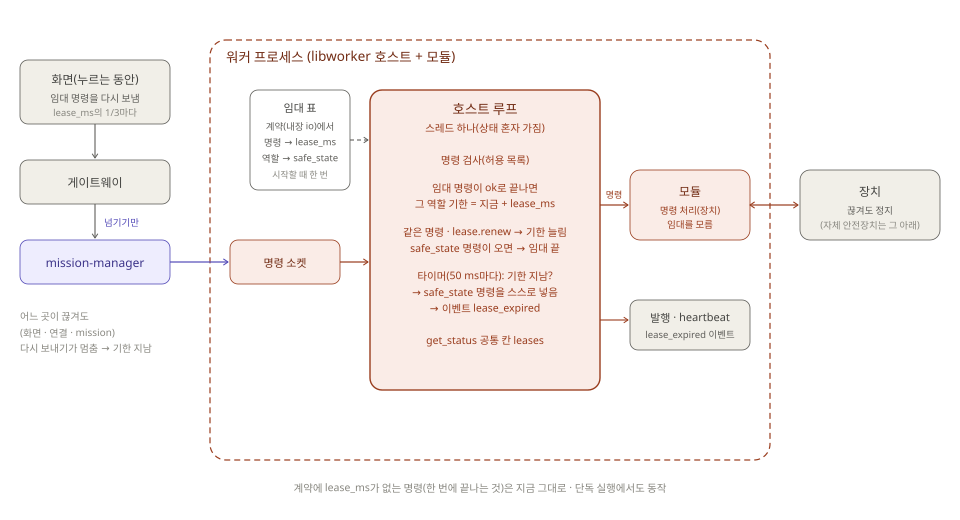

# 명령 임대

| 항목 | 내용 |
|---|---|
| 상태 | 확정·구현(2026-11-24, 0.72, libworker 0.15). 단위·계약·틀 통합 시험. 이벤트 `lease_expired`는 호스트 이벤트 큐(`Host::take_events`)(0.19부터 스트림을 내는 모듈이 `worker::stream_line`으로 저절로 실음)에 쌓이고, 스트림을 내는 모듈이 자기 이벤트에 붙여 발행(틀 source 모듈이 본보기). 오류 code는 9.6 목록이라 임대 없음은 `bad_request` |
| 대상 | 이어지는 명령(속도, 추종, 반복)은 명령한 쪽이 살아 있는 동안만 유지되고, 끊기면 워커가 스스로 안전 상태로 간다 |
| 바탕 | design.md 원칙 14(명령 임대)·15(장치 자체 안전장치가 마지막), `docs/command-path.md`(명령 길·허용 목록), 계약(design.md 6.6.7.1), 남은 일 목록 `docs/managers-next.md` 1번 |

## 1. 왜

화면에서 "초당 10도로 계속 돌아라"를 보낸 뒤 화면·연결·mission 중 어디가 끊기면, 지금은 장치가 마지막 명령대로 끝없이 움직인다. 이어지는 명령에 유효 시간을 붙이고, 명령한 쪽이 그 안에 다시 알려 주지 않으면 워커가 스스로 멈춘다(데드맨 스위치). 로봇 구동 드라이버의 속도 명령 시간 초과, 외부 제어 모드의 목표값 주기 요구, 산업 버스의 heartbeat와 같은 생각이다.

## 2. 구조



- **워커(libworker 호스트)가 잰다.** 움직이는 장치에 가장 가까운 곳이라, 위층이 죽거나 끊겨도 스스로 판단한다
- **모듈은 임대를 모른다.** 호스트가 기한을 재고, 끊기면 모듈에 안전 상태 명령을 넣는다. 장치 모듈은 늘 하던 명령 처리만 한다
- **새 스레드 없음.** 임대 표와 기한은 호스트 루프가 혼자 가진다(워커 구조 원칙: 상태는 한 스레드)

## 3. 계약 표시

역할 정의(`io/<역할>.json`)에 적는다. 표시가 없으면 아무것도 하지 않는다(지금과 같음).

```json
{
  "name": "mount",
  "version": "1.1",
  "safe_state": {"cmd": "mount.stop", "args": {}},
  "commands": {
    "mount.rate": {"description": "속도로 계속 돌기", "lease_ms": 1000, "args": {...}},
    "mount.angle": {"description": "각도로 한 번 가기", "args": {...}},
    "mount.stop": {"description": "멈춤", "args": {}}
  }
}
```

| 칸 | 뜻 |
|---|---|
| 명령 `lease_ms` | 이 명령은 임대가 필요함, 유효 시간(100 이상) |
| 역할 `safe_state` | 끊기면 할 명령. 같은 역할 정의의 명령이어야 하고, 그 자신은 `lease_ms`가 없어야 함 |

`dev/io_contract.py`(계약 점검)가 위 규칙을 검사한다. `lease_ms`가 있는데 `safe_state`가 없으면 오류.

## 4. 동작 (libworker)

| 때 | 하는 일 |
|---|---|
| 시작 | 내장 계약(`worker_io`로 실행 파일에 넣은 io 정의)에서 임대 표를 만든다: 명령 → `lease_ms`, 역할 → `safe_state` |
| 임대 명령이 ok로 끝남 | 그 역할의 임대 = `{기한: 지금 + lease_ms, cmd, from, origin}`. 실패한 명령은 임대를 잡지 않음(움직이지 않았으니) |
| 같은 역할의 임대 명령이 또 옴 | 기한을 다시 `지금 + lease_ms`로(갱신) |
| `lease.renew {"role"}` | 명령을 다시 보내지 않고 기한만 늘림(공통 명령, 운용 조작). 임대가 없으면 `bad_request` |
| `safe_state` 명령이 옴(사람이 멈춤을 누름) | 임대 끝 |
| 타이머(50 ms마다) | 기한이 지났으면 그 역할의 `safe_state` 명령을 모듈에 스스로 넣고(`from: lease`), 이벤트 `lease_expired`(warning, 역할·명령·origin·늦은 ms), 임대 끝 |
| 상태 | `get_status` 공통 칸 `leases: {"<역할>": {"cmd", "from", "origin", "left_ms"}}`, 지표 `host_lease_active`, `host_lease_expired` |

- 갱신은 허용 목록을 거친 명령으로만 된다(검사는 지금처럼). 다른 곳이 같은 역할에 명령하면 그 곳의 명령이 임대를 이어받는다(누가 이기나는 mission 우선순위, 남은 일 3번)
- 단독 실행(워크스페이스 밖)에서도 똑같이 동작한다(안전은 어디서나)
- 워커가 다시 시작하면 임대는 없다(장치는 모듈이 시작할 때의 상태)

## 5. 갱신하는 쪽

| 쪽 | 하는 일 |
|---|---|
| 처음 보낸 곳 | 이어지는 동작을 원하는 동안 같은 명령(또는 `lease.renew`)을 `lease_ms`의 1/3쯤마다 다시 보낸다. 화면 패널은 버튼·조이스틱을 누르는 동안 보내고, 떼면 `safe_state` 명령을 보낸다 |
| mission-manager | 넘기기만 한다(갱신을 대신하지 않음). 그래서 mission이 죽어도 갱신이 멈춰 장치가 멈춘다 |
| 게이트웨이 | 넘기기만 |

같은 (대상, 역할)의 명령은 mission 큐로 차례로 가므로, 다시 보내는 주기가 워커 응답 시간보다 짧으면 큐가 차서 `busy`가 날 수 있다. 그래서 주기는 `lease_ms`의 1/3쯤(1000이면 300 ms)을 권장한다.

## 6. 시험

| 무엇 | 어떻게 |
|---|---|
| libworker | 단위 시험: 임대 명령 ok → 기한, 갱신(같은 명령·`lease.renew`), 기한 지남 → `safe_state`가 모듈로·이벤트, `safe_state`가 오면 끝, 실패한 명령은 임대 없음, 표시 없는 명령은 그대로 |
| 계약 점검 | `dev/io_contract.py`: `lease_ms` 범위, `safe_state` 짝 검사 |
| 틀 | 예제 워커(`workers/_template`)의 역할에 임대 명령 하나를 넣어 통합 시험(보냄 → 멈춤 → 안전 상태 명령이 실행됨) |
| 동시성 | TSan |

## 7. 함께 정한 것 (2026-11-24)

| # | 항목 | 정한 것 |
|---|---|---|
| 1 | 표시 | 역할 정의의 명령에 `lease_ms`, 역할에 `safe_state` |
| 2 | 재는 곳 | libworker 호스트(모듈은 모름, 새 스레드 없음) |
| 3 | 임대 시작 | 워커가 ok로 답한 임대 명령만 |
| 4 | 갱신 | 같은 명령을 다시 보내거나 `lease.renew`. 권장 주기 `lease_ms`의 1/3 |
| 5 | 끊기면 | 호스트가 `safe_state` 명령을 모듈에 넣고 이벤트 `lease_expired`. `safe_state`가 들어오면 임대 끝 |
| 6 | 갱신하는 쪽 | 처음 보낸 곳(화면 패널은 누르는 동안). mission·게이트웨이는 넘기기만 |
| 7 | 기본 | 표시가 없으면 아무것도 안 함. 단독 실행에서도 동작 |
