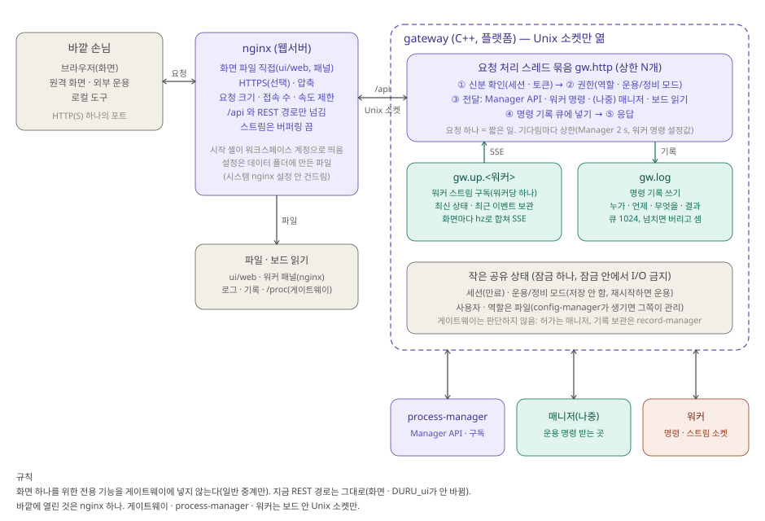

# 게이트웨이 설계

| 항목 | 내용 |
|---|---|
| 상태 | 확정(2026-11-20, design.md 0.49 6.4). 6장 1~2 구현(0.50): C++ 판이 HTTP 수락 시험 36개·단위 시험·TSan 통과, 시작 셸에서 고름(기본 Python). 3~5 남음 |
| 대상 | 플랫폼 블록 게이트웨이(design.md 4.1): 바깥(화면·외부 운용·도구)이 워크스페이스로 들어오는 단 하나의 문 |
| 바꾸는 것 | Python REST(`rest/workspace_rest`, 약 1,600줄)를 **nginx(웹서버) + C++ 게이트웨이**로 나눈다(원칙 10: 상주 블록은 C++). 지금 REST 경로는 그대로 두고 4.1의 새 역할을 더한다 |
| 바탕 | design.md 6.4(REST), 6.11(화면 제공), 9.6·9.7(명령·스트림), 10.3(접근 제어), 원칙 11~17 |

## 1. 하는 일과 품질 목표

**한 줄로:** 바깥 요청을 받아 누구인지 확인하고, 해도 되는 요청이면 알맞은 곳(process-manager·매니저·워커)에 넘기고, 남기고, 답을 돌려준다. 내용을 판단하지 않는다.

| 하는 일 | 누가 | |
|---|---|---|
| 화면 파일 내주기(ui/web, 워커 패널) | nginx | 지금은 REST가 함 |
| HTTPS, 요청 크기·접속 수·속도 제한, 압축 | nginx | 새로 |
| 신분 확인(로그인 세션 · API 토큰)과 역할 | 게이트웨이 | 새로 |
| 운용/정비 모드(원칙 17): 토글, 재시작하면 운용, process-manager에 알림 | 게이트웨이 | 새로 |
| 전달: Manager API(워커 관리), 워커 명령, 스트림 중계(SSE), 보드 읽기(로그·기록·프로세스), 계약(`/io`) | 게이트웨이 | 지금과 같음 |
| 명령 기록: 누가·언제·무엇을·결과(쓰기 요청 전부) | 게이트웨이(`gw.log`) | 새로 |
| 화면 상태 요청을 캐시로 답하기: Manager 구독 하나를 유지하며 최신 워커 목록·시스템 상태를 들고 있음 | 게이트웨이 | 새로(Manager 부담 줄임) |
| 운용 명령을 매니저로 보내기 | 게이트웨이 | 매니저가 생기면(지금은 워커로) |

| 하지 않는 일 | 누가 |
|---|---|
| 해도 되나 판단(모드 전환 허가 등) | 매니저 |
| 기록 보관·검색 | record-manager(그 전까지는 데이터 폴더 파일) |
| 사용자·권한 관리 화면과 저장 | config-manager(그 전까지는 설정 파일을 읽기만) |
| 화면 하나만을 위한 전용 기능 | 만들지 않음: 화면에 필요한 것은 워커·매니저의 명령·주제로 |

| # | 품질 목표 | 기준 | 확인 |
|---|---|---|---|
| ① | 바꿔 끼워도 아무도 모름 | 지금 REST 경로·응답·상태 코드·SSE 모양 그대로(화면·DURU_ui 수정 없음) | 지금 `rest/test_stream.py` + 새 수락 시험을 Python 판·C++ 판 모두로 |
| ② | 작다 | 게이트웨이 5 MB 이하 + nginx(지금 REST 19~25 MB) | 보드 실측 |
| ③ | 바깥에 열린 곳은 nginx 하나 | 게이트웨이는 Unix 소켓만 엶 | 포트 점검 |
| ④ | 막히지 않는다 | 느린 화면·느린 워커는 그 요청만 실패, 다른 요청·스트림 영향 없음. 모든 기다림에 상한 | 느린 클라이언트·느린 워커 시험 |
| ⑤ | 누가 무엇을 했는지 남는다 | 쓰기 요청마다 기록 한 줄(사용자, 모드, 경로·명령, 결과 code, 걸린 시간) | 수락 시험 |

## 2. 구조

**nginx를 앞에 두는 이유:** 바깥 HTTP를 직접 해석하는 일(가장 공격받기 쉬운 곳)을 오래 검증된 웹서버에 맡기고, C++ 게이트웨이는 nginx가 걸러 넘긴 요청만 보드 안에서 받는다. 화면 파일은 nginx가 폴더에서 바로 내주므로 화면을 고쳐도 게이트웨이는 그대로다.

**nginx 띄우는 방법:** 시스템 nginx 설정을 건드리지 않는다. 시작 셸이 데이터 폴더에 설정 파일을 만들어(`run/nginx/nginx.conf`, 포트·인증서·경로는 프로필 `workspace.env`) 워크스페이스 계정으로 띄운다(포트 1024 이상, 443을 쓰면 그 권한만 줌). nginx가 없으면 지금처럼 게이트웨이가 TCP로 직접 받는 개발용 모드(경고).

| 스레드 | 하는 일 | 대기 상한 | 큐 |
|---|---|---|---|
| `gw.http` × N | 요청 하나: 신분 확인 → 권한 → 전달 → 기록 큐 → 응답 | Manager 연결 1 s·응답 2 s, 워커 명령 `WORKSPACE_REST_COMMAND_TIMEOUT` | 동시 요청 N(넘치면 503) |
| SSE 연결 | 화면 하나에 하나, 전송 간격 `hz`(최대 50) | 쓰기 상한(느리면 그 화면만 끊음) | 화면당 최신 값만(주제별로 합침) |
| `gw.up.<워커>` | 워커 스트림 구독(워커당 하나), 최신 상태·최근 이벤트 보관 | 끊기면 1 s마다 다시 | — |
| `gw.mgr` | Manager 구독 하나: 워커 목록·시스템 상태 캐시 | 끊기면 1 s마다 다시(그동안 `GET /workers`는 Manager에 직접) | — |
| `gw.log` | 명령 기록 쓰기 | 쓰기 하나 2 s | 1024, 넘치면 버리고 셈(지표) |

**공유 상태가 작다:** 세션(만료 시각), 운용/정비 모드, 캐시. 잠금 하나로 지키고 잠금 안에서 I/O를 하지 않는다. 요청 처리는 그 밖에서 상태 없이.

**코드:** `gateway/`(C++, CMake). `core/`(경로 표·권한 규칙·세션·기록 줄 만들기, 시스템 호출 모름, 단위 시험), `src/`(HTTP: cpp-httplib 사본, Unix 소켓 클라이언트, SSE, 보드 읽기), `lib/`(libworker 일부·nlohmann·cpp-httplib 사본), `nginx/`(설정 틀).

## 3. 인터페이스

바꾸지 않는 것: design.md 6.4의 경로·상태 코드 표, 6.11의 화면 경로(`/api/board/…`, `/api/remote/…`, `/api/panels`, `/api/ui`), SSE 메시지 모양(9.7 + `stream`), `GET /workers/{id}/io`.

더하는 것:

| 경로 | 내용 |
|---|---|
| `POST /api/auth/login` `{name, password}` → 세션 쿠키(HttpOnly, 만료) | 화면 로그인 |
| `POST /api/auth/logout`, `GET /api/auth/me` | `{name, role}` |
| `Authorization: Bearer <토큰>` | 프로그램(외부 운용·원격 화면)용. 토큰은 사용자 파일에 해시로 |
| `GET /api/mode` · `PUT /api/mode {"mode": "operation"\|"maintenance"}` | 운용/정비 모드(정비는 `maintainer`만). 바꾸면 기록하고 process-manager에 알림(`set_access_mode` op, process-manager 설계 3장 권한 표) |

| 역할 | 할 수 있는 것 |
|---|---|
| `viewer` | 읽기(상태·스트림·로그·계약) |
| `operator` | 읽기 + 운용 명령(지금은 워커 명령, 매니저가 생기면 매니저로) |
| `maintainer` | 위 + 워커 시작·정지·설정·프리셋, 정비 모드 |

- 사용자 파일: `<데이터>/config/users.json`(`name`, `role`, `password_hash`(scrypt), `tokens`(해시)). 프로필로 처음 넣고, config-manager가 생기면 그쪽이 관리. 비밀번호 원문은 어디에도 저장하지 않음
- **신분 확인 켜고 끄기:** `WORKSPACE_AUTH=on|off`. 개발 보드 기본 `off`(지금처럼, 화면 위에 "인증 꺼짐" 표시), 제품 묶음은 `on`만
- 명령 기록 한 줄: `{"t": …, "user": …, "role": …, "mode": …, "method": …, "path": …, "cmd": …, "code": …, "ms": …}` → `<데이터>/records/gateway-<부팅>.jsonl`(용량 상한, record-manager가 생기면 그쪽으로)

## 4. 끊겼을 때

| 상황 | 게이트웨이 | 화면 |
|---|---|---|
| process-manager 없음 | 관리 요청 503, 캐시는 마지막 값 + `stale` 표시, 1 s마다 다시 붙음 | 워커 목록이 멈춤 표시 |
| 워커 명령 소켓 없음·느림 | 그 요청만 503/504 | 그 버튼만 실패 |
| 워커 스트림 끊김 | 그 워커 SSE에 `{"stream": "down"}`, 다시 붙으면 기준 상태 | 그 패널만 "끊김" |
| 화면이 느림 | 그 SSE만 끊음 | 브라우저가 다시 연결 |
| 기록 디스크 느림·가득 | 기록만 버리고 셈(요청은 처리) | 영향 없음 |
| 게이트웨이 죽음 | 시작 셸이 다시 띄움(지금 REST와 같음, 워커·Manager는 계속) | 잠깐 끊김 |
| nginx 죽음 | 시작 셸이 다시 띄움 | 잠깐 끊김 |

## 5. 시험

| 무엇 | 어떻게 |
|---|---|
| 같은 동작(①) | `rest/test_stream.py` + 새 HTTP 수락 시험(모든 경로·상태 코드·SSE 합치기·느린 화면)을 `REST_BIN`으로 Python 판·C++ 판 모두 |
| 신분 확인·권한·모드 | 역할별 허용·거절, 세션 만료, 토큰, 정비 모드 재시작 뒤 운용 |
| 기록 | 쓰기 요청마다 한 줄, 큐 넘침 |
| nginx 앞단 | 화면 파일·`/api` 넘김·SSE 버퍼링 없음·요청 크기 제한 |
| 동시성 | TSan |

## 6. 옮기는 순서

1. HTTP 수락 시험을 지금 Python REST로 먼저 통과
2. C++ 게이트웨이: 지금 기능 그대로(신분 확인 `off`) → 수락 시험 둘 다 통과
3. nginx 앞단(시작 셸이 띄움, 화면 파일·`/api`) → 보드에서 C++로 실측
4. 신분 확인·역할·운용/정비 모드·명령 기록·Manager 캐시
5. 기본을 C++로, Python REST 삭제

### 6.1 구현 결과 (0.50)

| 항목 | 결과 |
|---|---|
| 수락 시험 | `rest/test_rest_accept.py`(HTTP 블랙박스, 가짜 Manager·워커): Python 판 34(+ `test_stream` 3, 게이트웨이 전용 2개 건너뜀), C++ 판 36(`REST_BIN`) |
| 단위 시험 | `test_core`(경로 표·합치기·지난 지표·비밀값 가림 등), `test_threads`. TSan 경고 0(TSan 판 게이트웨이로 수락 시험도 통과) |
| 자원(PC WSL) | 메모리 20.8 → 6.8 MB(SSE 2개 7.0 MB), 실행 파일 1.4 MB. 같은 요청 묶음 50개/s(명령 3 : 목록 1 : 시스템 1, 가짜 Manager·워커): 요청 하나 CPU 0.50 → 0.21 ms, 전체 2.50 → 1.05% |
| 보드 실측 | 메모리 20.4 → 6.1~7.6 MB, 화면 열린 상태(요청 약 5.5개/s) CPU 0.63%. 고친 것: 재시작 직후 bind 실패(SO_REUSEADDR만), 쉬는 요청 스레드 48개가 1초마다 깨던 것(쉴 때 CPU 0.5%) |
| 실행 | `dev/release-worker.sh gateway` → `gateway/bin/gateway`. 시작 셸: `WORKSPACE_REST_IMPL=cpp` 또는 `<데이터>/config/rest_impl`에 `cpp`(기본 Python). `WORKSPACE_GATEWAY_SOCKET`(Unix 소켓, nginx용), `WORKSPACE_GATEWAY_THREADS`(동시 요청 상한, 기본 48, SSE 포함). 신분 확인은 아직 `off`만 |
| 라이브러리 | cpp-httplib v0.18.3(MIT, 사본) |

Python 판과 다른 점: HEAD·PATCH·OPTIONS는 JSON 501, Range 요청은 206, 워커 명령 시간 상한은 전체 시간으로 셈, Python이 예외로 답 없이 끊던 경우는 500·503으로 답함, 제품 빌드는 취소 중인 자식이 끝나기 전 새 시작을 막음(Python은 옛 상태가 섞였음), SSE 기준 상태를 잠금 안에서 넣어 드문 경합이 없어짐, 새로: 동시 요청 상한(넘으면 503), 받기·스트림 스레드 10 s 멈춤 → exit 4.

## 7. 미결

| 항목 | 언제 |
|---|---|
| HTTPS 인증서를 어디서 받나(보드 자체 서명 또는 프로필) | 3단계 |
| 제품 빌드 기능(`/system/product-build`, 개발 전용)을 게이트웨이에 둘지 개발 도구로 뺄지 | 2단계 |
| 원격 화면(DURU_ui 등)이 보드에 붙을 때 토큰 발급 방법 | 4단계 |
