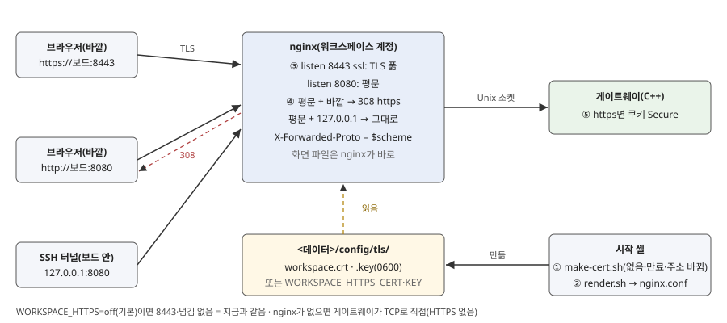

# HTTPS (nginx 앞단, 설치·시작 셸·게이트웨이)

| 항목 | 내용 |
|---|---|
| 상태 | 확정·구현(2026-11-24, 초안대로). render·인증서·HTTPS 앞단 시험(`rest/test_nginx_front.py` 13), 게이트웨이 수락 시험 55(쿠키 `Secure`). 보드는 `WORKSPACE_HTTPS=on`으로 켠 뒤 확인 |
| 대상 | 화면·REST를 HTTPS로 받기: 인증서(사용자 것 또는 보드 자체 서명), nginx 443류 포트, 평문 → HTTPS 넘김, 로그인 쿠키 |
| 바탕 | `docs/gateway.md`(2장 nginx 앞단, 바깥에 열린 곳은 nginx 하나), `gateway/nginx/`(틀·`render.sh`), `workspace-start.sh` |
| 남은 일 목록 | `docs/managers-next.md` 8번 |

## 1. 왜

| 지금 | 문제 |
|---|---|
| 화면·REST가 평문 HTTP(8080) | 같은 망의 누구나 로그인 비밀번호·세션 쿠키·명령을 볼 수 있다(신분 확인을 켜도 쿠키가 평문으로 다님) |
| nginx 앞단은 이미 있음(0.51) | TLS만 nginx에 맡기면 게이트웨이(C++)는 그대로 Unix 소켓만 연다 |

## 2. 구조

| 단계 | 하는 일 | 어디서 |
|---|---|---|
| ① 인증서 정하기 | `WORKSPACE_HTTPS=on`일 때만. `WORKSPACE_HTTPS_CERT`·`KEY`가 있으면 그것(만료 30일 안이면 로그 경고), 없으면 보드 자체 서명을 `<데이터>/config/tls/`에 만들거나 그대로 씀 | 시작 셸 → `gateway/nginx/make-cert.sh` |
| ② 설정 만들기 | `render.sh`에 `RENDER_TLS_LISTEN`·`CERT`·`KEY`·`REDIRECT`. 같은 server에 `listen <주소>:8443 ssl` 추가, TLS 1.2·1.3 | `render.sh` → `<데이터>/run/nginx/nginx.conf` |
| ③ 받기 | 브라우저 → nginx(TLS 풂) → 게이트웨이 Unix 소켓(지금과 같음). `X-Forwarded-Proto: $scheme`를 nginx가 덮어써 넘김 | nginx |
| ④ 평문 넘김 | 평문 포트(8080)로 바깥에서 온 요청은 `308 https://<host>:8443<경로>`. 보드 안(127.0.0.1, SSH 터널)에서 온 것은 그대로 | nginx |
| ⑤ 쿠키 | 로그인·로그아웃이 HTTPS로 왔으면(`X-Forwarded-Proto: https`) 쿠키에 `Secure` | 게이트웨이 |

- **nginx가 없거나 꺼짐(`WORKSPACE_NGINX=off`):** 게이트웨이가 TCP로 직접(지금과 같음), HTTPS 없음
- **nginx에 ssl 모듈이 없으면:** HTTPS를 빼고 경고(`render.sh`). rewrite 모듈이 없으면 넘김만 뺌
- **인증서를 워크스페이스 계정이 못 읽으면:** 평문만, 로그 한 줄(nginx는 워크스페이스 계정으로 돎)
- **스트림(SSE):** 같은 location 규칙이라 HTTPS에서도 버퍼링 없음. 화면은 웹소켓을 쓰지 않음(wss 따로 없음)

## 3. 보드 자체 서명 인증서 (`make-cert.sh`)

| 무엇 | 값 |
|---|---|
| 파일 | `<데이터>/config/tls/workspace.crt`, `workspace.key`(0600), `workspace.san`(만들 때의 이름 목록). 폴더 0700, 워크스페이스 계정 소유 |
| 키 | EC P-256 |
| 이름(SAN) | 호스트 이름, `<호스트>.local`, `localhost`, `127.0.0.1`, 만들 때의 보드 IPv4 전부(`hostname -I`). 저장소에는 주소를 적지 않음 |
| 유효 기간 | 825일 |
| 다시 만드는 때 | 파일 없음, 만료 30일 안, 보드 이름·주소가 바뀜(시작할 때마다 비교). 그대로면 아무것도 안 함 |
| 만드는 때 | 시작 셸이 시작할 때(설치 때가 아님: 설치 뒤 주소가 바뀌어도 맞게, 이미 깔린 보드도 켜기만 하면 됨) |

## 4. 설정 (`workspace.env`)

| 키 | 기본 | 뜻 |
|---|---|---|
| `WORKSPACE_HTTPS` | `off` | `on`이면 HTTPS도 받음 |
| `WORKSPACE_HTTPS_PORT` | `8443` | 443은 nginx에 낮은 포트 권한이 필요(`setcap`, install/README.md) |
| `WORKSPACE_HTTPS_CERT`·`WORKSPACE_HTTPS_KEY` | (비움) | 사용자 인증서. 비우면 보드 자체 서명 |
| `WORKSPACE_HTTP_REDIRECT` | `on` | 평문 → HTTPS 넘김(보드 안 127.0.0.1은 늘 그대로) |
| `WORKSPACE_REST_PORT` | `8080` | 평문 포트(그대로 열림: 보드 안·넘김용) |

## 5. 시험

| 무엇 | 어떻게 |
|---|---|
| render | 가짜 `nginx -V`: TLS 켬·넘김 끔·ssl 모듈 없음·TLS 없음(지금과 같음), 443이면 넘김 주소에 포트 없음 |
| 인증서 | `make-cert.sh`: SAN(`localhost`, `127.0.0.1`, 준 주소), 그대로면 다시 안 만듦 |
| HTTPS 앞단 | 실제 nginx + C++ 게이트웨이: 인증서·이름 확인(`localhost`)하며 화면·API, 스트림 첫 줄, 평문 127.0.0.1은 그대로, 127.0.0.2에서 온 평문은 308 |
| 게이트웨이 | 수락 시험: 평문 로그인 쿠키에 `Secure` 없음, `X-Forwarded-Proto: https`면 `Secure` |
| 보드 | `WORKSPACE_HTTPS=on`(설정 탭이면 바로 적용, 0.86 `docs/live-settings.md`. 손으로 고치면 다시 시작) → `https://<보드>:8443` 화면·로그인, 평문 8080은 바깥에서 넘김, SSH 터널(127.0.0.1:8080)은 그대로 |

## 6. 함께 정할 것

| # | 항목 | 초안 |
|---|---|---|
| 1 | 기본값 | **꺼짐**(`WORKSPACE_HTTPS=off`): "새 동작은 표시가 없으면 꺼짐" 원칙. 제품 모드에서 켜는 것은 프로필 몫. 다른 안: 기본 켬(보안 우선, 처음 접속에 인증서 경고) |
| 2 | 인증서 | 사용자 것이 있으면 그것, 없으면 보드 자체 서명(시작할 때 만듦·갱신) |
| 3 | 포트 | HTTPS 8443(권한 없이), 443은 선택(`setcap`). 평문 8080은 그대로 열어 둠 |
| 4 | 평문 넘김 | 켬(308), 보드 안 127.0.0.1은 넘기지 않음(SSH 터널 그대로) |
| 5 | HSTS | 넣지 않음(자체 서명·넘김 예외가 있어 브라우저가 평문 접속을 영영 막을 수 있음) |
| 6 | 쿠키 | HTTPS로 온 로그인에만 `Secure` |
| 7 | SAN 주소 | 보드 IPv4 전부(도커 브리지 등 포함), IPv6 제외. 주소가 바뀌면 다시 만들어 브라우저 경고를 다시 받아야 함 |

## 7. 남은 문제

- **영상(WebRTC):** 0.85부터 nginx가 `/media/`를 MediaMTX로 넘기고 기본 영상 주소가 같은 주소 `/media/{path}/`라 HTTPS에서도 그대로 나온다(`docs/media-proxy.md`). `WORKSPACE_UI_MEDIA_URL`을 `http://`로 적어 두었으면 HTTPS 화면에서는 막히니 비우거나 `https://`로
- 사용자 인증서 만료는 시작할 때 로그로만 알림(화면 표시는 7번 화면 일과 함께)
