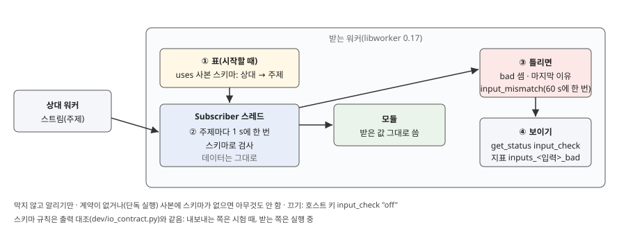

# 받은 칸 실행 중 검사

| 항목 | 내용 |
|---|---|
| 상태 | 초안대로 구현(2026-11-24, 0.74, libworker 0.17). 단위 시험. 9장은 초안 값(바꿀 수 있음) |
| 대상 | 워커가 다른 워커 스트림에서 받는 주제가 계약(`io/uses/<역할>.json` 사본)과 맞는지 실행 중에 본다. 지금은 시험 때(출력 대조, `dev/test_io_output.py`) 내보내는 쪽만 본다 |
| 바탕 | design.md 6.6.7(계약: `io.json` `uses`, 사본), 9.7(스트림), `dev/io_contract.py`(스키마 규칙) |
| 남은 일 목록 | `docs/managers-next.md` 6번 |

## 1. 왜

내보내는 쪽 정의가 바뀌었는데 받는 쪽 사본이 옛것이거나, 실제 장치에서만 나오는 값(빈 칸, 범위 밖)이 있으면 받는 모듈이 조용히 틀린 값을 쓴다. 출력 대조는 가짜 장치로 시험할 때만 돌아서 보드에서 생기는 어긋남은 못 본다.

## 2. 구조

| 단계 | 하는 일 | 어디서 |
|---|---|---|
| ① 표 만들기 | 호스트가 시작할 때 내장 계약(`io_bundle`)의 `uses`에서 입력마다 상대 워커 id와, 그 입력이 쓴다고 적은 주제의 사본 스키마(`topics.<이름>.schema`)를 모은다. `many` 입력(여럿에서 받음)·스키마 없는 주제는 뺌 | libworker 호스트 |
| ② 받을 때 | `Subscriber`가 줄을 받으면 상대 id로 표를 찾아, 주제마다 **주기(기본 1 s)에 한 번** 스키마로 검사. 데이터는 그대로 모듈로(막지 않음) | `Subscriber` 스레드 |
| ③ 알리기 | 틀리면 입력마다 `bad`를 세고 마지막 이유를 남김. (입력, 주제)마다 60 s에 한 번 이벤트 `input_mismatch`(warning, 호스트 이벤트 큐 `take_events`(0.19부터 스트림을 내는 모듈이 `worker::stream_line`으로 저절로 실음)) | 호스트 |
| ④ 보이기 | `get_status` `input_check: {"<입력>": {"checked", "bad", "last_error"}}`, 지표 `inputs_<입력>_bad` | 호스트 |

- 스키마 규칙은 출력 대조와 같다(`type`·`enum`·범위·`required`·`properties`·`additionalProperties` 기본 false·`items`·`$ref`). 같은 정의로 내보내는 쪽(시험)과 받는 쪽(실행)을 함께 본다
- 모듈 코드는 바꾸지 않는다(`Subscriber`를 쓰면 저절로)

## 3. 설정 (호스트 키)

| 키 | 뜻 | 기본 |
|---|---|---|
| `input_check` | `warn`(검사하고 알림) · `off` | `warn` |
| `input_check_period_s` | 주제마다 검사 간격(0.05 이상) | 1.0 |

- 계약이 없거나(단독 실행) 사본에 스키마가 없으면 아무것도 안 한다. 막지 않으므로 기본을 켬으로 둔다(동작은 그대로, 보이는 것만 늘어남)

## 4. 비용

주제마다 1 s에 한 번, 검사는 받는 스레드에서(워커 루프 아님). 틀린 곳은 4개까지만 모은다. 보드에서 큰 주제(수백 칸)도 1 ms 안.

## 5. 시험

| 무엇 | 어떻게 |
|---|---|
| 스키마 | 맞음·형식·enum·범위·필수·정의에 없음·`$ref`·배열 |
| 이름 자리 | `stream_<송출>_fps` |
| 표 | 사본 스키마 있는 주제만, `many` 입력 뺌 |
| 검사 | 주기 안은 건너뜀, 셈·마지막 이유, 알림 60 s에 한 번, 끄기 |

## 6. 하지 않는 것

명령 응답·데이터 버스(프레임) 검사, 틀린 값 막기, 받는 쪽 사본 자동 갱신.

## 9. 함께 정할 것 (초안 값으로 구현)

| # | 항목 | 초안 |
|---|---|---|
| 1 | 무엇을 | 스트림 주제(사본에 스키마가 있는 것)만 |
| 2 | 얼마나 자주 | 주제마다 1 s에 한 번(설정) |
| 3 | 틀리면 | 막지 않음, 셈·이유·이벤트(60 s에 한 번) |
| 4 | 기본 | 켬(`warn`), 끄기 `off` |
| 5 | 버전 | libworker 0.17부터(검사는 그대로), 공통 정의 1.5(`input_check`, `inputs_<입력>_bad`) |
