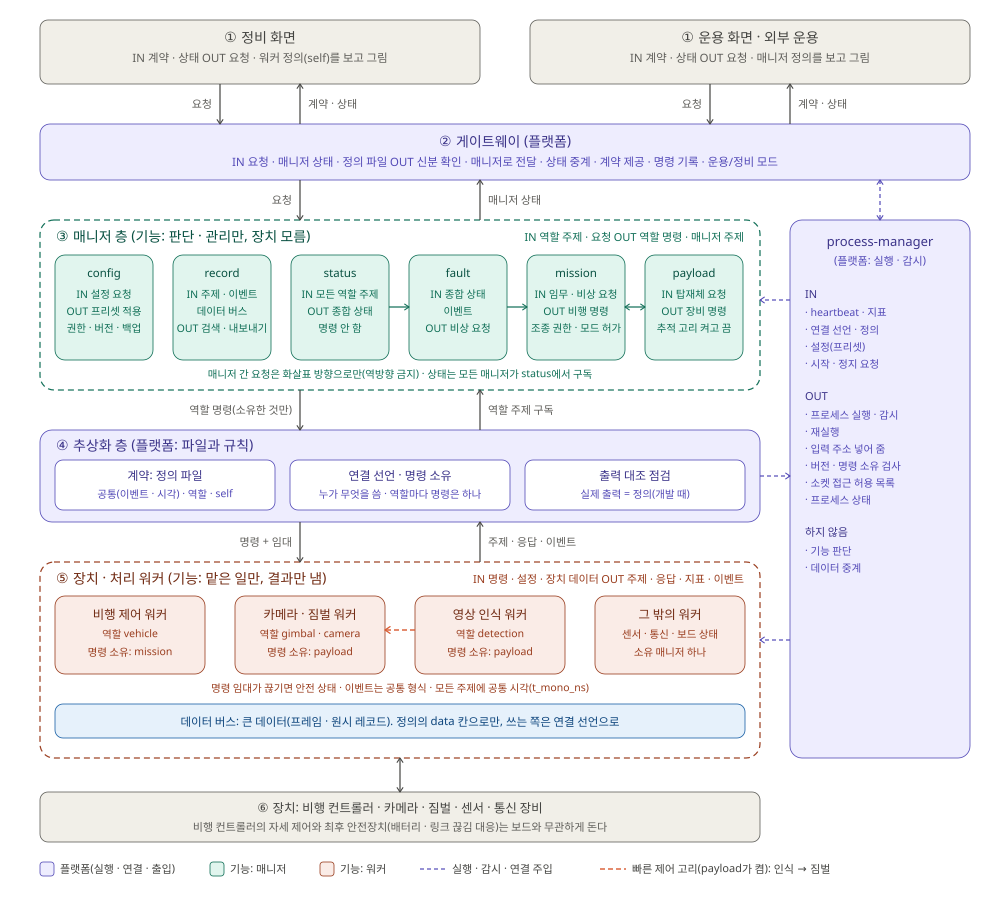

# 워크스페이스 계층과 매니저

| 항목 | 내용 |
|---|---|
| 상태 | 확정(design.md 4.1, 원칙 10~18). 이 문서는 자세한 판: 층별 입출력, 규칙, 매니저 책임 |
| 목적 | 워커·매니저·화면을 층으로 나누고 층 사이를 계약(정의 파일)으로만 잇는다. 일을 나눠 맡고, 장비를 갈아 끼우고, 문제를 추적할 수 있게 |
| 바탕 | AUTOSAR Adaptive(실행·상태·건강·저장·설정 관리), PX4(드라이버 → uORB → commander), ROS 2(노드·`.msg`), STANAG 4586(운용 화면은 표준 메시지만), MIL-STD-498 ICD, 항공우주 FDIR |

## 1. 구성

두 평면으로 나뉜다.

- **기능 평면:** 매니저(판단)와 워커(일). 무엇을 하는가
- **플랫폼 평면:** 게이트웨이(출입), 추상화 층(계약·연결), process-manager(실행·감시). 기능이 돌 수 있게 하는 것. 기능 평면의 부모라 같은 층에 두지 않는다(매니저를 띄우는 쪽이 매니저의 동료이면 매니저가 죽었을 때 살릴 쪽이 꼬임)

## 2. 블록별 입출력

| 블록 | 평면 | IN | OUT | 하지 않음 |
|---|---|---|---|---|
| 정비 화면 | — | 계약(`GET /io`), 상태(SSE) | 요청 | 판단, 워커 직접 접근 |
| 운용 화면·외부 운용 | — | 계약, 상태 | 요청 | 판단, 워커 직접 접근 |
| 게이트웨이 | 플랫폼 | 요청, 매니저 상태, 정의 파일 | 신분 확인, 매니저로 전달, 상태 중계, 계약 제공, 명령 기록, 운용/정비 모드 | 판단 |
| 매니저 | 기능 | 역할 주제, 위층 요청, 앞선 매니저의 요청 | 소유한 역할의 명령, 매니저 주제 | 장치와 대화, 장치 종류 알기 |
| 추상화 층 | 플랫폼 | (파일과 규칙) | 계약(공통·역할·워커 정의), 연결 선언·명령 소유, 출력 대조 점검 | 실행 |
| 워커 | 기능 | 명령(+ 임대), 설정, 장치 데이터 | 주제, 응답, 지표, 이벤트, 데이터 버스 | 판단, 결과를 누가 쓰는지 알기 |
| process-manager | 플랫폼 | heartbeat·지표, 연결 선언·정의, 설정, 시작·정지 요청 | 프로세스 실행·감시·재실행, 입력 주소 주입, 버전·명령 소유 검사, 소켓 접근 허용 목록, 프로세스 상태 | 기능 판단, 데이터 중계 |
| 장치 | — | 워커의 장치 명령 | 원시 데이터 | |

## 3. 규칙

1. **명령은 위에서 아래로, 결과는 아래에서 위로.** 화면 → 게이트웨이 → 매니저 → 워커. 아래층은 위층을 모른다
2. **층 사이는 계약으로만.** 바깥으로 나가는 명령 응답·주제·`get_status`·지표·이벤트·데이터 버스는 모두 정의 파일에 있다(design.md 6.6.7.1). 정의 밖은 워커 속사정(`runtime`)뿐
3. **연결은 선언으로.** 워커·매니저는 상대 이름을 모른다. 연결 선언(design.md 6.6.7.4)으로 잇고 끊는다. process-manager가 버전을 검사하고 입력 주소를 넣어 준다. 정의가 같으면 다른 워커로 갈아 끼워도 위층은 그대로
4. **명령 소유: 한 역할의 명령은 매니저 하나만.** 역할마다 명령하는 매니저를 하나로 정해 연결 선언에 적는다(예: 기체 명령은 mission, 짐벌·카메라·인식은 payload). process-manager가 겹치는 소유를 거절하고, 워커의 명령 소켓은 소유 매니저(와 정비 모드의 게이트웨이)만 받는다. 다른 매니저가 그 장치를 움직이려면 소유 매니저에 요청한다
5. **매니저 간 요청은 정해진 방향으로만.** fault → mission(비상 요청), mission ↔ payload(협조: 경로에 맞춘 촬영 등). 상태는 모든 매니저가 status에서 구독한다(status는 명령하지 않음). 역방향·순환 요청 금지
6. **명령 임대.** 명령하는 매니저는 워커에 주기적으로 살아 있음을 알린다(임대 갱신). 임대가 끊기면 워커는 정의에 적힌 안전 상태로 간다(예: 짐벌 정지, 추적 끝). 매니저가 죽어도 장치가 마지막 명령대로 계속 움직이지 않게
7. **비행 컨트롤러와의 경계.** 자세 제어와 최후 안전장치(배터리, 링크 끊김 시 귀환 등)는 비행 컨트롤러가 맡는다. 매니저는 임무 수준의 감독이다. 보드 전체가 멈춰도 기체는 비행 컨트롤러의 안전장치로 버틴다
8. **빠른 제어 고리는 예외.** 매 프레임 오가는 제어(예: 인식 → 짐벌 추적)는 소유 매니저가 켜고 끄고, 켜진 동안 정해진 두 워커가 직접 주고받는다. 켜진 고리는 매니저 상태에 보이고, 임대(규칙 6)는 고리에도 걸린다
9. **공통 형식.** 이벤트(시각·출처·심각도·코드·내용)와 시각(모든 주제의 `t_mono_ns`, 보드 CLOCK_MONOTONIC)은 공통 정의 하나를 모든 블록이 따른다. fault·record가 워커마다 다른 형식을 해석하지 않게
10. **운용 모드가 기본, 정비 모드는 토글.** 워크스페이스 설정 화면의 토글로 켠다. 정비 모드에서 매니저는 비행 조건 검사를 건너뛰고 장비 하나씩 시험하는 명령을 넘긴다(경로는 그대로 매니저 경유). 저장하지 않는 상태라 재시작하면 운용 모드. 켜고 끈 시각과 그동안 명령은 모두 기록
11. **이름은 용도로.** `<용도>-manager`
12. **엔진과 규칙을 나눈다.** 매니저의 엔진(모으기, 판단 틀, 명령 소유·임대 관리)은 코드, 기체·임무마다 바뀌는 규칙(예: 배터리 몇 % 이하면 귀환, 임무별 허용 모드)은 데이터(프로파일). 규칙은 config-manager가 관리·검증. 기체가 바뀌어도 매니저 코드는 그대로
13. **언어.** 플랫폼(process-manager, 게이트웨이)과 매니저는 C++(libworker 위): 한 번 만들면 거의 바뀌지 않고 늘 상주하므로 실행 비용을 우선(저가 보드). 워커는 성능에 따라 C/C++ 또는 Python(design.md 원칙 10)

## 4. 매니저

합치는 기준: 같은 데이터를 다루고 바뀌는 이유가 같으면 합친다. 하나가 죽어도 다른 하나가 살아 있어야 하거나, 빠르기·중요도가 다르면 나눈다.

| 매니저 | 하는 일 | 단일 소유 | 명령 소유 | 나눈 이유 |
|---|---|---|---|---|
| `config-manager` | 설정·프로파일(기체·임무별), 검증·백업·되돌리기, 사용자·권한·키, 소프트웨어 버전 | 설정 원본, 사용자·권한, 키 | (설정 적용은 process-manager에 요청) | "어떻게 두었나"와 "누가 무엇을 할 수 있나"는 같은 이유로 바뀜 |
| `status-manager` | 역할 주제를 모아 시스템 상태 하나로(건강·비행 상태·링크 품질), 시각 기준 공유 | 종합 상태 | 없음(보기만) | 결정하는 쪽과 나눠야 어디서든 가져다 씀 |
| `fault-manager` | 이상 탐지·격리, 심각도 분류, 비상 대응 요청(링크 끊김 대응 포함) | 이상 목록, 대응 단계 | 없음(mission에 요청) | 다른 매니저가 죽어도 이상 판단은 돌아야 함 |
| `record-manager` | 정의된 주제·이벤트를 정한 주기로 같은 시간축에 기록, 검색·내보내기, 텔레메트리와 대용량 경로 분리 | 기록 파일·색인 | 없음 | 저장이 느려도 다른 매니저에 영향 없게. 장시간 분석(온도와 성능 등) |
| `mission-manager` | 임무 계획·단계 실행, 경로, 조종 권한(누가 조종하나·우선순위), 모드 전환 허가 | 임무, 조종 권한 | 기체 역할 | 기체에 명령하는 곳이 한 곳이어야 충돌이 없음 |
| `payload-manager` | 탑재체 운용(카메라·짐벌·인식·추적 묶기), 빠른 제어 고리 켜고 끄기 | 탑재체 운용 상태 | 짐벌·카메라·인식 역할 | 비행과 따로 운용되고 담당도 다를 수 있음 |

역할이 나뉜 곳: 링크(통신)는 정책 config, 감시 status, 끊김 대응 fault. 보안은 판단 config, 신분 확인 게이트웨이, 소켓 허용 process-manager. 경로(Trajectory)는 mission.

## 5. 미결

| 항목 | 언제 |
|---|---|
| 기록 저장 방식(jsonl, 내장 DB, 시계열 DB), 암호화 위치 | record-manager·config-manager 설계 때 |
| 매니저끼리 주고받는 정의, 임대 주기와 워커별 안전 상태 | 매니저마다 설계 때 |
| 정비 화면을 어디에 둘지(워커 폴더 패널 또는 따로) | 계약 규칙 구현 뒤 |
