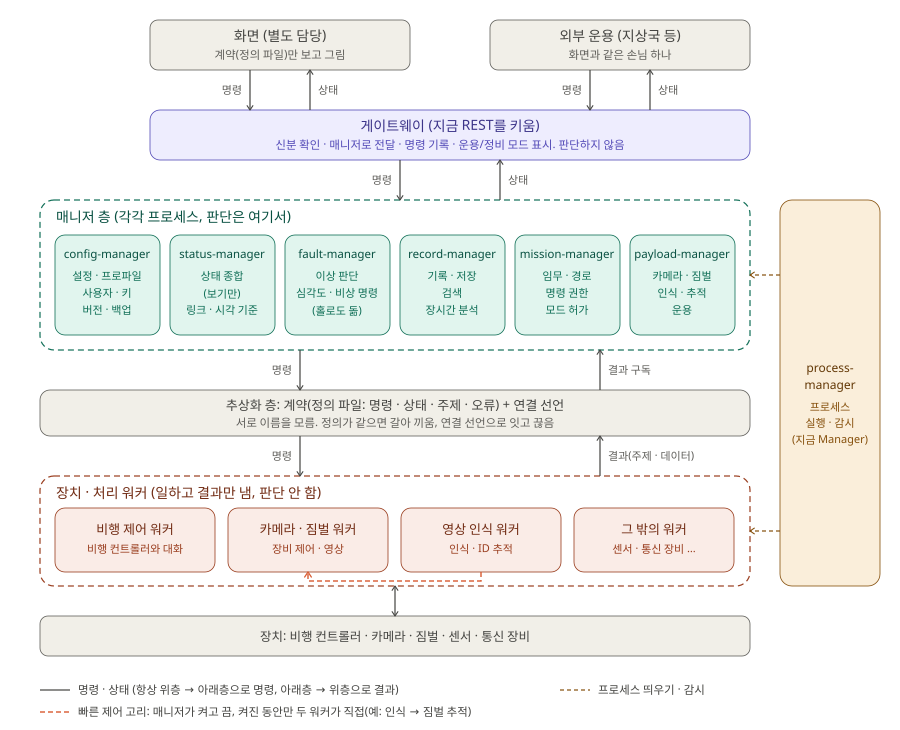

# 워크스페이스 계층과 매니저

| 항목 | 내용 |
|---|---|
| 상태 | 확정(2026-11-20, design.md 0.40 4.1·5장). 구현 전. 이 문서는 자세한 판(규칙·매니저 책임·지금과 차이·순서) |
| 목적 | 워커·매니저·화면의 관계를 층으로 나누고, 층 사이를 계약(정의 파일)으로만 잇는다. 일을 나눠 맡고, 장비를 갈아 끼우고, 문제를 추적할 수 있게 |
| 바탕 | PX4(드라이버 → uORB 주제 → commander·navigator), ROS 2(드라이버 노드, `.msg` 정의), STANAG 4586(운용 화면은 표준 메시지만, 기체 차이는 VSM이 흡수), MIL-STD-498 ICD, 항공우주 FDIR |

## 1. 한눈에

| 층 | 하는 일 | 하지 않는 일 |
|---|---|---|
| 화면·외부 운용 | 계약을 보고 그리기, 사람의 요청 보내기 | 판단, 워커 직접 조작 |
| 게이트웨이 | 신분 확인, 매니저로 전달, 명령 기록, 운용/정비 모드 표시 | 판단(허가는 매니저가) |
| 매니저 층 | 판단: 해도 되나, 언제, 무엇을. 여러 워커의 결과를 묶어 씀 | 장치와 직접 대화 |
| 추상화 층 | 계약(정의 파일)과 연결 선언. 누가 무엇을 내고 받는지 | 실행(파일과 규칙일 뿐, 프로세스 아님) |
| 장치·처리 워커 | 일하고 결과만 냄(명령 응답, 주제, 데이터 버스, 파일) | 판단, 결과를 누가 쓰는지 알기 |
| process-manager | 매니저·워커 프로세스 실행·감시·재실행 | 기능 판단(5장 원칙 5 그대로) |

## 2. 규칙

1. **명령은 위에서 아래로, 결과는 아래에서 위로.** 화면 → 게이트웨이 → 매니저 → 워커. 아래층은 위층을 모른다(워커는 매니저 이름을 모르고 결과만 낸다)
2. **층 사이는 계약으로만.** 바깥에서 쓰는 명령·상태(`get_status`)·주제·오류는 모두 정의 파일에 있다. 정의 밖의 칸은 아무도 쓰지 않는다. 점검 도구가 실제 출력이 정의와 맞는지 본다
   - 정의 밖: 워커 속사정(`runtime`: 스레드·큐·루프 시간). 개발자 진단용이라 바뀌어도 계약이 바뀌지 않게
   - 지표(heartbeat)는 process-manager가 모으는 것이라 워커마다 지표 목록으로 정의
3. **연결은 선언으로.** 워커·매니저는 상대 이름을 모른다. 연결 선언(지금 `connections.json`, design.md 6.6.7.4)으로 잇고 끊는다. 정의가 같으면 다른 워커로 갈아 끼워도 위층은 그대로
4. **판단은 매니저 한 곳.** 같은 판단(예: 모드 전환 허가)을 화면·외부 운용·자동 대응 어디서 요청해도 같은 매니저를 지난다
5. **빠른 제어 고리는 예외.** 매 프레임 오가는 제어(예: 인식 → 짐벌 추적)는 매니저를 거치면 늦다. 켜고 끄기와 조건은 매니저가 정하고, 켜진 동안은 정해진 두 워커가 직접 주고받는다. 켜진 고리는 매니저 상태에 보인다(PX4 offboard와 같은 방식: 진입 허가는 commander, 설정점은 직접)
6. **운용 모드와 정비 모드.** 기본은 운용 모드. 워크스페이스 설정 화면의 토글로 정비 모드를 켠다. 정비 모드에서는 매니저가 비행 조건 검사를 건너뛰고 장비 하나씩 시험하는 명령을 그대로 넘긴다(경로는 그대로 매니저 경유)
   - 저장하지 않는 지금 상태: 재시작하면 운용 모드로 돌아온다(켜 둔 채 잊는 사고 막기)
   - 켜고 끈 시각, 정비 모드 중 명령은 모두 기록
7. **이름은 용도로.** `<용도>-manager`. 지금의 Manager는 `process-manager`

## 3. 매니저

합치는 기준: 같은 데이터를 다루고 바뀌는 이유가 같으면 합친다. 하나가 죽어도 다른 하나가 살아 있어야 하거나, 빠르기·중요도가 다르면 나눈다.

| 매니저 | 하는 일 | 갖는 것(단일 소유) | 나눈 이유 |
|---|---|---|---|
| `config-manager` | 설정·프로파일(기체·임무별), 검증·백업·되돌리기, 사용자·권한·키, 소프트웨어 버전 | 설정 원본, 사용자·권한, 키 | 시스템을 "어떻게 두었나"와 "누가 무엇을 할 수 있나"는 같은 이유로 바뀜 |
| `status-manager` | 워커 결과를 모아 시스템 상태 하나로(건강, 비행 상태, 링크 품질), 시각 기준 공유 | 종합 상태 | **보기만 한다.** 결정하는 쪽과 나눠야 어디서든 마음 놓고 가져다 씀 |
| `fault-manager` | 이상 탐지·격리, 심각도 분류, 비상 대응 명령(링크 끊김 대응 포함) | 이상 목록, 대응 단계 | 다른 매니저가 죽어도 비상 대응은 돌아야 함 |
| `record-manager` | 정의된 주제를 정한 주기로 같은 시간축에 기록, 검색·내보내기, 텔레메트리와 대용량 데이터 경로 분리 | 기록 파일·색인 | 저장이 느려도 다른 매니저에 영향 없게. 장시간 분석(온도와 성능 등) |
| `mission-manager` | 임무 계획·단계 실행, 경로, 명령 권한(지금 누가 조종하나, 우선순위), 모드 전환 허가 | 임무, 조종 권한 | 기체에 명령을 내리는 곳이 한 곳이어야 충돌이 없음 |
| `payload-manager` | 탑재체 운용(카메라·짐벌·인식·추적 묶기), 빠른 제어 고리 켜고 끄기 | 탑재체 운용 상태 | 비행과 따로 운용되고 담당도 다를 수 있음 |

흩어진 역할이 간 곳:

| 역할 | 간 곳 |
|---|---|
| 링크(통신) | 정책 config, 감시 status, 끊김 대응 fault |
| 보안(사용자·키) | config(판단), 게이트웨이(신분 확인만) |
| 시각 맞춤 | 기준값을 가진 워커가 내고 status가 공유 |
| 경로(Trajectory) | mission |
| 지금 `workspace-logger` | record-manager가 이어받음 |
| 지금 `system-monitor` | 보드 상태를 내는 워커. status가 모음 |

## 4. 지금과 무엇이 달라지나

| | 지금 | 바뀐 뒤 |
|---|---|---|
| 화면의 명령 | REST가 워커 명령 소켓으로 바로 | 게이트웨이 → 매니저 → 워커 |
| 화면이 쓰는 칸 | 정의 밖(`get_status`, 화면용 주제) | 모두 정의 안 |
| 화면 코드 | 워커 폴더(`workers/<워커>/workspace/panel`)에 워커 개발자가 | 계약만 보고 따로. 워커 폴더 패널은 정비용으로 남길지 미결 |
| 판단 | 각 워커가 자기 장치만, 묶는 판단 없음 | 매니저 층 |
| 워커끼리 | 일부 직접(예: 인식 → 짐벌) | 빠른 제어 고리로만, 매니저가 켬 |
| 기록 | 1초 지표·보드 상태(logger) | 정의된 주제를 정한 주기로(record-manager) |

바뀌지 않는 것: 워커 프로세스 구조, 소켓 계약(9장), process-manager의 감시, 지금 워커의 내부.

## 5. 미결

| 항목 | 언제 |
|---|---|
| 기록 저장 방식(jsonl, 내장 DB, 시계열 DB), 암호화 위치 | record-manager·config-manager 설계 때 |
| 매니저끼리 주고받는 정의 | 매니저마다 설계 때 |
| 워커 폴더 패널(정비용)을 남길지, 화면을 어디에 둘지 | 계약 규칙 바꾼 뒤 |
| 매니저 구현 언어(제어 경로라 Python 가능, 5장 원칙 10) | 첫 매니저 때 |

## 6. 순서

1. 확정 → design.md 4.1·5장(0.40, 됨)
2. 계약 규칙 바꾸기: 상태·화면용 주제도 정의에, 점검 도구가 실제 출력과 대조. 지금 워커 정의 채우기
3. 게이트웨이: REST에 신분 확인·명령 기록·운용/정비 모드
4. 매니저: record → status → fault → mission·payload → config 순서(먼저 보는 것, 다음 판단하는 것)
5. 명령 경로 강제: 장치 워커는 매니저(와 정비 모드)의 명령만 받음
