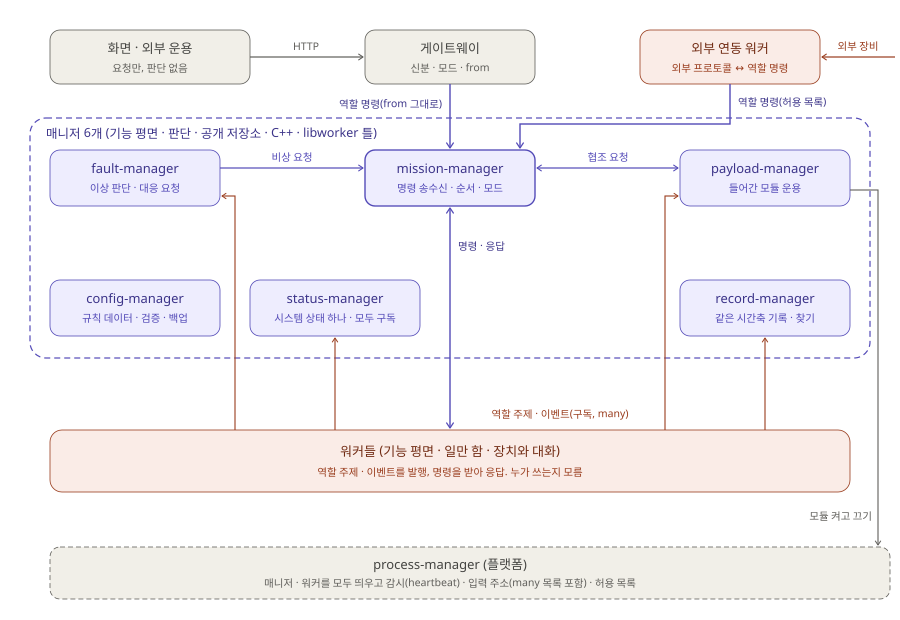
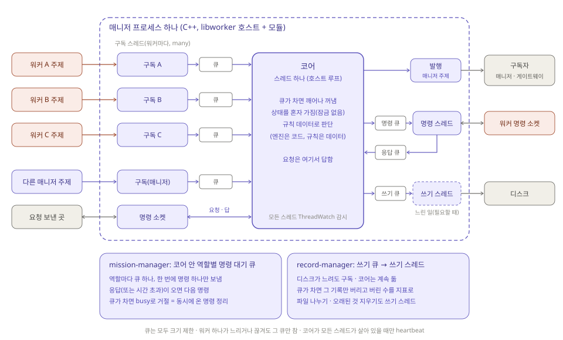

# 매니저 공통 설계

| 항목 | 내용 |
|---|---|
| 상태 | 확정(2026-11-24, design.md 0.62). 구현은 record-manager부터(1장 ④) |
| 대상 | 기능 평면의 매니저 6개(config, status, fault, record, mission, payload)가 함께 따르는 틀: 어디에 두고, 어떻게 뜨고, 무엇을 받고 내보내고, 명령 길이 어떻게 바뀌나 |
| 하지 않는 것 | 매니저 하나하나의 속 설계. 그것은 매니저 폴더의 `design.md`(워커와 같음) |
| 바탕 | design.md 4.1·원칙 11~18, `docs/layers.md`(층·규칙·책임), `docs/process-manager.md`, `docs/command-path.md`, 워커 틀(design.md 6.6.3·6.6.7) |

## 1. 정한 것

| # | 정한 것 | 뜻 |
|---|---|---|
| ① | 6개 모두 공개 저장소(플랫폼) | 어느 시스템에나 들어가는 기본 매니저다. 시스템마다 다른 것은 **규칙 데이터**(프로파일)뿐이고, 그것만 프로젝트 저장소에 둔다 |
| ② | process-manager가 띄우고 감시 | 워커와 같은 프로세스 계약(9장: spawn·heartbeat·exit code). 기본 탑재(`builtin`)로 늘 자동 시작 |
| ③ | 역할 명령은 게이트웨이 → mission-manager → 워커 | 명령 입구가 한 곳이어야 동시 명령을 정리할 수 있다. mission-manager가 생기기 전까지는 지금처럼 게이트웨이가 워커로 바로 보낸다 |
| ④ | 만드는 순서 | record → status → mission → payload → fault → config |

순서 ④의 이유: record는 아무것도 바꾸지 않고 받기만 해서 틀(구독·기록)을 시험하기 좋다. status는 record와 같은 입력을 쓰고 다른 매니저가 모두 구독한다. mission은 명령 길을 바꾸는 큰 단계라 받는 쪽 둘이 선 다음에. payload·fault는 mission에 요청하므로 그 뒤. config는 그동안 process-manager 프리셋(6.3.1)이 대신한다.

## 2. 매니저 하나의 모양

**매니저는 워커와 같은 틀로 만든다.** libworker `worker::Host` + 모듈(design.md 6.6.3), 병렬 파이프라인(입출력 스레드 + 크기 제한 큐 + 상태를 혼자 가진 코어, 6.6.1). 새 틀을 만들지 않고 다른 점만 둔다.



| | 워커 | 매니저 |
|---|---|---|
| 폴더 | `workers/<이름>/`(프로젝트가 더함) | `managers/<용도>/`(공개 저장소, `monitor/`처럼 플랫폼 부품) |
| type 선언 | `prepare.sh`가 만드는 조각 | 폴더의 `worker-types.json`, `builtin` + `"kind": "manager"` |
| 시작 | `autostart`는 사람이 고름 | 늘 자동 시작. 운용 모드에서는 정지·설정 바꾸기를 막음(개발 모드에서만) |
| 받는 것 | 장치 데이터, 명령 | 역할 주제(구독), 위층 요청, 앞선 매니저의 요청 |
| 내보내는 것 | 역할 주제, 명령 응답 | 매니저 주제(`io/<용도>.json`), 소유한 역할의 명령(mission만) |
| 아는 것 | 자기 장치 | **역할 정의만.** 워커 이름·type·장치 종류를 모른다(원칙 12) |
| 규칙 | 설정(스키마 폼) | 규칙 데이터 = 매니저 설정. 매니저 폴더의 `config_schema`로 검사하고, 프로젝트는 프로필로 덮어쓴다(6.12). config-manager가 생기면 그쪽이 관리·검증·백업 |
| 언어 | 성능에 따라 | C++(원칙 10, 늘 상주) |
| 화면 | 워커 목록에 보임 | 워커 목록에서 빠지고(지금 `builtin`과 같음) 워크스페이스 화면의 "매니저" 칸에 상태가 보임 |

매니저 안 구조(모든 매니저 같은 꼴):



매니저는 여러 워커를 한 번에 받으므로 큐가 중심이다. 워커마다 구독 스레드와 크기 제한 큐를 따로 두어, 워커 하나가 느리거나 끊겨도 그 큐만 차고 다른 워커·코어는 그대로 돈다.

| 부분 | 스레드 | 하는 일 |
|---|---|---|
| 입력 | 구독마다 `Subscriber`(libworker) | 역할 주제·매니저 주제를 받아 큐로. 상대가 없거나 다시 시작해도 기다렸다 다시 붙음 |
| 코어 | 호스트 루프 하나 | 상태를 혼자 가짐. 규칙 데이터로 판단(엔진은 코드, 규칙은 데이터, 원칙 18) |
| 출력 | 발행(`Publisher`), 명령 보내기(`CommandClient`) | 매니저 주제 발행, 소유한 역할 명령·다른 매니저에 요청 |
| 느린 일 | 매니저마다 필요할 때(예: record의 파일 쓰기) | 코어를 막지 않게 큐 뒤로 |

매니저마다 다른 곳:

| 매니저 | 큐 | 하는 일 |
|---|---|---|
| mission | 코어 안 역할별 명령 대기 큐 | 역할마다 한 번에 명령 하나만 보내고, 응답(또는 시간 초과)이 오면 다음. 큐가 차면 `busy`로 거절. "동시에 온 명령 정리"의 실체 |
| record | 쓰기 큐 → 쓰기 스레드 | 디스크가 느려도 구독·코어는 계속. 큐가 차면 그 기록만 버리고 버린 수를 지표로 |

## 3. 데이터가 흐르는 길

| # | 출발 → 도착 | 무엇 | 통로 |
|---|---|---|---|
| 1 | 워커 → status·record·fault·payload | 역할 주제, 이벤트 | 워커 스트림 소켓, 매니저가 구독 |
| 2 | process-manager → status·payload | 워커 프로세스 상태(running·failed 등) | Manager API 구독(읽기) |
| 3 | status → 다른 매니저 전부, 게이트웨이 | 시스템 상태 하나 | status 스트림 소켓 |
| 4 | 화면·외부 → 게이트웨이 → mission | 역할 명령, 운용 조작 | mission 명령 소켓(보낸 곳 `from` 그대로) |
| 4a | 외부 장비 → 외부 연동 워커 → mission | 외부 프로토콜을 역할 명령으로 바꾼 것. 결과·상태는 주제를 구독해 외부 프로토콜로 돌려줌 | mission 명령 소켓(허용 목록 `commanders`에 있어야 함) |
| 5 | mission → 워커 → mission → 게이트웨이 | 명령과 응답 | 워커 명령 소켓 |
| 6 | fault → mission | 비상 대응 요청 | mission 명령 소켓 |
| 7 | mission ↔ payload | 명령에 필요한 모듈 켜기, 모듈 상태 묻기 | 서로의 명령 소켓 |
| 8 | payload → process-manager | 모듈 켜고 끄기 = 워커 시작·정지 | Manager API(쓰기) |
| 9 | 매니저 → record | 매니저 주제(판단 결과도 기록) | 매니저 스트림 소켓 |

명령 입구는 게이트웨이(HTTP)와 외부 연동 워커(외부 프로토콜) 둘이고, 다른 프로토콜이 필요하면 외부 연동 워커를 더 만든다. 입구가 몇이든 판단하는 곳은 mission 하나이고, 운용 모드 제한도 똑같이 받는다. 매니저 코드는 바뀌지 않는다.

요청 방향은 이것뿐이다(원칙 13). 역방향·순환은 금지. status는 명령하지 않는다.

## 4. 명령 길이 바뀌는 것 (③)

| | 지금 | mission-manager가 생긴 뒤 |
|---|---|---|
| 역할 명령·운용 조작 | 게이트웨이 → 워커 | 게이트웨이 → mission → 워커 |
| 읽기(`get_status`, `"read": true`) | 게이트웨이 → 워커 | 그대로(판단이 없음) |
| 워커 전용 명령(개발 모드) | 게이트웨이 → 워커 | mission을 거치되 운용 조건 검사는 건너뜀(원칙 17) |
| 관리 조작(설정·시작/정지) | 게이트웨이 → process-manager | 그대로 |
| 외부 연동 워커의 명령 | 외부 연동 워커 → 워커 | 외부 연동 워커 → mission → 워커 |
| 허용 목록(`peers.json`) | 연결 선언 `commanders` | mission-manager가 모든 역할 명령에 자동으로 들어감(플랫폼 기본). 다른 곳의 직접 명령은 `command_guard`가 막는 단계(`enforce`)로 |

- **게이트웨이가 고르는 법:** type 선언에 `"kind": "manager"`이고 명령 입구를 맡는다고 적힌 매니저(mission)가 **설치되어 있으면** 그쪽으로, 없으면 지금처럼 바로. 게이트웨이는 판단하지 않고 표대로 보낸다
- **보낸 곳은 잃지 않는다:** mission이 워커에 보낼 때 원래 보낸 곳을 같이 넘긴다. 워커 기록에는 `from: mission-manager`와 원래 보낸 곳(`origin: screen` 등)이 둘 다 남는다

## 5. 매니저가 받는 입력: 여러 워커를 한 번에

워커의 입력(`io.json` `uses`)은 입력 하나에 상대 하나다. 매니저는 "이 역할을 내보내는 워커 **전부**"를 받아야 한다(status·record는 거의 모든 역할). 그래서 입력에 하나를 더한다.

```json
{"uses": {"camera": {"from": "camera", "version": "1.0", "many": true},
          "streams": {"from": "*", "many": true}}}
```

- `many: true`: process-manager가 그 역할을 내보내는 워커를 모두 찾아(버전·주제 검사를 통과한 것만, `"from": "*"`이면 자기 말고 모든 워커) 주소 목록을 넣어 준다. 목록은 입력 파일(`run/inputs/<id>.json`)의 **`"many"` 칸**에 따로 둔다: `{"inputs": {...}, "many": {"camera": [{"worker": "cam1"}, {"worker": "cam2"}]}}`. `"inputs"` 칸에 목록을 넣으면 예전 libworker가 파일 전체를 버리기 때문이다(구현 0.64)
- 워커가 늘거나 줄면 매니저를 다시 시작하지 않고 파일만 다시 쓴다. 매니저는 1 s마다 파일이 바뀌었나 보고 구독을 더하고 뺀다(record-manager). 상태 `inputs`에는 `how: "many"`, `from: [목록]`, 검사에서 뺀 것은 `skipped`
- libworker 0.13 `worker::ManyInputs`가 읽는다(`refresh()`로 바뀌었나 봄). process-manager 구독은 `worker::ManagerSubscription`(`worker/manager_link.hpp`)
- 매니저는 process-manager가 만들어 주는 읽기 전용 소켓 `manager-<id>.sock`으로 구독한다(환경 변수 `WORKSPACE_MANAGER_SOCKET`, 쓰기 op는 `forbidden`, 0.66)
- 매니저는 목록의 워커마다 `Subscriber`를 하나씩 만든다. 받은 줄에는 어느 워커에서 왔는지 붙는다
- 워커 쪽은 바뀌는 것이 없다(구독자가 하나 더 붙을 뿐)

## 6. 첫 판 범위

매니저마다 처음 만드는 것만. 자세한 것은 그 매니저의 `design.md`에서 같이 정한다.

| 매니저 | 첫 판 | 나중 |
|---|---|---|
| record | 고른 역할 주제·이벤트를 받아 같은 시간축(`t_mono_ns`)으로 파일에 기록, 파일 나누기·오래된 것 지우기, 시간 범위로 찾기·내보내기 | 저장 방식(내장 DB 등), 암호화. 영상 녹화는 지금처럼 replay 워커 |
| status | 역할 주제 + 워커 프로세스 상태 → 시스템 상태 하나(건강·동작 상태·링크), 주제로 발행 | 규칙으로 동작 상태 정의 |
| mission | 명령 입구(게이트웨이·외부 연동 워커 → 워커), 역할마다 한 번에 명령 하나(먼저 온 것이 끝나야 다음), 응답 돌려주기 | 우선순위 규칙, 모드 전환 허가, 임대 |
| payload | 모듈 목록(역할을 내보내는 워커와 상태), 모듈 켜고 끄기(워커 시작·정지 요청) | 모듈 묶어 쓰기, 빠른 제어 고리 켜고 끄기 |
| fault | 규칙(조건 → 심각도·대응)으로 이상 목록, 대응은 mission에 요청 | 격리, 단계별 대응 |
| config | 규칙 데이터 관리·검증·백업·되돌리기 | 사용자·권한·키, 소프트웨어 버전 |

## 7. 끊겼을 때

| 상황 | 어떻게 | 복구 |
|---|---|---|
| 매니저 하나가 죽음·멈춤 | process-manager가 다시 켬(워커와 같음). 다른 매니저는 그 입력만 `link` 0으로 보고하고 계속 | 자동 |
| status가 죽음 | 다른 매니저는 마지막 상태를 "오래됨"으로 표시하고 계속 | 자동 |
| mission이 다시 켜지는 중 | 역할 명령은 실패로 답함(`unavailable`). 바로 보내면 규칙을 건너뛰므로 우회하지 않음 | mission이 뜨면 다음 명령부터 |
| 워커가 늘거나 줄어듦 | `many` 입력 목록만 다시 알림 | 자동 |
| record의 디스크가 느림·가득 | 그 기록만 버리고 버린 수를 지표로, 다른 매니저는 영향 없음 | 공간이 생기면 다음부터 |

## 8. 시험

| 무엇 | 어떻게 |
|---|---|
| 매니저 코어 | 워커 모듈 코어처럼 단위 시험(가짜 시계·가짜 입력) |
| 틀 | `dev/check.sh`가 매니저 폴더도 빌드·시험·TSan(워커와 같은 단계) |
| 명령 길 | 게이트웨이 수락 시험: mission이 없을 때 바로, 있을 때 거쳐서, 다시 켜지는 중이면 `unavailable` |
| `many` 입력 | process-manager 수락 시험: 역할을 내보내는 워커 둘 → 목록 둘, 하나 멈춤 → 목록 하나 |
| 일반 | 시험 데이터에 특정 장비 용어를 쓰지 않음(카메라·센서 같은 일반 이름, 예시용 제품 이름은 됨) |

## 9. 함께 정한 것 (2026-11-24)

| # | 항목 | 정한 것 |
|---|---|---|
| 1 | 폴더 위치 | `managers/<용도>/`(최상위, `monitor/`처럼) |
| 2 | 운용 모드에서 매니저 정지 | 막음(개발 모드에서만 정지·설정 바꾸기) |
| 3 | 여러 워커 입력 | `uses`에 `many: true`(5장) |
| 4 | mission이 다시 켜지는 중 명령 | `unavailable`로 실패(우회 안 함) |
| 5 | 원래 보낸 곳 남기기 | `from`(지금 보낸 프로세스) + `origin`(처음 보낸 곳) |
| 6 | 허용 목록 | mission은 자동으로 모든 역할 명령에. 연결 선언에 적을 필요 없음 |
