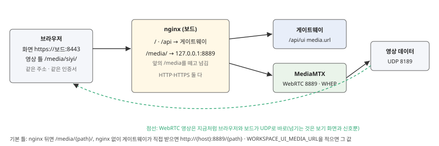

# 영상 넘기기: 화면과 같은 주소로 영상 열기

| 항목 | 내용 |
|---|---|
| 상태 | 구현(2026-11-25, 0.85). 9장 초안 값대로 |
| 대상 | 화면의 영상 틀(iframe)이 여는 MediaMTX WebRTC 주소. nginx 앞단, 게이트웨이 `/api/ui` `media.url` |
| 왜 | 화면을 HTTPS로 열면(`docs/https.md`) 영상 주소 `http://<보드>:8889/<경로>`가 섞인 내용(mixed content)으로 막힌다. 화면과 다른 포트라 인증서도 따로 받아들여야 한다. SSH 터널로 화면만 넘기면 영상 주소(8889)는 터널 밖이다 |
| 바탕 | `docs/gateway.md` 2장(nginx 앞단), `docs/https.md`, `ui/README.md` "영상과 지연 측정" |

## 1. 구조

| 단계 | 하는 일 |
|---|---|
| ① nginx `/media/` | `location ^~ /media/` → `http://127.0.0.1:8889/`(앞의 `/media`를 떼고). HTTP·HTTPS 둘 다, 같은 인증서. 버퍼링 없음 |
| ② 기본 영상 주소 | 게이트웨이가 nginx 뒤면(`WORKSPACE_GATEWAY_TCP=0`) 기본 틀을 **`/media/{path}/`**로. `/api/ui`는 요청이 온 주소(Host, `X-Forwarded-Proto`)로 완전하게 돌려준다(`https://<보드>:8443/media/{path}/`): 별도 UI(다른 주소에서 띄운 화면)가 읽어도 이 보드로 간다(보드에서 상대 주소를 돌려줬더니 별도 UI가 자기 주소로 풀어 영상이 끊김, 2026-11-25). nginx 없이 게이트웨이가 직접 받으면 지금처럼 `http://{host}:8889/{path}` |
| ③ 영상 틀 | MediaMTX 보기 화면(`/<경로>/`)이 신호(WHEP)를 상대 주소(`whep`)로 보내므로 `/media/<경로>/whep`도 같은 길로 간다. 세션 주소(응답 `Location: /<경로>/whep/<id>`, 절대 경로)는 nginx `proxy_redirect`로 `/media/` 아래로 바꿔 PATCH·DELETE도 같은 길로(빠뜨렸더니 보드에서 DELETE가 게이트웨이로 가 404, 2026-11-25) |
| ④ 영상 데이터 | WebRTC 영상 자체는 지금처럼 UDP(8189)로 바로(브라우저 ↔ 보드). 넘기는 것은 화면과 신호뿐 |

- `WORKSPACE_UI_MEDIA_URL`을 적어 두면 그 값을 그대로 쓴다(원격 미디어 서버 등). 비우면 위 자동
- 설정 탭(화면 › 영상 주소 틀)에서 비우면 자동으로 돌아간다
- 화면 로그인(`WORKSPACE_AUTH=on`, 로그인을 넣은 제품)을 켜면 `/media/`도 로그인한 사람만(0.86, `docs/media-auth.md`): nginx `auth_request`로 게이트웨이 `/api/auth/check`에 묻는다. MediaMTX 포트(8554·8889·8888·8890)를 바로 여는 프로그램도 게이트웨이가 판정(MediaMTX `authMethod: http`). 꺼져 있으면 예전처럼 열림

## 2. 설정

| 키 | 뜻 | 기본 |
|---|---|---|
| `WORKSPACE_UI_MEDIA_URL` | 영상 주소 틀(`{host}`·`{path}`) | 비움 = 자동(nginx 뒤 `/media/{path}/`, 아니면 `http://{host}:8889/{path}`) |
| `RENDER_MEDIA`(render.sh) | `/media/`가 넘길 곳 | `127.0.0.1:8889`, `off`면 `/media/` 없음 |
| `RENDER_AUTH`(render.sh) | `/media/`에 로그인 확인(`docs/media-auth.md`) | `apply.sh`가 시작 셸이 정한 `WORKSPACE_AUTH=on`이면 `on` |

## 3. 시험

| 무엇 | 어떻게 |
|---|---|
| nginx | `/media/x/` → 가짜 미디어 서버 `/x/`, POST(WHEP) 통과, HTTPS에서도 |
| 게이트웨이 | nginx 뒤면 `/api/ui` `media.url` = `/media/{path}/`, 아니면 예전 값. 적어 둔 값은 그대로 |
| 보드 | HTTPS로 화면을 열고 siyi 영상이 나오는지 |

## 9. 함께 정할 것 (초안)

| # | 항목 | 초안 |
|---|---|---|
| 1 | 넘기는 길 | `/media/` |
| 2 | 기본 | nginx 뒤면 자동으로 `/media/{path}/` |
| 3 | 로그인 | ~~`/media/`는 로그인과 상관없이~~ → 정함(0.86): 로그인을 켜면 `/media/`도 로그인한 사람만, MediaMTX 포트도 게이트웨이가 판정(`docs/media-auth.md`) |
