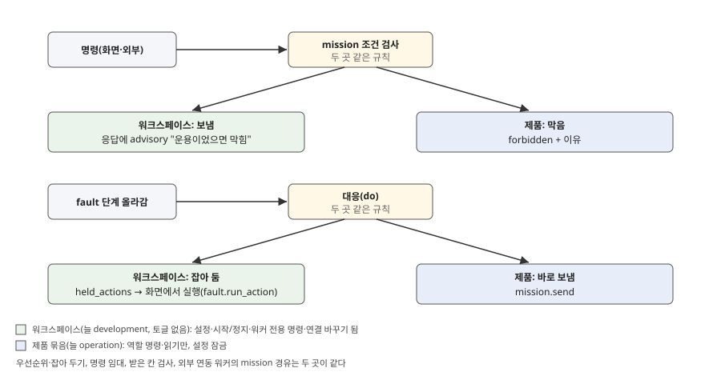

# 모드: 워크스페이스는 늘 개발, 제품은 늘 운용

| 항목 | 내용 |
|---|---|
| 상태 | 구현(2026-11-25, 0.79). 9장 초안 값대로. 제품 동작 미리 보기는 시작할 때 `WORKSPACE_ACCESS_MODE=operation`(시험·보드 확인용) |
| 바꾸는 것 | 운용/개발 모드를 **화면 토글**에서 **배포 형태**로. 워크스페이스(개발 작업대)는 늘 개발, 제품 묶음(장비 탑재, design.md 11.4)은 늘 운용. 토글이 없어진다 |
| 규칙 | 명령 조건·fault 대응 같은 운용 규칙은 두 곳에서 **똑같이 검사**한다. 워크스페이스는 막지 않고 "운용이었으면 막힘"을 알리고, 제품은 막는다 |
| 바탕 | design.md 원칙 17(운용 모드 기본·개발 모드 토글, 0.40·0.55), `docs/command-path.md` 3장(명령 종류와 모드), `managers/mission/conditions.md`, `managers/fault/escalate.md`, design.md 11.4(제품 묶음) |
| 고치는 문서 | design.md 원칙 17, `docs/command-path.md` 3장, mission·fault 설계서의 모드 부분 |

## 1. 왜

- 워크스페이스는 워커를 만들고 시험하는 작업대이고, 장비에는 제품 묶음을 싣는다(design.md 4장 "장비에는 제품 묶음"). 작업대 안에 운용 모드를 두면 시험할 때마다 개발 모드로 바꾸고, 재시작하면 다시 운용으로 돌아가 또 바꿔야 한다
- 개발 모드에서는 명령 조건을 건너뛰고 fault 대응을 하지 않아서, 규칙을 장비에 싣기 전에 보드에서 볼 방법이 없었다. 규칙을 시험하려고 규칙을 껐다 켜는 것은 번거롭고, 다시 켜는 것을 잊으면 그대로 실린다
- 모드가 정하는 것을 "누가 무엇을 할 수 있나"(권한)로 좁히고, 규칙(판단)은 어디서나 같게 돈다

## 2. 정한 것



| | 워크스페이스(개발 작업대) | 제품 묶음(장비) |
|---|---|---|
| 모드(`access_mode`) | `development` 고정 | `operation` 고정 |
| 정하는 곳 | 시작 셸: 제품 묶음이 아니면 개발 | 제품 묶음 표시(게이트웨이 `product`) |
| 바꾸기 | 없음(토글·`PUT /mode` 없앰) | 없음 |
| 설정·시작/정지·워커 전용 명령·연결 바꾸기 | 됨 | 안 됨(`forbidden`, 지금 운용 모드와 같음) |
| 역할 명령(장비 조작)·읽기 | 됨 | 됨 |
| 명령 허용 목록(누가 누구에게, `command-path.md` 4장) | 지금 개발 모드와 같음 | 지금 운용 모드와 같음 |

- 값 이름 `development`·`operation`은 그대로 쓴다(`system` 이벤트, `peers.json` `mode`, 게이트웨이 `GET /mode`). 받는 쪽 코드는 바뀌지 않는다
- 화면 위 띠에는 모드 배지 대신 **"개발"**(워크스페이스) 또는 **"제품"** 표시만 둔다. 누를 것이 없다

## 3. 규칙은 두 곳에서 같게: 워크스페이스는 알리고, 제품은 막는다

| 규칙 | 워크스페이스 | 제품 |
|---|---|---|
| 명령 조건(`mission.conditions`) | 검사한다. 안 맞으면 **보내되** 응답에 `advisory`를 붙인다(아래). 이벤트 `command_would_block`(notice), 지표 `would_block` | 안 맞으면 `forbidden`(지금과 같음) |
| fault 대응(`do`, 단계 `stages[].do`) | 이상·단계·심각도는 그대로 올린다. 대응은 **보내지 않고** 이벤트 `fault_action_held`(notice, 할 대응 담음), 상태 `held_actions`에 남긴다. 화면에서 하나씩 실행할 수 있다(`fault.run_action`) | 대응을 바로 mission에 보낸다(지금 운용 모드와 같음) |
| 우선순위·잡아 두기(`mission.priority`) | 그대로(같은 동작을 시험해야 함) | 그대로 |
| 명령 임대(`lease_ms`) | 그대로 | 그대로 |
| 받은 칸 검사(`input_check`) | 그대로(알리기만) | 그대로 |
| 외부 연동 워커 → mission 경유(`via`) | 그대로 | 그대로 |

**`advisory` 모양** (명령 응답 겉에, 응답 `data`는 그대로):

```json
{"ok": true, "data": {...}, "advisory": {"code": "forbidden", "message": "condition takeoff_ready: flight-control.armed = false (need true)", "condition": "takeoff_ready"}}
```

- 워커의 응답 형식(9.6)은 바뀌지 않는다. mission이 돌려줄 때만 붙이고, 게이트웨이·화면은 있으면 보여 준다(화면: 결과 옆에 노란 "운용이었으면 막힘")
- 조건을 모르는 값(`unknown: block`)도 같다: 워크스페이스는 알리고 보낸다

**fault 대응 실행(`fault.run_action`, 워크스페이스에서만)**: 인자 `{"id": "<이상 id>", "stage": <단계 번호, 없으면 처음 대응>}`. 잡아 둔 대응을 그대로 mission에 보낸다. 제품에서는 대응이 저절로 나가므로 이 명령은 `forbidden`. 이상이 내려가면 잡아 둔 대응은 지운다.

## 4. 무엇이 바뀌나

| 어디 | 지금 | 바꾼 뒤 |
|---|---|---|
| 게이트웨이 | 모드를 메모리에 두고 `PUT /mode`로 바꿈, 시작하면 운용 | 시작할 때 정함: 제품이면 운용, 아니면 `WORKSPACE_ACCESS_MODE`(기본 `development`). `PUT /mode` 없앰(405), `GET /mode`는 `{"mode", "since", "by": "workspace"|"product", "fixed": true}`. mission 응답의 `advisory`는 머리 `X-Workspace-Advisory`(오류 응답이면 본문에도). process-manager에 알리는 것(`set_access_mode`, 다시 붙으면 맞춤)은 그대로 |
| process-manager | 게이트웨이가 알려 준 값으로 쓰기 op 검사·`peers.json` | 그대로(값이 바뀌지 않을 뿐) |
| libworker | `peers.json` `mode`대로 명령 검사 | 그대로 |
| mission-manager | 개발 모드면 조건 검사를 건너뜀 | 개발이면 검사하고 `advisory`를 붙여 보냄. 지표 `would_block`, 이벤트 `command_would_block`. 역할 정의 `mission` 1.3 |
| fault-manager | 운용 모드에서만 대응을 보냄 | 개발이면 잡아 둠(`held_actions`, `fault_action_held`), 명령 `fault.run_action`. 역할 정의 `fault` 1.2 |
| 화면 | 운용/개발 토글, 머리 배지 "운용" | 토글 없음, "개발"·"제품" 표시. 명령 결과에 `advisory`, 패널 "워크스페이스 › 개요"의 이상 칸에 잡아 둔 대응과 실행 버튼(`ui/workspace-screen.md`) |
| 제품 묶음 | 제품 화면, 설정 잠금 | 그대로 + 모드 `operation` 고정 |

## 5. 하지 않는 것

- 워크스페이스에서 "운용처럼 막아 보기" 스위치. 막히는 것을 보려면 `advisory`로 충분하고, 실제로 막아야 하면 제품 묶음으로 띄운다(같은 보드에서 제품 묶음을 풀어 시험)
- 사용자 역할(로그인 `admin`·`operator`)은 그대로. 역할은 사람의 권한이고 모드는 배포 형태다

## 6. 시험

| 무엇 | 어떻게 |
|---|---|
| 게이트웨이 | 제품이면 `operation`, 아니면 `development`. `PUT /mode` 405. 다시 붙을 때 process-manager에 같은 값 |
| mission | 개발에서 조건 안 맞음 → 보내고 `advisory`·`would_block`·이벤트, 운용에서 → `forbidden`. 우선순위·임대는 두 모드 같음 |
| fault | 개발에서 단계 올라감 → 대응 잡아 둠·이벤트, `fault.run_action`으로 보냄, 이상 내려가면 지움. 운용에서 → 바로 보냄, `run_action`은 `forbidden` |
| 화면 | 토글 없음, 표시, `advisory` 보임 |
| 보드 | 워크스페이스로 띄워 조건·대응이 알림으로만 나오는지, 제품 묶음으로 띄워 막히는지 |

## 9. 함께 정할 것 (초안)

| # | 항목 | 초안 |
|---|---|---|
| 1 | 응답에 붙이는 칸 이름 | `advisory` `{code, message, condition}` |
| 2 | 이벤트·지표 이름 | `command_would_block`·`would_block`(mission), `fault_action_held`·`held_actions`(fault) |
| 3 | 대응 직접 실행 | `fault.run_action {id, stage?}`, 워크스페이스에서만 |
| 4 | `PUT /mode` | 없앰(405). `GET /mode`는 남김(`fixed: true`) |
| 5 | 버전 | 역할 정의 `mission` 1.3, `fault` 1.2. libworker·공통 정의는 그대로 |

## 로그인 (0.90)

| 배포 형태 | 로그인 | 정하는 곳 |
|---|---|---|
| 워크스페이스(개발) | **없음.** 늘 끔 | 시작 셸(`workspace-start.sh`)이 `WORKSPACE_AUTH=off`로 넘김. `workspace.env`에 적어도 읽지 않고 로그 한 줄. 설정 탭에도 칸 없음 |
| 제품 | **빌드할 때 고름**(기본 없음) | `dev/build_product.py --login on\|off`, 화면 빌드 창 "로그인", product.json `"login": true`. 묶음의 `PRODUCT_LOGIN`을 시작 셸이 읽음 |

- 로그인을 넣은 제품: 화면·REST·영상(`/media/`, MediaMTX 포트) 모두 로그인한 사람만(`docs/media-auth.md`). 설치가 첫 계정 `admin`과 원격 토큰을 만들어 한 번 보여 준다
- 게이트웨이는 받은 값만 따른다(정책은 시작 셸 한 곳). 그래서 시험은 게이트웨이에 `WORKSPACE_AUTH=on`을 직접 넘겨 로그인 동작을 본다
- 0.89까지: 제품은 늘 켬, 워크스페이스는 설정 탭에서 켜고 끌 수 있었다. "개발 상태에는 로그인이 없고, 넣는 것은 제품 빌드의 선택"으로 바꿈
