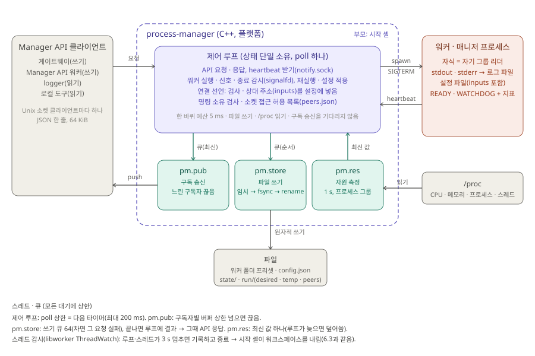

# process-manager 설계

| 항목 | 내용 |
|---|---|
| 상태 | 확정(2026-11-20, design.md 0.46 6.3). 구현 중(6장 순서) |
| 대상 | 플랫폼 블록 process-manager(design.md 4.1): 매니저·워커 프로세스를 띄우고 감시하고, 누구에게 붙을지 알려 준다 |
| 바꾸는 것 | Python `manager/workspace_manager`(약 2,000줄)를 C++로 다시 만든다(원칙 10: 상주 블록은 C++). 하는 일·API·파일은 그대로 두고, 4.1의 새 역할을 더한다 |
| 바탕 | design.md 6.1~6.3(지금 Manager), 6.6.7.3~6.6.7.5(연결 선언, 지금까지 설계만), 9장(프로세스 계약), 원칙 13(명령 소유) |

## 1. 하는 일과 품질 목표

**한 줄로:** 보드 위의 프로그램(워커·매니저)을 켜고, 살아 있는지 보고, 죽으면 다시 켜고, 서로 누구에게 붙을지 알려 주는 관리인. 기능(비행·짐벌 등)은 모르고 프로그램이 도는지만 본다.

| 하는 일 | 내용 | |
|---|---|---|
| ① 켜고 끄기 | 부팅 때 자동 시작 워커를 켬, 시작·정지 요청 처리 | 지금과 같음 |
| ② 살아 있는지 보기 | heartbeat가 끊기거나 READY가 늦으면 멈춘 것으로 판단 | 지금과 같음 |
| ③ 다시 켜기 | 죽거나 멈추면 끄고 다시 켬, 연달아 죽으면 간격을 늘림 | 지금과 같음 |
| ④ 설정 넘겨주기 | 프리셋으로 설정 파일을 만들어 켤 때 넘김, 바꾸면 다시 켜거나 SIGHUP | 지금과 같음 |
| ⑤ 상태 알려주기 | 워커마다 상태·CPU·메모리를 게이트웨이·logger에 알림 | 지금과 같음 |
| ⑥ 누구에게 붙을지 알려주기 | 연결 선언을 읽어 검사하고, 받는 워커를 켤 때 상대 주소(`inputs`)를 설정에 넣어 줌 | 새로 |
| ⑦ 명령 권한 표 만들기 | 연결 선언의 명령 소유로 "이 워커에는 누가 명령해도 되나" 표(`peers.json`)를 만들어 둠 | 새로 |

| 하지 않는 일 | 누가 |
|---|---|
| 통로를 만들거나 데이터·명령을 나르기 | 내보내는 워커가 통로(스트림 소켓, 명령 소켓, 프레임 버스)를 열고 받는 워커가 직접 붙는다. process-manager는 상대 이름만 알려 준다 |
| 기능 판단(모드를 바꿔도 되나 등) | 매니저 |
| 명령을 막기 | 각 워커가 권한 표를 보고 막는다(⑦은 표만 만듦) |
| 화면 명령 중계 | 게이트웨이 |

**워커는 process-manager에 기대지 않는다(원칙 4).** 워커가 받는 것은 자기 설정 파일의 값(`inputs`, 권한 표 위치)뿐이다. 워크스페이스 안에서는 process-manager가 채우고, 밖(단독 실행, 다른 시스템)에서는 사람이 설정에 적는다. 값이 없으면 단독 실행 기본값으로 돈다: `inputs`가 없으면 그 입력은 안 이어진 것(6.6.7.3), 권한 표 위치가 없으면 막지 않고 모든 명령을 받는다.


| # | 목표 | 기준 | 확인 |
|---|---|---|---|
| ① | 바꿔 끼워도 아무도 모름 | Manager API(6.2)·heartbeat(9.5)·spawn 설정 파일(9.1)·데이터 폴더 파일 형식이 그대로. 지금 Python 시험(`manager/test_*.py`)이 C++ 실행 파일로 그대로 통과 | 수락 시험 |
| ② | 작다 | 메모리 5 MB 이하(지금 25.6 MB), 평상시 CPU 0.5% 이하(지금 4.0%) | 보드 실측 |
| ③ | 막히지 않는다 | 제어 루프 한 바퀴 5 ms 안. 파일 쓰기·/proc 읽기·구독 송신을 기다리지 않음 | 루프 시간 지표, 느린 구독자·느린 디스크 시험 |
| ④ | 상태를 잃지 않는다 | 파일은 임시 → fsync → rename. 같은 부팅에서 다시 시작하면 직전 실행 상태·임시 적용 값 복원(6.3.1 그대로) | 쓰는 중 강제 종료 시험 |
| ⑤ | 누구에게 붙을지 알려 준다 | 연결 선언을 읽어 검사하고 워커 설정의 `inputs`를 채운다(6.6.7.4). 통로·데이터는 워커끼리 | 단위·수락 시험 |
| ⑥ | 명령 길을 지킬 준비 | 명령 소유 검사, 소켓 접근 허용 목록(`peers.json`)을 만든다. 막는 것은 6단계(매니저가 생긴 뒤)에 켠다 | 단위 시험 |

## 2. 구조

### 2.1 실행 구조



**한눈에:** 프로세스 하나, 상태는 제어 루프 하나가 혼자 가진다. 기다릴 수 있는 일(구독 송신, 파일 쓰기, /proc 읽기)만 스레드 셋으로 빼고 크기 제한 큐로 잇는다. 워커(libworker 호스트)와 같은 모양이다.

| 스레드 | 하는 일 | 대기 상한 | 큐(크기, 넘칠 때) |
|---|---|---|---|
| 제어 루프 | API 소켓(클라이언트마다), heartbeat 받기(`notify.sock`), signalfd(SIGCHLD·SIGTERM·SIGHUP), 타이머. 워커 desired/actual 맞추기, spawn(posix_spawn, 새 프로세스 그룹), SIGTERM·SIGKILL, 재실행, 설정 적용(재시작 또는 SIGHUP), 연결 선언, 명령 소유 | poll = 다음 타이머(최대 200 ms), 한 바퀴 예산 5 ms | — |
| `pm.pub` | 구독(`subscribe`) 송신: 상태 변화 즉시, 변화 없으면 주기마다 | 막히지 않음(non-blocking) | 구독자별 버퍼 상한, 넘으면 그 구독자만 끊음 |
| `pm.store` | 파일 쓰기(프리셋, `config.json`, `state/workers/<id>.json`, `run/desired.json`·`temp_config.json`·`peers.json`) | 쓰기 하나 상한 2 s(넘으면 실패로 보고) | 64, 차면 그 요청 실패(`internal`). 끝나면 결과를 루프로 → 그때 API 응답 |
| `pm.res` | 1초마다 워커 프로세스 그룹의 CPU·메모리·프로세스·스레드 수(/proc) | 한 번에 상한 500 ms | 최신 값 하나(루프가 늦으면 덮어씀) |

- **스레드 감시:** libworker `ThreadWatch`. 루프나 스레드가 3 s 멈추면 기록하고 끝낸다 → 시작 셸이 워크스페이스를 내린다(6.3 지금과 같음)
- **로그:** 워커 stdout·stderr는 파일로 바로 리다이렉트(`state/logs/{id}.log`, 10 MiB × 3). 회전은 루프가 1 s마다 크기만 보고 rename(쓰기는 워커가 함)

### 2.2 코드 구성

```text
manager/                         (C++, CMake. Python 판은 옮기는 동안 manager/python/에 남김)
├─ core/        상태 단위(libworker 모름, 단위 시험): Supervisor(desired/actual·재실행·종료 판정), Types(type 선언 읽기),
│               WorkerFiles(프리셋·config.json), ConfigCheck(설정 스키마 검사, 6.10), Connections(연결 선언), Ownership(명령 소유·허용 목록)
├─ src/         바깥과 닿는 곳: ApiServer(소켓·권한·op 나눠 주기), Notify(heartbeat), Spawner(posix_spawn·신호·signalfd),
│               Store(pm.store), Resources(pm.res), Publisher(pm.pub, libworker Publisher), main.cpp
├─ lib/         사본: libworker(ThreadWatch·Queue·Publisher·JSON), nlohmann json
└─ test/        core 단위 시험(가짜 시계·가짜 spawn), 수락 시험은 manager/test_*.py를 C++ 실행 파일로
```

core는 워커의 모듈 코어처럼 시스템 호출을 모른다(시계·spawn·파일을 포트로 받음). 재실행 간격, 멈춤 판정, 설정 버전 같은 상태 규칙을 실제 프로세스 없이 시험한다.

## 3. 인터페이스

바꾸지 않는 것(지금 문서가 원본):

| 인터페이스 | 원본 | 비고 |
|---|---|---|
| Manager API | design.md 6.2 | op·인자·응답·오류 code·클라이언트별 소켓과 쓰기 권한 그대로 |
| heartbeat | 9.5 | `READY=1 …`, `WATCHDOG=1 id= progress= config_version= <지표>` |
| spawn | 9.1 | 실행 인자 `--config <파일>`, 설정 파일 모양, 환경 변수 |
| 데이터 폴더 | 6.3·6.3.1·11장 | `state/`, `run/`, `config/`, 워커 폴더 파일 형식 그대로(되돌리기 가능) |

더하는 것:

| 더하는 것 | 내용 |
|---|---|
| 연결 선언 | `<데이터>/config/connections.json`(6.6.7.4 그대로): 수집·자동 연결·검사·`config.inputs` 주입·상태 `inputs`. op `get_connections`, `set_connections`(쓰기). 주입하는 것은 상대 주소뿐이고, 붙는 것은 받는 워커가 한다. 프리셋에 직접 적은 `inputs`는 선언이 없을 때 그대로 |
| 명령 소유 | `connections.json`에 `"owners": {"<워커>.<역할>": "<매니저 id>"}`. 검사: 소유 매니저가 있는지, 그 역할의 명령을 쓴다고 `uses`에 적었는지, 한 역할에 하나뿐인지(겹치면 거절). 상태·`list`에 보임 |
| 소켓 접근 허용 목록 | `<데이터>/run/peers.json`: 프로세스 그룹 → 워커 id, 워커마다 명령을 보내도 되는 id(소유 매니저, 정비 모드면 게이트웨이). process-manager가 spawn 설정 파일의 호스트 키 `peers_file`로 위치를 넘긴다. 워커(libworker)는 `peers_file`이 있을 때만 접속한 상대를 `SO_PEERCRED` pid → 프로세스 그룹으로 알아보고 이 목록으로 판단한다. 없으면(단독 실행) 막지 않음 |
| 막기 단계 | 설정 `command_guard`: `off`(지금, 기본) → `warn`(어긋난 명령을 기록만) → `enforce`(6단계, 매니저가 생긴 뒤). 읽기 명령(`get_status`, 정의에 `"read": true`인 명령)은 늘 허용 |
| 운용·정비 모드 | 게이트웨이가 바꾸고(원칙 17) process-manager가 `peers.json`에 반영. 재시작하면 운용 |

## 4. 끊겼을 때

| 상황 | process-manager | 워커 | 복구 |
|---|---|---|---|
| 워커가 죽음·멈춤 | 6.3 표 그대로(재실행, 간격 늘림) | 그 워커만 | 자동 |
| 구독자(logger·게이트웨이)가 느림·끊김 | 그 구독자만 끊음 | 영향 없음 | 다시 붙으면 전체 상태부터 |
| 디스크가 느림·가득 | 그 쓰기 요청만 실패(API에 `internal`), 루프는 계속 | 영향 없음 | 공간이 생기면 다음 요청부터 |
| /proc 읽기 실패 | 자원 값 비움(그 워커만) | 영향 없음 | 다음 주기 |
| 연결 선언 오류 | 그 입력만 오류로 표시, 워커는 띄움 | 그 입력 link 0 | 선언을 고치면 그 워커만 다시 시작 |
| process-manager 자체가 죽음·멈춤 | — | 시작 셸이 워크스페이스를 내림(6.3) | 시작 셸. 같은 부팅이면 직전 상태 복원 |

## 5. 시험

| 무엇 | 어떻게 |
|---|---|
| 같은 동작(①) | `manager/test_schema.py`·`test_manager_api.py`·`test_notify_race.py`를 C++ 실행 파일로(환경 변수 `MANAGER_BIN`). Python 판과 C++ 판 둘 다 통과해야 옮김 |
| 상태 규칙 | core 단위 시험: 재실행 간격·연속 실패, 멈춤·READY 시간 초과, 설정 버전·적용 판정, live_keys → SIGHUP, 연결 자동·검사, 명령 소유 겹침 |
| 막히지 않음(③) | 느린 구독자(안 읽음), 느린 디스크(가짜 Store 지연), 워커 100개 자원 측정 중 루프 시간 |
| 동시성 | TSan(워커와 같은 `check.sh` 단계) |
| 자원(②) | 보드에서 Python 판과 나란히 측정 |

## 6. 옮기는 순서

1. core + 단위 시험(PC)
2. src + 수락 시험(Python 시험이 C++ 판으로 통과)
3. 시작 셸에 고르기(`WORKSPACE_MANAGER_IMPL=python|cpp`, 기본 python) → 보드에서 cpp로 실측·확인
4. 기본을 cpp로, 한 번 더 확인한 뒤 Python 판 삭제
5. 연결 선언·명령 소유·허용 목록(`command_guard: off`) → libworker가 `peers.json`을 읽게(`warn`까지)

## 7. 미결

| 항목 | 언제 |
|---|---|
| process-manager 자체 멈춤을 systemd 워치독으로도 볼지 | 구현 때 |
| 소켓을 process-manager가 미리 만들어 넘기기(6.6.7.6, 상대가 다시 시작해도 안 끊김) | 필요해지면 |
| 정의에 `"read": true`(읽기 명령 표시)를 언제 붙일지 | 6단계 전, 계약 규칙에 더함 |
