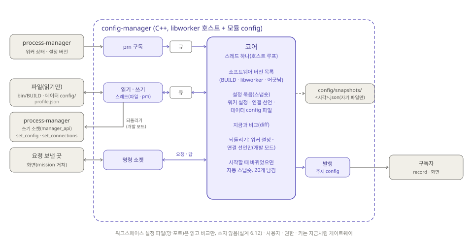

# config-manager 설계서 (기본 탑재 매니저)

| 항목 | 내용 |
|---|---|
| 상태 | 확정·구현(2026-11-24, 0.70). 단위·통합 시험. 보드 확인(2026-11-24): 버전 13개 모두 BUILD와 맞음, 자동 스냅숏 하나, libworker 목록 |
| 대상 | **설정과 소프트웨어 버전**: 지금 무엇이 깔려 있고 어떻게 설정됐나를 한곳에서 보이고, 설정 묶음(스냅숏)을 남기고 비교하고 되돌린다 |
| 실행 파일 | `bin/config-manager`(C++, libworker 호스트 + 모듈 `config`). 소스 `src/`, `lib/config/` |
| 바탕 | `docs/managers.md`(공통 틀), `docs/layers.md` 4장(config: 설정·프로파일, 검증·백업·되돌리기, 사용자·권한·키, 소프트웨어 버전), design.md 6.12(설정 체계: 워크스페이스 설정은 파일로만) |

매니저 공통 틀을 따른다. 지금 설정을 **쓰는** 곳은 이미 있다: 워커 설정·프리셋은 process-manager(검사·저장), 워크스페이스 설정은 파일(사람), 사용자·권한·키는 게이트웨이. config-manager는 그 일을 빼앗지 않고 **위에서 본다**: 버전 목록, 설정 묶음 남기기·비교·되돌리기. 되돌리기도 process-manager를 거친다(쓰는 곳은 한 곳).

## 1. 실행 구조

| 스레드 | 하는 일 | 큐(크기, 넘칠 때) |
|---|---|---|
| 코어(호스트 루프) | 버전 목록, 스냅숏 목록, 명령 받기, 주제·지표 | — |
| `config.pm` | process-manager 구독(워커 상태·`config_version`·`libworker`) | 256, 오래된 것 버림 |
| `config.io` | 막힐 수 있는 일: 파일 읽기(BUILD·데이터 `config/`), 스냅숏 쓰기·지우기, process-manager 요청(`get_config`·`get_connections`·되돌리기 `set_config`·`set_connections`) | 8, 차면 `busy` |
| `config.pub` | 주제 `config` | — |

## 2. 소프트웨어 버전 목록

| 무엇 | 어디서 |
|---|---|
| 플랫폼 실행 파일 | `manager/bin/BUILD`, `gateway/bin/BUILD`, `monitor/bin/BUILD`, `managers/*/bin/BUILD`: 소스 커밋·빌드 시각·sha256 |
| 워커 실행 파일 | `workers/*/workspace/bin/BUILD`(예전 워커는 `bin/BUILD`) |
| libworker | 워커마다 process-manager 상태의 `libworker`(heartbeat READY) |
| 어긋남 | 실행 파일의 sha256이 BUILD와 다름(손으로 바꿈·덜 받음) → 이벤트 `build_mismatch`(warning). 개발 빌드(`build/`)로 도는 것은 어긋남이 아니라 `dev_build: true` |
| 설치 기록 | 데이터 `config/profile.json`(어느 프로필, 언제, 워크스페이스 커밋) |

시작할 때와 10분마다 다시 읽는다(파일이 작음). sha256 계산은 `config.io`에서.

## 3. 설정 묶음(스냅숏)

| 담는 것 | 어디서 |
|---|---|
| 워커마다 지금 설정 | process-manager `get_config`(프리셋 이름, 지금 config, 임시 적용 여부, autostart) |
| 연결 선언 | process-manager `get_connections`(`connections`, `commanders`) |
| 워크스페이스 설정 파일 | 데이터 `config/`의 `workspace.env`·`manager.json`·`network.conf`·`mediamtx.yml` 내용(읽기만) |
| 버전 | 2장 목록 |

| 명령 | 하는 일 |
|---|---|
| `config.snapshot {"label"}` | 지금 것을 `<데이터>/config/snapshots/<시각>.json`에 남김(운용 조작: 바꾸는 것 없음) |
| `config.snapshots` | 남긴 것 목록(읽기) |
| `config.diff {"id"}` | 그 스냅숏과 지금의 다른 점(워커 설정 칸별, 연결 선언, 파일 줄별, 버전)(읽기) |
| `config.restore {"id", "workers": [...]?}` | 워커 설정·연결 선언을 그 스냅숏대로 다시 넣음(process-manager `set_config`·`set_connections`). **개발 모드에서만**(관리 조작, process-manager가 검사). 워크스페이스 설정 파일은 되돌리지 않음(6.12: 파일로만, 잘못 바꾸면 화면이 끊김) — diff로 보여 주기만 |

- **자동:** 시작할 때 마지막 스냅숏과 다르면 하나 남긴다(`label: "auto"`). 바뀐 것만 남겨 쌓이지 않게
- **남기는 수:** 20개(규칙 `keep`). 넘으면 오래된 `auto`부터 지움(이름 붙인 것은 지우지 않음)

## 4. 내보내는 것 (ICD)

| 무엇 | 내용 |
|---|---|
| 주제 `config` | `{"versions": {"<부품>": {"commit", "built", "ok", "dev_build"}}, "libworker": {"<워커>": "0.14.0"}, "mismatch": [...], "profile": {...}, "snapshots": [{"id", "label", "t"}], "drift": bool}` (`drift`: 마지막 스냅숏 뒤로 설정이 바뀜), 바뀌면 바로, 그대로면 10 s |
| 이벤트 | `build_mismatch`(warning), `snapshot_saved`(info), `config_restored`(notice) |
| 명령 | `config.versions`·`snapshots`·`diff`(읽기), `snapshot`(운용 조작), `restore`(관리, 개발 모드) |
| 지표 | `config_snapshots`, `config_mismatch`, `config_drift` |
| 규칙(설정) | `keep`(기본 20) |

## 5. 다른 곳에서 바꾸는 것

| 곳 | 바꾸는 것 |
|---|---|
| process-manager | 없음. config-manager는 `"manager_api": true`로 쓰기 소켓을 받고, 지금 규칙(운용 모드에서 Manager API 쓰기는 `forbidden`)이 되돌리기를 개발 모드로 묶는다 |
| 게이트웨이 | 없음(사용자·권한·키는 그대로 게이트웨이, 8장 5) |

## 6. 끊겼을 때

| 상황 | 어떻게 |
|---|---|
| process-manager가 없음 | 버전 목록(파일)은 됨, 스냅숏·되돌리기는 `unavailable` |
| 디스크가 가득 | 스냅숏 실패를 답과 이벤트로, 다른 일은 계속 |
| 되돌리기 중 일부 실패 | 워커별 결과를 모아 답함(되돌린 것은 되돌린 대로, 실패한 것은 이유와 함께) |

## 7. 시험

| 무엇 | 어떻게 |
|---|---|
| 코어 | 단위 시험: BUILD 읽기·sha 어긋남, 스냅숏 diff(칸별·줄별), 남기는 수(auto부터 지움) |
| 통합 | 가짜 process-manager(get_config·get_connections·set_config 기록) + 임시 워크스페이스 폴더 → 버전 목록, 스냅숏 남기기·diff·되돌리기 |
| 동시성 | TSan |

## 8. 함께 정한 것 (2026-11-24)

| # | 항목 | 정한 것 |
|---|---|---|
| 1 | 역할 | 쓰는 곳(process-manager·파일·게이트웨이)은 그대로, config는 위에서 봄: 버전 목록 + 스냅숏 남기기·비교·되돌리기 |
| 2 | 버전 목록 | 실행 파일 BUILD(커밋·sha256)와 워커 libworker, 어긋나면 이벤트 |
| 3 | 스냅숏 | 워커 설정·연결 선언·워크스페이스 설정 파일·버전. 시작할 때 바뀌었으면 자동, 20개 남김(auto부터 지움) |
| 4 | 되돌리기 | 워커 설정·연결 선언만, 개발 모드에서만(process-manager 쓰기 소켓). 워크스페이스 설정 파일은 diff로 보여 주기만 |
| 5 | 사용자·권한·키 | 이번 판은 그대로 게이트웨이(옮기려면 신분 확인 흐름을 다시 짜야 해서 따로 정함) |
| 6 | 이번 판에서 하지 않는 것 | 규칙 데이터 검증을 따로 하기(지금은 각 매니저·process-manager 스키마가 함), 스냅숏을 다른 보드로 옮기기, 화면 표시 |
