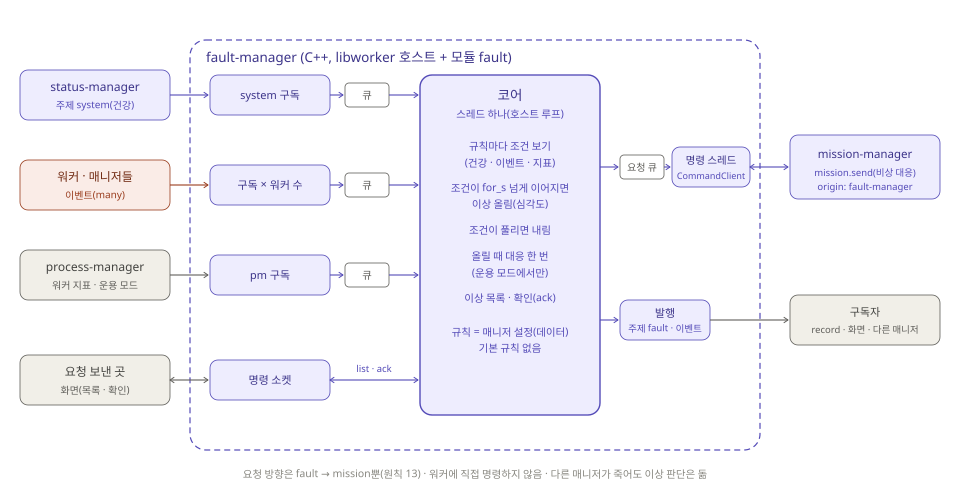

# fault-manager 설계서 (기본 탑재 매니저)

| 항목 | 내용 |
|---|---|
| 상태 | 확정·구현(2026-11-24, 0.69). 단위·통합·process-manager 수락 시험. 보드 확인(2026-11-24): 떠 있음, 이상 없음(status_lost 없음), 입력 연결을 알리지 않아 status가 degraded로 보던 것 고침 |
| 대상 | **이상 판단**: 규칙으로 이상을 올리고 내리며(심각도), 올릴 때 정해 둔 대응을 mission-manager에 요청한다 |
| 실행 파일 | `bin/fault-manager`(C++, libworker 호스트 + 모듈 `fault`). 소스 `src/`, `lib/fault/` |
| 바탕 | `docs/managers.md`(공통 틀, 요청 방향 fault → mission), `docs/layers.md` 4장(다른 매니저가 죽어도 이상 판단은 돎), 원칙 15(장치 자체 안전장치가 최후, 매니저는 시스템 수준 감독)·원칙 18(엔진은 코드, 규칙은 데이터) |

매니저 공통 틀을 따른다. status가 "지금 어떤가"(건강)를 보여 준다면, fault는 "무엇이 잘못됐고 무엇을 해야 하나"를 규칙으로 판단한다. 플랫폼은 장비를 모르므로 **기본 규칙은 없다**. 규칙(조건 → 심각도 → 대응)은 프로젝트가 데이터로 넣는다.

## 1. 실행 구조



| 스레드 | 하는 일 | 큐(크기, 넘칠 때) |
|---|---|---|
| 코어(호스트 루프) | 규칙 판정(200 ms마다·입력이 오면), 이상 목록, 대응 요청, 주제·이벤트 | — |
| `fault.sys` | status-manager 주제 `system`(입력 `system`, 하나) | 16, 오래된 것 버림 |
| `fs.<id>` | 워커·매니저 스트림의 이벤트(`many`, 입력 `streams`) | 상대마다 64, 오래된 것 버림 |
| `fault.pm` | process-manager 구독: 워커 지표(heartbeat)·운용 모드 | 256, 오래된 것 버림 |
| `fault.cmd` | mission-manager에 `mission.send`(입력 `mission`, libworker `CommandClient`) | 16, 차면 그 대응은 실패로 기록 |
| `fault.pub` | 주제 `fault` | — |

## 2. 규칙(매니저 설정 = 규칙 데이터)

```json
{
  "rules": [
    {"id": "cam_lost", "when": {"health": {"worker": "cam*", "is": ["fault", "off"]}}, "for_s": 3,
     "severity": "error", "text": "카메라 끊김",
     "do": [{"target": "payload-manager", "cmd": "payload.power", "args": {"module": "cam1", "on": true}}]},
    {"id": "hot", "when": {"metric": {"worker": "system-monitor", "name": "temp_max_c", "above": 85}}, "for_s": 10,
     "severity": "warning"},
    {"id": "link_drop", "when": {"event": {"code": "link_down", "worker": "*"}}, "hold_s": 30, "severity": "warning"}
  ]
}
```

| 키 | 뜻 |
|---|---|
| `id` | 규칙 이름(이상 이름) |
| `when` | 조건 하나: `health`(워커 건강, status 주제), `metric`(heartbeat 지표 `above`·`below`), `event`(이벤트 code·워커 글롭), `system`(시스템 건강 `is`) |
| `for_s` | 조건이 이만큼 이어져야 올림(기본 0). 건강·지표·시스템 조건만 |
| `hold_s` | 이벤트 조건: 이벤트를 받으면 올리고 이만큼 지나면 내림(기본 10) |
| `severity` | `warning` · `error` · `critical` |
| `text` | 사람이 읽는 말(없으면 규칙 id) |
| `do` | 올릴 때 한 번 할 대응 목록. 각각 `{"target", "cmd", "args"}` → mission-manager에 `mission.send`(워커에 직접 보내지 않음) |

- 워커 id 글롭에 맞는 워커가 여럿이면 워커마다 따로 판정한다(이상 이름 `<규칙 id>:<워커>`)
- 규칙은 설정 스키마로 검사(틀리면 매니저가 뜨지 않음, exit 1). 비우면 아무것도 판단하지 않는다(이상 목록만 빈 채로)

## 3. 이상의 일생

| 단계 | 하는 일 |
|---|---|
| 올림 | 조건이 `for_s` 넘게 이어짐(이벤트는 받는 즉시) → 이상 목록에 넣고 이벤트 `fault_raised`(심각도 그대로), 대응 `do`를 한 번 |
| 내림 | 조건이 풀림(이벤트는 `hold_s` 지남) → 목록에서 빼고 이벤트 `fault_cleared`(info) |
| 확인 | `fault.ack {"id"}`: 사람이 봤다고 표시(목록에 `acked: true`). 확인해도 조건이 남아 있으면 이상은 그대로 |
| 대응 결과 | mission 답을 이상에 붙임(`actions: [{"cmd", "ok", "error"}]`), 실패면 이벤트 `fault_action_failed` |

- **대응은 운용 모드에서만.** 개발 모드에서는 "할 뻔한 대응"만 남긴다(`actions[].skipped: "development mode"`). 장비 하나씩 시험할 때 자동 대응이 끼어들지 않게(원칙 17)
- **다시 하지 않음:** 같은 이상이 올라가 있는 동안 대응을 되풀이하지 않는다. 내렸다가 다시 올라가면 다시 한다
- **장치 자체 안전장치가 먼저:** fault는 시스템 수준 감독이다. 빠른 보호(전원, 통신 끊김 대응)는 장치가 스스로 한다(원칙 15)

## 4. 내보내는 것 (ICD)

| 무엇 | 내용 |
|---|---|
| 주제 `fault` | `{"active": {"<이상>": {"rule", "worker", "severity", "text", "since_ns", "acked", "actions": [...]}}, "counts": {"warning", "error", "critical"}, "worst": "none\|warning\|error\|critical"}`, 바뀌면 바로, 그대로면 1 s |
| 이벤트 | `fault_raised`, `fault_cleared`, `fault_action_failed` |
| 명령 | `fault.list`(읽기), `fault.ack {"id"}`(운용 조작) |
| 지표 | `fault_active`, `fault_worst`(0 none … 3 critical), `fault_raised`, `fault_actions`, `fault_action_failed` |
| 입력 | `system`(status, 하나), `streams`(`many`, 이벤트), `mission`(명령 보낼 곳, 하나), process-manager 구독 |

## 5. 다른 곳에서 바꾸는 것

| 곳 | 바꾸는 것 |
|---|---|
| process-manager | 매니저가 `io.json` `uses`에 역할 `mission`을 적으면, mission-manager의 허용 목록(`peers.json`)에 `mission.send`를 자동으로 연다(요청 방향 fault → mission은 플랫폼 규칙이라 사람이 `commanders`에 적지 않아도 되게) |
| mission-manager | 없음(fault의 요청도 다른 명령처럼 (대상, 역할) 큐로. `origin: fault-manager`) |

## 6. 끊겼을 때

| 상황 | 어떻게 |
|---|---|
| status가 없음·끊김 | 건강 조건은 판정하지 않고(올라간 이상은 그대로 둠), 이상 `status_lost`(warning)를 스스로 올림 |
| mission이 없음·끊김 | 대응은 실패로 기록(`fault_action_failed`), 이상 판단은 계속 |
| fault가 죽음 | process-manager가 다시 켬. 다시 뜨면 이상 목록은 비고 조건을 처음부터 봄(올라가 있던 이상은 조건이 남아 있으면 다시 올라감, 대응도 다시) |

## 7. 시험

| 무엇 | 어떻게 |
|---|---|
| 코어 | 단위 시험: 조건 종류별 올림·내림, `for_s`·`hold_s`(가짜 시계), 워커 글롭으로 여럿, 대응 한 번만, 개발 모드에서 대응 건너뜀, 규칙 검사 |
| 통합 | 가짜 status 주제·가짜 mission 명령 소켓 → 건강 fault 3 s → 이상 올림·`mission.send` 한 번, 풀리면 내림 |
| process-manager | 역할 `mission`을 쓰는 매니저가 mission의 `peers.json`에 `mission.send`로 들어감 |
| 동시성 | TSan |

## 8. 함께 정한 것 (2026-11-24)

| # | 항목 | 정한 것 |
|---|---|---|
| 1 | 기본 규칙 | 없음(플랫폼은 장비를 모름). 프로젝트가 규칙 데이터로 넣음 |
| 2 | 조건 종류 | 워커 건강, heartbeat 지표, 이벤트, 시스템 건강. 한 규칙에 조건 하나(조합은 다음 판) |
| 3 | 대응 | `do`의 명령을 mission-manager에 `mission.send`로(워커에 직접 안 보냄), 올릴 때 한 번 |
| 4 | 개발 모드 | 대응은 건너뛰고 "할 뻔한 대응"만 남김. 이상 판단·목록은 그대로 |
| 5 | 확인(ack) | 사람이 봤다는 표시만. 조건이 남아 있으면 이상은 그대로 |
| 6 | mission 허용 | 역할 `mission`을 쓰는 매니저는 process-manager가 mission 허용 목록에 자동으로 넣음 |
| 7 | 이번 판에서 하지 않는 것 | 조건 조합(그리고·또는), 단계별 대응(오래가면 더 센 대응), 격리(모듈을 자동으로 끄는 것은 `do`로 payload에 요청해서 함), 화면 표시 |
