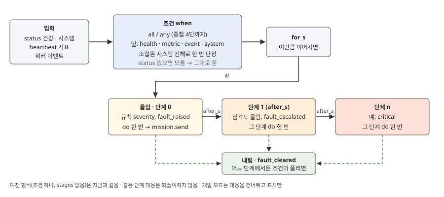

# fault 조건 조합·단계 대응 (fault-manager 다음 판, 초안)

| 항목 | 내용 |
|---|---|
| 상태 | 초안대로 구현(2026-11-24, 0.74 예정). 코어 단위·통합·TSan 시험. 9장은 함께 정할 것(초안 값으로 구현, 끝에 한꺼번에 합의) |
| 대상 | fault 규칙의 조건을 그리고·또는로 묶기, 이상이 오래가면 심각도·대응을 단계로 올리기 |
| 바탕 | `managers/fault/design.md`(2장 규칙, 3장 이상의 일생, 8장 7 미룬 것), 원칙 15(장치 자체 안전장치가 먼저)·18(엔진은 코드, 규칙은 데이터) |
| 남은 일 목록 | `docs/managers-next.md` 5번 |

## 1. 왜

| 지금(0.69) | 부족한 것 |
|---|---|
| 한 규칙에 조건 하나 | "카메라가 끊겼고 **그리고** 온도가 높다"처럼 둘이 겹칠 때만 이상인 경우를 못 적음 |
| 올릴 때 대응 한 번 | 재시작으로 안 풀리면 다음엔 끄기처럼, 오래갈수록 더 센 대응을 못 적음 |

새 칸이 없으면(예전 규칙) 지금과 똑같이 동작한다.

## 2. 구조



| 단계 | 하는 일 |
|---|---|
| ① 조건 | `when`이 잎 하나(지금과 같음, 워커마다 따로) 또는 `all`·`any` 묶음(시스템 전체로 한 번) |
| ② 이어짐 | 조건이 `for_s` 넘게 이어지면 올림(지금과 같음) |
| ③ 단계 0 | 규칙의 `severity`·`do`(지금과 같음), 이벤트 `fault_raised` |
| ④ 단계 1…n | 올라간 때부터 `after_s`가 지난 단계마다 심각도(`text`가 있으면 말도)를 바꾸고 그 단계 `do`를 한 번, 이벤트 `fault_escalated`(그 심각도) |
| ⑤ 내림 | 어느 단계에서든 조건이 풀리면 `fault_cleared`. 다시 올라가면 단계 0부터 |

## 3. 규칙 형식 (늘어나는 칸)

```json
{"id": "cam_hot_lost",
 "when": {"all": [{"health": {"worker": "cam*", "is": "fault"}},
                  {"any": [{"metric": {"worker": "system-monitor", "name": "temp_max_c", "above": 80}},
                           {"event": {"code": "link_down"}}]}]},
 "for_s": 2, "hold_s": 10, "severity": "warning",
 "do": [{"target": "payload-manager", "cmd": "payload.restart", "args": {"module": "cam1"}}],
 "stages": [{"after_s": 30, "severity": "error", "text": "카메라 계속 끊김",
             "do": [{"target": "payload-manager", "cmd": "payload.stop", "args": {"module": "cam1"}}]},
            {"after_s": 120, "severity": "critical"}]}
```

| 키 | 뜻 |
|---|---|
| `when.all` · `when.any` | 조건 목록(비면 안 됨). 안에 잎(`health`·`metric`·`event`·`system`)이나 또 `all`·`any`(4단까지) |
| 조합의 잎 판정 | 그 잎의 워커 글롭에 맞는 워커가 **하나라도** 조건을 채우면 참. 조합 규칙의 이상은 하나(이름 = 규칙 id, `worker` 없음) |
| 조합 안 `event` | 받은 뒤 규칙의 `hold_s` 동안 참 |
| 모름 | status가 끊겨 건강·시스템 잎을 알 수 없으면, 결과가 거기에 달렸을 때 올리지도 내리지도 않음(지금 단일 조건과 같음) |
| `stages` | 단계 목록. `after_s`(올라간 때부터, 0보다 크고 앞 단계보다 큼), `severity`(앞 단계보다 낮지 않음), `text`(없으면 그대로), `do`(없으면 심각도만) |
| `for_s` | 지금처럼 이름이 `for_s`(초). 처음 올릴 때만 |

## 4. 대응과 반복

| 규칙 | 내용 |
|---|---|
| 단계마다 한 번 | 같은 단계의 `do`는 되풀이하지 않음. 이상의 `actions` 목록에 단계 대응이 이어 붙음(칸 `stage`) |
| 결과 | 단계 대응의 mission 답도 지금처럼 `actions[i].ok`·`error`, 실패면 `fault_action_failed` |
| 개발 모드 | 단계는 그대로 오르고 그 단계 대응은 보내지 않고 잡아 둠(`held_actions`의 `stage` = 그 단계, 이벤트 `fault_action_held`). `fault.run_action {"id", "stage"}`로 하나씩 보냄(`design.md` 3.1, `docs/modes.md` 3장) |
| 확인(ack) | 단계와 상관없이 표시만. 단계 오름을 멈추지 않음 |

## 5. 내보내는 것 (늘어나는 것만)

| 무엇 | 내용 |
|---|---|
| 주제 `fault` | 이상마다 `stage`(0 = 처음). 역할 정의 `fault` 1.1 |
| 이벤트 | `fault_escalated`(심각도 = 그 단계, `detail.stage`) |
| 지표 | `fault_escalated`(누적) |

## 6. 끊겼을 때

지금과 같음(`design.md` 6장). fault가 다시 켜지면 단계도 0부터(조건이 남아 있으면 다시 올라가 단계 0 대응부터).

## 7. 시험

| 무엇 | 어떻게 |
|---|---|
| 코어 | 조합: all·any 중첩, for_s, status 끊김에 모름, 조합 안 이벤트 hold_s. 단계: after_s마다 심각도·대응 한 번, 같은 단계 반복 없음, 풀리면 끝·다시 0부터, 개발 모드 잡아 둠(단계마다). 규칙 검사(빈 목록, 너무 깊음, after_s 순서, 심각도 내려감, 모르는 칸) |
| 통합 | 가짜 status·가짜 mission: 단계 0 대응 → 2 s 뒤 critical·단계 대응 한 번(모두 2건), 조합 규칙 `both` 올림·내림 |
| 동시성 | TSan |

## 8. 하지 않는 것

- 조합에서 "같은 워커"끼리 묶기(잎마다 워커가 다를 수 있음). 필요하면 워커별 규칙을 따로 적음
- 단계 내리기(풀리면 끝). 단계를 거꾸로 밟는 대응이 필요하면 `fault_cleared`를 보고 다른 쪽(mission 규칙)에서

## 9. 함께 정할 것

| # | 항목 | 초안(구현한 값) |
|---|---|---|
| 1 | 조합 형식 | `when`에 `{"all": [...]}`·`{"any": [...]}`, 중첩 4단까지 |
| 2 | 조합 판정 단위 | 시스템 전체로 한 번(잎마다 맞는 워커가 하나라도 있으면 참), 이상 이름 = 규칙 id |
| 3 | 지속 시간 | 지금 칸 `for_s`(초) 그대로 씀(새 `for_ms`는 만들지 않음) |
| 4 | 단계 | `stages: [{after_s, severity, text?, do?}]`, 올라간 때부터 잼, 심각도는 내려가지 않음 |
| 5 | 반복 | 단계마다 대응 한 번, 풀렸다 다시 올라가면 단계 0부터 |
| 6 | 개발 모드·ack | ack는 단계를 멈추지 않음. 개발 모드 대응은 2026-11-25부터 잡아 둠(`design.md` 3.1, 역할 정의 `fault` 1.2) |
| 7 | 버전 | 역할 정의 `fault` 1.1(`stage`), 지표 `fault_escalated` |
