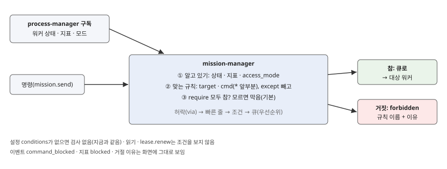

# 명령 조건 (mission-manager 다음 판, 모드 전환 허가)

| 항목 | 내용 |
|---|---|
| 상태 | 초안대로 구현(2026-11-24, 0.74). 코어 단위 시험·통합 시험. 9장은 초안 값(바꿀 수 있음) |
| 대상 | 어떤 명령은 어떤 상태일 때만 보낸다(예: 비행 모드 바꾸기는 시동이 꺼져 있을 때만, 디버그 명령은 개발 모드에서만). 안 맞으면 워커에 보내지 않고 이유와 함께 거절 |
| 바탕 | `managers/mission/design.md`(입구 하나), `docs/command-path.md`(운용·개발 모드), process-manager 구독(워커 상태·지표·모드) |
| 남은 일 목록 | `docs/managers-next.md` 4번 |

## 1. 왜

허용 목록·모드는 "누가 무슨 명령을 보낼 수 있나"만 본다. "지금 이 상태에서 보내도 되나"는 판단이라 mission 규칙(설정)으로 둔다. 워커 안에 박아 두면 워커마다 다르고 화면이 이유를 모른다.

## 2. 구조



| 단계 | 하는 일 |
|---|---|
| ① 알고 있기 | mission은 process-manager를 구독해 워커마다 `actual_state`·`metrics`, 워크스페이스 `access_mode`를 늘 들고 있다(명령마다 묻지 않음) |
| ② 맞는 규칙 | 명령이 오면 `target`·`cmd`(정확히, `"flight.*"` 앞부분, `"*"`)가 맞는 규칙을 찾는다. `except`에 있는 보낸 곳은 건너뜀(예: fault 비상 대응) |
| ③ 검사 | 규칙의 `require`가 모두 참이어야 함. 하나라도 거짓이면 `forbidden "condition <이름>: <무엇> is <값> (need <조건>): <message>"`. 값을 모르면(워커 없음·지표 없음·모드 모름) 기본은 막음(`"unknown": "allow"`로 바꿀 수 있음) |
| ④ 통과 | 우선순위·큐로(`priority.md`) |

- 검사 순서: 허락(`via`, external-link) → 빠른 줄(읽기·`lease.renew`는 조건 안 봄) → **조건** → 큐
- 워커 지표는 process-manager가 heartbeat로 받은 것(보통 1 s 안). 지표로 내지 않는 값은 조건에 쓸 수 없다(워커가 지표로 내면 됨)

## 3. 설정 (`config.mission.conditions`)

```json
[
  {"name": "disarmed-mode-change", "target": "fc", "cmd": "flight.set_mode", "except": ["fault-manager"],
   "require": [{"metric": "armed", "op": "==", "value": 0}, {"worker": "gps", "state": "running"}],
   "message": "시동을 끈 뒤 바꾸세요"},
  {"name": "dev-only", "cmd": "debug.*", "require": [{"mode": "development"}]}
]
```

| 키 | 뜻 |
|---|---|
| `name` | 거절 메시지·이벤트에 쓰는 이름(없으면 `rule<n>`) |
| `target`, `cmd` | 맞는 명령(기본 `"*"`) |
| `require[]` | `{"worker"?, "metric", "op", "value"}`(지표 비교, `op`: `==` `!=` `<` `<=` `>` `>=`) · `{"worker"?, "state"}`(실행 상태) · `{"mode"}`(`operation`·`development`). `worker`가 없거나 `"$target"`이면 명령 대상 |
| `except[]` | 검사하지 않는 보낸 곳 |
| `unknown` | `block`(기본) · `allow` |
| `message` | 거절 이유 뒤에 붙임(화면에 보임) |

- **설정이 없으면 지금과 같음**(검사 없음). 틀린 형식이면 mission이 뜨지 않음

## 4. 내보내는 것 (늘어나는 것만)

| 무엇 | 내용 |
|---|---|
| 주제 `mission` | `blocked` 수 |
| 이벤트 | `command_blocked`(warning, `{"target", "cmd", "origin", "reason"}`) |
| 지표 | `blocked` |
| 오류 | `forbidden`(9.6), 메시지에 규칙 이름과 이유 |

## 5. 시험

| 무엇 | 어떻게 |
|---|---|
| 코어 | 규칙 읽기(틀린 op·빈 require), 지표·상태·모드, `except`, 값 모름(막음·허용), 앞부분 일치 |
| 통합 | mission(설정 조건) + 가짜 워커: 모드를 모름 → `forbidden`(규칙 이름 포함) |

## 6. 하지 않는 것

두 번 확인(사람이 "정말?"에 다시 누르기: 게이트웨이·화면이 함께 바뀌어야 해서 화면 일과 함께), 워커 `get_status` 안쪽 값(지표만), 조건을 화면에서 고치기.

## 9. 함께 정할 것 (초안 값으로 구현)

| # | 항목 | 초안 |
|---|---|---|
| 1 | 조건에 쓰는 값 | 워커 실행 상태·지표, 워크스페이스 모드(process-manager 구독, 명령마다 묻지 않음) |
| 2 | 값을 모를 때 | 막음(규칙마다 `allow`로) |
| 3 | 빠지는 곳 | 규칙마다 `except`(기본 없음) |
| 4 | 거절 code | `forbidden` + 이유 |
| 5 | 읽기·`lease.renew` | 조건 안 봄 |
| 6 | 두 번 확인 | 이번엔 안 함(화면 일과 함께) |
| 7 | 기본 설정 | 비어 있음. 프로젝트가 프리셋으로 정함 |
