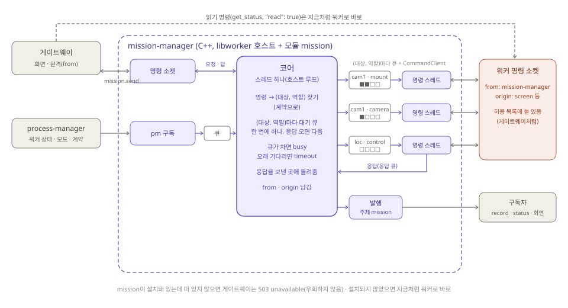

# mission-manager 설계서 (기본 탑재 매니저)

| 항목 | 내용 |
|---|---|
| 상태 | 확정·구현(2026-11-24, 0.67). 단위·통합·게이트웨이·process-manager 수락 시험. 보드 확인 남음 |
| 대상 | **명령 송수신**: 화면·외부에서 온 워커 명령을 받아 맡은 워커로 보내고 결과를 돌려준다. 같은 역할에 동시에 온 명령을 정리한다 |
| 실행 파일 | `bin/mission-manager`(C++, libworker 호스트 + 모듈 `mission`). 소스 `src/`, `lib/mission/` |
| 바탕 | `docs/managers.md`(공통 틀, 4장 명령 길), `docs/command-path.md`(허용 목록·모드·`from`), `docs/gateway.md`(지금 명령 전달) |

매니저 공통 틀을 따른다. record·status는 받기만 했지만 mission은 **워커에 명령하는 유일한 매니저**다(원칙 13: 명령 입구는 한 곳). 첫 판은 "입구 하나 + 같은 역할은 한 번에 하나"까지 하고, 우선순위·모드 전환 허가·임대는 규칙과 함께 다음 판에 한다(지금 미룬 것과 같음, design.md 15장).

## 1. 실행 구조



| 스레드 | 하는 일 | 큐(크기, 넘칠 때) |
|---|---|---|
| 코어(호스트 루프) | `mission.send` 받기, (대상, 역할) 찾기, 대기 큐 관리, 응답 돌려주기, 주제·지표 | (대상, 역할)마다 대기 큐 `queue`(기본 4), 차면 `busy` |
| `mission.pm` | process-manager 구독(워커 상태·모드), libworker `ManagerSubscription` | 256, 오래된 것 버림 |
| `mc.<대상>.<역할>` | (대상, 역할)마다 명령 스레드 하나(libworker `CommandClient`). 워커 명령 소켓으로 보내고 응답을 큐로 | 보낼 큐 1(코어가 하나씩만 넣음) |
| `mission.pub` | 주제 `mission` 발행(libworker `Publisher`) | — |

- 명령 스레드는 그 (대상, 역할)에 처음 명령이 올 때 만들고, 1분 동안 쓰지 않으면 닫는다
- 다른 역할·다른 워커의 명령은 서로 기다리지 않는다(큐가 따로)

## 2. 명령 길

```text
 화면·원격 ─HTTP─▶ 게이트웨이 ─(읽기 명령)──────────────────────────────▶ 워커       지금과 같음
                       └─(그 밖)─ mission.send ─▶ mission-manager ─────────▶ 워커       from: mission-manager, origin: screen
```

| 단계 | 하는 일 |
|---|---|
| ① 게이트웨이 | 지금처럼 사용자 역할·운용 모드 검사(`docs/command-path.md` 3장). 읽기 명령(`get_status`, `"read": true`)은 워커로 바로. 그 밖은 mission-manager가 **설치돼 있으면** `{"cmd": "mission.send", "args": {"target": "<워커>", "cmd": "...", "args": {...}}, "from": "<보낸 곳>"}`로 mission에, 아니면 지금처럼 워커로 바로 |
| ② mission | 명령의 역할을 대상 워커의 계약(`get_io`)으로 찾는다: 역할 정의(`io/<역할>.json`)에 있으면 그 역할, 없으면 `self`(워커 전용, 개발 모드). (대상, 역할) 큐에 넣고, 앞의 명령이 끝나면 보낸다 |
| ③ 워커 | 봉투 `{"cmd", "args", "origin": "<보낸 곳>"}`를 받는다. libworker는 믿는 곳(게이트웨이·mission)에서 온 `origin`만 쓴다: `last_command`에 `from: mission-manager`, `origin: screen` |
| ④ 돌아옴 | 워커 응답을 그대로 게이트웨이에 돌려준다(성공·오류 모두). mission 자신의 오류만 `busy`·`timeout`·`unavailable` |

- **"설치돼 있다"를 아는 법:** 계약으로. 역할 `mission`(`io/mission.json`, 명령 `mission.send`)을 내보내는 워커가 있으면 그쪽으로. 게이트웨이는 판단하지 않고 계약대로 보낸다(이름을 박아 두지 않음)
- **mission이 떠 있지 않으면:** 503 `unavailable "mission-manager is not running"`. 바로 보내면 순서 정리를 건너뛰므로 우회하지 않는다(공통 틀 9장 4)
- **외부 연동 워커:** 이번 판은 지금처럼 허용 목록(`commanders`)을 거쳐 워커로 바로. mission을 거치게 하는 것은 다음 판(그때 mission이 운용 모드 검사도 함, 9장 5)

## 3. 같은 역할에 동시에 온 명령

| 규칙 | 내용 |
|---|---|
| 한 번에 하나 | (대상, 역할)마다 보낸 명령의 응답(또는 시간 초과)이 오기 전에는 다음을 보내지 않는다 |
| 대기 | 그동안 온 명령은 온 순서대로 큐에(기본 4개). 차면 바로 `busy "<대상>.<역할>: N commands waiting"` |
| 시간 | 명령 하나 `command_timeout_ms`(기본 2000), 큐에서 기다린 시간 포함 상한 `total_timeout_ms`(기본 2800, 게이트웨이 시간 3 s보다 짧게). 넘으면 `timeout` |
| 순서 | 먼저 온 것이 먼저(우선순위 없음, 다음 판 규칙) |

예: 화면 두 개가 같은 구동기 각도를 동시에 바꾸면 두 번째는 첫 번째가 끝난 뒤 보내지고, 셋째 넷째가 겹쳐 쌓이다 다섯째부터는 `busy`.

## 4. 내보내는 것 (ICD)

| 무엇 | 내용 |
|---|---|
| 명령 | `mission.send`(운용 조작, `operate`): `{"target", "cmd", "args"}` → 워커 응답. `mission.get_queues`(읽기): 지금 큐 |
| 주제 `mission` | `{"queues": {"<대상>.<역할>": {"waiting": n, "inflight": {"cmd", "origin", "age_ms"} \| null}}, "sent": n, "busy": n, "timeouts": n}`, 바뀌면 바로, 그대로면 1 s |
| 이벤트 | `command_busy`(warning), `command_timeout`(warning). 성공한 명령마다는 내지 않음(명령 기록은 게이트웨이·워커 `last_command`·record) |
| 지표 | `mission_sent`, `mission_busy`, `mission_timeouts`, `mission_queues`, `mission_waiting` |
| 입력 | process-manager 구독(워커 상태·운용 모드), 계약(`get_io`)을 10 s마다·바뀌면 다시 읽음 |

## 5. 다른 곳에서 바꾸는 것

| 곳 | 바꾸는 것 |
|---|---|
| 게이트웨이 | `POST /workers/{id}/command`: 2장 ①. 역할 `mission`을 내보내는 워커를 계약으로 찾음(10 s 캐시) |
| process-manager | type `"command_entry": true`(mission-manager 선언)인 매니저를 허용 목록(`peers.json`)에서 게이트웨이처럼: 모든 워커에 `"*"`, `trusted_from` |
| libworker | 믿는 곳에서 온 봉투의 `origin`을 받아 `last_command.origin`에 남김(`common.json` 1.3, `last_command`에 `origin` 칸). 예전 봉투(`from`만)는 지금처럼 |

## 6. 끊겼을 때

| 상황 | 어떻게 |
|---|---|
| mission이 죽음·다시 켜지는 중 | 게이트웨이가 503 `unavailable`. process-manager가 다시 켬. 큐에 있던 명령은 사라짐(보낸 곳은 오류를 받음) |
| 대상 워커가 응답 없음 | 그 (대상, 역할)만 `timeout`, 다른 큐는 그대로 |
| 대상 워커가 꺼짐 | `unavailable "<대상> is not running"`(process-manager 상태로 앎, 보내지 않음) |
| process-manager 구독이 끊김 | 마지막으로 안 상태로 계속 보냄(명령 길은 워커 소켓이라 process-manager가 없어도 됨) |

## 7. 시험

| 무엇 | 어떻게 |
|---|---|
| 코어 | 단위 시험: 역할 찾기(계약), 큐 순서·한 번에 하나·busy·timeout(가짜 시계) |
| 통합 | 가짜 워커 명령 소켓(느린 응답) 둘 + mission: 같은 역할 동시 명령은 차례로, 다른 역할은 함께, 큐가 차면 busy |
| 게이트웨이 | 수락 시험: mission 없음 → 바로, 있음 → 거침(`origin` 확인), 설치됐는데 꺼짐 → 503, 읽기 명령은 늘 바로 |
| process-manager | `command_entry` 매니저가 `peers.json`에 `"*"`·`trusted_from` |
| libworker | `origin`: 믿는 곳이면 씀, 아니면 무시 |
| 동시성 | TSan |

## 8. 이번 판에서 하지 않는 것

우선순위(누가 이기나), 모드 전환 허가, 명령 임대(끊기면 안전 상태), 외부 연동 워커를 mission으로, 화면 표시. 모두 규칙 데이터가 필요하거나 따로 정할 것이라 다음 판(design.md 15장 미룬 것과 같음).

## 9. 함께 정한 것 (2026-11-24)

| # | 항목 | 정한 것 |
|---|---|---|
| 1 | 정리 단위 | (대상 워커, 역할)마다 한 번에 하나, 대기 4개, 넘치면 `busy` |
| 2 | 시간 | 명령 2 s, 기다림 포함 2.8 s(게이트웨이 3 s 안) |
| 3 | 게이트웨이가 mission을 아는 법 | 계약: 역할 `mission`을 내보내는 워커. 설치됐는데 꺼져 있으면 503 |
| 4 | 읽기 명령 | 늘 워커로 바로(판단이 없음) |
| 5 | 외부 연동 워커 | 이번 판은 지금처럼 바로, 다음 판에 mission으로 |
| 6 | 워커가 받는 보낸 곳 | `from: mission-manager`, `origin: <처음 보낸 곳>`(libworker, common 1.3) |
| 7 | 허용 목록 | type `"command_entry": true` 매니저는 게이트웨이처럼 `"*"`·`trusted_from` |
