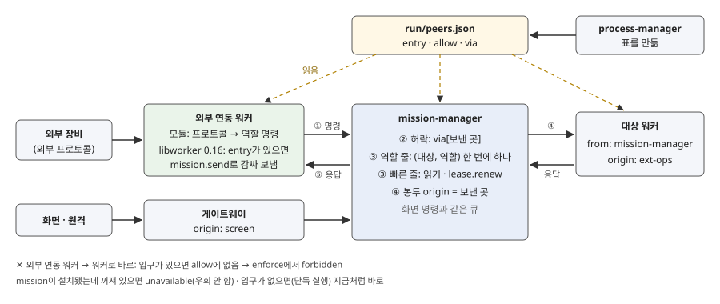

# 외부 연동 워커를 mission으로 (mission-manager 다음 판, 초안)

| 항목 | 내용 |
|---|---|
| 상태 | 확정·구현(2026-11-24, 0.73, libworker 0.16). process-manager·libworker·mission 단위 시험, mission 통합 시험(허락·forbidden·빠른 줄·origin). 보드는 외부 연동 워커가 생기면 |
| 대상 | 외부 연동 워커(외부 프로토콜 → 역할 명령)가 워커에 보내는 명령. 지금은 허용 목록(`commanders`)만 보고 워커로 바로 간다. 이것을 화면과 같은 입구(mission)로 모은다 |
| 바탕 | `managers/mission/design.md`(2장 명령 길, 3장 정리 규칙), `docs/command-path.md`(4장 허용 목록·`peers.json`), `docs/managers.md`(4장 길 4a), `docs/command-lease.md` |
| 남은 일 목록 | `docs/managers-next.md` 2번 |

## 1. 왜

| 지금 | 문제 |
|---|---|
| 외부 연동 워커 → 워커(허용 목록 검사만) | 같은 역할에 화면과 외부 장비가 동시에 명령하면 정리되지 않는다(mission 큐를 건너뜀). 다음 판의 우선순위·모드 전환 허가도 건너뛴다 |
| 화면 → 게이트웨이 → mission → 워커 | 이미 정리됨(0.67) |

입구는 둘(게이트웨이, 외부 연동 워커)이어도 판단하는 곳은 mission 하나(원칙 13, `docs/managers.md` 4장).

## 2. 구조



| 단계 | 하는 일 | 어디서 |
|---|---|---|
| ① 보냄 | 외부 연동 워커의 모듈은 지금처럼 `CommandClient(대상 워커)`로 보낸다. libworker가 `peers.json`의 `entry`(명령 입구)를 보고, 대상이 입구가 아니면 `mission.send {"target", "cmd", "args"}`로 감싸 입구 소켓으로 보낸다. 모듈 코드는 바꾸지 않음 | libworker 0.16 `CommandClient` |
| ② 허락 | mission이 보낸 곳(소켓 상대, `SO_PEERCRED`로 libworker가 찾은 이름)이 그 대상·명령을 보내도 되는지 `peers.json` `workers.<대상>.via[보낸 곳]`로 본다. 없으면 `forbidden`. 운용 모드 제한도 이 표에 이미 들어 있다(모드 × 역할 명령) | mission-manager |
| ③ 정리 | 허락되면 화면 명령과 **같은 큐**((대상, 역할)마다 한 번에 하나, 대기 4, `busy`). 읽기 명령·`lease.renew`는 큐를 기다리지 않는 빠른 줄로 | mission-manager |
| ④ 넘김 | 봉투 `origin: <보낸 곳>`(예 `ext-ops`). 워커 `last_command`에 `from: mission-manager`, `origin: ext-ops` | mission → 워커 |
| ⑤ 돌아옴 | 워커 응답을 그대로. mission 자신의 오류만 `busy`·`timeout`·`unavailable`·`forbidden` | mission → 외부 연동 워커 |

- **mission이 없으면(설치 안 됨·단독 실행):** `entry`가 없으니 지금처럼 바로(허용 목록 `allow`로)
- **mission이 설치됐는데 꺼져 있으면:** `unavailable`. 바로 보내지 않는다(게이트웨이와 같음, 우회 없음)
- **바로 보내면:** 입구가 있을 때 외부 연동 워커는 워커 `allow`에 없다 → `enforce`에서 `forbidden`(예전 libworker로 빌드된 외부 연동 워커는 0.16으로 다시 빌드해야 함)

## 3. `peers.json` 바뀌는 것 (process-manager)

```json
{
  "entry": {"id": "mission-manager"},
  "workers": {
    "cam": {
      "read": ["get_status", "mount.get_angle"],
      "allow": {"gateway": "*", "mission-manager": "*"},
      "via": {"ext-ops": ["mount.set_angle", "mount.center", "mount.rate"]}
    }
  }
}
```

| 칸 | 뜻 |
|---|---|
| `entry` | 명령 입구 매니저(type `"command_entry": true`이고 계약에 역할 `mission`이 있는 것). 소켓은 id의 기본 명령 소켓. 없으면 칸 없음 |
| `workers.<id>.allow` | 워커 소켓이 바로 받는 곳. 입구가 있으면 게이트웨이·입구 매니저만 |
| `workers.<id>.via` | 입구를 거쳐 보내도 되는 곳 → 허용 명령. 지금 `allow`에 들어가던 `commanders` 항목이 그대로 옮겨 옴(모드에 따른 범위도 같음) |

- 연결 선언(`connections.json` `commanders`)은 **그대로**. 사람이 적는 것은 바뀌지 않고, 표에서 놓이는 칸만 바뀐다
- 입구 매니저의 `allow`에 외부 연동 워커를 자동으로 넣는다(`mission.send`만). 매니저가 역할 `mission`을 쓰면 넣던 것(fault → mission)과 같은 자리

## 4. 누구를 어떻게 검사하나 (mission)

| 보낸 곳 | 검사 |
|---|---|
| `via` 어디엔가 이름이 있는 곳(외부 연동 워커) | 그 대상의 `via[보낸 곳]`에 그 명령이 있어야 함. `"*"`면 전부, `lease.renew {"role"}`은 그 역할 명령이 하나라도 있으면. `origin`은 보낸 곳 이름(믿지 않는 곳이 적은 `from`은 libworker가 무시) |
| 게이트웨이(`trusted_from`)·매니저(fault 등) | `via`에 없음 → 하지 않음(게이트웨이가 사용자 역할 × 모드로 이미 함, 매니저 간 요청 방향은 플랫폼 규칙) |
| 그 밖 | 입구 `allow`에 없어 mission 소켓 검사(`enforce`)가 먼저 막음 |

## 5. 빠른 줄 (읽기·`lease.renew`)

| 명령 | 왜 큐를 안 기다리나 |
|---|---|
| 읽기(`get_status`, 계약 `"read": true`) | 판단이 없음. 지금 게이트웨이도 바로 보냄 |
| `lease.renew {"role"}` | 임대 기한(예 300 ms) 안에 닿아야 함. 같은 역할에 느린 명령이 걸려 있어도 갱신은 가야 한다. 허락은 그 역할의 임대 명령을 보내도 되는 곳만 |

빠른 줄은 대상마다 명령 스레드 하나(`mf.<대상>`), 큐 8, 시간 1 s.

## 6. 시간

| 무엇 | 값 |
|---|---|
| mission 안 | 지금과 같음(명령 2 s, 기다림 포함 2.8 s) |
| 감싼 명령의 `CommandClient` 응답 대기 | `max(timeout_ms, 3000)`(mission 상한보다 길게, 응답이 늘 mission의 답으로 오게) |

## 7. 내보내는 것 (늘어나는 것만)

| 무엇 | 내용 |
|---|---|
| 주제 `mission` | `forbidden: n`, `inflight.origin`에 외부 연동 워커 이름 |
| 이벤트 | `command_forbidden`(warning, `{"origin", "target", "cmd"}`, 같은 (보낸 곳, 명령)은 10 s에 한 번) |
| 지표 | `mission_forbidden`, `mission_fast_sent` |
| libworker | `CommandClient::sent_via_entry()`(감싸서 보낸 수, 모듈이 지표로 낼 수 있음) |

## 8. 시험

| 무엇 | 어떻게 |
|---|---|
| process-manager | 입구 있음/없음에 따라 `entry`·`allow`·`via`(운용·개발 모드 각각), 외부 연동 워커가 입구 `allow`에 자동으로 |
| libworker | `CommandClient`: `entry` 있으면 감쌈·없으면 바로·대상이 입구면 그대로, 시간 상한 |
| mission 코어 | 허락(게이트웨이·매니저 통과, `via` 있음/없음/`"*"`), 빠른 줄이 역할 큐를 기다리지 않음 |
| 통합 | 가짜 외부 연동 워커 + mission + 가짜 워커: 화면 명령과 같은 큐에서 차례로, `origin: ext-ops`, 바로 보내면 `forbidden`(enforce), mission 꺼짐 → `unavailable` |
| 보드 | 프로젝트 쪽 외부 연동 워커가 생기면 그때(지금 DURU에는 없음). 그 전에는 틀 `peer` 모듈로 흉내 |

## 9. 함께 정할 것

| # | 항목 | 초안 |
|---|---|---|
| 1 | 외부 연동 워커가 mission을 아는 법 | libworker가 `peers.json` `entry`를 보고 알아서 감쌈(모듈 코드 그대로). 다른 안: 모듈이 직접 `mission.send`(io.json `uses` 역할 `mission`) |
| 2 | 허락 검사 자리 | mission이 `peers.json` `via`로(표 하나, process-manager가 만듦). 워커 소켓은 입구만 받음 |
| 3 | 연결 선언 | `commanders` 그대로(사람이 적는 것 안 바뀜) |
| 4 | 게이트웨이·매니저가 보낸 것 | mission은 다시 검사하지 않음 |
| 5 | 빠른 줄 | 읽기·`lease.renew`는 큐를 기다리지 않음 |
| 6 | mission이 꺼져 있을 때 | `unavailable`, 바로 보내지 않음 |
| 7 | 버전 | libworker 0.16, 워크스페이스 0.73, 역할 정의 `mission` 1.1(`forbidden`) |

위 초안대로 정함(2026-11-24). 구현하며 정한 것: 감싼 명령을 기다리는 동안 명령 스레드가 200 ms마다 맥박(`send_request` tick, 기본 `thread_stall_sec` 2 s보다 긴 대기에도 멈춤으로 안 봄). `CommandClient`에 `socket`을 직접 주면 감싸지 않음(fault → mission처럼)
