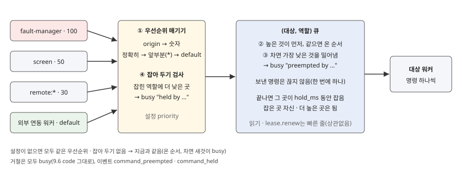

# 명령 우선순위 (mission-manager 다음 판)

| 항목 | 내용 |
|---|---|
| 상태 | 초안대로 구현(2026-11-24, 0.74). 코어 단위 시험·통합 시험. 9장은 초안 값(바꿀 수 있음) |
| 대상 | 같은 (대상 워커, 역할)에 여러 곳이 명령할 때 누가 먼저·누가 이기나. 지금(0.67)은 먼저 온 것이 먼저 |
| 바탕 | `managers/mission/design.md` 3장(한 번에 하나·대기·busy), `external-link.md`(입구가 하나라 여기서 정할 수 있음) |
| 남은 일 목록 | `docs/managers-next.md` 3번 |

## 1. 왜

화면 둘, 원격, 외부 장비, fault(비상 대응)가 같은 구동기에 명령하면 지금은 도착 순서대로 처리한다. 비상 대응이 화면 명령 뒤에 줄 서거나, 조종하던 사람 사이에 다른 곳의 명령이 끼어든다. 누가 이기는지는 판단이라 플랫폼이 아니라 mission 규칙(설정)으로 둔다(원칙 13).

## 2. 구조



| 규칙 | 내용 |
|---|---|
| ① 우선순위 매기기 | 보낸 곳(`origin`) → 숫자(클수록 먼저). 정확히 같은 이름 → `"remote:*"`처럼 앞부분 일치(긴 것) → `default` |
| ② 큐 순서 | 높은 것이 먼저, 같으면 온 순서. 이미 보낸 명령(inflight)은 끊지 않음(워커에 이미 감) |
| ③ 밀어내기 | 큐가 찼을 때 새 명령이 대기 중 가장 낮은 것보다 높으면 그것(가장 낮은 것 중 가장 늦게 온 것)을 `busy "preempted by <곳>"`로 빼고 넣음. 아니면 새 명령이 `busy` |
| ④ 잡아 두기(hold) | 역할마다 `hold_ms`. 명령이 끝나면 그 곳이 그 역할을 잠시 잡음: 더 낮은 다른 곳의 명령은 `busy "held by <곳>"`(큐에 있던 것도 빠짐). 잡은 곳 자신·더 높은 곳은 됨(더 높은 곳이 끝나면 그 곳이 잡음). 잡은 곳이 다시 명령하면 기한이 늘어남 |
| 빠른 줄 | 읽기·`lease.renew`는 우선순위와 상관없음(`external-link.md` 5장) |

## 3. 설정 (`config.mission.priority`)

```json
{
  "default": 50,
  "origins": {"fault-manager": 100, "screen": 50, "remote:*": 30},
  "hold_ms": 0,
  "roles": {"mount": {"hold_ms": 2000}}
}
```

| 키 | 뜻 | 기본 |
|---|---|---|
| `default` | 표에 없는 곳 | 50 |
| `origins` | 보낸 곳 → 우선순위(0..1000). 게이트웨이는 `screen`·`remote:<토큰>`, 매니저·외부 연동 워커는 id | 없음(모두 `default`) |
| `hold_ms` | 모든 역할의 잡아 두기 | 0(없음) |
| `roles.<역할>.hold_ms` | 그 역할만 | — |

- **설정이 없으면 지금과 같음:** 모두 같은 우선순위, 잡아 두기 없음 → 온 순서, 큐가 차면 새것이 `busy`
- 틀린 형식(모르는 키, 숫자가 아님, 범위 밖)이면 mission이 뜨지 않음(설정 오류)

## 4. 내보내는 것 (늘어나는 것만)

| 무엇 | 내용 |
|---|---|
| 주제 `mission` | `preempted`, `held` 수, `queues.<키>.holder: {"origin", "priority", "left_ms"}`(잡혀 있을 때만) |
| 이벤트 | `command_preempted`, `command_held`(warning, `{"lane", "cmd", "origin"}`) |
| 지표 | `preempted`, `held` |
| 오류 | 새 code 없음: `busy`(메시지에 preempted·held). 9.6 목록 그대로 |

## 5. 시험

| 무엇 | 어떻게 |
|---|---|
| 코어 | 규칙 읽기(정확·앞부분·기본·틀린 형식), 큐 순서, 밀어내기, 잡아 두기(자신·더 높은 곳·기한·큐에서 빠짐), 규칙 없음 = 예전 |
| 통합 | mission + 가짜 워커: 잡힌 역할에 낮은 곳 → `busy`, 잡은 곳 → 됨, 다른 역할 → 상관없음, 틀린 설정 → 안 뜸 |

## 6. 하지 않는 것

보낸 명령 끊기(워커에 취소 명령이 있어야 함), 사람 단위 우선순위(게이트웨이 사용자 → `origin`은 지금 `screen` 하나), 화면에서 규칙 고치기(설정 화면의 JSON으로).

## 9. 함께 정할 것 (초안 값으로 구현)

| # | 항목 | 초안 |
|---|---|---|
| 1 | 우선순위 키 | 보낸 곳(`origin`) 이름. 앞부분 일치 `*` |
| 2 | 같은 우선순위 | 온 순서 |
| 3 | 밀어내기 | 큐가 찼을 때만, 가장 낮은 것 중 가장 늦게 온 것 |
| 4 | 잡아 두기 | 역할마다 `hold_ms`, 기본 0(끔) |
| 5 | 보낸 명령 | 끊지 않음 |
| 6 | 거절 code | `busy`(새 code 안 만듦) |
| 7 | 기본 설정 | 비어 있음(지금과 같음). 프로젝트가 프리셋으로 정함 |
