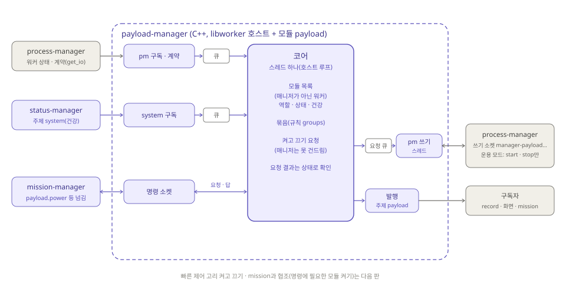

# payload-manager 설계서 (기본 탑재 매니저)

| 항목 | 내용 |
|---|---|
| 상태 | 확정·구현(2026-11-24, 0.68). 단위·통합·process-manager 수락 시험. 보드 확인(2026-11-24): 모듈 5(역할·상태·건강), 입력 연결을 알리지 않아 status가 degraded로 보던 것 고침(다시 확인: 시스템 ok, 입력 link true) |
| 대상 | **시스템에 들어간 모듈의 운용**: 무엇이 있고 어떤 상태인지, 켜고 끄기, 묶어 쓰기 |
| 실행 파일 | `bin/payload-manager`(C++, libworker 호스트 + 모듈 `payload`). 소스 `src/`, `lib/payload/` |
| 바탕 | `docs/managers.md`(공통 틀, 1장: payload = 들어간 모듈), `docs/command-path.md` 3장·8장(운용 조작, "모듈 전원 = 워커 시작/정지"), `managers/status`(건강) |

매니저 공통 틀을 따른다. "모듈"은 워커가 맡은 장치·기능 하나다(카메라 워커, 센서 워커, 시스템 모니터 등). payload는 모듈 목록을 들고, 사람(화면)이나 다른 매니저가 모듈을 켜고 끌 수 있게 한다. 모듈 명령 자체(줌, 각도 등)는 하지 않는다(그것은 mission을 거쳐 워커로, 공통 틀 1장).

## 1. 실행 구조

| 스레드 | 하는 일 | 큐(크기, 넘칠 때) |
|---|---|---|
| 코어(호스트 루프) | 모듈 목록(역할·상태·건강), 묶음, 켜고 끄기 요청 받기, 주제·지표 | — |
| `payload.pm` | process-manager 구독(워커 상태), libworker `ManagerSubscription` | 256, 오래된 것 버림 |
| `payload.io` | 계약(get_io) 10 s마다·워커가 늘면 바로: 모듈이 내보내는 역할 | 1(최신만) |
| `payload.sys` | status-manager 주제 `system` 구독(`io.json` `uses`, 하나): 모듈 건강 | 16, 오래된 것 버림 |
| `payload.ctl` | process-manager 쓰기 요청(시작·정지). 막힐 수 있어 코어 밖 | 16, 차면 `busy` |
| `payload.pub` | 주제 `payload` | — |

## 2. 모듈 목록

| 칸 | 어디서 |
|---|---|
| 모듈 | 매니저(`kind: manager`)가 아닌 워커 전부. 기본 탑재 워커(시스템 모니터)도 모듈 |
| `roles` | 그 워커의 계약 `provides`(예: `camera`, `mount`) |
| `state`, `autostart`, `desired` | process-manager 상태 |
| `health`, `why` | status-manager 주제 `system`의 `workers.<id>`(다시 판정하지 않음). status가 없으면 null |
| `groups` | 규칙 `groups`에서 이 모듈이 든 묶음 |

## 3. 켜고 끄기

| 명령 | 하는 일 |
|---|---|
| `payload.power {"module": "<id>", "on": true\|false}` | process-manager에 `start`/`stop` 요청. 답은 요청이 받아들여졌는지(`desired_state`). 실제로 켜졌는지는 상태로(주제 `payload`) |
| `payload.power_group {"group": "<이름>", "on": ...}` | 묶음의 모듈마다 위와 같이. 모듈별 결과를 모아 답함 |
| `payload.list` | 모듈 목록(읽기) |

- **매니저는 건드리지 않는다:** 대상이 매니저면 `forbidden`(자기 포함). 매니저는 개발 모드에서 화면으로만(공통 틀 9장 2)
- **운용 모드에서도 된다:** 모듈 전원은 운용 조작이다(`docs/command-path.md` 8장에 미뤄 둔 "운용 모드에서도 허용할 관리 조작"). process-manager는 이 매니저에게 **쓰기 소켓**을 주되, 운용 모드에서는 매니저가 아닌 워커의 `start`·`stop`만 허용한다(설정·프리셋·자동 시작 바꾸기는 개발 모드에서만, 지금처럼)
- **길:** 화면 → 게이트웨이 → mission(`payload.power`는 `operate`) → payload → process-manager. 화면의 "시작/정지" 버튼(관리 조작, 개발 모드)은 그대로 둔다

## 4. 내보내는 것 (ICD)

| 무엇 | 내용 |
|---|---|
| 주제 `payload` | `{"modules": {"<id>": {"roles": [...], "state", "desired", "autostart", "health", "why", "groups": [...]}}, "groups": {"<이름>": [...]}}`, 바뀌면 바로, 그대로면 1 s |
| 이벤트 | `module_power`(info: 누가 무엇을 켜고 껐나, `origin` 포함), `module_power_failed`(warning) |
| 명령 | `payload.list`(읽기), `payload.power`·`payload.power_group`(운용 조작) |
| 지표 | `payload_modules`, `payload_running`, `payload_power_requests`, `payload_power_failed` |
| 규칙(설정) | `groups: {"<이름>": ["<워커 id 글롭>", ...]}` |

## 5. 다른 곳에서 바꾸는 것

| 곳 | 바꾸는 것 |
|---|---|
| process-manager | type `"module_control": true` 매니저: 쓰기 소켓(`manager-<id>.sock`, `manager_api`처럼), 운용 모드에서도 매니저가 아닌 워커의 `start`·`stop`만 허용. 그 밖의 쓰기 op는 지금 Manager API 워커 규칙(운용 모드 `forbidden`) |
| libworker | 없음(`ManagerSubscription`, `Subscriber`, `manager_call` 그대로) |

## 6. 끊겼을 때

| 상황 | 어떻게 |
|---|---|
| status-manager가 없음·끊김 | 모듈 `health`를 null로(목록·켜고 끄기는 그대로) |
| process-manager 쓰기 실패 | 그 요청만 오류로 답, `module_power_failed` 이벤트 |
| payload가 죽음 | process-manager가 다시 켬. 모듈은 영향 없음(켜고 끄기만 잠시 안 됨) |

## 7. 시험

| 무엇 | 어떻게 |
|---|---|
| 코어 | 단위 시험: 모듈 목록(매니저 빼기, 역할·건강 합치기), 묶음 글롭, 매니저 대상 거절 |
| 통합 | 가짜 process-manager(구독 + 쓰기 요청 기록) + 가짜 status 주제 → `payload.power`가 `start`/`stop` 요청, 주제 `payload` |
| process-manager | `module_control` 매니저: 운용 모드에서 워커 `start`·`stop` 됨, 매니저 대상·`set_config`는 `forbidden`(수락 시험) |
| 동시성 | TSan |

## 8. 함께 정한 것 (2026-11-24)

| # | 항목 | 정한 것 |
|---|---|---|
| 1 | 모듈의 범위 | 매니저가 아닌 워커 전부(기본 탑재 시스템 모니터 포함), 역할은 계약에서 |
| 2 | 건강 | status-manager 주제 `system`을 받아 씀(다시 판정 안 함) |
| 3 | 켜고 끄기 권한 | `"module_control": true` 매니저에게 쓰기 소켓. 운용 모드에서도 워커 `start`·`stop`만 됨. 매니저는 못 건드림 |
| 4 | 묶음 | 규칙 `groups`(이름 → 워커 id 글롭)로 한꺼번에 켜고 끄기 |
| 5 | 명령 길 | 화면 → 게이트웨이 → mission → payload(`payload.power`는 운용 조작) |
| 6 | 이번 판에서 하지 않는 것 | 빠른 제어 고리 켜고 끄기, mission과 협조(명령에 필요한 모듈을 자동으로 켜기), 화면 표시 |
