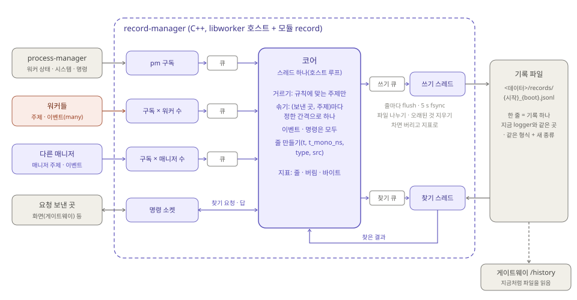

# record-manager 설계서 (기본 탑재 매니저)

| 항목 | 내용 |
|---|---|
| 상태 | 확정(2026-11-24). 구현은 4장 순서대로 |
| 대상 | 정해진 주제·이벤트·명령을 같은 시간축으로 파일에 기록하고, 시간 범위로 찾는다 |
| 실행 파일 | `bin/record-manager`(C++, libworker 호스트 + 모듈 `record`). 소스 `src/`, `lib/record/` |
| 바탕 | `docs/managers.md`(매니저 공통 틀), design.md 6.9(지금 `workspace-logger`), 공통 정의 `common.json`(이벤트·스트림·시각) |

매니저 공통 틀(`docs/managers.md`)을 따른다. 플랫폼 부품(`managers/record/`)이고, process-manager가 기본 탑재로 늘 띄운다.

**지금 `workspace-logger`를 흡수한다.** 지금 기록은 Python `workspace-logger`(시작 셸이 따로 띄움, 죽어도 다시 안 켬)가 process-manager 상태만 남긴다. record-manager가 같은 파일·같은 형식으로 그것을 이어받고, 역할 주제·이벤트를 더한다. 그러면 상주 Python이 사라지고(원칙 10), 기록이 한 곳·한 시간축이 되며, 죽으면 process-manager가 다시 켠다. 게이트웨이 `/history`는 그대로 파일을 읽는다.

## 1. 실행 구조



| 스레드 | 하는 일 | 큐(크기, 넘칠 때) |
|---|---|---|
| `record.pm` | process-manager 구독(`workers`, `system`, `commands`), 끊기면 2 s마다 다시 붙음 | 256, 넘치면 오래된 것 버림 |
| `record.sub.<id>`(3단계) | 워커·매니저마다 스트림 구독(`many` 입력). 늘거나 줄면 목록만 다시 받음 | 상대마다 256, 넘치면 그 상대 것만 버림 |
| 코어(호스트 루프) | 거르기·솎기, 기록 줄 만들기, 찾기 요청 받기·답하기, 지표 | — |
| `record.write` | 파일에 쓰기: 줄마다 flush, 5 s마다 fsync, 파일 나누기, 오래된 것 지우기 | 4096, 넘치면 그 줄 버리고 `rec_drops` |
| `record.find` | 찾기: 파일을 읽어 범위·조건에 맞는 줄을 모음 | 4, 넘치면 `busy` |

- 코어는 파일을 만지지 않는다. 디스크가 느리거나 가득 차도 구독·코어는 계속 돈다
- 모든 스레드 ThreadWatch 감시(멈추면 기록하고 끝냄 → process-manager가 다시 켬)

## 2. 동작

### 2.1 무엇을 기록하나

| 종류(`type`) | 출처 | 언제 | 지금 logger |
|---|---|---|---|
| `worker` | process-manager `workers` | 상태가 바뀌면 바로, 아니면 워커마다 1 s | 같음 |
| `removed` | process-manager | 워커가 빠질 때 | 같음 |
| `command` | process-manager `commands` | 올 때마다 | 같음 |
| `system` | process-manager `system` | 올 때마다 | 같음 |
| `logger` | 자기 자신 | 시작·끝·다시 붙음 | 같음(이름 그대로, `/history`가 읽음) |
| `topic` | 워커·매니저 스트림의 `topics` | 규칙의 간격마다 하나(솎기). `kf`(기준 상태)는 늘 | 새로 |
| `event` | 스트림의 `events` | 모두(솎지 않음). 기준 상태(kf)마다 다시 실려 오는 지난 이벤트는 뺌((보낸 곳, source)마다 마지막 `t_mono_ns`보다 새것만, 보드에서 찾음) | 새로 |

### 2.2 규칙(매니저 설정 = 규칙 데이터)

```json
{
  "topics": [
    {"match": "*", "interval_ms": 1000},
    {"match": "*.camera", "interval_ms": 200}
  ],
  "exclude": [],
  "max_file_mb": 64,
  "max_total_mb": 2048,
  "fsync_s": 5
}
```

| 키 | 뜻 | 기본 |
|---|---|---|
| `topics[].match` | `<보낸 곳>.<주제>` 글롭(`*`). 위에서부터 처음 맞는 것 하나 | `*`(모두) |
| `topics[].interval_ms` | (보낸 곳, 주제)마다 이 간격에 하나. `0`이면 오는 대로 모두 | 1000 |
| `exclude` | 기록하지 않을 `<보낸 곳>.<주제>` 글롭 | 없음 |
| `max_file_mb`, `max_total_mb` | 파일 하나·전체 상한, 넘으면 새 파일·오래된 것부터 지움 | 64, 2048(지금과 같음) |
| `fsync_s` | 디스크에 확실히 쓰는 간격 | 5 |

- 예전 환경 변수(`WORKSPACE_LOGGER_*`)는 4단계에서 지움(0.65). 값은 이 설정 칸으로만 받는다(프로필 `managers/record` 프리셋)
- 규칙은 설정 스키마로 검사(design.md 6.10). 프로젝트는 프로필로 덮어쓴다

### 2.3 기록 줄

```json
{"t": "2026-11-24T10:00:00.123+09:00", "t_mono_ns": 123456789000, "type": "topic", "src": "cam1", "topic": "camera", "v": {}}
{"t": "...", "t_mono_ns": 123456790000, "type": "event", "src": "cam1", "v": {"severity": "warning", "code": "link_down"}}
```

- `t`: 사람이 읽는 시각(지금 logger와 같음). `t_mono_ns`: 같은 시간축(보드 CLOCK_MONOTONIC, 공통 정의). 주제 값에 `t_mono_ns`가 있으면 그것(잰 시각), 없으면 받은 시각
- 파일: `<데이터>/records/{처음 쓴 시각}_{boot_id 8자}.jsonl`(지금과 같음). 같은 부팅이면 이어 씀

### 2.4 찾기

명령 `record.find`(읽기 명령):

```json
{"cmd": "record.find", "args": {"since_ns": 0, "until_ns": 0, "kinds": ["event"], "src": "cam1", "topic": "*", "limit": 1000}}
```

- 답: `{"lines": [...], "more": true|false}`. `limit` 최대 5000, 그보다 많으면 `more`
- 지금 부팅 파일만 `t_mono_ns`로 찾는다(부팅이 바뀌면 시계가 0부터라). 지난 부팅은 `t`(사람 시각)로 `since`·`until`
- 내보내기(파일로 잘라 받기)는 다음 판

## 3. 인터페이스 명세 (ICD)

| 무엇 | 내용 |
|---|---|
| 입력 | process-manager Manager API 구독(매니저 읽기 소켓 `manager-record-manager.sock`, 0.66. 설정·환경 변수가 없을 때만 예전 `manager-logger.sock`, libworker `ManagerSubscription`). `io.json` `uses`: 모든 스트림(`many: true`, 정의는 가리지 않음: 내용은 해석하지 않고 그대로 기록) |
| 명령 | `record.find`(읽기), `get_status` |
| 주제 | `record`: `{"file": "<지금 파일>", "lines": n, "bytes": n, "drops": n, "disk_free_mb": n}` 1 s |
| 이벤트 | `disk_low`(warning, 남은 공간 < 5%), `write_failed`(error), `pm_lost`(warning, process-manager 구독이 끊김) |
| 지표 | `record_lines`, `record_bytes`, `record_drops`, `record_files`, `record_write_errors`, `record_pm_link`, `record_disk_free_mb`, `record_finds`(모듈 접두어 `record_`, 구독 수는 3단계에서) |

## 4. 옮기는 순서

1. record-manager가 `worker`·`removed`·`command`·`system`·`logger` 종류를 지금 logger와 같은 모양으로 씀. PC에서 둘을 나란히 돌려 줄을 비교(시험) — **됨(2026-11-24)**: `test_compare.py`(시각만 빼고 글자 그대로 같음), 단위·통합 시험·TSan
2. 시작 셸이 logger를 띄우지 않음. 게이트웨이 `/history` 시험 그대로 통과 확인 — **됨(2026-11-24, 0.63)**: 기본 탑재(`worker-types.json`, `kind: manager`, `stop_order: 2`), process-manager 수락 시험 `test_managers`. 보드 확인(2026-11-24): 떠 있음(RSS 3.6 MB, 스레드 4), 같은 파일에 이어 씀, `/history` 그대로. 끌 때 순서는 다음 재시작 때
3. `topic`·`event` 종류 추가(`many` 입력 구현과 함께, process-manager 쪽) — **됨(2026-11-24, 0.64)**: `io.json` `uses.streams`(`from: "*"`, `many`), 구독 스레드 `rs.<id>`, 규칙 `topics`·`exclude`. 단위·통합 시험(가짜 워커 스트림, 목록에서 빠지면 구독 끊음) 보드 확인(2026-11-24): 끌 때 순서(워커 → record, `stop` 맨 끝), 구독 5(스트림 내는 2 연결), 주제 1 s 솎기, 이벤트 중복 없음
4. Python logger 삭제, 환경 변수 정리, 보드 확인 — **됨(2026-11-24, 0.65)**: `logger/workspace_logger/` 삭제, 비교 시험은 지우기 전에 저장한 정답 줄(`test/logger_expected.jsonl`)과 맞댐 보드 확인(2026-11-24): Python logger 없음, 기록 그대로, 끌 때 `stop` 맨 끝, 데이터 폴더의 옛 변수 3개는 "ignored"만

## 5. 끝날 때

워크스페이스를 내릴 때 마지막까지 기록해야 한다(지금은 시작 셸이 Manager 다음에 logger를 내림). process-manager가 끌 때 순서를 **워커 → 다른 매니저 → record**로 한다. record는 끝나기 전에 쓰기 큐를 비우고 fsync한다.

## 6. 시험

| 무엇 | 어떻게 |
|---|---|
| 코어 | 단위 시험: 거르기·솎기·`kf`·이벤트 모두·줄 모양(가짜 시계·가짜 입력) |
| 쓰기 | 파일 나누기·지우기·느린 디스크(가짜 지연)·가득 참(버림 지표) |
| 지금 logger와 같음 | 같은 process-manager 구독을 둘이 받아 종류별 줄 비교 |
| `/history` | 게이트웨이 수락 시험 그대로 |
| 찾기 | 범위·조건·`limit`·`more`, 찾는 동안 기록이 막히지 않음 |
| 동시성 | TSan |

## 7. 함께 정한 것 (2026-11-24)

| # | 항목 | 정한 것 |
|---|---|---|
| 1 | logger 흡수 | record-manager가 `workspace-logger`를 대신함(같은 파일·형식, Python 삭제) |
| 2 | 기본 기록 대상 | 모든 주제 1 s에 하나 + 이벤트·명령 모두 |
| 3 | 파일 형식 | jsonl 유지(지금 `/history`가 그대로 읽음). 내장 DB 등은 나중 |
| 4 | 찾기 첫 판 | 명령 `record.find`(최대 5000줄). 내보내기는 다음 판 |
| 5 | 끝날 때 순서 | process-manager가 워커 → 다른 매니저 → record 순서로 끔 |
| 6 | 영상 | 기록하지 않음(지금처럼 replay 워커). record는 텔레메트리·이벤트만 |
