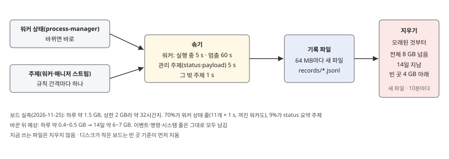

# 기록 보존: 덜 쓰고 오래 남기기

| 항목 | 내용 |
|---|---|
| 상태 | 구현(2026-11-25, 0.84). 9장 초안 값대로 |
| 대상 | record-manager의 기록(`<데이터>/records/*.jsonl`): 무엇을 얼마나 자주 쓰고, 언제 지우나 |
| 왜 | 보드 실측(2026-11-25): 하루 약 1.5 GB, 전체 상한 2 GB라 **약 32시간치만** 남는다. 디스크는 982 GB 중 881 GB가 비어 있다. 한 파일(66분, 67 MB)의 **70%가 워커 상태 줄**(워커 11개 × 1초 × 1~1.7 KB, 꺼진 워커도 1초마다), 9%가 status-manager `system` 주제(워커 상태 요약을 한 번 더) |
| 바탕 | `managers/record/design.md` 2장(무엇을·규칙), 게이트웨이 `/history`(시스템 모니터 추이 그래프, 구간마다 줄여 그림이라 간격에 묶이지 않음) |

## 1. 구조

| 단계 | 지금 | 바꾼 뒤 |
|---|---|---|
| 워커 상태 줄 | 상태 키가 바뀌면 바로, 아니면 1 s마다 | 바뀌면 바로(그대로), 아니면 **실행 중 5 s**(`interval_s`), **실행 중이 아니면 60 s**(`stopped_interval_s`) |
| 주제 | 규칙 없으면 모두 1 s에 하나 | 규칙 없을 때 기본: `status-manager.*`·`payload-manager.*` **5 s**, 그 밖 1 s. 규칙을 주면 그것만 |
| 지우기 | 전체가 2 GB를 넘으면 오래된 파일부터 | 셋 중 하나라도 걸리면 오래된 파일부터(지금 쓰는 파일은 빼고): 전체 **8 GB**(`max_total_mb`) 넘음, **14일**(`keep_days`) 지남, 디스크 빈 곳 **4 GB**(`min_free_mb`) 아래 |
| 지우는 때 | 새 파일을 열 때 | 새 파일을 열 때 + **10분마다** |

- 이벤트·명령·시스템 줄은 그대로(모두 남김)
- 예상: 워커 줄 약 1/5, 관리 주제 1/5 → 하루 약 0.4~0.5 GB, 14일 약 6~7 GB(8 GB 안)
- 디스크가 작은 보드는 `min_free_mb`가 먼저 지운다(기록이 디스크를 채우지 않음)

## 2. 설정 (record-manager 설정 칸, 프리셋)

| 키 | 뜻 | 기본(바뀜) |
|---|---|---|
| `interval_s` | 실행 중 워커의 상태 줄 간격(바뀌면 바로) | 1 → **5** |
| `stopped_interval_s` | 실행 중이 아닌 워커의 상태 줄 간격 | 새로 **60** |
| `topics` | 주제 솎기 규칙 | 없을 때 기본에 관리 주제 5 s |
| `max_total_mb` | 전체 상한 | 2048 → **8192** |
| `keep_days` | 이보다 오래된 파일 지움(0 = 기간으로 지우지 않음) | 새로 **14** |
| `min_free_mb` | 디스크 빈 곳이 이 아래면 오래된 것부터 지움(0 = 안 봄) | 새로 **4096** |
| `max_file_mb`, `fsync_s` | 그대로 | 64, 5 |

- 상태(`get_status`)·지표: 지운 파일 수(`removed`)에 지운 까닭별 셈(`removed_size`·`removed_age`·`removed_free`)

## 3. 시험

| 무엇 | 어떻게 |
|---|---|
| 워커 줄 간격 | 실행 중 5 s, 멈춤 60 s, 상태 키가 바뀌면 바로 |
| 주제 기본 규칙 | 규칙 없을 때 관리 주제 5 s, 그 밖 1 s |
| 지우기 | 전체 상한·기간(파일 시각을 옛날로)·빈 곳(빈 곳 재는 함수를 시험에서 바꿔 끼움), 지금 파일은 안 지움 |
| 보드 | 하루 쓰는 양 다시 재기 |

## 9. 함께 정할 것 (초안)

| # | 항목 | 초안 |
|---|---|---|
| 1 | 워커 줄 간격 | 실행 중 5 s, 아니면 60 s |
| 2 | 관리 주제 간격 | status·payload 5 s |
| 3 | 보존 | 14일, 전체 8 GB, 빈 곳 4 GB 아래면 지움 |
| 4 | 지우는 때 | 새 파일 + 10분마다 |
