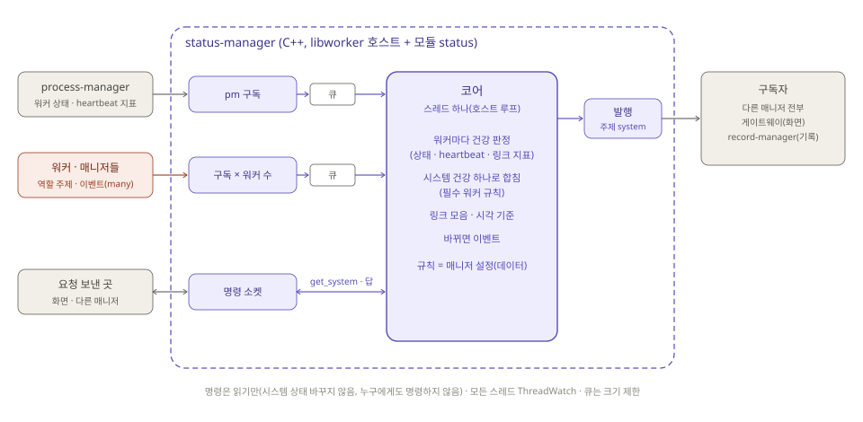

# status-manager 설계서 (기본 탑재 매니저)

| 항목 | 내용 |
|---|---|
| 상태 | 확정·구현(2026-11-24, 0.66). 단위·통합·수락 시험. 보드 확인(2026-11-24): 건강 ok(워커 7: ok 5, off 2), RSS 3.6 MB, 주제·이벤트가 record에 기록됨. 시작 직후 이벤트가 버려지던 것은 고침(구독자가 없으면 최근 64개를 쌓아 두었다가 처음 붙는 구독자에게). 다시 확인: seq 1~5 모두 기록, 마지막 degraded → ok까지 |
| 대상 | 워커 프로세스 상태와 역할 주제를 모아 **시스템 상태 하나**(건강·링크·시각 기준)로 만들어 내보낸다. 보기만 한다 |
| 실행 파일 | `bin/status-manager`(C++, libworker 호스트 + 모듈 `status`). 소스 `src/`, `lib/status/` |
| 바탕 | `docs/managers.md`(공통 틀), `docs/layers.md` 4장(status: 보기만, 모두가 구독), `managers/record`(같은 틀의 첫 매니저) |

매니저 공통 틀(`docs/managers.md`)을 따른다. record-manager와 같은 모양이고, 다른 점은 **판단(건강 판정)을 하고 그 결과를 주제로 내보낸다**는 것이다. 누구에게도 명령하지 않는다(원칙 13: status는 명령하지 않음).

## 1. 실행 구조



| 스레드 | 하는 일 | 큐(크기, 넘칠 때) |
|---|---|---|
| `status.pm` | process-manager 구독(`workers`, `system`), 끊기면 2 s마다 다시 붙음 | 256, 넘치면 오래된 것 버림(다음 주기에 전체가 다시 옴) |
| `ss.<id>` | 워커·매니저마다 스트림 구독(`many` 입력) | 상대마다 256, 넘치면 오래된 것 버림(최신이 중요) |
| 코어(호스트 루프) | 워커마다 건강 판정, 시스템 상태로 합치기, 1 s마다(바뀌면 바로) 발행, 이벤트, 읽기 명령 | — |

- 발행은 libworker `Publisher`(워커와 같은 스트림 소켓). 느린 구독자는 그 구독자만 끊는다
- 파일을 쓰지 않는다(상태는 메모리, 기록은 record-manager가 이 주제를 구독해 남김)

## 2. 무엇을 판단하나

### 2.1 워커마다 건강

process-manager가 주는 것만으로 정한다(장치 종류를 모름, 원칙 12).

| 건강 | 조건(위에서부터 처음 맞는 것) |
|---|---|
| `off` | 꺼 둠(`desired_state` stopped, 또는 `disabled`) |
| `fault` | `failed`·`crash_loop`, 또는 실행 중인데 heartbeat가 `stale_s`(기본 3 s) 넘게 없음 |
| `starting` | `starting`·다시 켜는 중 |
| `degraded` | 실행 중인데 링크 지표 하나라도 0(이름이 `*_link`인 heartbeat 지표, 예: `link_link`, `inputs_<입력>_link`), 또는 규칙의 지표 조건에 걸림 |
| `ok` | 실행 중, 위에 안 걸림 |

- 링크 지표: 워커가 이미 heartbeat로 내는 `<모듈>_link`·`inputs_<입력>_link`(libworker 규칙)를 그대로 본다. 새 약속을 만들지 않는다
- 규칙의 지표 조건(선택): `{"worker": "cam*", "metric": "camera_fps", "below": 10, "then": "degraded"}`처럼 데이터로 더한다(엔진은 그대로, 원칙 18)

### 2.2 시스템 건강 하나

| 시스템 | 조건 |
|---|---|
| `fault` | 필수 워커 하나라도 `fault`·`off` |
| `degraded` | 필수 워커 하나라도 `degraded`·`starting`, 또는 필수 아닌 워커가 `fault` |
| `ok` | 그 밖 |

- **필수 워커:** 규칙 `required`(워커 id 글롭 목록). 비우면 **자동 시작(`autostart`) 워커 전부**(사람이 "늘 켜 둘 것"으로 정한 것이라)
- 매니저 자신들도 워커처럼 본다(record-manager가 죽으면 그것도 보임)

### 2.3 시각 기준

모든 주제의 시각은 보드 CLOCK_MONOTONIC(`t_mono_ns`, 공통 정의)이다. 사람 시각으로 바꿀 수 있게 `clock: {"t_mono_ns": .., "t_unix": .., "boot_id": ..}`를 주제에 함께 낸다(같은 순간의 두 시계). 다른 블록은 이것으로 바꾼다.

### 2.4 역할 주제(이번 판에서 하는 것)

스트림 구독(`many`)은 이번 판에서 **링크 상태만** 본다: 각 워커 스트림에 붙었는지(`subs_up`). 역할 주제의 내용으로 "동작 상태"(예: 준비·동작 중)를 정하는 것은 규칙이 필요해서 다음 판(8장 4).

## 3. 내보내는 것 (ICD)

주제 `system`(1 s, 바뀌면 바로, 정의 `io/system.json`):

```json
{
  "t_mono_ns": 0,
  "health": "ok|degraded|fault",
  "reasons": ["cam1: link down (link_link=0)"],
  "workers": {"cam1": {"health": "degraded", "state": "running", "kind": "worker", "required": true,
                       "links": {"link_link": 0}, "heartbeat_age_ms": 120, "stream": true}},
  "counts": {"ok": 3, "degraded": 1, "fault": 0, "starting": 0, "off": 2},
  "clock": {"t_mono_ns": 0, "t_unix": 0.0, "boot_id": "4aa35cde"},
  "pm_link": true
}
```

| 무엇 | 내용 |
|---|---|
| 이벤트 | `health_changed`(시스템 건강이 바뀜: info/warning/error), `worker_health_changed`(워커 건강이 바뀜). record-manager가 기록 |
| 명령 | `status.get_system`(읽기): 위 주제의 지금 값 |
| 지표 | `status_health`(0 ok, 1 degraded, 2 fault), `status_workers`, `status_faults`, `status_pm_link`, `status_subs_up` |
| 입력 | process-manager 구독, `io.json` `uses.streams`(`from: "*"`, `many`) |

## 4. process-manager에 붙는 길

record-manager는 예전 logger 자리(`manager-logger.sock`)를 이어받았다. status-manager는 자기 소켓이 필요하다. **매니저마다 읽기 전용 클라이언트 소켓 `manager-<id>.sock`을 process-manager가 만들어 준다**(type `"kind": "manager"`이면 자동, 환경 변수 `WORKSPACE_MANAGER_SOCKET`로 위치 전달). 쓰기 op는 `forbidden`. 나중에 payload-manager처럼 켜고 끄기가 필요한 매니저만 쓰기를 연다(그때 정함).

## 5. libworker로 옮기는 것

`many` 입력 목록 읽기(입력 파일의 `"many"` 칸, 바뀌면 다시 읽기)를 record-manager에서 libworker로 옮긴다: `worker::ManyInputs`(`list(name)`, `changed()` 1 s마다 파일 확인). record-manager도 이것을 쓰게 바꾼다(같은 동작). 라이브러리 사본(틀·워커·매니저)을 맞춘다.

## 6. 끊겼을 때

| 상황 | 어떻게 |
|---|---|
| process-manager 구독이 끊김 | 마지막 상태를 내되 `pm_link: false`, 시스템 건강 `degraded`(이유 "process-manager link lost") |
| 워커 스트림이 끊김 | 그 워커의 `stream: false`. 건강은 heartbeat·링크 지표로만 정하므로 바뀌지 않음 |
| status-manager가 죽음 | process-manager가 다시 켬. 구독자는 `link` 0으로 "오래됨" 표시(공통 틀 7장) |

## 7. 시험

| 무엇 | 어떻게 |
|---|---|
| 코어 | 단위 시험: 워커 건강 표(상태·heartbeat 나이·링크 지표·규칙 조건), 시스템 건강(필수 규칙·autostart 기본), 바뀔 때만 이벤트 |
| 통합 | 가짜 process-manager 소켓 → 주제 `system` 구독해 건강 바뀜 확인, `get_system`, 끊김 시 `pm_link` |
| process-manager | 매니저 읽기 소켓 `manager-<id>.sock` 생김·쓰기 `forbidden`(수락 시험) |
| 동시성 | TSan |

## 8. 함께 정한 것 (2026-11-24)

| # | 항목 | 정한 것 |
|---|---|---|
| 1 | 워커 건강 판정 | 2.1 표(상태·heartbeat·`*_link` 지표, 규칙으로 지표 조건 더함) |
| 2 | 필수 워커 기본값 | 규칙 `required`가 비면 자동 시작 워커 전부 |
| 3 | process-manager 소켓 | 매니저마다 읽기 전용 `manager-<id>.sock` 자동(record도 나중에 옮김) |
| 4 | 역할 주제 | 이번 판은 스트림 연결 여부만. "동작 상태"는 규칙과 함께 다음 판 |
| 5 | libworker | `many` 읽기를 `worker::ManyInputs`로 옮기고 record도 그것을 씀 |
| 6 | 게이트웨이·화면 | 이번 판은 주제만 냄. 화면 표시(맨 위 건강 표시 등)는 따로 정함 |
