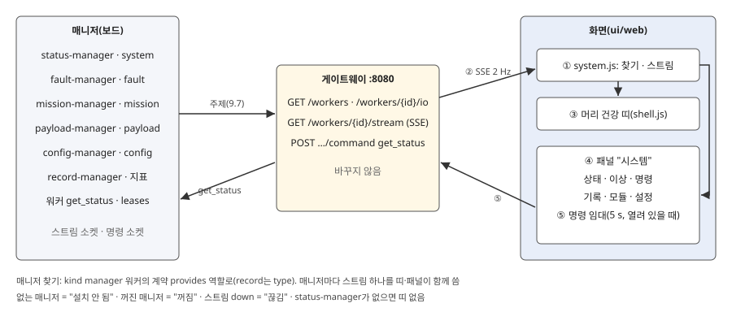

# 건강 띠와 패널 "시스템" (워크스페이스 화면, 초안)

| 항목 | 내용 |
|---|---|
| 상태 | 확정·구현(2026-11-24, 0.74 예정). 9장은 초안대로 정함(사용자: "나머지도 다 하고 한 번에 검증") |
| 대상 | 워크스페이스 기본 화면(`ui/web`)에서 매니저 6개의 상태를 한눈에: 상단 건강 띠(늘 보임) + 왼쪽 목록 "모니터링 › 시스템" 패널 |
| 바탕 | `ui/README.md`(패널 추가·디자인 규칙), `docs/managers.md`, 매니저 주제 정의 `managers/*/io/*.json`, `docs/command-lease.md`(임대 `leases`) |
| 남은 일 목록 | `docs/managers-next.md` 7번 |

## 1. 왜

매니저는 모두 떠 있지만 화면에는 "전체 워커" 표의 한 줄씩으로만 보인다. 시스템이 지금 괜찮은지(status), 무슨 이상이 올라와 있는지(fault), 명령이 막히고 있는지(mission)를 보려면 REST를 직접 불러야 했다.

## 2. 구조

| 단계 | 하는 일 | 어디서 |
|---|---|---|
| ① 찾기 | `GET /workers`에서 `kind: "manager"`인 워커마다 계약 `GET /workers/{id}/io`를 한 번 읽어, 내보내는 역할(`system`·`fault`·`mission`·`payload`·`config`)을 내보내는 매니저를 안다(이름을 박아 두지 않음). record는 역할이 없어 type `record-manager`로 | `web/system.js` |
| ② 받기 | 그 매니저가 떠 있으면 스트림 `GET /workers/{id}/stream?hz=2`(SSE, 9.7)를 하나 열어 주제를 합친다(첫 메시지 기준 상태, 이후 바뀐 주제만). 이벤트는 매니저마다 최근 20개. 꺼지면 닫고 "끊김" | `web/system.js` |
| ③ 건강 띠 | 셸 머리에 `system` 주제의 `health`(정상·주의·고장)와 fault 주제의 이상 수. 누르면 `#/system` | `web/shell.js` |
| ④ 패널 | 카드 6개(아래 3장). 셸 갱신 주기마다 다시 그림 | `web/panels/system/` |
| ⑤ 임대 | 패널이 열려 있을 때만 5 s마다 떠 있는 워커에 `get_status`(읽기 명령, 게이트웨이가 워커로 바로)를 보내 `leases`를 모음 | `web/panels/system/` |

- 화면 하나가 매니저 스트림을 매니저마다 하나만 연다(띠와 패널이 같은 `system.js`를 씀, ES 모듈 하나)
- 브라우저는 출처마다 HTTP/1.1 연결이 6개라, 늘 여는 스트림은 띠에 쓰는 system·fault 둘뿐. mission·payload·config는 패널 "시스템"이 열려 있는 동안만(다른 패널의 자기 스트림이 막히지 않게)
- 게이트웨이·매니저는 바꾸지 않는다(지금 있는 경로만 씀)

## 3. 패널 "시스템"

| 카드 | 무엇을 | 출처 |
|---|---|---|
| 머리 타일 | 전체 건강, 이상 수(가장 심한 것), 명령 거절(busy+forbidden), 기록 중 여부 | system·fault·mission·record |
| 상태(status) | 워커마다 건강·상태·이유(`why`), 전체 이유(`reasons`) | `system` 주제 |
| 이상(fault) | 올라간 이상: 심각도·규칙·워커·내용·지난 시간·확인 여부, 확인(`fault.ack`) 버튼 | `fault` 주제 |
| 명령(mission) | (대상, 역할)마다 대기·보내는 중(명령·보낸 곳·나이), 보냄·busy·timeout·forbidden, 최근 거절 이벤트 | `mission` 주제·이벤트 |
| 기록(record) | 상태, 줄·바이트·빠짐·쓰기 오류·남은 디스크·구독 수 | `GET /workers`의 record-manager 지표 |
| 모듈(payload) | 모듈마다 역할·상태·자동 시작·건강 | `payload` 주제 |
| 설정(config) | 어긋난 버전, 스냅숏 수, 스냅숏 뒤 바뀜(drift) | `config` 주제 |
| 명령 임대 | 걸린 임대: 워커·역할·명령·보낸 곳·남은 시간 | 워커 `get_status`의 `leases` |

- 매니저가 없으면 그 카드는 "설치 안 됨", 있는데 꺼져 있으면 "꺼짐", 스트림이 끊기면 "끊김"
- 공통 부품만 씀(`ctx.ui`: `panelHead`·`tiles`·`card`·`kvList`·`pill`), 배치는 `cols2`

## 4. 건강 띠

| status `health` | 띠 |
|---|---|
| `ok` | 초록 "시스템 정상" |
| `degraded` | 주황 "시스템 주의" + 이유 개수 |
| `fault` | 빨강 "시스템 고장" |
| 스트림 없음·끊김 | 회색 "시스템 상태 모름" |
| status-manager 없음 | 띠 없음(지금과 같음) |

fault 주제에 올라간 이상이 있으면 옆에 "이상 N"(가장 심한 것의 색). 띠 위에 마우스를 올리면 이유(`reasons`)가 보인다.

## 5. 끊겼을 때

| 상황 | 화면 |
|---|---|
| 매니저 꺼짐 | 그 카드 "꺼짐", 스트림 닫음, 다시 뜨면 다시 엶 |
| 스트림 끊김(`stream: down`) | 그 카드 "끊김"(마지막 값 지움) |
| 보드 응답 없음 | 셸이 이미 "보드 응답 없음", 띠는 "상태 모름" |

## 6. 시험

| 무엇 | 어떻게 |
|---|---|
| 화면 | 로컬 게이트웨이(8090) + 가짜 매니저 스트림으로 띠·패널을 띄워 내장 브라우저로 봄 |
| 문법 | `node --check`(모듈) |
| 보드 | 재시작 뒤 한 번에: 띠가 "시스템 정상", 패널 카드 6개가 값으로 참 |

## 7. 하지 않는 것

이상 규칙 편집, 명령 큐 비우기, 스냅숏 복원 같은 조작(매니저 명령 화면)은 넣지 않는다. 지금은 보기와 이상 확인만.

## 9. 함께 정할 것 (초안)

| # | 항목 | 초안 |
|---|---|---|
| 1 | 매니저 찾기 | 계약(provides 역할)으로, record만 type으로 |
| 2 | 받는 법 | 매니저 스트림(SSE) 2 Hz, 화면 전체에서 매니저마다 하나. 늘 여는 것은 system·fault, 나머지는 패널이 열려 있을 때만 |
| 3 | 띠 자리 | 셸 머리, 모드 배지 앞. status-manager가 없으면 안 보임 |
| 4 | 패널 자리 | "모니터링" 묶음, 시스템 모니터 다음(order 25, 처음 열리는 화면은 그대로 시스템 모니터) |
| 5 | 임대 | 패널이 열려 있을 때만 5 s마다 워커 `get_status` |
| 6 | 조작 | 이상 확인(`fault.ack`)만 |
