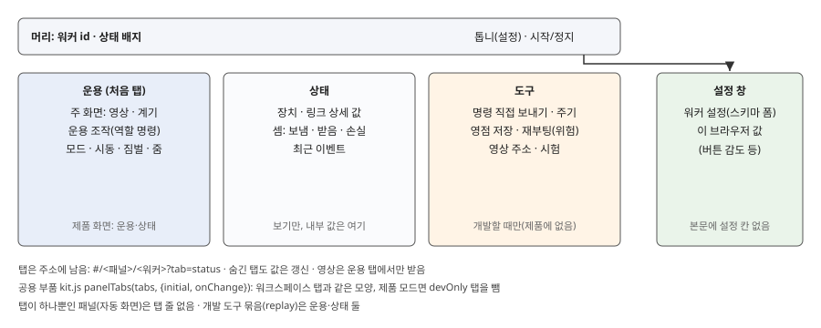

# 워커 패널 정리: 운용 · 상태 · 도구

| 항목 | 내용 |
|---|---|
| 상태 | 구현(2026-11-25, 0.83). 9장 초안 값대로 |
| 대상 | 왼쪽 "페이로드"·"개발 도구"의 워커 패널(워커 폴더 `workspace/panel/`). 공용 부품 `ui/web/kit.js` |
| 왜 | 패널마다 운용 조작(모드·시동·짐벌·줌)과 진단 값(연결 주소·송수신 수·시각 맞춤)과 개발 도구(명령 직접 보내기·메시지 주기·재부팅·영점 저장)가 한 화면에 섞여 있다. 쓰는 사람이 무엇이 운용이고 무엇이 정비인지 화면만 보고 알 수 없다 |
| 바탕 | `ui/workspace-screen.md`(정리 기준 3장), `ui/README.md`(패널 규칙), `docs/modes.md`(제품 화면), design.md 6.10(워커 설정 창) |

## 1. 구성

워커 패널 하나 = 머리 + 탭 셋. 탭은 주소에 남는다(`#/<패널>/<워커>?tab=status`).

| 자리 | 내용 | 규칙 |
|---|---|---|
| 머리 | 워커 id, 상태 배지(실행·연결·모드 등 장치의 핵심 몇 개), 오른쪽에 설정(톱니)·시작/정지 | 지금 그대로(`panelHead`, `workerSettings`, `workerControls`) |
| 탭 "운용" | 장치의 주 화면(영상·계기)과 운용 조작(역할 명령) | 처음 열리는 탭. 운용 중 쓰는 것만. 제품 화면에는 운용·상태 둘(도구는 빠짐) |
| 탭 "상태" | 장치·링크 상세 값, 셈(보냄·받음·손실·다시 시작), 최근 이벤트 | 보기만. 내부 값(주소·포트·소켓)은 여기 |
| 탭 "도구" | 정비·시험: 명령 직접 보내기, 메시지 주기, 영점 저장, 재부팅, 영상 주소 바꾸기, 추적 시험 | 개발할 때만(제품 화면에 없음). 위험한 것은 `section({danger})` |
| 설정 창(톱니) | 워커 설정(스키마 폼) + 이 브라우저에만 두는 값(버튼 감도 등) | 패널 본문에 설정 칸을 두지 않는다 |

- 탭이 하나뿐인 패널(자동 화면)은 탭 줄을 그리지 않는다
- 숨긴 탭도 갱신은 받는다(값이 바로 보이게). 영상은 "운용" 탭에서만 받는다

## 2. 공용 부품

`kit.js` `panelTabs(tabs, { initial, onChange })`: 탭 줄 + 탭 몸통들. `tabs = [{id, label, body, devOnly?}]`. 지금 탭은 주소 `?tab=`에서 읽고 바꾸면 주소에 쓴다(`history.replaceState`, 패널을 다시 띄우지 않음). 제품 모드면 `devOnly` 탭을 뺀다. 워크스페이스 패널의 탭(`.tabs`)과 같은 모양.

## 3. 패널마다 나누기

| 패널 | 운용 | 상태 | 도구 |
|---|---|---|---|
| siyi(짐벌 카메라) | 영상(보는 영상 고르기), 짐벌 제어(방향·정면·아래 보기), 줌·초점, 모드(lock·follow·fpv), 사진·녹화. 추적 시험 버튼은 영상 아래(영상 위에서 쓰므로, 제품 화면에서 숨김) | 카메라 정보(전에는 대화창), 영상 상태 | 각도 이동(값 넣기), 영점 저장, 정비(재시작·영점 초기화·SD 포맷, 전에는 설정 창) |
| flight-control(FC) | 머리 타일(배터리·잔량·GPS·고도·속도), 자세계, 비행 모드 버튼, 시동(설정이 허락할 때) | 자세·위치·링크(수신률·손실·지연)·송수신 셈·시각 맞춤·다른 참여자·명령 셈, 이벤트 | 정보 요청(버전·홈·GPS·배터리), 메시지 주기, 직접 보내기(메시지 주기·COMMAND_LONG), FC 재부팅(위험) |
| ximea(카메라) | 영상, 노출·게인·fps | 카메라 상태 | 송출 켜고 끄기(전에는 설정 창) |
| replay(개발 도구) | 녹화(워커 고르기·시작·멈춤), 재생(배속·반복), 녹화 목록 | 셈 타일, 상태 | (없음: 탭 둘) |
| 자동 화면 | (탭 없음, 지금 그대로: 지표·상태 카드) | | |
| 틀(`_template`) | 예제 값 | 상태 카드 | 예제 명령 |

- 버튼 감도(siyi)는 설정 창의 "이 브라우저" 묶음으로 옮긴다. 영상 주소 바꾸기도 이 브라우저 값이라 설정 창에 그대로 둔다
- siyi·ximea 설정 버튼이 설정 창을 만들기 전 값을 잡아 눌러도 열리지 않던 것을 함께 고침
- 요청·주기 버튼 결과는 도구 탭 아래 "결과" 한 줄로(지금처럼)

## 4. 바뀌는 파일

| 저장소 | 파일 |
|---|---|
| 공개 | `ui/web/kit.js`(`panelTabs`), `ui/web/shell.css`(워크스페이스 탭과 같은 모양), `workers/_template/workspace/panel/panel.js`, `workers/replay/workspace/panel/panel.js`, `ui/README.md`(패널 규칙에 탭 셋) |
| DURU | `workers/siyi|flight-control|ximea/workspace/panel/panel.js` |

## 5. 시험

브라우저로 패널마다 탭 셋이 열리고 주소에 남는지, 제품 모드에서 도구 탭이 없는지, 영상은 운용 탭에서만 받는지, 탭을 바꿔도 값이 그대로 갱신되는지. 모듈 불러오기(문법)는 점검에서.

## 9. 함께 정할 것 (초안)

| # | 항목 | 초안 |
|---|---|---|
| 1 | 탭 이름 | 운용 · 상태 · 도구 |
| 2 | 처음 탭 | 운용 |
| 3 | 도구 탭 | 개발할 때만(제품 화면에 없음) |
| 4 | 버튼 감도 | 설정 창 "이 브라우저" 묶음 |
| 5 | 탭 주소 | `?tab=` (패널을 다시 띄우지 않고 바꿈) |
