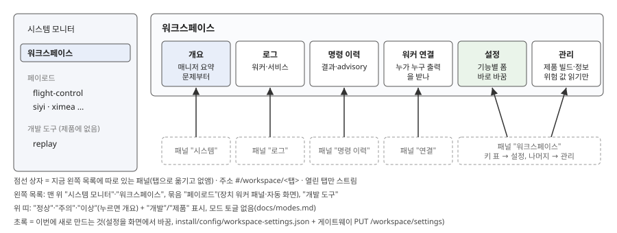

# 워크스페이스 화면 개편: 왼쪽 목록 넷, 워크스페이스 탭 여섯

| 항목 | 내용 |
|---|---|
| 상태 | 구현(2026-11-25, 0.80). 9장 초안 값대로. 명령 이력의 `advisory` 표시는 아직(게이트웨이 명령 기록에 칸 없음) |
| 대상 | 보드 화면(`ui/web`)의 왼쪽 목록과 공용 패널 전부. 워커 패널(장치마다)은 이 다음에 같은 기준으로 |
| 왜 | 공용 패널 6개(시스템, 시스템 모니터, 로그, 명령 이력, 워크스페이스, 연결)가 왼쪽 목록에 나란히 있고, "워크스페이스" 패널은 모드·제품 빌드·프로필·폴더·키 표·파일 출처·연결 상태를 한 페이지에 쌓아 두었으며 설정은 읽기 전용이다. 공용 플랫폼 화면으로는 무엇이 어디 있는지 알기 어렵다 |
| 함께 바뀌는 것 | `docs/modes.md`(워크스페이스는 늘 개발: 모드 토글이 없어짐) |
| 바탕 | `ui/README.md`(패널 규칙, 0.77 묶음 고정), `ui/system-panel.md`(매니저 요약), design.md 6.10(워커 설정 폼), 11.4(제품 화면) |

## 1. 구성

**왼쪽 목록**

| 자리 | 항목 | 내용 |
|---|---|---|
| 맨 위 | 시스템 모니터 | 보드 자원(CPU·GPU·메모리·온도·전력), 프로세스, 전체 워커 자원. 지금 그대로 |
| 맨 위 | 워크스페이스 | 아래 탭 여섯. 처음 열리는 화면 |
| 묶음 "페이로드" | 장치 워커 패널 | 워커 폴더 `workspace/panel/`의 패널, 자기 패널이 없으면 자동 화면 |
| 묶음 "개발 도구" | 개발할 때만 쓰는 워커 패널 | 예: replay. 제품 화면에는 없음 |

- 화면에서 "시스템"이라는 말은 시스템 모니터에만 남긴다. 위 띠의 "시스템 정상"은 **"정상"·"주의"·"이상"**만(누르면 워크스페이스 › 개요)
- 위 띠 오른쪽: "개발"(워크스페이스) 또는 "제품" 표시, 로그인. 모드 토글 없음(`docs/modes.md`)

**워크스페이스 탭**

| 탭 | 내용 | 지금 어디 |
|---|---|---|
| 개요 | 매니저 6개 요약: 위에 타일(건강·이상·명령 거절·기록), 아래에 **문제 있는 것부터** 카드(상태, 이상과 잡아 둔 대응·실행 버튼, 명령, 임대, 기록, 설정 버전). 모듈 목록은 빼고 페이로드 묶음 개수만 | 패널 "시스템" |
| 로그 | 워커 로그·서비스 로그(필터, 자동 새로 읽기) | 패널 "로그" |
| 명령 이력 | 보낸 곳·명령·결과, `advisory`("운용이었으면 막힘") 표시 | 패널 "명령 이력" |
| 워커 연결 | 위: "어느 워커가 어느 워커의 출력을 받나" 그림. 아래: 입력마다 상대 고르기, 명령할 수 있는 곳(commanders). 맨 위에 한 줄 설명 | 패널 "연결" |
| 설정 | 워크스페이스 기능 설정을 **기능별 폼**으로 보고 바꿈(아래 2장) | 패널 "워크스페이스"의 키 표(읽기 전용) |
| 관리 | 제품 빌드, 이 보드 정보(프로필·커밋·폴더), 설정 파일 출처(프로필 그대로·보드에서 바뀜), 바꾸면 안 되는 값(받는 주소·포트·토큰·화면 켬) 읽기 전용, 화면 연결 상태 | 패널 "워크스페이스" 나머지 |

- 탭은 주소에 남는다: `#/workspace/<탭>`(예 `#/workspace/logs`). 다른 패널에서 "로그 보기"로 바로 갈 수 있다
- 탭마다 파일 하나(`panels/workspace/tabs/<탭>.js`), 지금 패널 코드를 옮긴다. 열린 탭만 스트림·폴링을 연다(지금처럼)

## 2. 설정 탭

| 묶음 | 칸 | 적용 |
|---|---|---|
| 화면 | 화면 제목(`WORKSPACE_UI_TITLE`), 영상 주소 틀(`WORKSPACE_UI_MEDIA_URL`) | 바로 |
| 명령 | 명령 응답 대기(`WORKSPACE_REST_COMMAND_TIMEOUT`, 초) | 바로 |
| 로그 | 로그 수준(`WORKSPACE_LOG_LEVEL`): 게이트웨이·process-manager | 바로(0.86) |
| 보안 | HTTPS 켬·포트·인증서·평문 넘김(`WORKSPACE_HTTPS*`, `WORKSPACE_HTTP_REDIRECT`): nginx 설정 다시 만들기·다시 읽기 | 바로(0.86, nginx 뒤일 때) |
| 보안 | 로그인(`WORKSPACE_AUTH`): 게이트웨이 신분 확인 바꿔 끼우기 + nginx `/media/` 막기 | 바로(0.86) |

- 폼은 워커 설정 창과 같은 부품(`kit.js` 스키마 폼, design.md 6.10)으로 그린다. 칸 정의는 **`install/config/workspace-settings.json`**(키·묶음·이름·형식·범위·적용 `apply`·설명). 0.86부터 모든 칸 `live`(`docs/live-settings.md`), `restart`는 형식으로만 남김. 지금 `workspace.env` 주석에 있는 설명을 옮긴다
- 저장 → 게이트웨이가 `<데이터>/config/workspace.env`의 그 줄만 바꿈(주석·순서 그대로, 원자적 쓰기), 명령 이력에 남김. 칸마다 그 값을 쓰는 곳만 바로 다시 적용(워크스페이스 전체를 다시 시작하지 않음, `docs/live-settings.md`). 적용하지 못한 칸은 응답 `failed`에 이유(예: nginx 없음, 인증서 못 읽음): 값은 저장돼 다음 시작에 쓰인다. `pending`은 늘 `false`(칸은 그대로 둠)
- 바꾸면 화면이 끊길 수 있는 값(받는 주소·포트·토큰·화면 켬)은 설정 탭에 없다. 관리 탭에 읽기 전용으로, 바꾸는 법 한 줄
- 제품 화면에는 설정 탭이 없다(설정 잠금, design.md 11.4)

**게이트웨이 API(새로)**

| 요청 | 하는 일 |
|---|---|
| `GET /workspace/settings` | 칸 정의 + 파일 값(`value`) + 지금 쓰는 값(`effective`) + `pending`(늘 `false`) |
| `PUT /workspace/settings` `{"<키>": "<값>", ...}` | 검사(정의의 형식·범위, 정의에 없는 키 `bad_request`) 후 저장. 제품이면 `forbidden`. 응답 `{saved, live, restart, applied, failed}`: 저장한 키, `live` 칸, `restart` 칸(지금은 늘 빔), 실제로 적용된 키, 적용 못 한 키 → 이유. 로그인 켜기는 사용자가 없으면 `bad_request`(켜자마자 모두 503이 되지 않게) |

## 3. 정리 기준(모든 공용 패널)

- 패널 하나에 한 가지 일. 정보(읽기)와 조작(바꾸기)을 섞지 않는다: 바꾸는 것은 설정 탭과 워커 설정 창, 보는 것은 나머지
- 내부 값(폴더 경로, 소켓, 클라이언트 연결 상태)은 관리 탭 한 곳에만, 접어서
- 빈 상태 문구는 무엇이 없는지와 왜인지 한 줄("규칙이 없어 올라간 이상 없음")
- 문제 있는 것이 위로. 정상인 줄은 접거나 개수만

## 4. 바뀌는 파일

| 어디 | 무엇 |
|---|---|
| `ui/web/shell.js`·`shell.html`·`shell.css` | 왼쪽 목록 넷(맨 위 둘 + 묶음 둘), 위 띠 표시 바꿈, 탭 주소 |
| `ui/web/panels/workspace/` | 탭 여섯을 담는 패널로. `system`·`logs`·`commands`·`connections` 패널 폴더는 탭 파일로 옮기고 없앰 |
| `ui/web/panels/board/` | 그대로(맨 위 "시스템 모니터") |
| `gateway/src` | `GET`·`PUT /workspace/settings`, `live` 칸 다시 읽기, `PUT /mode` 없앰(`docs/modes.md`) |
| `install/config/workspace-settings.json` | 칸 정의(새로) |
| `dev/test_workers.py` | 0.77 묶음 검사를 "공용 패널은 맨 위, 워커 패널은 페이로드·개발 도구"로 |
| 문서 | `ui/README.md` 화면 표, `ui/system-panel.md`(개요 탭으로), design.md 변경 기록 |

## 5. 시험

| 무엇 | 어떻게 |
|---|---|
| 목록 | 맨 위 둘, 묶음 둘, 개발 도구는 제품 화면에 없음 |
| 탭 | 주소로 바로 열림, 다른 탭으로 가면 스트림 닫힘 |
| 설정 | 정의 밖 키·범위 밖 값 `bad_request`, 저장하면 그 줄만 바뀜(주석 그대로), 모든 칸 바로 적용(로그 수준·로그인 다음 요청부터, HTTPS는 nginx 다시 읽기), nginx 없으면 HTTPS `failed`, 제품 `forbidden` |
| 보드 | 화면에서 제목·영상 주소 바꾸고 바로 보임, 로그 수준·HTTPS·로그인을 바꾸고 다시 시작 없이 적용(nginx pid 그대로) |

## 9. 함께 정할 것 (초안)

| # | 항목 | 초안 |
|---|---|---|
| 1 | 탭 이름 | 개요 · 로그 · 명령 이력 · 워커 연결 · 설정 · 관리 |
| 2 | 바로 적용 칸 | 전부(0.86, `docs/live-settings.md`). 처음 초안은 화면 제목·영상 주소 틀·명령 응답 대기만 |
| 3 | 화면에서 다시 시작 | 없음. 0.86부터 다시 시작할 칸이 없어 필요 없음(바꾼 칸을 쓰는 곳만 다시 적용) |
| 4 | 위 띠 | "정상"·"주의"·"이상" + "개발"/"제품" |
| 5 | 순서 | `docs/modes.md` 먼저(토글 없앰) → 화면 개편 → 워커 패널 정리 |
