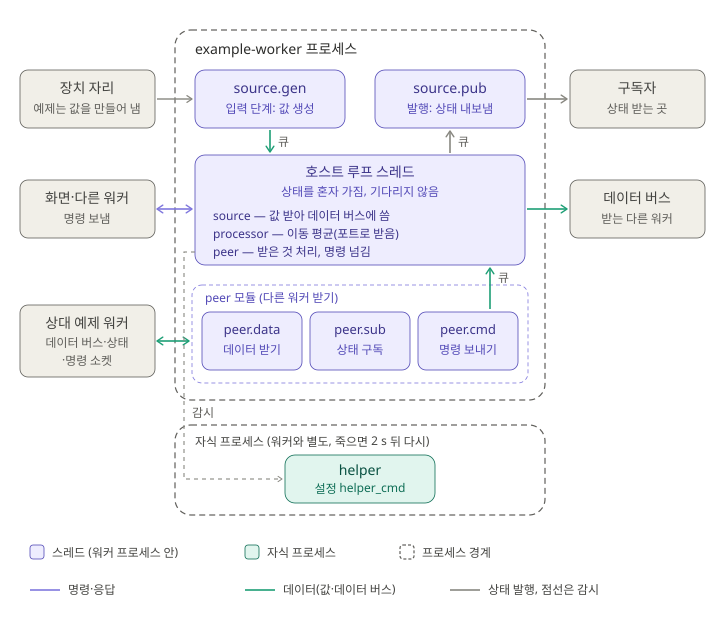

# 워커 설계 가이드

새 워커를 만들거나 기존 워커를 고도화할 때 **설계서(`design.md`)를 먼저 쓰고, 확정한 뒤 구현한다.** 사람이 직접 설계하든 AI에게 맡기든 이 가이드의 순서와 기준을 따른다. 설계서 틀은 `new/design.md`(새 워커를 만들면 `workers/<이름>/design.md`로 복사됨), 플랫폼 계약은 워크스페이스 `design.md` 6.6.

순서는 널리 쓰는 설계 문서 기준을 따른다: 품질 목표를 먼저 적고(arc42), 바깥에서 안으로(C4: 맥락 → 구성 → 실행), 실행은 프로세스·스레드 관점으로 따로 본다(4+1 뷰의 프로세스 뷰), 구성 단위와 인터페이스 문서는 MIL-STD-498(CSCI·CSC·CSU, ICD)·IEEE 1016의 말을 쓴다.

## 1. 작업 흐름

```text
 dev/new-worker.sh <이름>  →  설계서 쓰기(2장 순서)  →  검토(5장 체크리스트)  →  확정(문서 버전, 6장 미결 정리)
   →  구현(설계서 8장 구현 순서대로)  →  시험이 1장의 품질 목표를 확인  →  확정본(dev/release-worker.sh)
```

- 설계가 확정되기 전에는 코드를 쓰지 않는다(시험용 측정·실험 코드는 예외, 결과는 설계서에 적는다)
- 구현 중에 설계와 달라지면 설계서를 먼저 고치고 다시 확인받는다

## 2. 설계서 작성 순서

| 순서 | 무엇 | 설계서 | 산출물 |
|---|---|---|---|
| ① | 목적·범위, **요구와 품질 목표** | 1장 | 품질 목표 표(측정할 수 있는 문장 + 확인 방법) |
| ② | **맥락**: 바깥(장치·다른 워커·화면·서버)과의 경계 | 1장 | 맥락 그림 또는 표(워커 상자 하나 + 바깥 + 통로) |
| ③ | **구성**: 모듈·유닛과 포트 | 2.1 | 모듈 표, 코어와 모듈의 경계 |
| ④ | **실행 구조**: 프로세스·스레드·흐름 | 2.2 | **한눈 그림 `structure.svg`** + 길마다 설명 + 스레드 표 |
| ⑤ | **인터페이스**: 입출력 정의, 상태·지표·설정 | 3장 | `io.json`, `io/<정의>.json`, 3장 표 |
| ⑥ | **동작·끊겼을 때·안전** | 4장 | 동작 표, 끊겼을 때 표, 죽었을 때 장치 상태 |
| ⑦ | **시험**: ①의 목표를 어떻게 확인하나 | 5장 | 품질 목표 ↔ 시험 대응표 |
| ⑧ | 미결·결정 기록·구현 순서 | 6~8장 | 미결 표(결정 시점), 구현 순서 표 |

바깥에서 안으로 들어간다. 무엇을 지켜야 하는지(①)를 모르면 구조(③④)가 맞는지 판단할 수 없고, 시험(⑦)도 확인할 대상이 없다.

### ① 요구와 품질 목표

구조를 고르는 근거다. "빠르게", "안정적으로" 대신 **확인할 수 있는 문장**으로 쓰고, 각 목표를 무엇으로 확인하는지 함께 적는다.

| 목표 | 확인 |
|---|---|
| 제어 루프가 멈추거나 바빠도 영상 송출은 끊기지 않는다 | 워커 시험: 루프를 일부러 멈춰도 송출 진행이 계속됨(장애 주입) |
| 명령은 받은 뒤 50 ms 안에 응답한다(장치 응답을 기다리는 명령은 장치 응답 + 50 ms) | 워커 시험·실기: 응답 시간 측정 |
| 장치와 통신이 끊기면 출력은 한 주기(예: 50 ms) 안에 안전한 상태가 된다 | 실기: 케이블 뽑기 |
| 다른 워커가 없거나 다시 시작해도 이 워커는 살아서 기다리고 다시 붙는다 | 워커 시험: 상대를 껐다 켬 |

### ② 맥락

워커를 상자 하나로 두고, 바깥과 무엇으로 이어지는지만 그린다(장치 프로토콜·포트, 다른 워커와 주고받는 정의, 화면). 안쪽은 아직 그리지 않는다.

### ③ 구성

모듈(CSC)과 유닛(CSU, 코어)으로 나누고, 모듈 사이는 포트(인터페이스)로만 잇는다(워크스페이스 design.md 6.6.3). 코어는 libworker를 모른다(다른 프로그램에 그대로 가져갈 수 있게, 시험도 호스트 없이). 장치에 매인 코드는 얇게, 장치와 무관하게 만들 수 있는 계산(제어·판정·변환)은 따로 둔다(장치가 바뀌면 장치 쪽만 바꿈).

### ④ 실행 구조 — 한눈 그림 먼저

**그림 하나로 워커가 어떻게 도는지 보여야 한다.** 그다음에 길마다 설명을 붙인다. 예: `new/structure.svg`(템플릿 예제 워커).



| 그림에 꼭 있는 것 | 그리는 법 |
|---|---|
| 프로세스 경계 | 점선 상자. 워커 프로세스, 워커가 띄운 자식 프로세스를 따로 |
| 스레드 | 워커 프로세스 상자 안의 채운 상자. 이름(코드의 스레드 이름)과 하는 일 한 줄 |
| 자식 프로세스 | 다른 색으로 채운 상자 |
| 바깥 | 회색 상자(장치, 화면·다른 워커, 서버) |
| 흐름 | 종류마다 선 색(명령·응답, 데이터, 상태·감시), 스레드 사이 큐는 선 옆에 "큐" |
| 범례 | 상자 색·점선·선 색의 뜻 |

- 파일은 색을 직접 적은 SVG(문서 보기 도구 어디서나 보이게, 흰 바탕). 글자는 짧게
- 용어는 표준 이름 그대로 쓰고 처음 나올 때 짧은 설명을 붙인다: 발행(상태를 받는 쪽이 묻지 않아도 내보냄), 구독자(상태를 받아 가는 곳), 주제(내보내는 상태 묶음의 이름), 입력·출력 단계(장치를 읽고 쓰는 전용 스레드 + 큐), 호스트 루프(상태를 가진 처리 루프)
- 그림을 보고 **무엇이 무엇을 막을 수 있고 무엇은 못 막는지**가 보여야 한다

그림 다음에 **길마다** 설명한다(예: 영상 길, 제어 길, 상태 내보내기). 길마다 세 가지를 적는다:
1. 어디서 도나(프로세스·스레드)
2. 무엇을 기다리나(대기 상한), 무엇과 큐로 잇나(크기, 넘칠 때)
3. 무엇이 이 길을 막을 수 있고, 그때 어떻게 되나

마지막으로 스레드 표(이름, 하는 일, 대기 상한, 큐, 우선순위)와, 명령 하나가 들어와 장치가 움직이고 응답이 나가기까지의 흐름(시간 포함)을 적는다.

### ⑤ 인터페이스

바깥으로 나가는 것(명령 응답, 주제, `get_status`, 지표, 이벤트, 데이터 버스)은 모두 입출력 정의가 원본이다(워크스페이스 design.md 6.6.7). 역할 정의 `io/<역할>.json`은 같은 역할의 다른 워커와 바꿔 쓸 수 있는 것(명령·주제·데이터 버스), 워커 정의 `io/self.json`은 이 워커 구현의 것(모듈별 상태·지표·진단 주제·정비 명령). 가르는 기준은 "다른 회사 장비로 바꿔도 같은 값이 나와야 하나". 칸은 JSON Schema, 정의 밖 칸은 내보내지 않는다. 설계서 3장은 칸 목록을 다시 적지 않고 뜻·응답 시점·주기의 이유·상대가 없을 때 동작만 적는다.

### ⑥ 동작·끊겼을 때·안전

**끊겼을 때 표**를 꼭 쓴다. 행은 끊길 수 있는 것(장치 제어, 장치 데이터, 서버·망, 화면·다른 워커, 워커 자신의 루프), 열은 실행 구조의 길마다.

| 상황 | 길 A(예: 영상) | 길 B(예: 제어) | 동작·회복 |
|---|---|---|---|
| 장치 응답 없음 | | | |
| 서버·망 끊김 | | | |
| 루프 멈춤(버그) | | | |
| 워커 비정상 종료 | | | |

**죽었을 때 장치 상태**를 적는다(예: 목표값 방식이라 마지막 목표에서 멈춤 / 데드맨으로 정지 / 워커와 무관하게 동작).

### ⑦ 시험

①의 품질 목표마다 어느 시험이 확인하는지 표로 잇는다. 단계: 유닛(코어만, 가짜 시계) → 모듈(호스트 없이) → 워커(실행 파일, 가짜 장치, 장애 주입) → TSan → 시스템(보드 실기).

## 3. 안정성 패턴

실행 구조를 고를 때 쓰는 패턴. 이유를 알고 고르고, 쓰지 않으면 그 이유를 설계서에 적는다.

| 패턴 | 언제 | 왜 | 템플릿 도구 |
|---|---|---|---|
| **무겁거나 멈출 수 있는 일은 자식 프로세스** | 외부 프로그램(인코더·송출), 멈추거나 죽을 수 있는 SDK | 멈추거나 죽어도 워커(제어)는 계속, 그것만 다시 띄움. 메모리가 새도 그 프로세스만 | `worker::spawn`, `lib/libvideo` |
| **스레드는 기다림이 생기는 경계에만** | 장치 읽기·쓰기(직렬·소켓 대기), 무거운 계산 | 기다림을 루프에서 떼어냄. 스레드를 부품마다 두지 않음(공유 상태·잠금이 늘어남) | 입력·출력 단계 `host.input`/`host.output` |
| **스레드 사이는 크기 제한 큐로만** | 스레드가 둘 이상 | 막힘이 번지지 않음. **넘칠 때 정책**을 정함: 텔레메트리는 오래된 것 버림, 명령은 거절(부른 쪽이 앎) | `BoundedQueue`, 단계 `overflow` |
| **상태 주인은 하나** | 늘 | 잠금 없음, 경합 없음, 시험 쉬움 | 호스트 루프 |
| **루프에서 기다리지 않기** | 장치 응답을 받는 명령 | 응답은 콜백, 명령 응답은 나중에 보내도 됨(연결 유지). 동기 호출 하나가 모든 일을 멈춤 | 명령 `reply`를 나중에 호출(libworker 0.9.1) |
| **상대가 없어도 살아서 다시 붙기** | 장치·다른 워커·서버 | 시작 순서·재시작에 상관없이 회복. 연결은 지표로 보임 | `Subscriber`·`CommandClient`, `<모듈>_link` |
| **멈추면 안전하게 끝내기** | 늘 | 멈춘 워커가 장치를 위험한 상태로 두지 않음. Manager가 다시 띄움 | 스레드 감시, `safe_state()`, 워치독 |
| **끊겨도 위험하지 않은 명령 방식** | 움직이는 장치 | "계속 움직여라" 대신 "여기까지 가라"를 짧은 주기로 갱신. 끊기면 한 주기 안에서 멈춤. keepalive·데드맨 | (워커 설계) |
| **느린 받는 쪽이 보내는 쪽을 막지 않게** | 상태 발행, 데이터 버스 | 발행 스레드가 보내고 느린 구독자는 끊음. 데이터 버스는 최신만(Latest) 또는 생산자가 기다리지 않음 | `Publisher`, `framebus` |
| **시각은 보드 시계 하나로** | 장치 시각이 따로 있을 때 | 다른 워커 데이터와 맞추기. 모든 시각을 보드 CLOCK_MONOTONIC으로 바꿔 내보냄 | (워커 설계) |

피할 것: 루프 안의 동기 호출·`sleep`, 크기 없는 큐, 여러 스레드가 같은 상태를 바꾸기, 잠금 안에서 입출력, 실패를 조용히 삼키기(지표·로그 없이), 장치가 끊기면 계속 움직이는 명령.

## 4. 이름과 용어

- 모듈·명령·지표·스레드 이름: 워크스페이스 design.md 6.6.3(`<모듈>.<명령>`, `<모듈>_<이름>`, `<모듈>.<역할>`)
- 표준 용어는 그대로(코드와 같은 말이라 찾기 쉬움), 처음 나올 때 짧은 설명
- 단위는 칸 이름이나 표에 적는다(ms, deg, m/s)

## 5. 확정 전 검토 체크리스트

- [ ] 1장 품질 목표가 확인할 수 있는 문장이고, 5장에 각각 확인하는 시험이 있다
- [ ] 2.2에 한눈 그림이 있고, 그림에 없는 스레드·프로세스·큐가 없다
- [ ] 모든 대기에 상한이, 모든 큐에 크기와 넘칠 때 정책이 있다
- [ ] 호스트 루프 안에 기다리는 호출이 없다(있다면 이유와 최대 시간)
- [ ] 같은 상태를 두 스레드가 바꾸지 않는다(잠금이 있다면 짧고, 안에서 입출력하지 않는다)
- [ ] 무겁거나 멈출 수 있는 일이 자식 프로세스로 분리돼 있다(아니면 이유)
- [ ] 끊겼을 때 표가 있고, 길마다 무엇이 계속되고 무엇이 멈추는지 적혀 있다
- [ ] 죽었을 때 장치 상태가 안전하다
- [ ] 바깥으로 나가는 것은 모두 `io/` 정의(역할·`self.json`)에 있고, 점검과 출력 대조(`dev/check.sh`, `io.json` `check`)를 통과한다
- [ ] 미결 항목마다 결정 시점이 있다

## 6. AI에게 맡길 때

요청 예:

```text
workers/_template/new/GUIDE.md 순서대로 workers/<이름>/design.md 설계서부터 써 줘.
코드는 설계를 확정하기 전에는 쓰지 마.
품질 목표(1장), 실행 구조 한눈 그림(2.2, structure.svg), 입출력 정의(io/), 끊겼을 때 표(4장)를 꼭 넣고,
확정 전 검토 체크리스트(가이드 5장)를 스스로 확인한 결과와 내가 정해야 할 것을 따로 알려 줘.
```

- 사람이 확인할 것: 품질 목표가 맞는지(무엇이 끊기면 안 되는지는 운용을 아는 사람이 정함), 그림이 실제와 같은지, 미결 결정
- 설계서를 확정한 뒤 "8장 구현 순서대로 구현"을 맡긴다. 단계마다 PC 시험(TSan 포함) → 확정본 → 실기 확인
