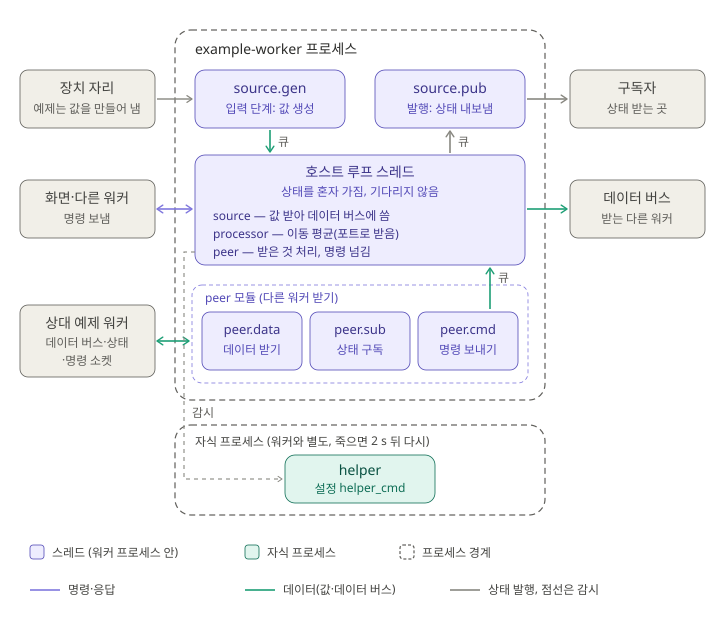

# @NAME@ 워커 설계

| 항목 | 내용 |
|---|---|
| 문서 버전 | 0.1 |
| type | `@TYPE@` |
| 단계 | 워커(CSCI). 워크스페이스 design.md 3장 "단계" |
| 모듈 | (예: `source`, `processor`, `peer` — 쓰는 것만 남긴다) |
| 상태 | 설계 중(확정 전에는 구현하지 않음) |

이 설계서는 설계 가이드(`workers/_template/new/GUIDE.md`)의 순서로 쓴다: 품질 목표 → 맥락 → 구성 → 실행 구조(그림) → 인터페이스 → 끊겼을 때 → 시험 → 미결·구현 순서. 확정 전 검토 체크리스트는 가이드 5장.

## 1. 목적

이 워커가 맡는 일 하나(예: 모터 구동·제어, 카메라 수집, 데이터 처리). 다른 워커와 어떻게 함께 움직이는지.

### 1.1 요구와 품질 목표

구조를 고르는 근거. 확인할 수 있는 문장으로 쓰고, 확인 방법(5장)을 함께 적는다.

| 목표 | 확인(5장) |
|---|---|
| (예: 장치 제어가 멈춰도 데이터 송출은 끊기지 않는다) | (예: 워커 시험, 장애 주입) |
| (예: 명령은 받은 뒤 50 ms 안에 응답한다) | |
| (예: 장치와 통신이 끊기면 출력은 한 주기 안에 안전한 상태가 된다) | |

### 1.2 맥락

워커를 상자 하나로 두고 바깥과의 경계만 적는다(안쪽은 2장).

| 바깥 | 통로 | 주고받는 것 |
|---|---|---|
| (장치) | (프로토콜·포트) | |
| (다른 워커) | 입출력 정의(3장) | |
| (화면·운용) | 명령 소켓·REST, 발행 | |

## 2. 구조

### 2.1 모듈과 유닛

| 모듈(CSC) | 하는 일 | 유닛(CSU, 코어) | 포트(내주는 것 / 받는 것) |
|---|---|---|---|
| | | | |

- 코어(①: 유닛)가 하는 일과 모듈(②: 설정·명령·스레드·통로)이 하는 일의 경계
- 모듈 사이는 포트로만(워크스페이스 design.md 6.6.3)

### 2.2 실행 구조

**먼저 한눈 그림 하나**(`structure.svg`, 이 설계서 옆): 워커가 어떻게 도는지 큰 그림이 바로 보여야 한다. 그다음에 아래 표와 부분별 설명을 붙인다.



| 그림에 꼭 있는 것 | 그리는 법 |
|---|---|
| 프로세스 경계 | 점선 상자. 워커 프로세스, 워커가 띄운 자식 프로세스(송출·도우미 등)를 따로 |
| 스레드 | 워커 프로세스 상자 안의 채운 상자(호스트 루프, 입력·출력 단계, 발행 등). 각 스레드가 하는 일 한두 줄 |
| 자식 프로세스 | 다른 색으로 채운 상자 |
| 바깥 | 장치, 화면·다른 워커, 서버(회색) |
| 흐름 | 종류마다 선 색(예: 제어, 영상·데이터, 상태·감시), 큐는 선 위 표시 |
| 범례 | 상자 색·점선·선 색의 뜻 |

- 파일은 색을 직접 적은 SVG(문서 보기 도구 어디서나 보이게). 글자는 짧게, 자세한 것은 아래 표와 설명으로
- 용어는 표준 이름 그대로(발행·구독자·주제·입력 단계 등, 코드와 같은 말) 쓰고, 그림과 본문에 처음 나올 때 짧은 설명을 붙인다. 예: "발행 스레드(상태를 실시간으로 내보냄)", "구독자(상태를 받아 가는 곳: 화면·다른 워커)"
- 그림을 보면 "무엇이 무엇을 막을 수 있고 무엇은 못 막는지"(예: 제어가 바빠도 영상은 다른 프로세스라 흐름)가 보여야 한다

아래는 자세한 형식이다: 스레드·큐·대기 상한·우선순위·상태 소유·워치독이 모두 보이게 그리면 다른 사람이 오해 없이 읽는다. 예는 템플릿 제공 도구(워크스페이스 design.md 6.6.9 ③)를 쓴 모양이고, 직접 만든 스레드·큐도 같은 식으로 그린다.

```text
 장치 ─▶ [입력 <모듈>.<역할> 대기 ≤100ms, 우선순위] ─큐(크기, 넘칠 때)─▶ [호스트 루프: 상태 소유, 예산 50ms]
                                                                      ├─큐(크기, 넘칠 때)─▶ [출력 <모듈>.<역할>] ─▶ 장치
                                                                      ├─▶ 발행 · 명령 소켓
 안전망: 스레드 2 s beat 없음 / 루프 3 s 멈춤 → safe_state() → 종료 → Manager 재시작
```

| 단계·스레드·프로세스 | 하는 일(워커가 채운 것) | 대기 상한 | 큐(크기, 넘칠 때) | 우선순위·CPU |
|---|---|---|---|---|
| (호스트 루프) | 메시지 처리, 명령, 타이머, 상태 | 예산 `loop_budget_ms` | — | 보통 |
| `<모듈>.<역할>` | | | | |
| 자식 프로세스(있으면) | | | | |

## 3. 인터페이스 명세 (ICD)

다른 워커·화면·운용 인터페이스가 이 워커와 주고받는 것 전부. 여기 없는 것은 쓰지 않는다.

**바깥으로 나가는 것의 칸 목록은 모두 정의 파일이 원본이다**(워크스페이스 design.md 6.6.7.1): 역할 정의 `io/<역할>.json`(명령·주제·데이터 버스), 워커 정의 `io/self.json`(상태 `get_status`·지표·진단 주제·정비 명령), 공통 정의(틀 `io/common.json`). 이 장은 칸을 다시 적지 않고, 사람이 알아야 할 것(뜻, 응답 시점, 주기를 그렇게 정한 이유, 상대가 없을 때 동작, 임대가 끊겼을 때 안전 상태)만 적는다.

| 정의 | 방향 | 파일 | 버전 | 무엇 |
|---|---|---|---|---|
| `@NAME@` | 내보냄 | `io/@NAME@.json` | 1.0 | |
| (워커 정의) | 내보냄 | `io/self.json` | 1.0 | 상태·지표·진단 주제·정비 명령 |
| | 씀(입력 `<이름>`) | `io/uses/<정의>.json`(사본) | | |

### 3.1 명령 (명령 소켓, `<모듈>.<명령>`)

인자·응답 칸·오류 code는 정의 파일(`commands`). 여기에는 하는 일과 시점.

| cmd | 하는 일 | 응답 시점 | 바로 적용 / 저장 |
|---|---|---|---|
| `get_status` | 3.2 | 즉시 | — |
| | | | |

### 3.2 상태 (`get_status`의 모듈 칸)

칸·형식은 `io/self.json`의 `status`. 여기에는 뜻만.

| 칸 | 뜻 |
|---|---|
| `<모듈>.<키>` | |

### 3.3 지표 (heartbeat, `<모듈>_<이름>`, 1초)

이름·형식·단위는 `io/self.json`의 `metrics`. 여기에는 뜻만.

| 지표 | 뜻 |
|---|---|
| `<모듈>_link` | 장치·상대 연결 |
| | | |

### 3.4 스트림 주제 (발행, 있으면)

칸·최소 간격은 정의 파일(`topics`). 여기에는 뜻과 간격을 그렇게 정한 이유.

| 주제 | 뜻 | 간격의 이유 | 이벤트 |
|---|---|---|---|
| | | | |

### 3.5 데이터 버스 (있으면)

형식은 정의 파일(`data`). 여기에는 레코드의 뜻과 받는 쪽 모드.

| 방향 | 이름(정의 `data`) | 레코드 | 받는 쪽 모드 |
|---|---|---|---|
| 내보냄 | 예: `frames`(`<데이터>/run/frames/<id>.sock`) | | Latest / InOrder |
| 받음(입력 `<이름>`) | | | |

### 3.6 다른 워커와의 연결

입력은 `io.json`의 `uses`, 상대 주소는 설정 `inputs`(워크스페이스에서는 연결 선언으로 Manager가 채움). 이 워커는 상대 워커 이름을 모른다.

| 입력(`uses`) | 정의 | 쓰는 것 | 필수 | 상대가 없을 때 |
|---|---|---|---|---|
| | | 주제 / 명령 / 데이터 | 예·아니요 | `<모듈>_link=0`, 기다리며 다시 붙음, 그동안 동작 |

### 3.7 설정 (원본: `lib/<모듈>/schema.json`)

| 키 | 형식 | 기본값 | 바로 적용(live) | 뜻 |
|---|---|---|---|---|
| `<모듈>.<키>` | | | | |

### 3.8 가짜 장치 (가짜 장치 모드, 워크스페이스 design.md 6.6.8)

| 항목 | 내용 |
|---|---|
| 프리셋 sim | 바뀌는 설정(장치 주소 127.0.0.1 등) |
| 가짜 장치 | `tools/<이름>-sim`(무엇에 어떻게 답하는지) 또는 바꿔 끼우는 라이브러리 |
| 흉내 내지 않는 것 | 예: 영상(RTSP) |

## 4. 위험과 대비

워크스페이스 design.md 6.6.9의 설계 점검 목록(권장)을 이 워커에 적용한 결과. 해당 없는 행은 "해당 없음". **죽었을 때 장치 상태**는 꼭 적는다.

| 위험 | 이 워커에서 생기는 곳 | 그러면 | 죽나 |
|---|---|---|---|
| 지연·막힘 | | | |
| 동시성(공유 상태·잠금) | | | |
| 우선순위 | | | |
| 예외·오류 | | | |
| 자원 | | | |
| 멈춤 | | 스레드 감시 → `safe_state()` → 종료 → Manager 재시작 | 예(의도) |
| 재시작 뒤 회복 | | | |

**끊겼을 때:** 끊길 수 있는 것마다 실행 구조의 길(2.2)별로 무엇이 계속되고 무엇이 멈추는지.

| 상황 | 길 A | 길 B | 동작·회복 |
|---|---|---|---|
| 장치 응답 없음 | | | |
| 서버·망 끊김 | | | |
| 화면·다른 워커 끊김 | | | |
| 루프 멈춤(버그) | | | `safe_state()` → 종료 → Manager 재시작 |
| 워커 비정상 종료 | | | |

**죽었을 때 장치 상태:** (예: 목표값 방식이라 마지막 목표에서 멈춤 / 데드맨으로 정지 / 마지막 명령을 유지 / 워커와 무관하게 동작)

## 5. 시험

| 단계 | 시험 | 내용 |
|---|---|---|
| 유닛 | `lib/<모듈>/test/` | 코어만(libworker 없이, 가짜 시계) |
| 모듈 | `lib/<모듈>/test/` | 호스트 없이 설정 칸·명령·포트(가짜 포트) |
| 워커 | `test/test_worker.cpp` | 실행 파일: 명령·상태, 다른 워커와 통신, 다시 시작, 가짜 장치 모드 |
| 시스템 | 보드 `dev/system-check.sh` | 실기: 실행·heartbeat·링크·지표·연결 |

**품질 목표 확인(1.1과 짝):**

| 목표(1.1) | 시험 | 기준 |
|---|---|---|
| | | |

## 6. 미결

| 항목 | 결정 시점 | 상태 |
|---|---|---|
| | | |

## 7. 구현 순서와 진행

설계를 확정한 뒤 이 순서로 구현한다. 단계마다 PC 시험(TSan 포함) → 확정본(`dev/release-worker.sh`) → 실기 확인.

| 순서 | 내용 | 상태 |
|---|---|---|
| 1 | | |
